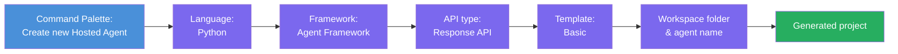
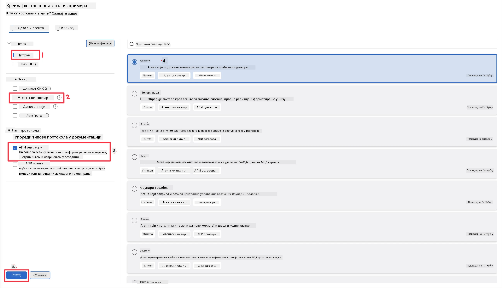
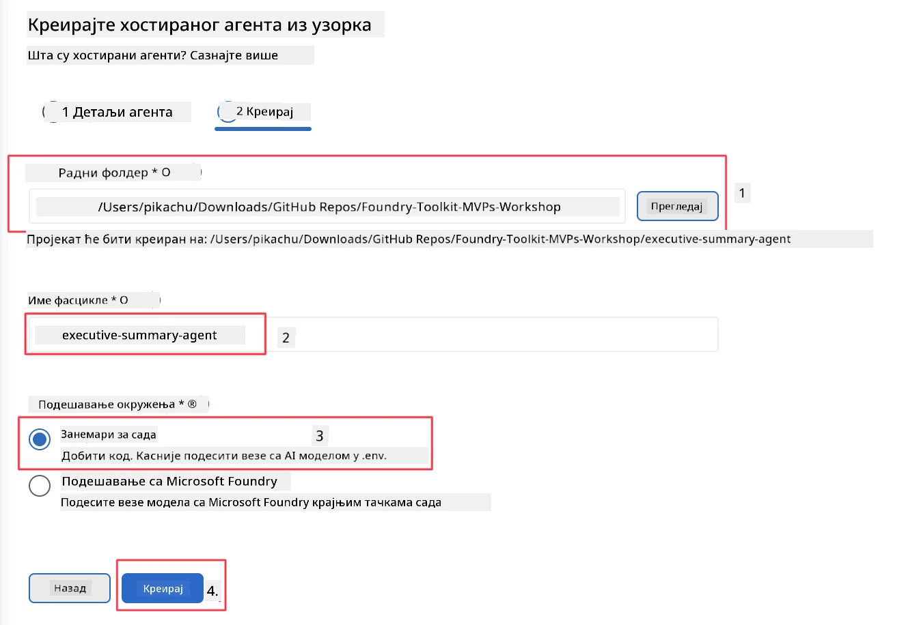

# Модул 2 - Креирање новог хостираног агента

⏱️ ~5 мин

У овом модулу користите Foundry Toolkit да **направите шаблон пројекта хостираног агента**. Шаблон генерише целу структуру пројекта - `agent.yaml`, `main.py`, `Dockerfile`, `requirements.txt` и VS Code конфигурацију за дебаговање - тако да се можете фокусирати на прилагођавање понашања агента.

> **Кључни појам:** Фасцикла `agent/` у овом упутству је пример онога што Foundry Toolkit генерише. Не пишете ове датотеке од почетка.

### Ток чаробњака за шаблоне



---

## Корак 1: Отворите чаробњака за креирање хостираног агента

1. Притисните `Ctrl+Shift+P` да бисте отворили **Палету команди**.
2. Укуцајте: **Foundry Toolkit: Create new Hosted Agent** и изаберите ту опцију.

> **Алтернатива: Креирање преко Foundry Портала**
> Ако више волите прегледач, можете креирати свој пројекат на [https://ai.azure.com](https://ai.azure.com). Када је пројекат подешен, вратите се у VS Code и користите бочно окно **Foundry Toolkit** да се повежете са њим.

> **Алтернатива:** У бочној траци Foundry Toolkit-у, задржите показивач миша изнад **Agents** испод вашег пројекта, кликните на икону **+**, затим изаберите **Create in Code With Template**.

## Корак 2: Изаберите подешавања



1. У левом навигационом/опцијском делу изаберите следеће:

| Мени | Избор | Напомене |
|--------|-----------|-------|
| **Језик** | Python | Подржан је и C# |
| **Фрејмворк** | Agent Framework | Једноставна почетна тачка са Agent Framework SDK |
| **Тип API** | Response API | `POST /responses` - разговорни, са платформом управљаном историјом |
| **Шаблон** | Basic | Једноставна почетна тачка са Agent Framework SDK |

2. Када изаберете, кликните **Next**



3. У следећем прозору изаберите следеће:

| Мени | Избор | Напомене |
|--------|-----------|-------|
| **Радна фасцикла** | Изаберите циљну фасциклу | нпр. `/workspace/Foundry_Toolkit_for_VSCode_Lab/` или подфасциклу у овом репозиторијуму |
| **Име агента** | Унесите име | нпр. `executive-summary-agent` |
| **Подешавање окружења** | прескочите подешавање за сада |  |

Кликните **create** да креирате нашег агента. Биће креирана нова фасцикла са именом хостираног агента.

## Корак 3: Прегледајте генерисани пројекат

Након завршетка шаблонизације, проверите да ли видите ове датотеке у Explorer-у (`Ctrl+Shift+E`):

```
📂 executive-summary-agent/
├── .env                ← Environment variables (placeholders)
├── .vscode/
│   ├── launch.json     ← Debug config (F5 → run + Agent Inspector)
│   └── tasks.json      ← VS Code task definitions
├── agent.yaml          ← Agent definition (kind: hosted)
├── Dockerfile          ← Container config for deployment
├── main.py             ← Agent entry point (your main code)
└── requirements.txt    ← Python dependencies
```

### Објашњење кључних датотека

| Датотека | Сврха |
|------|---------|
| `agent.yaml` | Декларише агента као `kind: hosted`, мапира променљиве окружења, дефинише `/responses` протокол |
| `main.py` | Креира `FoundryChatClient` → умотава га у `Agent` са упутствима → сервира преко `ResponsesHostServer` на порту 8088 |
| `Dockerfile` | Користи `python:3.12-slim`, инсталира зависности, експонира порт 8088, покреће `main.py` |
| `requirements.txt` | `agent-framework-foundry`, `agent-framework-foundry-hosting`, `mcp`, `debugpy` |

> **Важно:** Отворите фасциклу хостираног агента директно у VS Code-у (саму фасциклу `agent/`) да би `.vscode/launch.json` и `tasks.json` правилно радили током F5 дебаговања.

---

### ✅ Контролна тачка

- [ ] Шаблонизован пројекат креиран са свим очекиваним датотекама
- [ ] `agent.yaml` приказује `kind: hosted` и `protocol: responses`
- [ ] `main.py` увози `Agent`, `FoundryChatClient`, `ResponsesHostServer`
- [ ] Фасцикла агента је отворена у VS Code-у као корен радног простора

---

**Претходно:** [01 - Setup](01-setup.md) · **Следеће:** [03 - Configure & Code →](03-configure-and-code.md)

---

<!-- CO-OP TRANSLATOR DISCLAIMER START -->
**Изјава о одрицању одговорности**:
Овај документ је преведен коришћењем услуге за аутоматски превод [Co-op Translator](https://github.com/Azure/co-op-translator). Иако тежимо тачности, имајте у виду да аутоматски преводи могу садржати грешке или нетачности. Оригинални документ на његовом изворном језику треба сматрати ауторитативним извором. За критичне информације препоручује се професионални људски превод. Нисмо одговорни за било каква неспоразума или погрешна тумачења која произилазе из коришћења овог превода.
<!-- CO-OP TRANSLATOR DISCLAIMER END -->