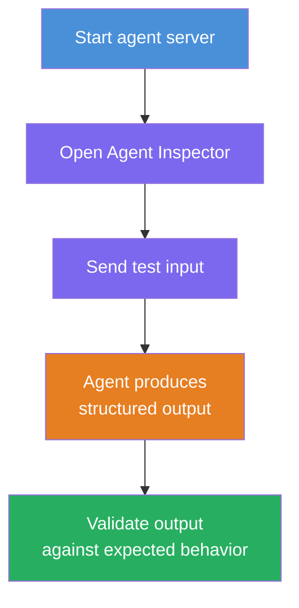
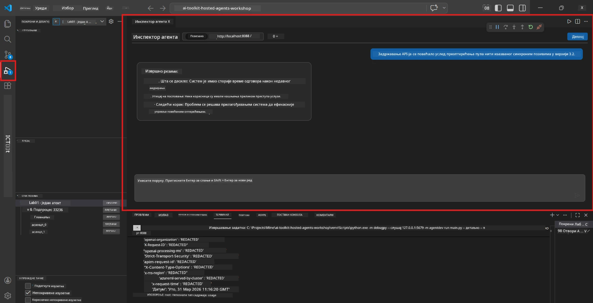
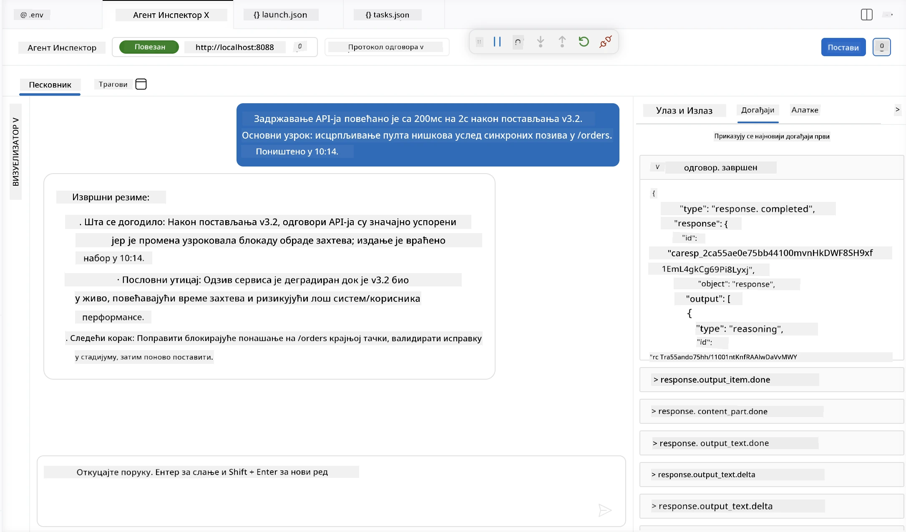

# Модул 4 - Тестирање Локално

⏱️ ~10 мин

У овом модулу покрећете свог агента локално и проверавате да ли ради исправно помоћу **функционалних тестова срећног пута**. Користићете Agent Inspector (визуелни кориснички интерфејс) или директне HTTP позиве да бисте потврдили да агент производи структуриране, тачне одговоре.

### Ток локалног тестирања



---

## Опција 1: Притисните F5 - Дебаг са Agent Inspector-ом (препоручено)

### Покрените дебагер

1. Отворите фасциклу **executive-summary-agent/** директно у VS Code (`File → Open Folder`).
2. Отворите **Run and Debug** панел (`Ctrl+Shift+D`).
3. Изаберите **Debug Local Agent HTTP Server** из падајућег менија.
4. Притисните **F5** (или кликните ▶ Start Debugging).

> ⚠️ **Критично: Изаберите свој Python Interpreter**
> Ако добијете "ModuleNotFoundError" или се дебагер не покреће, морате рећи VS Code-у да користи ваше виртуелно окружење:
  > 1. Притисните `Ctrl+Shift+P` $\rightarrow$ укуцајте **Python: Select Interpreter**.
  > 2. Изаберите интерпретер који се налази у фасцикли `.venv` вашег пројекта (нпр. `.\.venv\Scripts\python.exe` на Виндовс-у).
  > 3. Поново покрените дебаг сесију.
> Ако и даље добијате грешке, ручно ажурирајте ваш фајл `tasks.json` на следећи начин:
  > 1. Идите у фајл `.vscode/tasks.json`
  > 2. Пронађите задаћу означену као: `Run Agent HTTP Server`
  > 3. Ажурирајте вредност команде на следећи начин:
  >    - **Windows:** `"value": "${workspaceFolder}/.venv/Scripts/python.exe",`
  >    - **macOS/Linux:** `"value": "${workspaceFolder}/.venv/bin/python",`

### Шта се дешава

1. HTTP сервер се покреће на `http://localhost:8088/responses`.
2. Панељ **Agent Inspector** се аутоматски отвара - визуелни чат интерфејс за тестирање.
3. Прекретне тачке су омогућене у `main.py`.

Пратите Терминал за:
```
Starting executive summary hosted agent
Executive agent server running on http://localhost:8088
```

> **Уколико се Agent Inspector не отвори:** Притисните `Ctrl+Shift+P` → **Foundry Toolkit: Open Agent Inspector**.



> *Снимак екрана може да приказује старији 'AI TOOLKIT' брeнд из раније верзије екстензије.*

---

## Опција 2: Тест преко Терминала (алтернатива)

Покрените агента у једном терминалу, шаљите захтеве из другог:

```bash
# Terminal 1: Start agent
cd executive-summary-agent/
source .venv/bin/activate
python main.py
```

```bash
# Terminal 2: Send test (curl)
curl -sS -X POST http://localhost:8088/responses \
  -H "Content-Type: application/json" \
  -d '{"input": "The API latency increased due to thread pool exhaustion caused by sync calls in v3.2.", "stream": false}'
```

---

## Тестови сценарија: Валидација функционалности за срећан ток

Покрените **сва три** сценарија у наставку. Они проверавају да ли ваш агент производи тачан, структурисан резултат за реалистичне уносе.



### Сценарио 1: IT Incident - Повећање латенције API-ја

**Унос:**
```
The API latency increased from 200ms to 2s after deploying v3.2.
Root cause: thread pool starvation from synchronous calls in /orders.
Rolled back at 10:14.
```

**Очекивано понашање:**
- ✅ Прати структуру "Извршног резимеа" (Шта се десило / Утицај на пословање / Следећи корак)
- ✅ Без техничког жаргона (нема "thread pool", нема "/orders", нема "v3.2")
- ✅ Јасно наводи утицај на пословање (нпр. корисници су искусили кашњења)
- ✅ Укључује следећи корак (нпр. решење имплементирано, мониторинг успостављен)

---

### Сценарио 2: Data Pipeline - Неуспех ETL-а

**Унос:**
```
The nightly ETL job failed because the upstream schema changed. APAC dashboards show missing data.
```

**Очекивано понашање:**
- ✅ Сажето објашњава неуспех освежавања података у једноставном језику
- ✅ Помиње утицај на APAC таблу
- ✅ Укључује корак за решавање проблема
- ✅ НЕ помиње "ETL", "шума" или друге техничке појмове

---

### Сценарио 3: Security - Потробљени креденцијал

**Унос:**
```
Static analysis flagged a hardcoded secret in the repository.
The secret may have been exposed in commit history.
```

**Очекивано понашање:**
- ✅ Описује проблем са креденцијалима/безбедношћу језиком прилагођеним руководиоцима
- ✅ Наводи потенцијални ризик (неовлашћени приступ)
- ✅ Наводи акцију исправке (ротирање акредитива, ревизија)
- ✅ НЕ укључује термине као што су "статичка анализа", "историја комита" или "тврдокодирано"

---

## Критеријуми валидације

За сваки сценарио, проверите:

| # | Критеријум | Услов за пролаз |
|---|----------|---------------|
| 1 | **Структура** | Одговор користи „Извршни Сажетак“ формат са све три тачке |
| 2 | **Једноставан језик** | Без техничког жаргона који руководиоци не би разумели |
| 3 | **Тачност** | Сажетак одражава улаз - без измишљених детаља |
| 4 | **Краткост** | Одговор има мање од 100 речи |
| 5 | **Следећи корак** | Јасно је назначена акција или ублажавање |

---

## Савети за отклањање грешака

| Проблем | Поправка |
|-------|-----|
| Агент не почиње | Проверите `.env` вредности, верификујте да је venv активиран, покрените `pip install -r requirements.txt` |
| Празан или општи одговор | Прегледајте упутства у `main.py` - осигурајте да је формат излаза наведен |
| Одговор садржи жаргон | Појачајте правила „уклони техничке појмове“ у упутствима |
| Агент инспектор се не отвара | `Ctrl+Shift+P` → **Foundry Toolkit: Отвори Agent Inspector** |
| Грешке модела у Терминалу | Проверите да ли се `AZURE_AI_MODEL_DEPLOYMENT_NAME` тачно поклапа (са осетљивошћу на велика и мала слова) |

---

### ✅ Контролна тачка

- [ ] Агент почиње локално без грешака
- [ ] Агент Инспектор се отвара и приказује интерфејс за чет (ако користите F5)
- [ ] **Сценарио 1** (ИТ инцидент) - структуриран Извршни Сажетак, без жаргона
- [ ] **Сценарио 2** (подаци у цевоводу) - релевантан сажетак са утицајем на пословање
- [ ] **Сценарио 3** (безбедносни аларм) - одговарајућа комуникација ризика
- [ ] Сви одговори прате дефинисану структуру излаза

> **Сачувајте своје одговоре** (копирајте или направите снимак екрана) - упоредићете их са резултатима у облаку у Модулу 06.

---

**Претходно:** [03 - Подешавање и Кодирање](03-configure-and-code.md) · **Следеће:** [05 - Објави у Foundry →](05-deploy-to-foundry.md)

---

<!-- CO-OP TRANSLATOR DISCLAIMER START -->
**Изјава о одрицању одговорности**:
Овај документ је преведен коришћењем услуге за аутоматски превод [Co-op Translator](https://github.com/Azure/co-op-translator). Иако тежимо тачности, имајте у виду да аутоматски преводи могу садржати грешке или нетачности. Оригинални документ на његовом изворном језику треба сматрати ауторитативним извором. За критичне информације препоручује се професионални људски превод. Нисмо одговорни за било каква неспоразума или погрешна тумачења која произилазе из коришћења овог превода.
<!-- CO-OP TRANSLATOR DISCLAIMER END -->