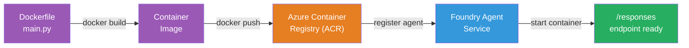
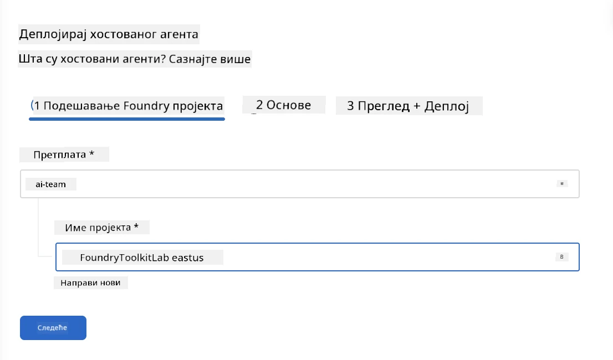
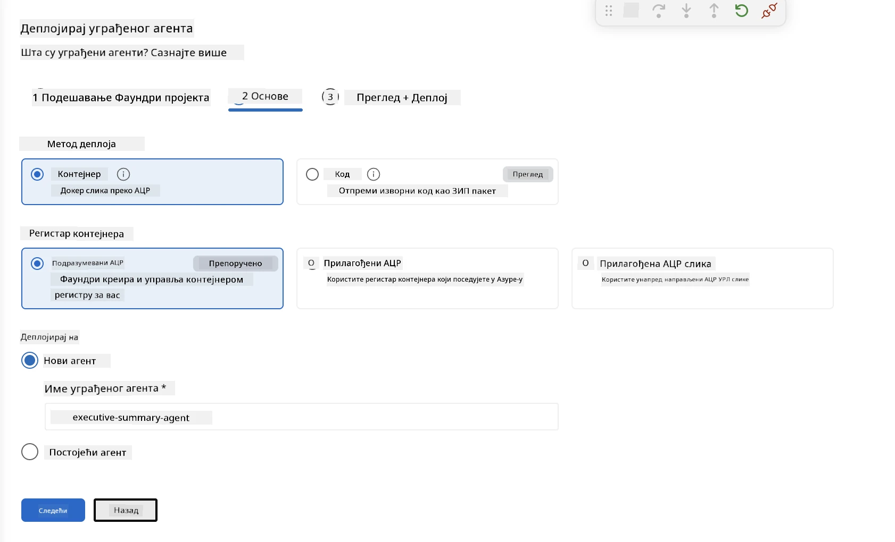
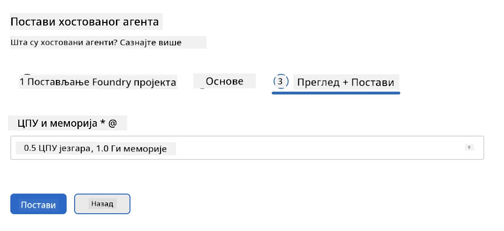
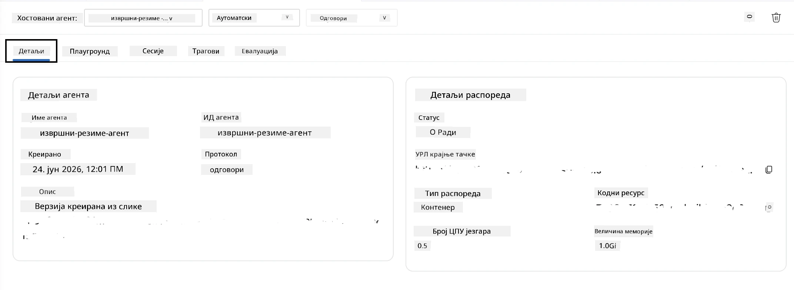

# Модул 5 - Деплој на Foundry Agent сервис

⏱️ ~10 мин

> ⚠️ **Корисници путање Б:** Овај модул захтева претплату на Foundry. Ако користите Foundry Local, прескочите на [Модул 07 - Резиме](07-summary.md). Успешно сте завршили локални развојни ток рада!

У овом модулу деплојујете свог локално тестираног агента на Microsoft Foundry као **Хостованог агента**. Деплој изграђује слику контејнера, шаље је у Azure Container Registry и покреће агента у управљаној Foundry инфраструктури.

### Поступак деплоја

---

## Провера предуслова

Пре деплоја, проверите:

- [ ] Агенат пролази сва 3 локална сценарија из [Модула 04](04-test-locally.md)
- [ ] Имате **Azure AI User** улогу на нивоу пројекта ([Модул 01, dodela RBAC-а](01-setup.md#deploy-a-model--assign-rbac))
- [ ] Пријављени сте у Azure у VS Code (икона налога приказује ваше име)

---

## Корак 1: Покрените деплој

### Опција А: Деплој са Agent Inspector-а (препоручено)

Ако је Agent Inspector отворен (из тестирања):
1. Кликните на дугме **Deploy** у горњем десном углу (икона облака ↑).

### Опција Б: Деплој из Command Palette-а

1. Притисните `Ctrl+Shift+P` → **Foundry Toolkit: Deploy Hosted Agent**.

---

## Корак 2: Конфигуришите деплој

Визард ће затражити:

| Захтев | Избор |
|--------|-----------|
| **Претплата** | Ваша Azure претплата |
| **Циљни пројекат** | Ваш Foundry пројекат (нпр. `workshop-agents`) |

Кликните **следеће** да конфигуришете свог агента.

| Захтев | Избор |
|--------|-----------|
| **Метод деплоја** | Контејнер |
| **Регистри контејнера** | **Дефолтни ACR** (Microsoft Foundry креира и управља једним за вас) |
| **Деплој на** | Нови агент (име, `executive-summary-agent`) |

Кликните **следеће** да прегледате и деплојујете свог агента.

| Захтев | Избор |
|--------|-----------|
| **CPU и меморија** | **0.5 CPU језгара, 1.0 Gi меморије** (подразумевано - довољно за радионицу) |

---

## Корак 3: Деплој и праћење

1. Кликните **Deploy**.
2. Пратите панел **Output** (изаберите **Microsoft Foundry** из падајућег менија).
3. Деплој се изводи кроз следеће фазе:
   - **Docker build** - гради контејнер са вашег Dockerfile-а
   - **Docker push** - шаље слику у ACR (1–3 минута при првом деплоју)
   - **Agent registration** - креира хостованог агента у Foundry
   - **Container start** - покреће се са системски управљаним идентитетом

4. Када заврши, појављује се обавештење:
   > **executive-summary-agent је успешно деплојован.** `View logs` `Run agent`

5. Кликните **Run agent** да бисте отворили Agent Playground.

### Вредности статуса деплоја

| Статус | Значење |
|--------|---------|
| **Running** | Контејнер спреман, агент одговара |
| **Pending** | Контејнер се покреће - сачекајте 30–60 секунди |
| **Failed** | Проверите логове (погледајте решавање проблема испод) |

---

## Уобичајене грешке приликом деплоја

| Грешка | Основни узрок | Решење |
|-------|-----------|-----|
| `agents/write` permission denied | Недостаје **Azure AI User** улога на нивоу пројекта | [Модул 01, додељивање RBAC-а](01-setup.md#deploy-a-model--assign-rbac) |
| Docker није покренут | Docker Desktop није покренут | Покрените Docker Desktop → проверите `docker info` |
| Ауторизација ACR-а | Управљани идентитет не може да преузме слику | Погледајте [Модул 08 - Решавање проблема](08-troubleshooting.md) |

---

### ✅ Контролна тачка

- [ ] Деплој је завршен без грешака
- [ ] Агенат се појављује на картици **Hosted Agent** када кликнете **Agents** у Foundry Toolkit бочној траци вашег пројекта
- [ ] Статус контејнера показује **Running**
- [ ] Отворена је картица Agent Playground са детаљима агента и URL крајње тачке

---

**Претходни:** [04 - Тестирање локално](04-test-locally.md) · **Следећи:** [06 - Потврда у Playground-у →](06-verify-in-playground.md)

---

<!-- CO-OP TRANSLATOR DISCLAIMER START -->
**Изјава о одрицању одговорности**:
Овај документ је преведен коришћењем услуге за аутоматски превод [Co-op Translator](https://github.com/Azure/co-op-translator). Иако тежимо тачности, имајте у виду да аутоматски преводи могу садржати грешке или нетачности. Оригинални документ на његовом изворном језику треба сматрати ауторитативним извором. За критичне информације препоручује се професионални људски превод. Нисмо одговорни за било каква неспоразума или погрешна тумачења која произилазе из коришћења овог превода.
<!-- CO-OP TRANSLATOR DISCLAIMER END -->