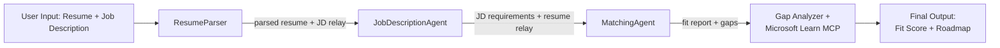

# PersonalCareerCopilot - Оцена усклађености резимеа са послом

Вишеагентска апликација са фокусом на ток рада која процењује колико резиме одговара опису посла, а затим генерише персонализовани план учења за затварање недостатака.

---

## Агенти

| Агенат | Улога | Алати |
|-------|-------|-------|
| **ResumeParser** | Извлачи структуриране вештине, искуство, сертификате из текста резимеа | - |
| **JobDescriptionAgent** | Извлачи потребне/пожељне вештине, искуство, сертификате из описа посла | - |
| **MatchingAgent** | Упоређује профил и захтеве → резултат усклађености (0-100) + подударајуће/недостајуће вештине | - |
| **GapAnalyzer** | Креира персонализовани план учења са ресурсима Microsoft Learn | `search_microsoft_learn_for_plan` (MCP) |

## Ток рада



---

## Брзи почетак

### 1. Подешавање окружења

Ова фасцикла је референтна имплементација за скелет лабораторије 02 заснован на току рада. Њен `main.py` користи постојеће блокове упита плус `WorkflowBuilder` за повезивање четири агента.

```powershell
cd workshop\lab02-multi-agent\PersonalCareerCopilot
python -m venv .venv
.\.venv\Scripts\Activate.ps1          # Windows PowerShell
# source .venv/bin/activate            # macOS / Linux
pip install -r requirements.txt
```

### 2. Конфигурисање података за пријаву

Направите `.env` фајл у овој фасцикли:

```powershell
copy .env .env.bak 2>$null; echo $null > .env
```

Уредите `.env`:

```env
FOUNDRY_PROJECT_ENDPOINT=https://<your-account>.services.ai.azure.com/api/projects/<your-project>
AZURE_AI_MODEL_DEPLOYMENT_NAME=gpt-4.1-mini
```

| Вредност | Где се налази |
|---------|---------------|
| `FOUNDRY_PROJECT_ENDPOINT` | Foundry Toolkit бочна трака → десни клик на ваш пројекат → **Copy Project Endpoint** |
| `AZURE_AI_MODEL_DEPLOYMENT_NAME` | Foundry бочна трака → прошири пројекат → **Models + endpoints** → име деплоја |

### 3. Покретање локално

```powershell
python -m debugpy --listen 127.0.0.1:5679 main.py --port 8088
```

Или користите VS Code задатак: `Ctrl+Shift+P` → **Tasks: Run Task** → **Run Agent HTTP Server**.

За пуштање у рад са F5 користите **Debug Local Agent HTTP Server**.

### 4. Тестирање са Agent Inspector

Отворите Agent Inspector: `Ctrl+Shift+P` → **Foundry Toolkit: Open Agent Inspector**.

Залепите овај тест упит:

```
Resume:
Jane Doe
Senior Software Engineer with 5 years of experience in Python, Django, and AWS.
Built microservices handling 10K+ requests/second. Led a team of 4 developers.
Certifications: AWS Solutions Architect Associate.
Education: B.S. Computer Science, State University.

Job Description:
Senior Cloud Engineer at Contoso Ltd.
Required: Python, Azure, Kubernetes, Terraform, CI/CD pipelines.
Preferred: Go, monitoring (Prometheus/Grafana), cost optimization.
Experience: 5+ years in cloud infrastructure.
Certifications: Azure Solutions Architect Expert preferred.
```

**Очекујe се:** Резултат усклађености (0-100), подударајуће/недостајуће вештине и персонализовани план учења са Microsoft Learn URL-овима.

### 5. Објављивање на Foundry

`Ctrl+Shift+P` → **Foundry Toolkit: Deploy Hosted Agent** → изаберите ваш пројекат → потврдите.

---

## Структура пројекта

```
PersonalCareerCopilot/
├── .env                ← Your credentials (git-ignored)
├── agent.yaml          ← Hosted agent definition (name, resources, env vars)
├── Dockerfile          ← Container image for Foundry deployment
├── main.py             ← 4-agent workflow (instructions, MCP tool, WorkflowBuilder)
└── requirements.txt    ← Python dependencies
```

## Кључни фајлови

### `agent.yaml`

Дефинише хостираног агента за Foundry Agent Service:
- `kind: hosted` - ради као управљани контејнер
- `protocols` - `responses` протокол са `version: 2.0.0`, изложен на `/responses` HTTP крајњој тачки
- `environment_variables` - `AZURE_AI_MODEL_DEPLOYMENT_NAME` је декларисан овде; `FOUNDRY_PROJECT_ENDPOINT` се аутоматски инјектује приликом деплоја

### `main.py`

Садржи:
- **Упутства агента** - четири `*_INSTRUCTIONS` константе, по једна за агента
- **MCP алат** - `search_microsoft_learn_for_plan()` позиви `https://learn.microsoft.com/api/mcp` преко Streamable HTTP
- **Креирање агената** - четири `Agent()` + `AgentExecutor()` инстанце које деле један `FoundryChatClient`
- **Граф тока рада** - `WorkflowBuilder` повезује агенте у секвенцијалну цевовод: ResumeParser → JD Agent → MatchingAgent → GapAnalyzer
- **Покретање сервера** - `ResponsesHostServer` ради на порту 8088

### `requirements.txt`

| Пакет | Сврха |
|-------|--------|
| `agent-framework-foundry` | Основно извршно окружење: `Agent`, `AgentExecutor`, `WorkflowBuilder`, `@tool`, `FoundryChatClient` |
| `agent-framework-foundry-hosting` | `ResponsesHostServer` + Интеграција хостинга Foundry |
| `mcp<2,>=1.24.0` | MCP клијент за GapAnalyzer (`streamable_http_client`) |
| `debugpy` | Питање и решавање грешака у Python-у (F5 у VS Code) |

---

## Решавање проблема

| Проблем | Решење |
|-------|-----|
| `KeyError: 'FOUNDRY_PROJECT_ENDPOINT'` или `KeyError: 'AZURE_AI_MODEL_DEPLOYMENT_NAME'` | Креирајте `.env` са оба `FOUNDRY_PROJECT_ENDPOINT` и `AZURE_AI_MODEL_DEPLOYMENT_NAME` подешена |
| `ModuleNotFoundError: No module named 'agent_framework'` | Активирајте venv и покрените `pip install -r requirements.txt` |
| Нема Microsoft Learn URL-ова у излазу | Проверите интернет везу према `https://learn.microsoft.com/api/mcp` |
| Само 1 картица са празнином (скраћено) | Проверите да ли `GAP_ANALYZER_INSTRUCTIONS` укључује блок `CRITICAL:` |
| Порт 8088 је у употреби | Зауставите друге сервере: `netstat -ano \| findstr :8088` |

За детаљна упутства о решавању проблема, погледајте [Модул 8 - Решавање проблема](../docs/08-troubleshooting.md).

---

**Потпуна шетња:** [Документација лабораторије 02](../docs/README.md) · **Назад на:** [README лабораторије 02](../README.md) · [Почетак радионице](../../../README.md)

---

<!-- CO-OP TRANSLATOR DISCLAIMER START -->
**Изјава о одрицању одговорности**:
Овај документ је преведен коришћењем услуге за аутоматски превод [Co-op Translator](https://github.com/Azure/co-op-translator). Иако тежимо тачности, имајте у виду да аутоматски преводи могу садржати грешке или нетачности. Оригинални документ на његовом изворном језику треба сматрати ауторитативним извором. За критичне информације препоручује се професионални људски превод. Нисмо одговорни за било каква неспоразума или погрешна тумачења која произилазе из коришћења овог превода.
<!-- CO-OP TRANSLATOR DISCLAIMER END -->