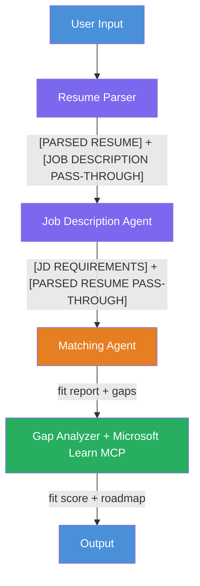

# Лабораторија 02 - Viшеагентски ток рада: Оцена подударности биографије и посла

## Преглед

У овој практичној радионици направићете **апликацију више агената која је првенствено усмерена на ток рада** користећи Foundry Toolkit у VS Code-у и поставити је у Microsoft Foundry Agent Service.

**Шта ћете направити:** Оцена биографије у односу на посао која анализира биографију и опис посла, оцени подударање и генерише персонализовани план учења користећи ресурсе Microsoft Learn.

---

## Архитектура

**Како то функционише:**
1. Корисник залепи биографију и опис посла.
2. **ResumeParser** анализира биографију и преноси опис посла дословце у `[JOB DESCRIPTION PASS-THROUGH]` секцију.
3. **JD Agent** извлачи структуриране захтеве из прослеђеног текста, затим прослеђује `[PARSED RESUME]` као `[PARSED RESUME PASS-THROUGH]`.
4. **MatchingAgent** упоређује `[PARSED RESUME PASS-THROUGH]` и `[JD REQUIREMENTS]` и генерише резултат подударања.
5. **GapAnalyzer** претвара празнине у практичан план и преузима реалне Microsoft Learn везе преко MCP.

---

## Претпоставке

Прво завршите Лабораторију 01:

- [Лабораторија 01 - Један агент](../lab01-single-agent/README.md)

---

## Део 1: Прочитајте модуле по реду

Погледајте цео пут учења на:

- [Лаб 2 Документација - Претпоставке](docs/00-prerequisites.md)
- [Лаб 2 Документација - Потпун пут учења](docs/README.md)
- [Персонални водич за PersonalCareerCopilot](PersonalCareerCopilot/README.md)

---

## Део 2: Направите и тестирате ток рада

1. Користите Foundry Toolkit чаробњак за креирање пројекта заснованог на току рада.
2. Копирајте блокове упита и граф тока рада из `PersonalCareerCopilot/main.py` у ваш радна површина.
3. Покрените локално помоћу Agent Inspector-а и проверите сва четири агента и MCP алат.
4. Поставите хостованог агента на Foundry када локално тестирање прође.

---

## Обрасци оркестрације

Лабораторија 02 користи **секвенцијалну линију**: излаз сваког агента иде као улаз следећем, а ток рада враћа одговор последњег агента. Два обрасца омогућавају ово:

- **Секвенцијални ланац** - `WorkflowBuilder` повезује ResumeParser → JD Agent → MatchingAgent → GapAnalyzer са једним `add_edge()` позивом по кораку
- **Прослеђивање садржаја** - јер сваки агент види само излаз свог непосредног претходника, ResumeParser и JD Agent копирају податке потребне агенатима у даљем току у означене пролазне секције

Документи такође објашњавају зашто лабораторија не користи fan-out/fan-in и како проширити граф другим агентом.

Погледајте [docs/04-orchestration-patterns.md](docs/04-orchestration-patterns.md).

---

**Претходно:** [Лабораторија 01 - Један агент](../lab01-single-agent/README.md) · **Назад на:** [Почетна радна радионице](../../README.md)

---

<!-- CO-OP TRANSLATOR DISCLAIMER START -->
**Изјава о одрицању одговорности**:
Овај документ је преведен коришћењем услуге за аутоматски превод [Co-op Translator](https://github.com/Azure/co-op-translator). Иако тежимо тачности, имајте у виду да аутоматски преводи могу садржати грешке или нетачности. Оригинални документ на његовом изворном језику треба сматрати ауторитативним извором. За критичне информације препоручује се професионални људски превод. Нисмо одговорни за било каква неспоразума или погрешна тумачења која произилазе из коришћења овог превода.
<!-- CO-OP TRANSLATOR DISCLAIMER END -->