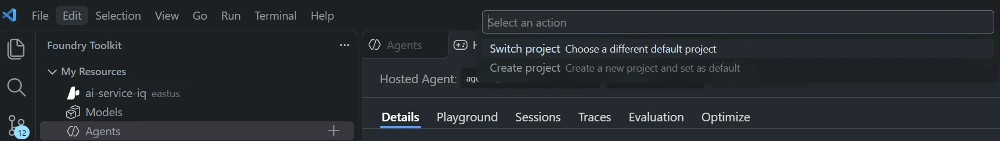

# Модул 0 - Увод

⏱️ ~10 мин

> [!WARNING]
> **Преглед и ограничења:** [Хостовани агенти](https://learn.microsoft.com/azure/foundry/agents/concepts/hosted-agents) су тренутно у фази **јавног прегледа** - не препоручује се за продукционе радне оптерећења. Неке функције приказане у овој радионици могу се мењати како услуга буде напредовала ка GA.

## Шта ћете направити

У овој лабораторији проширујете вештине једног агента из Лабораторије 01 да бисте направили **радни ток са више агената** - Оцењивач погодности резимеа за посао.

Налепите **резиме** и **опис посла**. Четири специјализована агента обрађују улаз секвенцијално, а затим враћају:
- Оцена погодности (0–100 са распадом бодова)
- Листу недостатака вештина и сертификата
- Персонализовану мапу учења са стварним линковима из Microsoft Learn за сваки недостатак

**Радни ток користи:**
- **Microsoft Agent Framework** - `WorkflowBuilder` за секвенцијалну оркестрацију процеса
- **Foundry Toolkit за VS Code** - скеле, тестирање локално, деплој
- **АИ модел** (нпр. `gpt-4.1-mini`) - користе сва четири агента
- **Microsoft Learn MCP сервер** - обезбеђује стварне ресурсе за учење за сваки недостајући део вештина

---

## Изаберите свој пут

> ⚠️ **Наставите са истим путем који сте користили у Лабораторији 01.**

<details open>
<summary><strong>🅰️ Пут А - Azure облак (захтева Azure претплату)</strong></summary>

| | Детаљи |
|---|---|
| **За кога је ово?** | Завршили сте Лабораторију 01 користећи Azure претплату |
| **Модел** | Azure OpenAI преко Foundry (нпр. `gpt-4.1-mini`) |
| **Обухваћени модули** | Сви модули (00–09) |
| **Деплој у облак?** | ✅ Да - комплетан деплој крај-до-краја |

</details>

<details open>
<summary><strong>🅱️ Пут Б - Foundry Local (није потребна Azure претплата)</strong></summary>

| | Детаљи |
|---|---|
| **За кога је ово?** | Завршили сте Лабораторију 01 користећи Foundry Local |
| **Модел** | Foundry Local (бесплатно, ради на вашем рачунару) |
| **Обухваћени модули** | Модули 00–05 (прескочити 06–07 - деплој и верификација у облаку) |
| **Деплој у облак?** | ❌ Не - само локално тестирање преко Agent Inspector |

</details>

---

## Провера Лабораторије 01

Лабораторија 02 директно наставља Лабораторију 01. Прво завршите Лабораторију 01.

Још нисте обавили Лабораторију 01? Почните овде: [Lab 01 - Introduction](../../lab01-single-agent/docs/00-prerequisites.md)

<details open>
<summary><strong>🅰️ Пут А - Azure облак</strong></summary>

```powershell
az account show --query "{name:name, id:id}" --output table
```

Ако ово не успе, покрените `az login`. Затим потврдите у VS Code:

1. `Ctrl+Shift+P` → укуцајте **Foundry Toolkit** → потврдите да се команде приказују.
2. Кликните на икону **Foundry Toolkit** → ваш пројекат и деплојовани модел показују **Succeeded**.



> **RBAC:** Доделили сте улогу **Foundry User** у Лабораторији 01. Ако је потребно поново доделити, видите [Lab 01, Module 1](../../lab01-single-agent/docs/01-setup.md#deploy-a-model--assign-rbac). Раније је улога била названа **Azure AI User** - иста права.

</details>

<details open>
<summary><strong>🅱️ Пут Б - Foundry Local</strong></summary>

```powershell
Invoke-WebRequest -Uri "http://localhost:5273/v1/health" -UseBasicParsing | Select-Object StatusCode
```

Очекује се: `StatusCode: 200`. Ако није, рестартујте Foundry Local из Foundry Toolkit бочне траке.

> Све инференције се извршавају на вашем рачунару. Једини одлазни позив је MCP алат ка `https://learn.microsoft.com/api/mcp`.

</details>

---

## Шта је ново у Лабораторији 02

| | Лабораторија 01 | Лабораторија 02 |
|--|--------|--------|
| Агенти | 1 | 4 (повезаних са WorkflowBuilder) |
| Шаблон скеле | Основно - Agent Framework | Радни токови - Agent Framework |
| Нови пакет | - | `mcp` |
| Оркестрација | Један конверзациони агент | Секвенцијална цевоводна оркестрација (WorkflowBuilder) |
| Нови алат | - | `search_microsoft_learn_for_plan` (MCP) |

---

**Следеће:** [01 - Разумети архитектуру →](01-understand-multi-agent.md)

---

<!-- CO-OP TRANSLATOR DISCLAIMER START -->
**Изјава о одрицању одговорности**:
Овај документ је преведен коришћењем услуге за аутоматски превод [Co-op Translator](https://github.com/Azure/co-op-translator). Иако тежимо тачности, имајте у виду да аутоматски преводи могу садржати грешке или нетачности. Оригинални документ на његовом изворном језику треба сматрати ауторитативним извором. За критичне информације препоручује се професионални људски превод. Нисмо одговорни за било каква неспоразума или погрешна тумачења која произилазе из коришћења овог превода.
<!-- CO-OP TRANSLATOR DISCLAIMER END -->