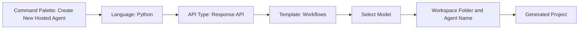

# Модул 2 - Скeлет мулти-агентског пројекта

⏱️ ~5 мин

У овом модулу користите [Foundry Toolkit for VS Code](https://aka.ms/foundrytk) да бисте **поставили скелет мулти-агентског пројекта**. Чаробњак генерише `agent.yaml`, `main.py`, `Dockerfile`, `requirements.txt`, `.env`, и VS Code конфигурацију за дебаговање - тако да се можете фокусирати на повезивање тока рада са 4 агента у Модулу 3.

> **Кључни концепт:** Скелет је радни stub са једним агентом. Замените плейсхолдер логику графом `WorkflowBuilder` у Модулу 3. Нећете писати шаблонски код од нуле.

> **Референтна имплементација:** [`PersonalCareerCopilot/`](../../../../../workshop/lab02-multi-agent/PersonalCareerCopilot) је потпун радни пример. Користите га да упоредите свој рад док напредујете.

### Ток чаробњака за скелет



---

## Корак 1: Отворите чаробњака Create Hosted Agent

1. Притисните `Ctrl+Shift+P` да бисте отворили **Командну палету**.
2. Откуцајте: **Foundry Toolkit: Create a New Hosted Agent** и изаберите је.
3. Чаробњак се отвара на картици **Agent Details**.

> **Алтернатива:** Кликните на икону **Foundry Toolkit** у Activity Bar → кликните икону **+** поред **Hosted Agents** → **Create New Hosted Agent**.

---

## Корак 2: Изаберите подешавања


1. У левом делу навигације/опција изаберите следеће:

| Мени | Избор | Напомене |
|--------|-----------|-------|
| **Језик** | Python | C# (.NET) такође подржано |
| **Фрејмворк** | Agent Framework | Обезбеђује `Agent`, `AgentExecutor`, `WorkflowBuilder` |
| **Тип API-ја** | Response API | `POST /responses` - историја под управом платформе, подршка за стримовање |
| **Шаблон** | **Workflows** | Обрађује захтеве кроз више агената узастопно |

2. Када одаберете, кликните **Next**


3. У следећем прозору изаберите следеће:

| Мени | Избор | Напомене |
|--------|-----------|-------|
| **Фолдер радног простора** | Browse to target folder | нпр. `workshop/lab02-multi-agent/` у овом репозиторијуму |
| **Име агента** | `PersonalCareerCopilot` | Ово постаје име директоријума пројекта |
| **Деплој модела** | Select your deployed model | нпр. `gpt-4.1-mini` из Lab 01 |

4. Кликните **Create** да бисте поставили скелет пројекта. VS Code генерише фајлове и отвори фасциклу.

> **Савет:** [`gpt-4.1-mini`](https://learn.microsoft.com/azure/foundry/foundry-models/concepts/models-sold-directly-by-azure#gpt-41-series) добро балансира брзину и квалитет за развој мулти-агентских система.

---

## Корак 3: Прегледајте генерисани пројекат

Након што се скелетирање заврши, проверите да у Explorer-у видите ове фајлове (`Ctrl+Shift+E`):

```
📂 <your-agent-name>/
├── .azdignore          ← Files excluded from Azure Developer CLI deployments
├── .dockerignore       ← Files excluded from Docker builds
├── .env                ← Environment variables (placeholders - fill in Module 3)
├── .vscode/
│   ├── launch.json     ← Debug config (F5 → run + Agent Inspector)
│   └── tasks.json      ← VS Code task definitions
├── agent.yaml          ← Agent definition (kind: hosted, protocol: responses)
├── Dockerfile          ← Container config for deployment
├── main.py             ← Stub agent entry point (replace with WorkflowBuilder in Module 3)
└── requirements.txt    ← Python dependencies
```

> **Важно:** Отворите ову скелетирани фасциклу директно у VS Code-у тако да се `.vscode/launch.json` и `tasks.json` правилно примењују за F5 дебаговање.

### Објашњење кључних фајлова

| Фајл | Сврха |
|------|---------|
| `agent.yaml` | Декларише `kind: hosted`, мапира променљиве окружења, дефинише `/responses` протокол |
| `main.py` | Stub: један `FoundryChatClient` → `Agent` → `ResponsesHostServer`. Ово замените са 4 агента + `WorkflowBuilder` у Модулу 3 |
| `Dockerfile` | `python:3.12-slim`, инсталира `requirements.txt`, отвара порт 8088, покреће `python main.py` |
| `requirements.txt` | `agent-framework-foundry`, `agent-framework-foundry-hosting`, `mcp<2,>=1.24.0`, `debugpy` |

> **Референца:** Погледајте [`PersonalCareerCopilot/agent.yaml`](../../../../../workshop/lab02-multi-agent/PersonalCareerCopilot/agent.yaml) и [`PersonalCareerCopilot/requirements.txt`](../../../../../workshop/lab02-multi-agent/PersonalCareerCopilot/requirements.txt) за комплетан генерисани садржај.

---

### ✅ Контролна тачка

- [ ] Чаробњак за скелет је завршен - нови фолдер пројекта видљив у Explorer-у
- [ ] Сви очекивани фајлови присутни: `agent.yaml`, `main.py`, `Dockerfile`, `requirements.txt`, `.env`
- [ ] `agent.yaml` приказује `kind: hosted` и `protocol: responses`
- [ ] `main.py` увози `Agent`, `FoundryChatClient`, `ResponsesHostServer`
- [ ] Скeлетирана фасцикла је отворена као корен радног простора у VS Code-у
- [ ] Разумете да је `main.py` привремени код - `WorkflowBuilder` се додаје у Модулу 3

---

**Претходно:** [01 - Разумевање архитектуре са више агената](01-understand-multi-agent.md) · **Следеће:** [03 - Конфигуришите агенте & окружење →](03-configure-agents.md)

---

<!-- CO-OP TRANSLATOR DISCLAIMER START -->
**Изјава о одрицању одговорности**:
Овај документ је преведен коришћењем услуге за аутоматски превод [Co-op Translator](https://github.com/Azure/co-op-translator). Иако тежимо тачности, имајте у виду да аутоматски преводи могу садржати грешке или нетачности. Оригинални документ на његовом изворном језику треба сматрати ауторитативним извором. За критичне информације препоручује се професионални људски превод. Нисмо одговорни за било каква неспоразума или погрешна тумачења која произилазе из коришћења овог превода.
<!-- CO-OP TRANSLATOR DISCLAIMER END -->