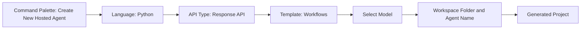
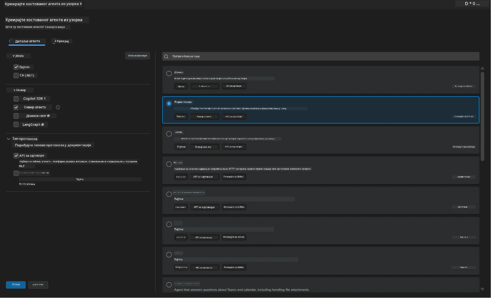
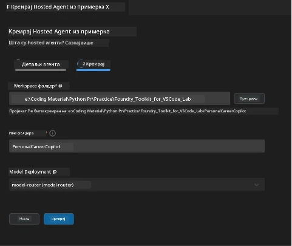

# Модул 2 - Креирање оквира за мулти-агент пројекат

⏱️ ~5 мин

У овом модулу користите [Foundry Toolkit for VS Code](https://aka.ms/foundrytk) за **креирање оквира мулти-агент пројекта**. Чаробњак генерише `agent.yaml`, `main.py`, `Dockerfile`, `requirements.txt`, `.env`, и VS Code конфигурацију за дебаговање - тако да се можете фокусирати на повезивање 4-агентног тока у Модулу 3.

> **Кључна кон ceпција:** Оквир је радни приручник са једним агентом. Замените резервисану логику графом `WorkflowBuilder` у Модулу 3. Не пишете узорке од нуле.

> **Референтна имплементација:** [`PersonalCareerCopilot/`](../../../../../workshop/lab02-multi-agent/PersonalCareerCopilot) је потпуни радни пример. Користите га за упоређивање вашег рада током израде.

### Ток чаробњака за креирање оквира



---

## Корак 1: Отворите чаробњака за креирање хостованог агента

1. Притисните `Ctrl+Shift+P` да бисте отворили **Командну палету**.
2. Укуцајте: **Foundry Toolkit: Create new Hosted Agent** и изаберите ту опцију.
3. Чаробњак ће се отворити на картици **Детаљи агента**.

> **Алтернатива:** Кликните на икону **Foundry Toolkit** у траци активности → кликните на икону **+** поред **Hosted Agents** → **Create New Hosted Agent**.

---

## Корак 2: Избор поставки



1. У левом делу за навигацију/опције изаберите следеће:

| Мени | Избор | Напомене |
|--------|-----------|-------|
| **Језик** | Python | Подржан је и C# (.NET) |
| **Фрејмворк** | Agent Framework | Обезбеђује `Agent`, `AgentExecutor`, `WorkflowBuilder` |
| **Тип API** | Response API | `POST /responses` - историја којом управља платформа, подршка за стреаминг |
| **Шаблон** | **Workflows** | Обрађује захтеве преко више агената у низу |

2. Када одаберете, кликните на **Next**



3. У следећем прозору изаберите следеће:

| Мени | Избор | Напомене |
|--------|-----------|-------|
| **Фасцикла радног окружења** | Претражите до циљне фасцикле | нпр. `workshop/lab02-multi-agent/` у овом репозиторијуму |
| **Име агента** | `PersonalCareerCopilot` | Постаје име директоријума пројекта |
| **Распоређивање модела** | Изаберите инсталирани модел | нпр. `gpt-4.1-mini` из Лаб 01 |

4. Кликните **Create** да бисте креирали оквир пројекта. VS Code ће генерисати датотеке и отворити фасциклу.

> **Савет:** [`gpt-4.1-mini`](https://learn.microsoft.com/azure/foundry/foundry-models/concepts/models-sold-directly-by-azure#gpt-41-series) добро балансира брзину и квалитет за развој мулти-агената.

---

## Корак 3: Прегледајте генерисани пројекат

Након завршетка креирања оквира, проверите да видите ове датотеке у Истраживачу (`Ctrl+Shift+E`):

```
📂 <your-agent-name>/
├── .azdignore          ← Files excluded from Azure Developer CLI deployments
├── .dockerignore       ← Files excluded from Docker builds
├── .env                ← Environment variables (placeholders - fill in Module 3)
├── .vscode/
│   ├── launch.json     ← Debug config (F5 → run + Agent Inspector)
│   └── tasks.json      ← VS Code task definitions
├── agent.yaml          ← Agent definition (kind: hosted, protocol: responses)
├── Dockerfile          ← Container config for deployment
├── main.py             ← Stub agent entry point (replace with WorkflowBuilder in Module 3)
└── requirements.txt    ← Python dependencies
```

> **Важно:** Отворите ову креирану фасциклу директно у VS Code-у како би `.vscode/launch.json` и `tasks.json` исправно функционисали при дебаговању са F5.

### Објашњење кључних датотека

| Датотека | Намена |
|------|---------|
| `agent.yaml` | Декларише `kind: hosted`, мапира env променљиве, дефинише `/responses` протокол |
| `main.py` | Приручник: један `FoundryChatClient` → `Agent` → `ResponsesHostServer`. Ово замените са 4 агента + `WorkflowBuilder` у Модулу 3 |
| `Dockerfile` | `python:3.12-slim`, инсталира `requirements.txt`, излази на порт 8088, покреће `python main.py` |
| `requirements.txt` | `agent-framework-foundry`, `agent-framework-foundry-hosting`, `mcp<2,>=1.24.0`, `debugpy` |

> **Референца:** Погледајте [`PersonalCareerCopilot/agent.yaml`](../../../../../workshop/lab02-multi-agent/PersonalCareerCopilot/agent.yaml) и [`PersonalCareerCopilot/requirements.txt`](../../../../../workshop/lab02-multi-agent/PersonalCareerCopilot/requirements.txt) за потпуни генерисани садржај.

---

### ✅ Контролна тачка

- [ ] Чаробњак за креирање оквира завршен - нова фасцикла пројекта је видљива у Истраживачу
- [ ] Све очекиване датотеке присутне: `agent.yaml`, `main.py`, `Dockerfile`, `requirements.txt`, `.env`
- [ ] `agent.yaml` приказује `kind: hosted` и `protocol: responses`
- [ ] `main.py` увози `Agent`, `FoundryChatClient`, `ResponsesHostServer`
- [ ] Отворена фасцикла је VS Code радни корен
- [ ] Разумете да је `main.py` приручник - `WorkflowBuilder` се додаје у Модулу 3

---

**Претходно:** [01 - Разумевање мулти-агентне архитектуре](01-understand-multi-agent.md) · **Следеће:** [03 - Конфигурисање агената и окружења →](03-configure-agents.md)

---

<!-- CO-OP TRANSLATOR DISCLAIMER START -->
**Изјава о одрицању одговорности**:
Овај документ је преведен коришћењем услуге за аутоматски превод [Co-op Translator](https://github.com/Azure/co-op-translator). Иако тежимо тачности, имајте у виду да аутоматски преводи могу садржати грешке или нетачности. Оригинални документ на његовом изворном језику треба сматрати ауторитативним извором. За критичне информације препоручује се професионални људски превод. Нисмо одговорни за било каква неспоразума или погрешна тумачења која произилазе из коришћења овог превода.
<!-- CO-OP TRANSLATOR DISCLAIMER END -->