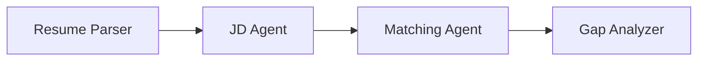
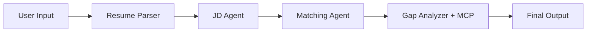

# Модул 4 - Обрасци оркестрације

⏱️ ~10 мин

У овом модулу истражујете обрасце оркестрације који се користе у Resume Job Fit Evaluator-у и учите како да читате, мењате и проширујете графикон радног тока. Разумевање ових образаца је кључно за отклањање грешака у току података и изградњу ваших [мулти-агентских радних токова](https://learn.microsoft.com/agent-framework/workflows/).

---

## Образац 1: Секвенцијални ланац

Основни образац у радном току је **секвенцијални ланац** - излаз сваког агента иде директно у следећег.



У коду, сваки `add_edge()` позив прави један корак у ланцу:

```python
.add_edge(resume_executor, jd_executor)       # ResumeParser output → JD Agent
.add_edge(jd_executor, matching_executor)     # JD Agent output → MatchingAgent
.add_edge(matching_executor, gap_executor)    # MatchingAgent output → GapAnalyzer
```

> **Зашто секвенцијално, а не фан-аут/фан-ин?** `WorkflowBuilder` користи **ИЛИ-семантику** за долазне ивице: извршилац низводно покреће се чим **било који** претходник заврши. Ако би `matching_executor` имао две долазне ивице (од `resume_executor` и `jd_executor`), окидао би два пута - једном кад ResumeParser заврши и опет кад JD Agent заврши - што би изазвало да GapAnalyzer такође ради два пута и да излаз буде два пута видљив. Секвенцијални ланац то у потпуности избегава.

## Образац 2: Прослеђивање садржаја

Јер `context_mode="last_agent"` значи да сваки извршилац види само **излаз свог директног претходника**, агенти у секвенцијалном ланцу морају експлицитно да прослеђују све податке који су потребни агенатима низводно.

У овом радном току:
- **ResumeParser** копира JD реч по реч у `[JOB DESCRIPTION PASS-THROUGH]` (да би JD Agent могао да га пронађе).
- **JD Agent** копира `[PARSED RESUME]` реч по реч у `[PARSED RESUME PASS-THROUGH]` (да би MatchingAgent могао да упореди оба профила).

```
ResumeParser output
└─ [PARSED RESUME]               ← extracted by JD Agent
└─ [JOB DESCRIPTION PASS-THROUGH] ← extracted by JD Agent

JD Agent output
└─ [JD REQUIREMENTS]             ← extracted by MatchingAgent
└─ [PARSED RESUME PASS-THROUGH]  ← extracted by MatchingAgent
```

Сваки део прослеђивања мора бити копиран **реч по реч** - сажимање или препричавање уништава низводног агента који од њега зависи.

---

## Потпуни графикон

Комбинација секвенцијалног ланца и обрасца прослеђивања содржаја производи комплетан радни ток:



Agent Inspector приказује исту структуру графикона када агент ради локално. Погледајте [Модул 5 - Тестирање Локално](05-test-locally.md) за снимке екрана.

---

## Читање кода WorkflowBuilder-а

Графикон радног тока се гради у функцији `main()` у [`PersonalCareerCopilot/main.py`](../../../../../workshop/lab02-multi-agent/PersonalCareerCopilot/main.py). Три `add_edge()` позива састављају секвенцијалну линију:

| # | Ивица | Ефекат |
|---|------|--------|
| 1 | `resume_executor → jd_executor` | JD Agent добија `[PARSED RESUME]` + `[JOB DESCRIPTION PASS-THROUGH]` |
| 2 | `jd_executor → matching_executor` | MatchingAgent добија `[JD REQUIREMENTS]` + `[PARSED RESUME PASS-THROUGH]` |
| 3 | `matching_executor → gap_executor` | GapAnalyzer добија извештај о одговарању + листу празнина |

---

## Модификација графикона

### Додавање новог агента

За додавање петог агента (нпр. **InterviewPrepAgent** после GapAnalyzer-а):

1. Дефинишите константу `INTERVIEW_PREP_INSTRUCTIONS`.
2. Креирајте објекте `Agent` + `AgentExecutor` (исти образац као код претходна четири).
3. Додајте `.add_edge(gap_executor, interview_exec)` у `WorkflowBuilder`.
4. Ажурирајте `output_executors=[interview_exec]`.

> **Важно:** `start_executor` је једини агент који прима сирови улаз корисника. Сви остали агенти примају излаз са своје претходне ивице.

---

## Уобичајене грешке у графикону

| Грешка | Симптом | Поправка |
|---------|---------|-----|
| Недостаје ивица ка `output_executors` | Агент ради али излаз је празан | Обезбедите путању од `start_executor` до сваког агента у `output_executors` |
| Кружна зависност | Бесконачна петља или истека времена | Проверите да ниједан агент не враћа одговор узводном агенту |
| Агент у `output_executors` без долазне ивице | Празан излаз | Додајте најмање једну `add_edge(source, that_agent)` |
| Више `output_executors` без фан-ин-а | Излаз садржи одговор само једног агента | Користите једног агента за излаз који агрегира, или прихватите више излаза |
| Недостаје `start_executor` | `ValueError` у време израде | Увек наведите `start_executor` у `WorkflowBuilder()` |

---

## Отклањање грешака у графикону

### Коришћење Agent Inspectora

1. Покрените агента локално са F5.
2. Отворите Agent Inspectora (`Ctrl+Shift+P` → **Foundry Toolkit: Open Agent Inspector**).
3. Пошаљите тест поруку.
4. У панелу за одговор Inspector-а, тражите **стријиминг излаз** - приказује допринос сваког агента по реду.


### Коришћење логовања

Додајте логовање у `main.py` за праћење тока података:

```python
import logging
logger = logging.getLogger("resume-job-fit")

# In main(), after building the workflow:
logger.info("Workflow graph built with edges: RP→JD, JD→MA, MA→GA")
```

Логови сервера показују редослед извршавања агената и позиве алата MCP:

```
INFO:agent_framework:Executing agent: ResumeParser
INFO:agent_framework:Executing agent: JobDescriptionAgent
INFO:agent_framework:Executing agent: MatchingAgent
INFO:agent_framework:Executing agent: GapAnalyzer
INFO:agent_framework:Tool call: search_microsoft_learn_for_plan(skill="Kubernetes")
POST https://learn.microsoft.com/api/mcp → 200
INFO:agent_framework:Tool call: search_microsoft_learn_for_plan(skill="Terraform")
POST https://learn.microsoft.com/api/mcp → 200
```

---

### Контролна тачка

- [ ] Можете препознати два образаца оркестрације у радном току: секвенцијални ланац и прослеђивање садржаја
- [ ] Разумете зашто `context_mode="last_agent"` захтева експлицитно прослеђивање података између агената
- [ ] Можете читати код `WorkflowBuilder` и повезати сваки `add_edge()` позив са визуелним графом
- [ ] Знате како да додате новог агента на крај линије
- [ ] Можете препознати уобичајене грешке у графу и њихове симптоме

---

**Претходни:** [03 - Конфигурисање агената и окружења](03-configure-agents.md) · **Следећи:** [05 - Тестирање Локално →](05-test-locally.md)

---

<!-- CO-OP TRANSLATOR DISCLAIMER START -->
**Изјава о одрицању одговорности**:
Овај документ је преведен коришћењем услуге за аутоматски превод [Co-op Translator](https://github.com/Azure/co-op-translator). Иако тежимо тачности, имајте у виду да аутоматски преводи могу садржати грешке или нетачности. Оригинални документ на његовом изворном језику треба сматрати ауторитативним извором. За критичне информације препоручује се професионални људски превод. Нисмо одговорни за било каква неспоразума или погрешна тумачења која произилазе из коришћења овог превода.
<!-- CO-OP TRANSLATOR DISCLAIMER END -->