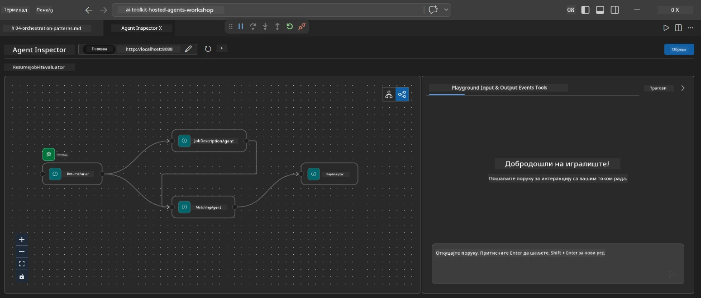
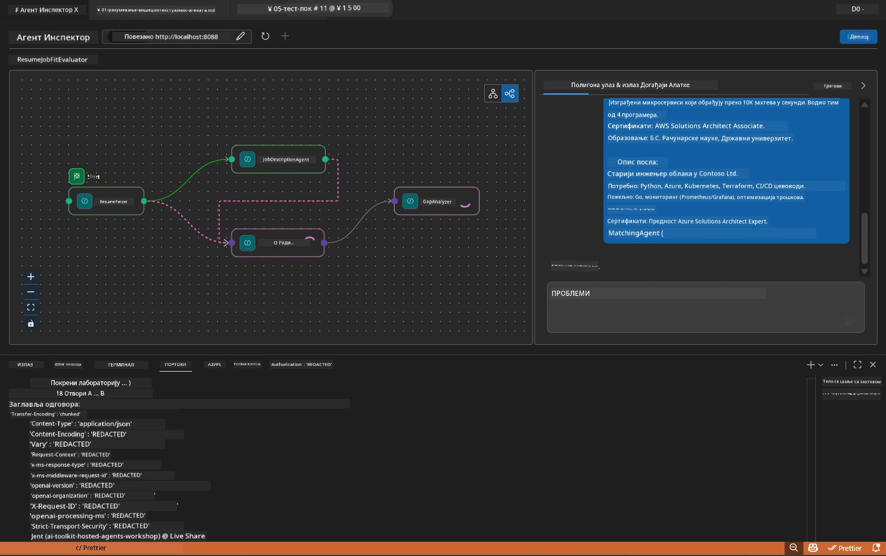
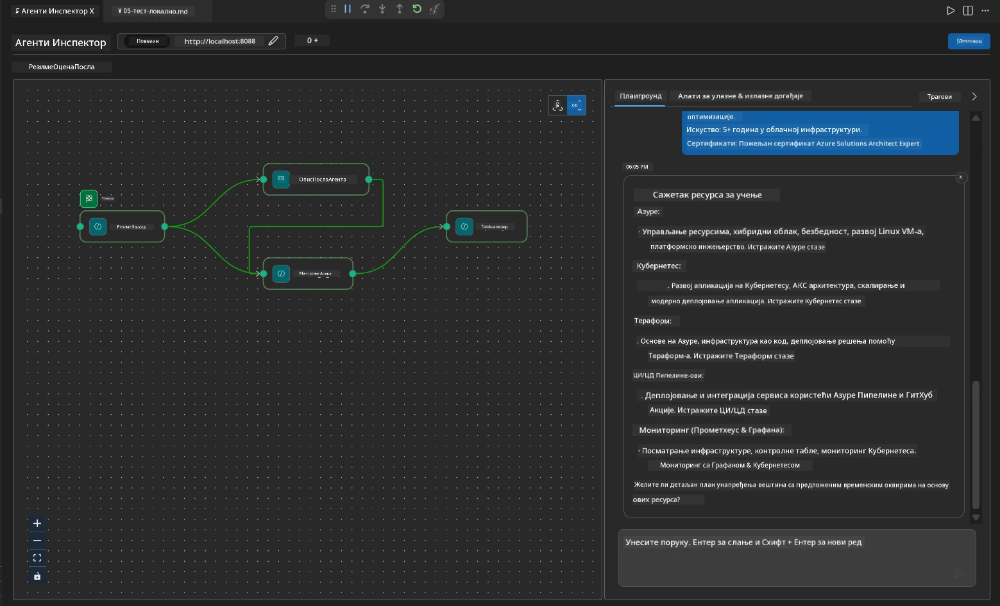

# Модул 5 - Тестирање локално

⏱️ ~15 мин

У овом модулу покрећете мулти-агентски ток рада локално, тестирате га са Agent Inspector-ом и проверавате да ли сви четири агента и MCP алат исправно раде пре распоређивања.

---

## Корак 1: Покрените агент сервер

### Опција А: Коришћење VS Code задатка (препоручено)

1. Отворите `workshop/lab02-multi-agent/PersonalCareerCopilot/` као ваш VS Code фолдер.
2. Притисните `Ctrl+Shift+P` → откуцајте **Tasks: Run Task** → изаберите **Run Agent HTTP Server**.
3. Задатак покреће сервер са debugpy прикључком на порт `5679` и агента на порту `8088`.
4. Сачекајте да излаз покаже поруку о покретању, а затим и поруку о спремности сервера (друге линије лога се појављују између):

```
INFO:resume-job-fit:Starting Resume -> Job Fit Evaluator HTTP server...
...
INFO:hypercorn.error:Running on http://0.0.0.0:8088 (CTRL + C to quit)
```

### Опција Б: Коришћење F5 (режим дебага)

1. Притисните `F5` → изаберите **Debug Local Agent HTTP Server**.
2. Сервер се покреће са пуном подршком за прекиде - корисно за испитивање MCP одговора или излаза агента.

---

## Корак 2: Отворите Agent Inspector

1. Притисните `Ctrl+Shift+P` → откуцајте **Foundry Toolkit: Open Agent Inspector**.
2. Agent Inspector се отвара као панел у VS Code-у повезан са `http://localhost:8088`.
3. Требало би да видите интерфејс агента спреман да прими поруке.



> **Ако се Agent Inspector не отвори:** Уверите се да је сервер потпуно покренут (видите `Running on http://0.0.0.0:8088` лог). Ако је порт 5679 заузет, погледајте [Модул 8 - Решавање проблема](08-troubleshooting.md).

---

## Корак 2б: (опционо) Отворите Workflow Visualizer

Foundry Toolkit укључује визуелизатор у реалном времену **Workflow Visualizer** који показује како агенти међусобно комуницирају током извршавања графа. Ово је посебно корисно за дебаговање мулти-агената.

1. Притисните `Ctrl+Shift+P` → откуцајте **Foundry Toolkit: Open Visualizer for Hosted Agents**.
2. Отвориће се нови таб у VS Code-у који приказује граф извршавања уживо.
3. Како шаљете поруке у Agent Inspector-у, визуелизатор се аутоматски ажурира - зелени чворови указују на завршене агенте, а анимиране ивице показују проток података између њих.

> **Конфликт портова:** Ако је порт визуелизатора већ у употреби, измените га у подешавањима VS Code-а → **Extensions** → **Microsoft Foundry Configuration** → **Hosted Agents: Visualizer Port**.

---

## Корак 3: Покрените smoke тестове

Покрените ова два теста редом. Сваки тест покрива све више делова тока рада.

### Тест 1: Основни наставак + опис посла

Налепите следеће у Agent Inspector:

```
Resume:
Jane Doe
Senior Software Engineer with 5 years of experience in Python, Django, and AWS.
Built microservices handling 10K+ requests/second. Led a team of 4 developers.
Certifications: AWS Solutions Architect Associate.
Education: B.S. Computer Science, State University.

Job Description:
Senior Cloud Engineer at Contoso Ltd.
Required: Python, Azure, Kubernetes, Terraform, CI/CD pipelines.
Preferred: Go, monitoring (Prometheus/Grafana), cost optimization.
Experience: 5+ years in cloud infrastructure.
Certifications: Azure Solutions Architect Expert preferred.
```

**Очекујена структура излаза:**

Одговор би требао садржати излаз свих четири агента по реду:

1. **Излаз Resume Parser-а** - Два означена одељка: `[PARSED RESUME]` (профил кандидата са груписаним вештинама) и `[JOB DESCRIPTION PASS-THROUGH]` (текст JD-а који се прослеђује JD агента)
2. **Излаз JD агента** - Структурирани захтеви са раздвојеним обавезним и пожељним вештинама
3. **Излаз Matching агента** - Оцена подударности (0-100) са разломком, усклађене вештине, недостајуће вештине, празнине
4. **Излаз Gap Analyzer-а** - Појединачне картице празнина за сваку недостајућу вештину, свака са Microsoft Learn URL-овима





### Шта проверити у Тесту 1

| Провера | Очекује се | Прошао? |
|-------|----------|-------|
| Одговор садржи оцену подударности | Број између 0-100 са разломком | |
| Наведене су усклађене вештине | Python, CI/CD (делимично), итд. | |
| Наведене су недостајуће вештине | Azure, Kubernetes, Terraform, итд. | |
| За сваку недостајућу вештину постоје картице празнина | Једна картица по вештини | |
| Microsoft Learn URL-ови су присутни | Прави `learn.microsoft.com` линкови | |
| Нема порука о грешкама у одговору | Чист и структуриран излаз | |

### Тест 2: Крајњи случај - кандидат са високим подударом

Налепите резиме који блиско одговара JD-у да бисте проверили како GapAnalyzer рукује сценаријима високог подударa:

```
Resume:
Alex Chen
Senior Cloud Engineer with 7 years of experience.
Skills: Python, Azure (AKS, Functions, DevOps), Kubernetes, Terraform, CI/CD (GitHub Actions, Azure Pipelines), Go, Prometheus, Grafana, cost optimization.
Certifications: Azure Solutions Architect Expert, Azure DevOps Engineer Expert.
Led infrastructure migration to Azure for 3 enterprise clients.
Education: M.S. Computer Science, Tech University.

Job Description:
Senior Cloud Engineer at Contoso Ltd.
Required: Python, Azure, Kubernetes, Terraform, CI/CD pipelines.
Preferred: Go, monitoring (Prometheus/Grafana), cost optimization.
Experience: 5+ years in cloud infrastructure.
Certifications: Azure Solutions Architect Expert preferred.
```

**Очекивано понашање:**
- Оцена подударности треба да буде **80+** (већина вештина се подудара)
- Картице празнина треба да се фокусирају на уређивање/спремност за интервју уместо на основно учење
- Упутства GapAnalyzer-а кажу: "Ако је оцена >= 80, фокусирајте се на уређивање/спремност за интервју"

---

## Корак 4: Тестирајте својим подацима (опционо)

Покушајте да налепите свој резиме и прави опис посла. То помаже у верификацији:

- Агенти могу обрадити различите формате резимеа (хронолошки, функционални, хибридни)
- JD агент обрађује различите стилове JD-а (тачке, параграфи, структурирано)
- MCP алат враћа релевантне ресурсе за стварне вештине
- Картице празнина су персонализоване за вашу специфичну позадину

> **Приватност - Путања А (Foundry облак):** Резиме и текст JD се шаљу вашем Azure OpenAI распореда за инференцију. Није забележено или сачувано од стране инфраструктуре радионице. Користите замене имена (нпр. "Јана Доу") ако желите.
>
> **Приватност - Путања Б (Foundry Локално):** Све четири инференције агената се изводе у потпуности на вашем уређају. Ваш резиме и текст описa посла **никада не напуштају ваш уређај**. Једини одлазни позив је MCP алат који преузима ресурсе са `https://learn.microsoft.com/api/mcp`; тај упит садржи само име вештине, не и ваше личне податке.

---

### Контролна тачка

- [ ] Сервер успешно покренут на порту `8088` (лог показује `Running on http://0.0.0.0:8088`)
- [ ] Agent Inspector отворен и повезан са агентом
- [ ] Тест 1: Комплетан одговор са оценом подударности, усклађеним/недостајућим вештинама, картицама празнина и Microsoft Learn URL-овима
- [ ] Тест 2: Кандидат са високим подударом добија оцену 80+ са препорукама фокусираним на уређивање
- [ ] Све картице празнина присутне (једна по недостајућој вештини, без скраћивања)
- [ ] Нема грешака или изузетака у серверском терминалу

---

**Претходно:** [04 - Обрасци оркестрације](04-orchestration-patterns.md) · **Следеће:** [06 - Распореди на Foundry →](06-deploy-to-foundry.md)

---

<!-- CO-OP TRANSLATOR DISCLAIMER START -->
**Изјава о одрицању одговорности**:
Овај документ је преведен коришћењем услуге за аутоматски превод [Co-op Translator](https://github.com/Azure/co-op-translator). Иако тежимо тачности, имајте у виду да аутоматски преводи могу садржати грешке или нетачности. Оригинални документ на његовом изворном језику треба сматрати ауторитативним извором. За критичне информације препоручује се професионални људски превод. Нисмо одговорни за било каква неспоразума или погрешна тумачења која произилазе из коришћења овог превода.
<!-- CO-OP TRANSLATOR DISCLAIMER END -->