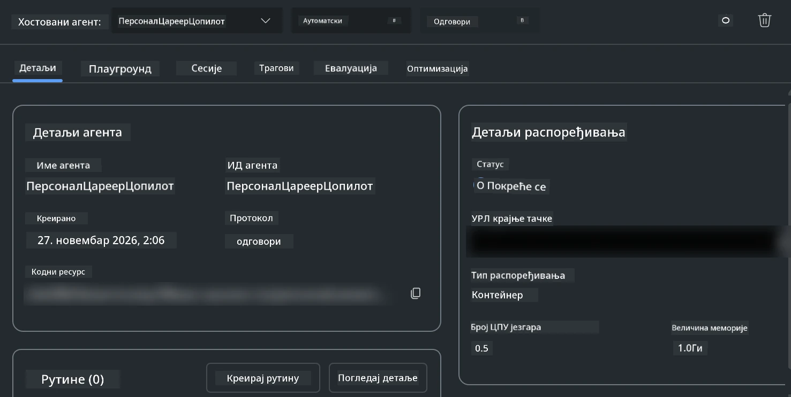

# Модул 7 - Верификација у Плејграунду

⏱️ ~10 мин

У овом модулу тестирате ваш распоређени мулти-агентски ток рада у VS Code и Foundry Порталу, потврђујући да агент понашање исто као при локалном тестирању.

---

## Зашто поново тестирати након распоређивања?

Хостовано окружење се разликује од локалног на неколико важних начина:

| | Локално | Хостовано |
|--|-------|--------|
| **Идентитет** | Ваш лични пријава (`DefaultAzureCredential`) | Посебан Entra идентитет по агенту (аутоматски провижионован при распоређивању) |
| **Приступна тачка** | `http://localhost:8088/responses` | URL управљан Foundry Agent Service-ом |
| **Мрежа** | Ваш уређај → Azure OpenAI + MCP | Azure мрежа (мања латенција) |

Погрешно подешене променљиве окружења, RBAC проблем, или блокиран излазни позив MCP-а би се прво појавили овде.

---

## Опција А: Тестирање у VS Code Плејграунду (препоручује се прво)

### Корак 1: Навигирајте до вашег хостованог агента

1. Кликните на **Foundry Toolkit** иконицу у Activity Bar-у.
2. Испод **My Resources**, кликните на **Agents** у вашем пројекту, изаберите картицу **Hosted Agent**, затим кликните на вашег агента.



### Корак 2: Проверите статус

1. Плејграунд хостованог агента се отвара на картици **Details**.
2. Потврдите да је **Deployment Details** → **Status** **активан** (VS Code може приказати "Running" или "Started" - обоје означавају спремно стање).

### Корак 3: Отворите Плејграунд

1. Кликните на картицу **Playground**.
2. Отвориће се прозор за ћаскање у VS Code табу.

### Корак 4: Покрените ваш сmоке тест

Покрените три сmоке теста у наставку - Тест 1 користи упит из [Модула 5](05-test-locally.md). Унесите сваку поруку у улазни оквир Плејграунда и притисните **Send** (или **Enter**).

#### Тест 1 - Потпуна биографија + опис посла (стандардни ток)

Налепите потпуни упит за биографију + опис посла из Модула 5, Тест 1 (Џејн Доу + Виши облачни инжењер у Contoso Ltd).

**Очекује се:**
- Оцена погодности са детаљним рачунањем (скала од 100 поена)
- Одељак Подударајућих вештина
- Одељак Немајућих вештина
- **Једна картица непокривене вештине по вештини коју недостаје** са Microsoft Learn URL адресама
- План учења са временском линијом

#### Тест 2 - Брзи кратки тест (минимални унос)

```
RESUME: 3 years Python developer, knows Django and PostgreSQL, no cloud experience.

JOB: Cloud DevOps Engineer requiring AWS, Kubernetes, Terraform, CI/CD. 5 years needed.
```

**Очекује се:**
- Нижа оцена погодности (< 40)
- Искрена процена са фазним планом учења
- Више картица непокривених вештина (AWS, Kubernetes, Terraform, CI/CD, празнина у искуству)

#### Тест 3 - Кандидат са високом погодности

```
RESUME:
10 years Azure Cloud Architect. AZ-305 certified. Expert in AKS, Terraform, Azure DevOps, 
Azure Functions, Helm, Prometheus, Grafana, Python, Go. Led platform team of 8.

JOB:
Senior Cloud Engineer. Required: AKS, Terraform, Azure DevOps, Python. Preferred: Helm, Go.
5+ years experience. AZ-305 preferred.
```

**Очекује се:**
- Висока оцена погодности (≥ 80)
- Фокус на припреми за интервју и финализацији
- Понеколи или без картица непокривених вештина
- Кратка временска линија усмерена на припрему

### Корак 5: Упоредите са локалним резултатима

Отворите ваше белешке или прегледач таб из Модула 5 где сте сачували локалне одговоре. За сваки тест:

- Да ли одговор има **иста структура** (оцена погодности, картице непокривених вештина, план)?
- Да ли прати **исту шему бодовања** (расподела од 100 поена)?
- Да ли су **Microsoft Learn URL адресе** још увек присутне у картицама непокривених вештина?
- Да ли постоји **једна картица непокривене вештине по вештини која недостаје** (не скраћено)?

> **Мање разлике у формулацији су нормалне** - модел није детерминистички. Фокусирајте се на структуру, конзистентност бодовања и коришћење MCP алата.

---

## Опција Б: Тестирање у Foundry Порталу

Портал [Foundry](https://ai.azure.com) пружа веб засновану платформу корисну за дељење са тимом или заинтересованим странама.

### Корак 1: Отворите Foundry портал

1. Отворите свој прегледач и идите на [https://ai.azure.com](https://ai.azure.com).
2. Пријавите се са истим Azure налогом који сте користили током целе радионице.

### Корак 2: Идите на свој пројекат

1. На почетној страни потражите **Недавни пројекти** на левој страни.
2. Кликните на назив свог пројекта (нпр. `workshop-agents`).
3. Ако га не видите, кликните на **Сви пројекти** и потражите га.

### Корак 3: Пронађите свог распоређеног агента

1. У левом навигационом менију пројекта кликните на **Изградња** → **Агенти** (или потражите одељак **Агенти**).
2. Требало би да видите листу агената. Пронађите свог распоређеног агента (нпр. `PersonalCareerCopilot`).
3. Кликните на име агента да бисте отворили страницу са детаљима.

### Корак 4: Отворите Playground

1. Страница агента се отвара на картици **Playground**. Ако је изабрана друга картица, кликните на **Playground**.
2. Проверите да ли селектор **Верзија** горе десно приказује верзију коју сте управо распоредили.
3. Отвориће се интерфејс за ћаскање.

### Корак 5: Покрените исте тестове

Поновите све 3 теста из одељка о Playground-у за VS Code изнад. Упоредите сваки одговор са локалним резултатима (Модул 5) и резултатима из Playground-а за VS Code (Опција А изнад).

---

## Верификација специфична за више агената

Осим основне тачности, проверите ове понашања специфична за више агената:

### Извођење MCP алата

| Провера | Како проверити | Услови за пролаз |
|-------|---------------|----------------|
| MCP позиви успехују | Картице са празнинама садрже `learn.microsoft.com` URL адресе | Праве URL адресе, а не поруке за резервне опције |
| Више MCP позива | Свака празнина високог/средњег приоритета има ресурсе | Не само прва картица са празнином |
| Резервна опција MCP ради | Ако URL адресе недостају, провери да ли постоји резервни текст | Агент и даље производи картице са празнинама (са или без URL адреса) |

### Координација агената

| Провера | Како проверити | Услови за пролаз |
|-------|---------------|----------------|
| Сва 4 агента су радили | Излаз садржи бодове приспособљености И картице са празнинама | Бодови долазе од MatchingAgent, картице од GapAnalyzer |
| Секвенцијално извођење | Време одговора је разумно (< 2 мин) | Ако је > 3 мин, проверите грешке у терминалном запису |
| Интегритет тока података | Картице са празнинама реферишу вештине из извештаја о упаривању | Нема халуцинација вештина које нису у описи посла |

---

## Рубрика за валидацију

Користите ову рубрику да бисте проценили понашање свог мулти-агентног радног процеса на хостингу:

| # | Критеријум | Услов за пролаз | Пролаз? |
|---|----------|---------------|-------|
| 1 | **Функционална исправност** | Агент одговара на резиме + опис посла са бодом приспособљености и анализом празнина | |
| 2 | **Конзистентност бодовања** | Бод приспособљености користи скалу од 100 поена са рачунском поделом | |
| 3 | **Комплетност картица са празнинама** | Једна картица по недостајућој вештини (није скраћена или комбинована) | |
| 4 | **Интеграција MCP алата** | Картице са празнинама укључују праве Microsoft Learn URL адресе | |
| 5 | **Структурна конзистентност** | Структура излаза је иста између локалних и хостованих покретања | |
| 6 | **Време одговора** | Хостовани агент одговара у року од 2 минута за потпуну процену | |
| 7 | **Нема грешака** | Нема HTTP 500 грешака, истеклог времена или празних одговора | |

> „Прошао“ значи да су свих 7 критеријума испуњено за сва 3 теста у најмање једном окружењу за пробу (VS Code или Портал).

---

## Решавање проблема са окружењем за пробу

| Симптом | Вероватни узрок | Поправка |
|---------|-------------|-----|
| Playground се не учитава | Контејнер није у `active` стању | Вратите се на [Модул 6](06-deploy-to-foundry.md), проверите статус распореда. Сачекајте ако је `creating` |
| Агент враћа празан одговор | Неслагање имена распореда модела | Проверите да ли се `agent.yaml` → `environment_variables` → `AZURE_AI_MODEL_DEPLOYMENT_NAME` поклапа са вашим распоредом модела |
| Агент враћа поруку о грешци | [RBAC](https://learn.microsoft.com/azure/foundry/concepts/rbac-foundry) дозвола недостаје | Доделите **[Foundry User](https://aka.ms/foundry-ext-project-role)** (раније Azure AI User) у оквиру пројекта |
| Нема Microsoft Learn URL адреса у gap картицама | MCP излаз блокиран или MCP сервер недоступан | Проверите да ли контејнер може да приступи `learn.microsoft.com`. Види [Module 8](08-troubleshooting.md) |
| Само 1 gap картица (скраћено) | Упутства GapAnalyzer-а немају "CRITICAL" блок | Прегледајте [Module 3, Step 2.4](03-configure-agents.md) |
| Оцена уклапања знатно различита од локалне | Различит модел или упутства имплементирани | Упоредите `agent.yaml` env променљиве са локалним `.env`. Поново поставите по потреби |
| "Агент није пронађен" у порталу | Дистрибуција још у току или није успела | Сачекајте 2 минута, освежите страницу. Ако и даље недостаје, поново имплементирајте са [Модул 6](06-deploy-to-foundry.md) |

---

### Контролна тачка

- [ ] Тестирано агент у VS Code Playground - сва 3 смок теста су прошла
- [ ] Тестирано агент у [Foundry Portal](https://ai.azure.com) Playground - сва 3 смок теста су прошла
- [ ] Одговори су структурно у складу са локалним тестирањем (fit score, gap cards, roadmap)
- [ ] Microsoft Learn URL-ови су присутни у gap cards (MCP алат ради у хостираном окружењу)
- [ ] Једна gap card по недостајућој вештини (без скраћивања)
- [ ] Нема грешака или истекања времена током тестирања
- [ ] Завршена валидирајућа рубрика (сва 7 критеријума је испуњено)

---

**Претходно:** [06 - Deploy to Foundry](06-deploy-to-foundry.md) · **Следеће:** [08 - Troubleshooting →](08-troubleshooting.md)

---

<!-- CO-OP TRANSLATOR DISCLAIMER START -->
**Изјава о одрицању одговорности**:
Овај документ је преведен коришћењем услуге за аутоматски превод [Co-op Translator](https://github.com/Azure/co-op-translator). Иако тежимо тачности, имајте у виду да аутоматски преводи могу садржати грешке или нетачности. Оригинални документ на његовом изворном језику треба сматрати ауторитативним извором. За критичне информације препоручује се професионални људски превод. Нисмо одговорни за било каква неспоразума или погрешна тумачења која произилазе из коришћења овог превода.
<!-- CO-OP TRANSLATOR DISCLAIMER END -->