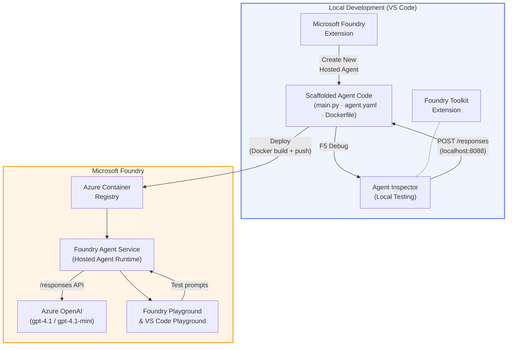

# Foundry Toolkit + Foundry Hosted Agents Workshop

[](https://www.python.org/)
[](https://github.com/microsoft/agents)
[](https://learn.microsoft.com/azure/foundry/agents/concepts/hosted-agents)
[](https://ai.azure.com/)
[](https://learn.microsoft.com/azure/ai-services/openai/)
[](https://learn.microsoft.com/cli/azure/install-azure-cli)
[](https://learn.microsoft.com/azure/developer/azure-developer-cli/install-azd)
[](https://www.docker.com/)
[](https://marketplace.visualstudio.com/items?itemName=ms-windows-ai-studio.windows-ai-studio)
[](../../LICENSE)

Bygg, testa och distribuera AI-agenter till **Microsoft Foundry Agent Service** som **Hosted Agents** - helt från VS Code med hjälp av **Microsoft Foundry-tillägget** och **Foundry Toolkit**.

> **Hosted Agents är för närvarande i förhandsgranskning.** Stödda regioner är begränsade - se [regiontillgänglighet](https://learn.microsoft.com/azure/foundry/agents/concepts/hosted-agents#region-availability).

> Mappen `agent/` inuti varje labb är **automatiskt scaffoldad** av Foundry-tillägget - du anpassar sedan koden, testar lokalt och distribuerar.

### 🌐 Stöd för flera språk

#### Stöds via GitHub Action (Automatiserat & Alltid uppdaterat)

<!-- CO-OP TRANSLATOR LANGUAGES TABLE START -->
[Arabiska](../ar/README.md) | [Bengaliska](../bn/README.md) | [Bulgariska](../bg/README.md) | [Burmesiska (Myanmar)](../my/README.md) | [Kinesiska (förenklad)](../zh-CN/README.md) | [Kinesiska (traditionell, Hongkong)](../zh-HK/README.md) | [Kinesiska (traditionell, Macau)](../zh-MO/README.md) | [Kinesiska (traditionell, Taiwan)](../zh-TW/README.md) | [Kroatiska](../hr/README.md) | [Tjeckiska](../cs/README.md) | [Danska](../da/README.md) | [Nederländska](../nl/README.md) | [Estniska](../et/README.md) | [Finska](../fi/README.md) | [Franska](../fr/README.md) | [Tyska](../de/README.md) | [Grekiska](../el/README.md) | [Hebreiska](../he/README.md) | [Hindi](../hi/README.md) | [Ungerska](../hu/README.md) | [Indonesiska](../id/README.md) | [Italienska](../it/README.md) | [Japanska](../ja/README.md) | [Kannada](../kn/README.md) | [Khmer](../km/README.md) | [Koreanska](../ko/README.md) | [Litauiska](../lt/README.md) | [Malajiska](../ms/README.md) | [Malayalam](../ml/README.md) | [Marathi](../mr/README.md) | [Nepalesiska](../ne/README.md) | [Nigeriansk Pidgin](../pcm/README.md) | [Norska](../no/README.md) | [Persiska (Farsi)](../fa/README.md) | [Polska](../pl/README.md) | [Portugisiska (Brasilien)](../pt-BR/README.md) | [Portugisiska (Portugal)](../pt-PT/README.md) | [Punjabi (Gurmukhi)](../pa/README.md) | [Rumänska](../ro/README.md) | [Ryska](../ru/README.md) | [Serbiska (kyrilliska)](../sr/README.md) | [Slovakiska](../sk/README.md) | [Slovenska](../sl/README.md) | [Spanska](../es/README.md) | [Swahili](../sw/README.md) | [Svenska](./README.md) | [Tagalog (filippinska)](../tl/README.md) | [Tamil](../ta/README.md) | [Telugu](../te/README.md) | [Thailändska](../th/README.md) | [Turkiska](../tr/README.md) | [Ukrainska](../uk/README.md) | [Urdu](../ur/README.md) | [Vietnamesiska](../vi/README.md)

> **Föredrar du att klona lokalt?**
>
> Detta repository inkluderar 50+ språköversättningar vilket avsevärt ökar nedladdningsstorleken. För att klona utan översättningar, använd sparse checkout:
>
> **Bash / macOS / Linux:**
> ```bash
> git clone --filter=blob:none --sparse https://github.com/microsoft-foundry/Foundry_Toolkit_for_VSCode_Lab.git
> cd Foundry_Toolkit_for_VSCode_Lab
> git sparse-checkout set --no-cone '/*' '!translations' '!translated_images'
> ```
>
> **CMD (Windows):**
> ```cmd
> git clone --filter=blob:none --sparse https://github.com/microsoft-foundry/Foundry_Toolkit_for_VSCode_Lab.git
> cd Foundry_Toolkit_for_VSCode_Lab
> git sparse-checkout set --no-cone "/*" "!translations" "!translated_images"
> ```
>
> Detta ger dig allt du behöver för att slutföra kursen med en mycket snabbare nedladdning.
<!-- CO-OP TRANSLATOR LANGUAGES TABLE END -->

---

## Arkitektur



**Flöde:** Foundry-tillägget scaffoldar agenten → du anpassar kod & instruktioner → testar lokalt med Agent Inspector → distribuerar till Foundry (Docker-image pushas till ACR) → verifierar i Playground.

---

## Vad du kommer att bygga

| Labb | Beskrivning | Status |
|-----|-------------|--------|
| **Lab 01 - Enkel agent** | Bygg **"Explain Like I'm an Executive" Agent**, testa den lokalt och distribuera till Foundry | ✅ Tillgänglig |
| **Lab 02 - Arbetsflöde med flera agenter** | Bygg **"Resume → Job Fit Evaluator"** - 4 agenter samarbetar för att bedöma CV:ns lämplighet och generera en lärandeplan | ✅ Tillgänglig |

---

## Möt Executive-agenten

I denna workshop bygger du **"Explain Like I'm an Executive" Agent** - en AI-agent som tar komplicerat tekniskt jargong och översätter det till lugna, styrelserumsredo sammanfattningar. För ärligt talat, ingen i ledningen vill höra om "thread pool exhaustion caused by synchronous calls introduced in v3.2."

Jag byggde denna agent efter ett par för många incidenter där min perfekt utformade post-mortem fick svaret: *"Så... är webbplatsen nere eller inte?"*

### Hur det fungerar

Du matar den med en teknisk uppdatering. Den ger tillbaka en ledningssammanfattning - tre punkter, inget jargong, inga stacktraces, ingen existentiell ångest. Bara **vad som hände**, **affärspåverkan**, och **nästa steg**.

### Se det i aktion

**Du säger:**
> "The API latency increased due to thread pool exhaustion caused by synchronous calls introduced in v3.2."

**Agenten svarar:**

> **Ledningssammanfattning:**
> - **Vad som hände:** Efter den senaste releasen blev systemet långsammare.
> - **Affärspåverkan:** Vissa användare upplevde förseningar vid användning av tjänsten.
> - **Nästa steg:** Ändringen har rullats tillbaka och en fix förbereds innan omdistribuering.

### Varför denna agent?

Det är en supersimpel, enkelfunktionsagent - perfekt för att lära sig arbetsflödet för hostade agenter från början till slut utan att fastna i komplexa verktygskedjor. Och ärligt talat? Varje utvecklingsteam skulle kunna ha nytta av en sådan.

---

## Workshopens struktur

```
📂 Foundry_Toolkit_for_VSCode_Lab/
├── 📄 README.md                      ← You are here
└── 📂 workshop/
    ├── 📂 lab01-single-agent/        ← Full lab: docs + agent code
    │   ├── README.md                 ← Hands-on lab instructions
    │   ├── 📂 docs/                  ← Step-by-step tutorial modules
    │   │   ├── 00-prerequisites.md
    │   │   ├── 01-setup.md
    │   │   ├── 02-create-hosted-agent.md
    │   │   ├── 03-configure-and-code.md
    │   │   ├── 04-test-locally.md
    │   │   ├── 05-deploy-to-foundry.md
    │   │   ├── 06-verify-in-playground.md
    │   │   ├── 07-summary.md
    │   │   └── 08-troubleshooting.md
    │   └── 📂 agent/                 ← Reference solution (auto-scaffolded by Foundry extension)
    │       ├── agent.yaml
    │       ├── Dockerfile
    │       ├── main.py
    │       └── requirements.txt
    └── 📂 lab02-multi-agent/         ← Resume → Job Fit Evaluator
        ├── README.md                 ← Hands-on lab instructions (end-to-end)
        ├── 📂 docs/                  ← Step-by-step tutorial modules
        │   ├── 00-prerequisites.md
        │   ├── 01-understand-multi-agent.md
        │   ├── 02-scaffold-multi-agent.md
        │   ├── 03-configure-agents.md
        │   ├── 04-orchestration-patterns.md
        │   ├── 05-test-locally.md
        │   ├── 06-deploy-to-foundry.md
        │   ├── 07-verify-in-playground.md
        │   └── 08-troubleshooting.md
        └── 📂 PersonalCareerCopilot/ ← Reference solution (multi-agent workflow)
            ├── agent.yaml
            ├── Dockerfile
            ├── main.py
            └── requirements.txt
```

> **Obs:** Mappen `agent/` inuti varje labb är vad **Microsoft Foundry-tillägget** genererar när du kör `Microsoft Foundry: Create a New Hosted Agent` från Command Palette. Filerna anpassas sedan med din agents instruktioner, verktyg och konfiguration. Lab 01 guidar dig igenom att återskapa detta från grunden.

---

## Komma igång

### 1. Klona repositoryt

```bash
git clone https://github.com/microsoft-foundry/Foundry_Toolkit_for_VSCode_Lab.git
cd Foundry_Toolkit_for_VSCode_Lab
```

### 2. Ställ in en Python-virtuell miljö

```bash
python -m venv venv
```

Aktivera den:

- **Windows (PowerShell):**
  ```powershell
  .\venv\Scripts\Activate.ps1
  ```
- **macOS / Linux:**
  ```bash
  source venv/bin/activate
  ```

### 3. Installera beroenden

```bash
pip install -r workshop/lab01-single-agent/agent/requirements.txt
```

### 4. Konfigurera miljövariabler

Kopiera exempel `.env`-filen inne i agentmappen och fyll i dina värden:

```bash
cp workshop/lab01-single-agent/agent/.env.example workshop/lab01-single-agent/agent/.env
```

Redigera `workshop/lab01-single-agent/agent/.env`:

```env
AZURE_AI_PROJECT_ENDPOINT=https://<your-account>.services.ai.azure.com/api/projects/<your-project>
AZURE_AI_MODEL_DEPLOYMENT_NAME=<your-model-deployment-name>
```

### 5. Följ workshopens labb

Varje labb är fristående med sina egna moduler. Börja med **Lab 01** för att lära dig grunderna, och gå sedan vidare till **Lab 02** för arbetsflöden med flera agenter.

#### Lab 01 - Enkel agent ([fullständiga instruktioner](workshop/lab01-single-agent/README.md))

| # | Modul | Länk |
|---|--------|------|
| 1 | Läs förutsättningarna | [00-prerequisites.md](workshop/lab01-single-agent/docs/00-prerequisites.md) |
| 2 | Installera Foundry Toolkit & Foundry-tillägget | [01-setup.md](workshop/lab01-single-agent/docs/01-setup.md) |
| 3 | Skapa ett Foundry-projekt | [01-setup.md](workshop/lab01-single-agent/docs/01-setup.md) |
| 4 | Skapa en hostad agent | [02-create-hosted-agent.md](workshop/lab01-single-agent/docs/02-create-hosted-agent.md) |
| 5 | Konfigurera instruktioner & miljö | [03-configure-and-code.md](workshop/lab01-single-agent/docs/03-configure-and-code.md) |
| 6 | Testa lokalt | [04-test-locally.md](workshop/lab01-single-agent/docs/04-test-locally.md) |
| 7 | Distribuera till Foundry | [05-deploy-to-foundry.md](workshop/lab01-single-agent/docs/05-deploy-to-foundry.md) |
| 8 | Verifiera i playground | [06-verify-in-playground.md](workshop/lab01-single-agent/docs/06-verify-in-playground.md) |
| 9 | Felsökning | [08-troubleshooting.md](workshop/lab01-single-agent/docs/08-troubleshooting.md) |

#### Lab 02 - Arbetsflöde med flera agenter ([fullständiga instruktioner](workshop/lab02-multi-agent/README.md))

| # | Modul | Länk |
|---|--------|------|
| 1 | Förutsättningar (Lab 02) | [00-prerequisites.md](workshop/lab02-multi-agent/docs/00-prerequisites.md) |
| 2 | Förstå arkitekturen för flera agenter | [01-understand-multi-agent.md](workshop/lab02-multi-agent/docs/01-understand-multi-agent.md) |
| 3 | Skapa stommen för projektet med flera agenter | [02-scaffold-multi-agent.md](workshop/lab02-multi-agent/docs/02-scaffold-multi-agent.md) |
| 4 | Konfigurera agenter & miljö | [03-configure-agents.md](workshop/lab02-multi-agent/docs/03-configure-agents.md) |
| 5 | Orkestreringsmönster | [04-orchestration-patterns.md](workshop/lab02-multi-agent/docs/04-orchestration-patterns.md) |
| 6 | Testa lokalt (flera agenter) | [05-test-locally.md](workshop/lab02-multi-agent/docs/05-test-locally.md) |
| 7 | Distribuera till Foundry | [06-deploy-to-foundry.md](workshop/lab02-multi-agent/docs/06-deploy-to-foundry.md) |
| 8 | Verifiera i playground | [07-verify-in-playground.md](workshop/lab02-multi-agent/docs/07-verify-in-playground.md) |
| 9 | Felsökning (flera agenter) | [08-troubleshooting.md](workshop/lab02-multi-agent/docs/08-troubleshooting.md) |

---

## Underhållare

<table>
<tr>
    <td align="center"><a href="https://github.com/ShivamGoyal03">
        <br />
        <sub><b>Shivam Goyal</b></sub>
    </a><br />
    </td>
</tr>
</table>

---

## Nödvändiga behörigheter (snabbreferens)

| Scenario | Krävd roller |
|----------|---------------|
| Skapa nytt Foundry-projekt | **Azure AI Owner** på Foundry-resursen |
| Distribuera till befintligt projekt (nya resurser) | **Azure AI Owner** + **Contributor** på prenumerationen |
| Distribuera till fullt konfigurerat projekt | **Reader** på kontot + **Azure AI User** på projektet |

> **Viktigt:** Azure `Owner` och `Contributor`-roller inkluderar endast *hanterings*behörigheter, inte *utvecklings* (dataåtgärds)behörigheter. Du behöver **Azure AI User** eller **Azure AI Owner** för att bygga och distribuera agenter.

---

## Referenser

- [Snabbstart: Distribuera din första hostade agent (VS Code)](https://learn.microsoft.com/azure/foundry/agents/quickstarts/quickstart-hosted-agent)
- [Vad är hostade agenter?](https://learn.microsoft.com/azure/foundry/agents/concepts/hosted-agents)
- [Skapa arbetsflöden för hostade agenter i VS Code](https://learn.microsoft.com/azure/foundry/agents/how-to/vs-code-agents-workflow-pro-code)
- [Distribuera en hostad agent](https://learn.microsoft.com/azure/foundry/agents/how-to/deploy-hosted-agent)
- [RBAC för Microsoft Foundry](https://learn.microsoft.com/azure/foundry/concepts/rbac-foundry)
- [Exempel på Architecture Review Agent](https://github.com/Azure-Samples/agent-architecture-review-sample) - Verklig hostad agent med MCP-verktyg, Excalidraw-diagram och dubbel distribution

---


## Licens

[MIT](../../LICENSE)

---

<!-- CO-OP TRANSLATOR DISCLAIMER START -->
**Ansvarsfriskrivning**:
Detta dokument har översatts med hjälp av AI-översättningstjänsten [Co-op Translator](https://github.com/Azure/co-op-translator). Även om vi strävar efter noggrannhet, var vänlig notera att automatiska översättningar kan innehålla fel eller brister. Det ursprungliga dokumentet på dess modersmål bör betraktas som den auktoritativa källan. För kritisk information rekommenderas professionell mänsklig översättning. Vi ansvarar inte för några missförstånd eller feltolkningar som uppstår till följd av användningen av denna översättning.
<!-- CO-OP TRANSLATOR DISCLAIMER END -->
