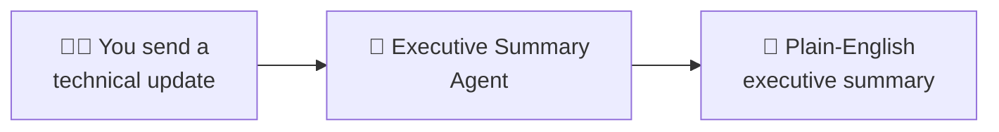

# Modul 0 - Introduktion

⏱️ ~10 min

> [!WARNING]
> **Förhandsgranskning & Begränsningar:** [Hosted Agents](https://learn.microsoft.com/azure/foundry/agents/concepts/hosted-agents) är för närvarande i **offentlig förhandsgranskning** - rekommenderas inte för produktionsarbetsbelastningar. Var medveten om följande:
> - **Stödda regioner är begränsade** - kontrollera [regiontillgänglighet](https://learn.microsoft.com/azure/foundry/agents/concepts/hosted-agents#region-availability) innan du skapar resurser. Om du väljer en region som inte stöds kommer distributionen att misslyckas.
> - Paketet `agent-framework-foundry-hosting` är förhandsversion - API:er kan ändras mellan versioner.
> - Skala begränsningar: hostade agenter stöder 0–5 repliker (inklusive skala till noll).
> - Vissa funktioner som visas i denna workshop kan ändras när tjänsten går mot GA.

## Vad du kommer att bygga

I denna workshop kommer du att bygga en **"Förklara som om jag vore en chef"**-agent - en hostad AI-agent som tar komplexa tekniska uppdateringar och omskriver dem till enkla sammanfattningar på engelska för chefer.

**Agenten använder:**
- **Microsoft Agent Framework** - för agentlogik och struktur
- **Foundry Toolkit för VS Code** - för att skissa upp, testa lokalt och distribuera
- **En AI-modell** (t.ex. `gpt-4.1-mini/gpt-5-mini`) - för att generera sammanfattningarna

I slutet av denna labb kommer du att ha en fungerande agent som du kan testa lokalt via Agent Inspector, och eventuellt distribuera i molnet.

---

## Vad är hostade agenter?

En **hostad agent** är en AI-agent som körs som en hanterad tjänst i Microsoft Foundry. Istället för att hantera din egen infrastruktur paketerar du din agentkod i en container och Foundry sköter skalning, hosting och exponering via en standard HTTP-endpoint.

| Begrepp | Vad det betyder |
|---------|--------------|
| **Agent** | Din Python-kod som tar emot ett användarmeddelande, anropar en AI-modell och returnerar ett strukturerat svar |
| **Hostad** | Foundry kör din container åt dig - inga virtuella maskiner, ingen Kubernetes, ingen infrastruktur att hantera |
| **Svarprotokoll** | En standard HTTP-API (`POST /responses`) som vilken klient som helst kan anropa för att interagera med din agent |
| **Agent Inspector** | En lokal test-UI (inbyggd i Foundry Toolkit) som låter dig chatta med din agent innan distribution |

I denna workshop går du från noll till en fullständigt hostad agent - eller stannar vid lokal testning om du föredrar det.

---

## Välj din väg

> ⚠️ **Välj en väg innan du fortsätter.** Ditt val bestämmer vilka verktyg du ska installera och vilka moduler som gäller. Du kan byta från väg B → väg A senare om du skaffar en prenumeration.

<strong>🅰️ Väg A - Azure-moln (kräver Azure-prenumeration)</strong>

| | Detaljer |
|---|---|
| **Vem är detta för?** | Du har en aktiv Azure-prenumeration och kan skapa Foundry-resurser |
| **Modell** | Azure OpenAI via Foundry (t.ex. `gpt-4.1-mini/gpt-5-mini`) |
| **Moduler som täcks** | Alla moduler (00–07) |
| **Distribuera till molnet?** | ✅ Ja - fullständig end-to-end-distribution |

<strong>🅱️ Väg B - Lokalt / gratisnivå (ingen Azure-prenumeration behövs)</strong>

| | Detaljer |
|---|---|
| **Vem är detta för?** | MVP:s, studenter eller någon utan Azure-åtkomst |
| **Modell** | **Foundry Local** (gratis, körs på din dator) |
| **Moduler som täcks** | Moduler 00–04 (hoppa över distribution & molnverifiering) |
| **Distribuera till molnet?** | ❌ Nej - endast lokal testning via Agent Inspector |

---

## Alla vägar: Krävs verktyg

Installera varje verktyg nedan. Efter installation, verifiera att det fungerar genom att köra kontrollkommandot.

| # | Verktyg | Version | Installera | Verifiera (Förväntat resultat) |
|---|---------|---------|----------|------------------------------|
| 1 | **Visual Studio Code** | Senaste | [code.visualstudio.com](https://code.visualstudio.com/) | Öppnas utan fel |
| 2 | **Python** | 3.12 eller högre | [python.org/downloads](https://www.python.org/downloads/) | `python --version` $\rightarrow$ `Python 3.12.x` |
| 3 | **Foundry Toolkit för VS Code** | Senaste | Tilläggs-ID: `ms-windows-ai-studio.windows-ai-studio` | Foundry-ikon i aktivitetsfältet |
| 4 | **Python-tillägg för VS Code** | Senaste | Tilläggs-ID: `ms-python.python` | Installerat i tilläggspanelen |

> [!TIP]
> **Proffstips för installation:**
> - **Python PATH (Windows):** Bocka alltid i **"Lägg till Python i PATH"** på första skärmen i Python-installationen. Utan detta känns inte `python` igen i din terminal.
> - **Flera Python-versioner:** Om du har både Python 3.10 och 3.12 installerade, använd `python3.12 -m venv .venv` för att säkerställa att rätt version används för din virtuella miljö.
> - **Docker WSL 2 (Windows):** Under installationen av Docker Desktop, se till att **WSL 2-backend** är vald. Docker med Hyper-V är långsammare och kan orsaka problem med Foundrys containerbyggen.
> - **Docker startar inte?** Vänta 30–60 sekunder efter att ha startat Docker Desktop. Kör `docker info` - om du får "Cannot connect to the Docker daemon" så håller Docker fortfarande på att starta.
> - **VS Code-tillägg som inte laddas?** Efter installation av tillägg, ladda om fönstret: `Ctrl+Shift+P` → `Developer: Reload Window`.

> **Windows-användare:** Bocka i **"Lägg till Python i PATH"** under Python-installationen.

**Nästa:** [01 - Setup →](01-setup.md)

---

<!-- CO-OP TRANSLATOR DISCLAIMER START -->
**Ansvarsfriskrivning**:
Detta dokument har översatts med hjälp av AI-översättningstjänsten [Co-op Translator](https://github.com/Azure/co-op-translator). Även om vi strävar efter noggrannhet, var vänlig notera att automatiska översättningar kan innehålla fel eller brister. Det ursprungliga dokumentet på dess modersmål bör betraktas som den auktoritativa källan. För kritisk information rekommenderas professionell mänsklig översättning. Vi ansvarar inte för några missförstånd eller feltolkningar som uppstår till följd av användningen av denna översättning.
<!-- CO-OP TRANSLATOR DISCLAIMER END -->