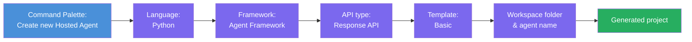
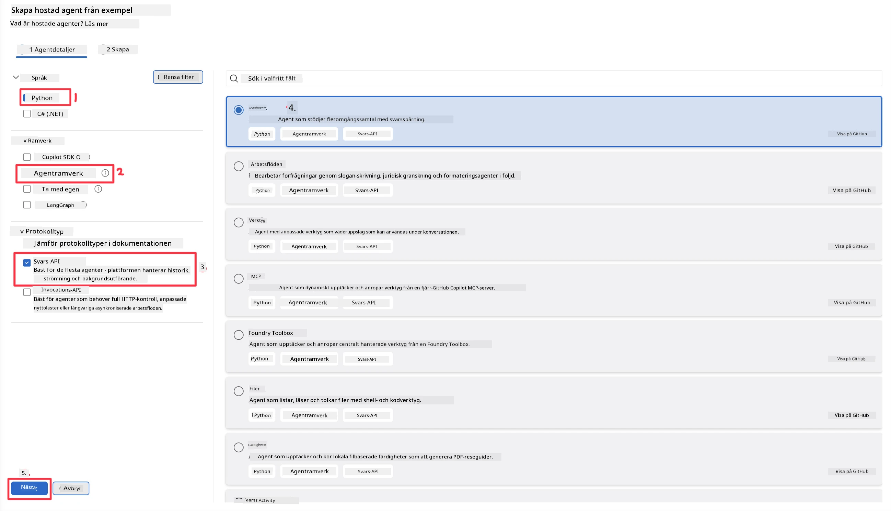
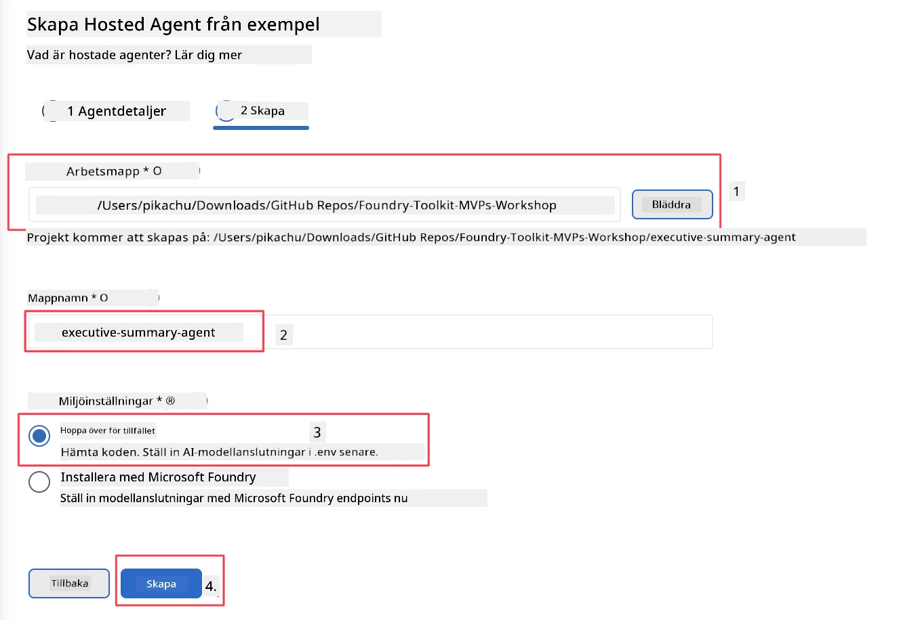

# Modul 2 - Skapa en ny hostad agent

⏱️ ~5 min

I den här modulen använder du Foundry Toolkit för att **skapa en grund för ett hostat agent-projekt**. Grunden genererar hela projektstrukturen - `agent.yaml`, `main.py`, `Dockerfile`, `requirements.txt` och VS Code debugkonfiguration - så att du kan fokusera på att anpassa agentens beteende.

> **Nyckelkoncept:** Mappen `agent/` i denna labb är ett exempel på vad Foundry Toolkit genererar. Du skriver inte dessa filer från grunden.

### Flöde för skapande av grund



---

## Steg 1: Öppna guiden Skapa hostad agent

1. Tryck på `Ctrl+Shift+P` för att öppna **Kommandopaletten**.
2. Skriv: **Foundry Toolkit: Create new Hosted Agent** och välj det.

> **Alternativ: Skapa via Foundry Portal**
> Om du föredrar webbläsaren kan du skapa ditt projekt på [https://ai.azure.com](https://ai.azure.com). När projektet är provisionerat, gå tillbaka till VS Code och använd **Foundry Toolkit**-sidofältet för att ansluta till det.

> **Alternativ:** I Foundry Toolkit-sidofältet, hovra över **Agents** under ditt projekt, klicka på **+**-ikonen, och välj sedan **Create in Code With Template**.

## Steg 2: Välj inställningar



1. I navigations-/alternativdelen till vänster välj följande:

| Meny | Val | Noteringar |
|--------|-----------|-------|
| **Language** | Python | C# stöds också |
| **Framework** | Agent Framework | En enkel startpunkt med Agent Framework SDK |
| **API type** | Response API | `POST /responses` - konverserande, med plattformsstyrd historik |
| **Template** | Basic | En enkel startpunkt med Agent Framework SDK |

2. När du valt, klicka på **Next**



3. I nästa fönster, välj följande:

| Meny | Val | Noteringar |
|--------|-----------|-------|
| **Workspace folder** | Välj en målmapp | t.ex. `/workspace/Foundry_Toolkit_for_VSCode_Lab/` eller en undermapp i detta repo |
| **Agent name** | Ange ett namn | t.ex. `executive-summary-agent` |
| **Environment Setup** | hoppa över setup för nu |  |

Klicka på **create** för att skapa vår agent. En ny mapp skapas med namnet på den hostade agenten.

## Steg 3: Inspektera det genererade projektet

Efter att grunden är skapad, kontrollera att du ser dessa filer i Utforskaren (`Ctrl+Shift+E`):

```
📂 executive-summary-agent/
├── .env                ← Environment variables (placeholders)
├── .vscode/
│   ├── launch.json     ← Debug config (F5 → run + Agent Inspector)
│   └── tasks.json      ← VS Code task definitions
├── agent.yaml          ← Agent definition (kind: hosted)
├── Dockerfile          ← Container config for deployment
├── main.py             ← Agent entry point (your main code)
└── requirements.txt    ← Python dependencies
```

### Förklaringar av viktiga filer

| Fil | Syfte |
|------|---------|
| `agent.yaml` | Deklarerar agenten som `kind: hosted`, mappar miljövariabler, definierar `/responses` protokollet |
| `main.py` | Skapar en `FoundryChatClient` → kapslar in den i en `Agent` med instruktioner → tillhandahåller via `ResponsesHostServer` på port 8088 |
| `Dockerfile` | Använder `python:3.12-slim`, installerar beroenden, exponerar port 8088, kör `main.py` |
| `requirements.txt` | `agent-framework-foundry`, `agent-framework-foundry-hosting`, `mcp`, `debugpy` |

> **Viktigt:** Öppna den scaffoldade agentmappen direkt i VS Code (själva `agent/`-mappen) så att `.vscode/launch.json` och `tasks.json` fungerar korrekt för F5-debuggning.

---

### ✅ Kontrollpunkt

- [ ] Scaffoldat projekt skapat med alla förväntade filer
- [ ] `agent.yaml` visar `kind: hosted` och `protocol: responses`
- [ ] `main.py` importerar `Agent`, `FoundryChatClient`, `ResponsesHostServer`
- [ ] Agentmappen är öppen i VS Code som arbetsmappens rot

---

**Föregående:** [01 - Setup](01-setup.md) · **Nästa:** [03 - Configure & Code →](03-configure-and-code.md)

---

<!-- CO-OP TRANSLATOR DISCLAIMER START -->
**Ansvarsfriskrivning**:
Detta dokument har översatts med hjälp av AI-översättningstjänsten [Co-op Translator](https://github.com/Azure/co-op-translator). Även om vi strävar efter noggrannhet, var vänlig notera att automatiska översättningar kan innehålla fel eller brister. Det ursprungliga dokumentet på dess modersmål bör betraktas som den auktoritativa källan. För kritisk information rekommenderas professionell mänsklig översättning. Vi ansvarar inte för några missförstånd eller feltolkningar som uppstår till följd av användningen av denna översättning.
<!-- CO-OP TRANSLATOR DISCLAIMER END -->