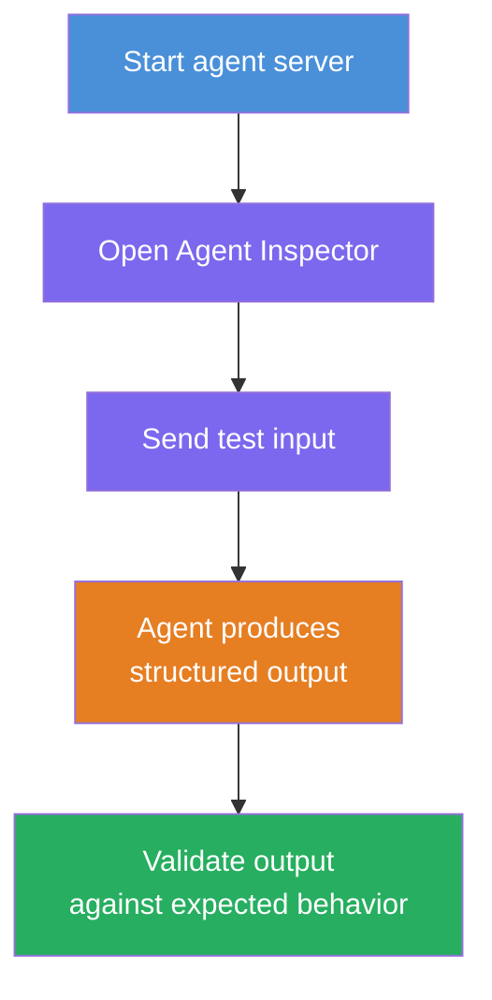
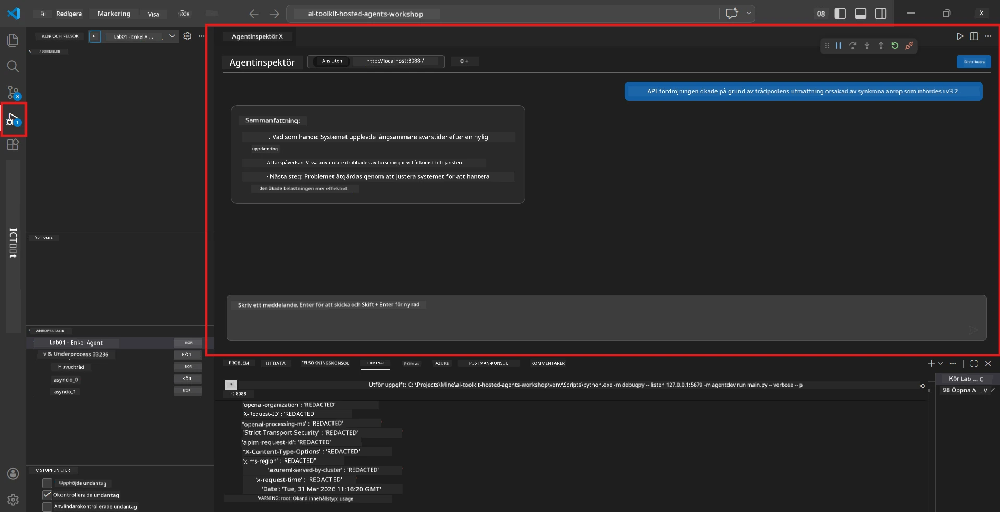
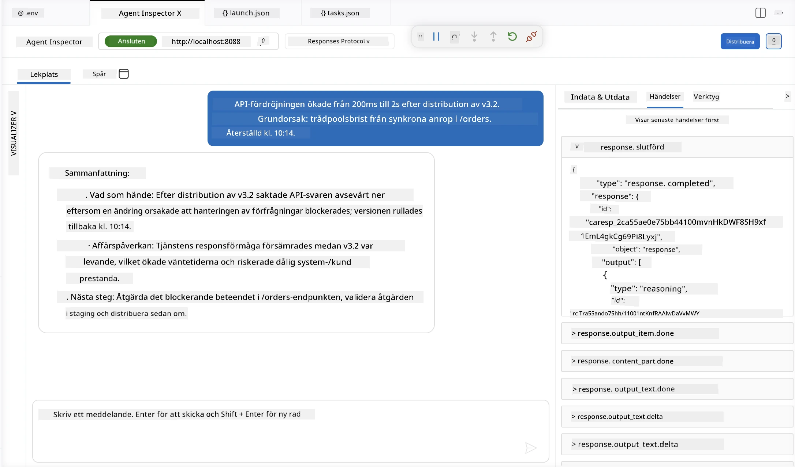

# Modul 4 - Testa Lokalt

⏱️ ~10 min

I denna modul kör du din agent lokalt och validerar att den fungerar korrekt med hjälp av **happy-path funktionella tester**. Du kommer att använda Agent Inspector (visuellt gränssnitt) eller direkta HTTP-anrop för att bekräfta att agenten producerar strukturerade, korrekta svar.

### Lokalt testflöde



---

## Alternativ 1: Tryck på F5 - Felsök med Agent Inspector (rekommenderat)

### Starta felsökaren

1. Öppna mappen **executive-summary-agent/** direkt i VS Code (`File → Open Folder`).
2. Öppna **Kör och Felsök**-panelen (`Ctrl+Shift+D`).
3. Välj **Felsök lokal Agent HTTP-server** från rullgardinsmenyn.
4. Tryck på **F5** (eller klicka på ▶ Starta felsökning).

> ⚠️ **Kritiskt: Välj din Python-tolk**
> Om du får "ModuleNotFoundError" eller felsökaren inte startar måste du tala om för VS Code att använda din virtuella miljö:
  > 1. Tryck på `Ctrl+Shift+P` $\rightarrow$ skriv **Python: Välj tolk**.
  > 2. Välj den tolk som finns i projektets `.venv`-mapp (t.ex., `.\.venv\Scripts\python.exe` på Windows).
  > 3. Starta om felsökningssessionen.
> Om du fortfarande får fel, uppdatera filen `tasks.json` manuellt enligt följande:
  > 1. Navigera till filen `.vscode/tasks.json`
  > 2. Gå till uppgiften märkt: `Run Agent HTTP Server`
  > 3. Uppdatera kommandovärdet som följer:
  >    - **Windows:** `"value": "${workspaceFolder}/.venv/Scripts/python.exe",`
  >    - **macOS/Linux:** `"value": "${workspaceFolder}/.venv/bin/python",`

### Vad som händer

1. HTTP-servern startas på `http://localhost:8088/responses`.
2. **Agentinspektör**-panelen öppnas automatiskt – ett visuellt chattgränssnitt för testning.
3. Brytpunkter aktiveras i `main.py`.

Håll koll på Terminalen för:
```
Starting executive summary hosted agent
Executive agent server running on http://localhost:8088
```

> **Om Agentinspektören inte öppnas:** Tryck `Ctrl+Shift+P` → **Foundry Toolkit: Öppna Agentinspektör**.



> *Skärmbilden kan visa äldre 'AI TOOLKIT'-varumärke från en tidigare version av tillägget.*

---

## Alternativ 2: Testa via Terminal (alternativ)

Starta agenten i en terminal, skicka förfrågningar från en annan:

```bash
# Terminal 1: Start agent
cd executive-summary-agent/
source .venv/bin/activate
python main.py
```

```bash
# Terminal 2: Send test (curl)
curl -sS -X POST http://localhost:8088/responses \
  -H "Content-Type: application/json" \
  -d '{"input": "The API latency increased due to thread pool exhaustion caused by sync calls in v3.2.", "stream": false}'
```

---

## Scenario-tester: Funktionell validering av framgångsrik väg

Kör **alla tre** scenarier nedan. Dessa validerar att din agent producerar korrekt, strukturerad output för realistiska indata.



### Scenario 1: IT-incident – API-latensspik

**Indata:**
```
The API latency increased from 200ms to 2s after deploying v3.2.
Root cause: thread pool starvation from synchronous calls in /orders.
Rolled back at 10:14.
```

**Förväntat beteende:**
- ✅ Följer strukturen för "Executive Summary" (Vad hände / Affärspåverkan / Nästa steg)
- ✅ Ingen teknisk jargong (ingen "thread pool", inget "/orders", ingen "v3.2")
- ✅ Klargör affärspåverkan (t.ex. användare upplevde förseningar)
- ✅ Inkluderar ett nästa steg (t.ex. åtgärd implementerad, övervakning på plats)

---

### Scenario 2: Datapipeline - ETL-fel

**Inmatning:**
```
The nightly ETL job failed because the upstream schema changed. APAC dashboards show missing data.
```

**Förväntat beteende:**
- ✅ Sammanfattar datauppdateringsfelet på enkelt språk
- ✅ Nämner påverkan på APAC-instrumentpanelen
- ✅ Inkluderar ett nästa steg för åtgärd
- ✅ NÄMNER INTE "ETL", "schema" eller andra tekniska termer

---

### Scenario 3: Säkerhet - Exponerad inloggningsuppgift

**Inmatning:**
```
Static analysis flagged a hardcoded secret in the repository.
The secret may have been exposed in commit history.
```

**Förväntat beteende:**
- ✅ Beskriver ett inloggnings-/säkerhetsproblem på ett ledningsvänligt språk
- ✅ Påpekar potentiell risk (obehörig åtkomst)
- ✅ Anger åtgärd (uppdatering av inloggningsuppgifter, granskning)
- ✅ INNEHÅLLER INTE termer som "statisk analys", "commit-historik" eller "hårdkodad"

---

## Valideringskriterier

För varje scenario, kontrollera:

| # | Kriterium | Godkänd villkor |
|---|----------|---------------|
| 1 | **Struktur** | Svaret använder "Executive Summary"-format med alla tre punkter |
| 2 | **Enkelt språk** | Ingen teknisk jargong som en ledare inte skulle förstå |
| 3 | **Noggrannhet** | Sammanfattningen speglar inmatningen - inga påhittade detaljer |
| 4 | **Korthet** | Svaret är under 100 ord |
| 5 | **Nästa steg** | En tydlig åtgärd eller mildrande åtgärd anges |

---

## Felsökningstips

| Problem | Lösning |
|-------|-----|
| Agent startar inte | Kontrollera `.env`-värden, verifiera att venv är aktiverad, kör `pip install -r requirements.txt` |
| Tomt eller generiskt svar | Granska instruktionerna i `main.py` - säkerställ att outputformat är specificerat |
| Svaret innehåller jargong | Stärk reglerna för "ta bort tekniska termer" i instruktionerna |
| Agent Inspector öppnas inte | `Ctrl+Shift+P` → **Foundry Toolkit: Öppna Agent Inspector** |
| Modellfel i Terminal | Kontrollera att `AZURE_AI_MODEL_DEPLOYMENT_NAME` matchar exakt (skiftlägeskänsligt) |

---

### ✅ Kontrollpunkt

- [ ] Agent startar lokalt utan fel
- [ ] Agent Inspector öppnas och visar ett chattgränssnitt (om F5 används)
- [ ] **Scenario 1** (IT-incident) - strukturerad Executive Summary, ingen jargong
- [ ] **Scenario 2** (datapipeline) - relevant sammanfattning med affärspåverkan
- [ ] **Scenario 3** (säkerhetsvarning) - lämplig riskkommunikation
- [ ] Alla svar följer den definierade utdata-strukturen

> **Spara dina svar** (kopiera eller skärmdumpa) - du kommer jämföra dem med molnresultat i Modul 06.

---

**Föregående:** [03 - Configure & Code](03-configure-and-code.md) · **Nästa:** [05 - Deploy to Foundry →](05-deploy-to-foundry.md)

---

<!-- CO-OP TRANSLATOR DISCLAIMER START -->
**Ansvarsfriskrivning**:
Detta dokument har översatts med hjälp av AI-översättningstjänsten [Co-op Translator](https://github.com/Azure/co-op-translator). Även om vi strävar efter noggrannhet, var vänlig notera att automatiska översättningar kan innehålla fel eller brister. Det ursprungliga dokumentet på dess modersmål bör betraktas som den auktoritativa källan. För kritisk information rekommenderas professionell mänsklig översättning. Vi ansvarar inte för några missförstånd eller feltolkningar som uppstår till följd av användningen av denna översättning.
<!-- CO-OP TRANSLATOR DISCLAIMER END -->