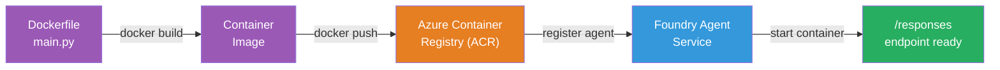
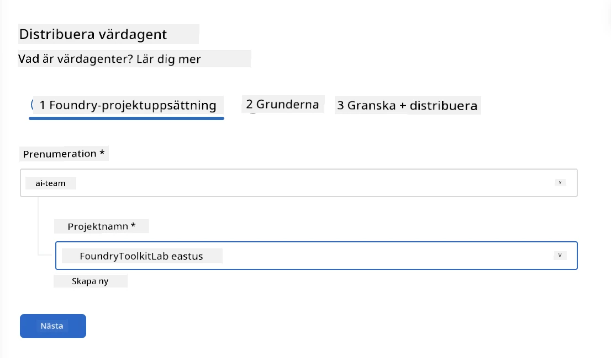
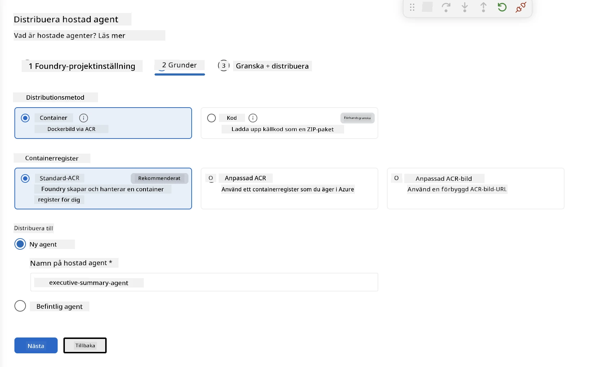
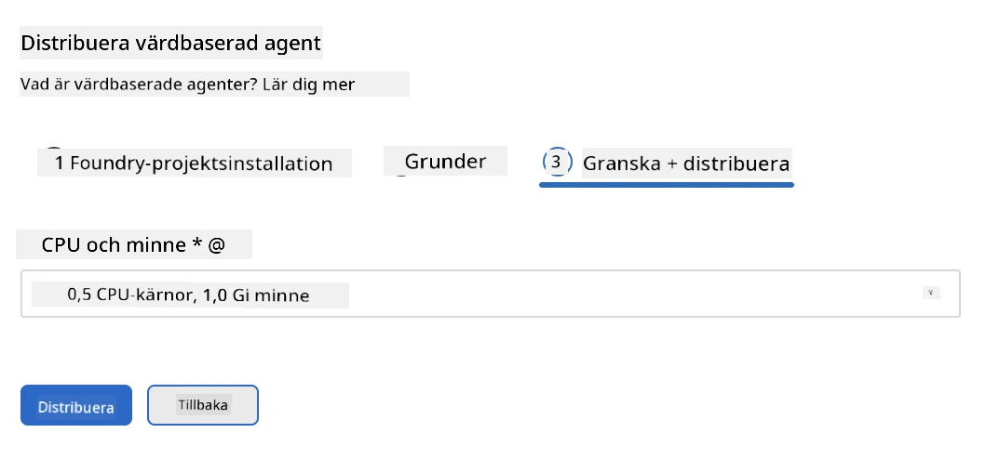
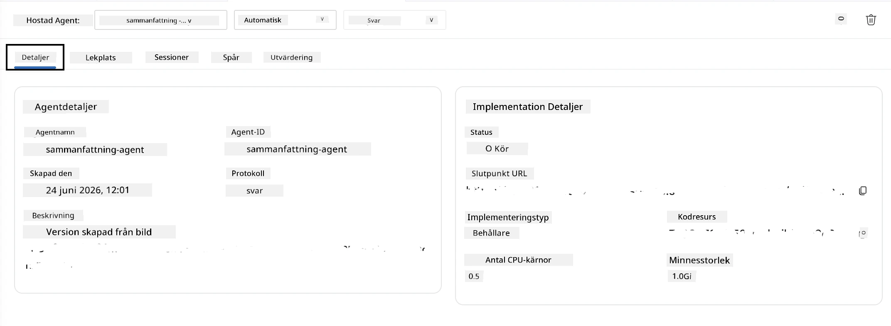

# Modul 5 - Distribuera till Foundry Agent Service

⏱️ ~10 min

> ⚠️ **Användare av Väg B:** Denna modul kräver en Foundry-prenumeration. Om du använder Foundry Local, hoppa till [Modul 07 - Sammanfattning](07-summary.md). Du har framgångsrikt slutfört det lokala utvecklingsarbetsflödet!

I denna modul distribuerar du din lokalt testade agent till Microsoft Foundry som en **Hostad Agent**. Distributionen bygger en containerbild, pushar den till Azure Container Registry och startar agenten i Foundrys hanterade infrastruktur.

### Distribueringspipeline

---

## Kontroll av förutsättningar

Innan distribution, verifiera:

- [ ] Att agenten klarar alla 3 lokala scenarier från [Modul 04](04-test-locally.md)
- [ ] Du har **Azure AI User**-rollen på projektnivå ([Modul 01, Tilldela RBAC](01-setup.md#deploy-a-model--assign-rbac))
- [ ] Du är inloggad i Azure i VS Code (Konton-ikonen visar ditt namn)

---

## Steg 1: Starta distributionen

### Alternativ A: Distribuera från Agent Inspector (rekommenderat)

Om Agent Inspector är öppen (från testning):
1. Klicka på **Distributera**-knappen i det övre högra hörnet (molnikon ↑).

### Alternativ B: Distribuera från kommandopaletten

1. Tryck på `Ctrl+Shift+P` → **Foundry Toolkit: Deploy Hosted Agent**.

---

## Steg 2: Konfigurera distributionen

Guiden ber dig ange:

| Fråga | Val |
|--------|-----------|
| **Prenumeration** | Din Azure-prenumeration |
| **Målprojekt** | Ditt Foundry-projekt (t.ex. `workshop-agents`) |

Klicka på **nästa** för att konfigurera din agent.

| Fråga | Val |
|--------|-----------|
| **Distributionsmetod** | Container |
| **Containerregister** | **Standard ACR** (Microsoft Foundry skapar och hanterar ett åt dig) |
| **Distribuera till** | Ny agent (namn, `executive-summary-agent`) |

Klicka på **nästa** för att granska och distribuera din agent.

| Fråga | Val |
|--------|-----------|
| **CPU och minne** | **0.5 CPU-kärnor, 1.0 Gi minne** (standard – tillräckligt för workshopen) |

---

## Steg 3: Distribuera och övervaka

1. Klicka på **Distribuera**.
2. Titta på **Utdata**-panelen (välj **Microsoft Foundry** från rullgardinsmenyn).
3. Distributionen går igenom dessa steg:
   - **Docker build** - bygger container från din Dockerfile
   - **Docker push** - pushar bilden till ACR (1–3 min vid första distribution)
   - **Agentregistrering** - skapar hostad agent i Foundry
   - **Containerstart** - startar med systemhanterad identitet

4. När klar visas en notis:
   > **executive-summary-agent är distribuerad framgångsrikt.** `View logs` `Run agent`

5. Klicka på **Kör agent** för att öppna Agent Playground.

### Värden för distributionsstatus

| Status | Betydelse |
|--------|---------|
| **Körs** | Container redo, agent svarar |
| **Väntar** | Container startar - vänta 30–60 sekunder |
| **Misslyckades** | Kontrollera loggar (se felsökning nedan) |

---

## Vanliga distributionsfel

| Fel | Grundorsak | Lösning |
|-------|-----------|-----|
| `agents/write` behörighet nekad | Saknar **Azure AI User**-roll på projektnivå | [Modul 01, Tilldela RBAC](01-setup.md#deploy-a-model--assign-rbac) |
| Docker körs inte | Docker Desktop är inte startad | Starta Docker Desktop → verifiera `docker info` |
| ACR-auktorisering | Hanterad identitet kan inte hämta bild | Se [Modul 08 - Felsökning](08-troubleshooting.md) |

---

### ✅ Kontrollpunkt

- [ ] Distributionen slutfördes utan fel
- [ ] Agenten visas på fliken **Hostad Agent** när du klickar på **Agenter** under ditt projekt i Foundry Toolkit sidopanel
- [ ] Containerstatus visar **Körs**
- [ ] Agent Playground-flik öppnades och visar agentdetaljer och slutpunkts-URL

---

**Föregående:** [04 - Testa lokalt](04-test-locally.md) · **Nästa:** [06 - Verifiera i Playground →](06-verify-in-playground.md)

---

<!-- CO-OP TRANSLATOR DISCLAIMER START -->
**Ansvarsfriskrivning**:
Detta dokument har översatts med hjälp av AI-översättningstjänsten [Co-op Translator](https://github.com/Azure/co-op-translator). Även om vi strävar efter noggrannhet, var vänlig notera att automatiska översättningar kan innehålla fel eller brister. Det ursprungliga dokumentet på dess modersmål bör betraktas som den auktoritativa källan. För kritisk information rekommenderas professionell mänsklig översättning. Vi ansvarar inte för några missförstånd eller feltolkningar som uppstår till följd av användningen av denna översättning.
<!-- CO-OP TRANSLATOR DISCLAIMER END -->