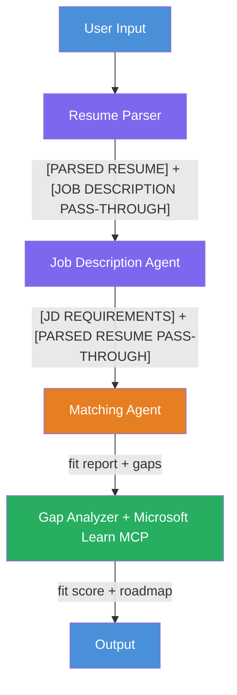

# Lab 02 - Multi-Agent Workflow: CV → Passande Jobbevaluator

## Översikt

I denna praktiska labb bygger du en **arbetsflödesförst multi-agent-app** med Foundry Toolkit i VS Code och deployar den till Microsoft Foundry Agent Service.

**Vad du kommer bygga:** en CV → Passande Jobbevaluator som analyserar ett CV och en arbetsbeskrivning, poängsätter matchningen och skapar en personlig lärandeplan med Microsoft Learn-resurser.

---

## Arkitektur

**Hur det fungerar:**
1. Användaren klistrar in ett CV och en arbetsbeskrivning.
2. **ResumeParser** analyserar CV:t och kopierar arbetsbeskrivningen ordagrant till en `[JOB DESCRIPTION PASS-THROUGH]`-sektion.
3. **JD Agent** extraherar strukturerade krav från genomsändningen, och vidarebefordrar sedan `[PARSED RESUME]` som `[PARSED RESUME PASS-THROUGH]`.
4. **MatchingAgent** jämför `[PARSED RESUME PASS-THROUGH]` mot `[JD REQUIREMENTS]` och producerar en passande poäng.
5. **GapAnalyzer** förvandlar luckorna till en praktisk färdplan och hämtar riktiga Microsoft Learn-länkar via MCP.

---

## Förutsättningar

Slutför först Lab 01:

- [Lab 01 - Single Agent](../lab01-single-agent/README.md)

---

## Del 1: Läs modulerna i ordning

Se hela lärandevägen i:

- [Lab 2 Docs - Prerequisites](docs/00-prerequisites.md)
- [Lab 2 Docs - Full Learning Path](docs/README.md)
- [PersonalCareerCopilot run guide](PersonalCareerCopilot/README.md)

---

## Del 2: Bygg och testa arbetsflödet

1. Använd Foundry Toolkit-guiden för att skapa projektet baserat på arbetsflödet.
2. Kopiera prompt-blocken och arbetsflödesgrafen från `PersonalCareerCopilot/main.py` till ditt arbetsområde.
3. Kör lokalt med Agent Inspector och verifiera alla fyra agenter samt MCP-verktyget.
4. Distribuera den hostade agenten till Foundry när lokal testning är godkänd.

---

## Orkestreringsmönster

Lab 02 använder en **sekventiell pipeline**: varje agents output matar nästa, och arbetsflödet returnerar slutagentens svar. Två mönster gör detta möjligt:

- **Sekventiell kedja** - `WorkflowBuilder` kopplar ResumeParser → JD Agent → MatchingAgent → GapAnalyzer med ett `add_edge()`-anrop per steg
- **Innehållsrelä** - eftersom varje agent bara ser föregående agents output, kopierar ResumeParser och JD Agent data som nedströmsagenter behöver i tydligt märkta genomgångssektioner

Dokumentationen förklarar också varför labben inte använder fan-out/fan-in, samt hur man utökar grafen med en ytterligare agent.

Se [docs/04-orchestration-patterns.md](docs/04-orchestration-patterns.md).

---

**Föregående:** [Lab 01 - Single Agent](../lab01-single-agent/README.md) · **Tillbaka till:** [Workshop Home](../../README.md)

---

<!-- CO-OP TRANSLATOR DISCLAIMER START -->
**Ansvarsfriskrivning**:
Detta dokument har översatts med hjälp av AI-översättningstjänsten [Co-op Translator](https://github.com/Azure/co-op-translator). Även om vi strävar efter noggrannhet, var vänlig notera att automatiska översättningar kan innehålla fel eller brister. Det ursprungliga dokumentet på dess modersmål bör betraktas som den auktoritativa källan. För kritisk information rekommenderas professionell mänsklig översättning. Vi ansvarar inte för några missförstånd eller feltolkningar som uppstår till följd av användningen av denna översättning.
<!-- CO-OP TRANSLATOR DISCLAIMER END -->