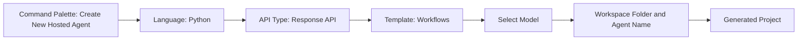
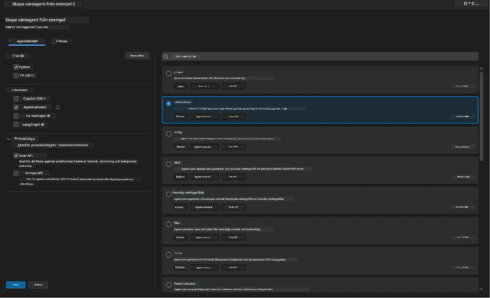
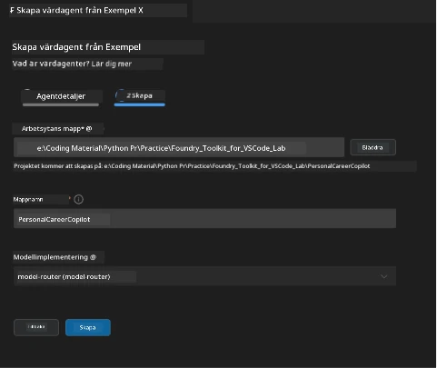

# Modul 2 - Skapa grunden för Multi-Agent-projektet

⏱️ ~5 min

I den här modulen använder du [Foundry Toolkit för VS Code](https://aka.ms/foundrytk) för att **skapa grunden för ett multi-agent-projekt**. Guiden genererar `agent.yaml`, `main.py`, `Dockerfile`, `requirements.txt`, `.env`, och VS Code debug-konfiguration - så du kan fokusera på att koppla ihop arbetsflödet för 4 agenter i Modul 3.

> **Nyckelkoncept:** Grunden är en fungerande stub med en agent. Du ersätter platshållarlogiken med `WorkflowBuilder` grafer i Modul 3. Du skriver inte grundkoden från början.

> **Referensimplementering:** [`PersonalCareerCopilot/`](../../../../../workshop/lab02-multi-agent/PersonalCareerCopilot) är ett komplett fungerande exempel. Använd det för att jämföra ditt arbete under tiden.

### Guidens flöde för att skapa grunden



---

## Steg 1: Öppna guiden Create Hosted Agent

1. Tryck på `Ctrl+Shift+P` för att öppna **Command Palette**.
2. Skriv: **Foundry Toolkit: Create new Hosted Agent** och välj det.
3. Guiden öppnas på fliken **Agent Details**.

> **Alternativ:** Klicka på **Foundry Toolkit**-ikonen i aktivitetsfältet → klicka på **+**-ikonen bredvid **Hosted Agents** → **Create New Hosted Agent**.

---

## Steg 2: Välj inställningar



1. I navigerings-/valsektionen till vänster välj följande:

| Meny | Val | Anteckningar |
|--------|-----------|-------|
| **Språk** | Python | C# (.NET) stöds också |
| **Ramverk** | Agent Framework | Tillhandahåller `Agent`, `AgentExecutor`, `WorkflowBuilder` |
| **API-typ** | Response API | `POST /responses` - plattformsstyrd historik, stöd för streaming |
| **Mall** | **Workflows** | Processar förfrågningar genom flera agenter i sekvens |

2. När dessa är valda, klicka på **Next**



3. I nästa fönster, välj följande:

| Meny | Val | Anteckningar |
|--------|-----------|-------|
| **Arbetsmapp** | Bläddra till målmapp | t.ex. `workshop/lab02-multi-agent/` i detta repo |
| **Agentnamn** | `PersonalCareerCopilot` | Detta blir projektets mappnamn |
| **Modellutplacering** | Välj din utplacerade modell | t.ex. `gpt-4.1-mini` från Lab 01 |

4. Klicka på **Create** för att skapa projektets grund. VS Code genererar filerna och öppnar mappen.

> **Tips:** [`gpt-4.1-mini`](https://learn.microsoft.com/azure/foundry/foundry-models/concepts/models-sold-directly-by-azure#gpt-41-series) balanserar bra mellan snabbhet och kvalitet för multi-agent utveckling.

---

## Steg 3: Inspektera det genererade projektet

När grundskapandet är klart, kontrollera att du ser dessa filer i Utforskaren (`Ctrl+Shift+E`):

```
📂 <your-agent-name>/
├── .azdignore          ← Files excluded from Azure Developer CLI deployments
├── .dockerignore       ← Files excluded from Docker builds
├── .env                ← Environment variables (placeholders - fill in Module 3)
├── .vscode/
│   ├── launch.json     ← Debug config (F5 → run + Agent Inspector)
│   └── tasks.json      ← VS Code task definitions
├── agent.yaml          ← Agent definition (kind: hosted, protocol: responses)
├── Dockerfile          ← Container config for deployment
├── main.py             ← Stub agent entry point (replace with WorkflowBuilder in Module 3)
└── requirements.txt    ← Python dependencies
```

> **Viktigt:** Öppna denna skapade mapp direkt i VS Code så att `.vscode/launch.json` och `tasks.json` tillämpas korrekt för F5-debuggning.

### Förklaring av nyckelfiler

| Fil | Syfte |
|------|---------|
| `agent.yaml` | Deklarerar `kind: hosted`, mappar miljövariabler, definierar `/responses` protokollet |
| `main.py` | Stub: en `FoundryChatClient` → `Agent` → `ResponsesHostServer`. Du ersätter denna med 4 agenter + `WorkflowBuilder` i Modul 3 |
| `Dockerfile` | `python:3.12-slim`, installerar `requirements.txt`, exponerar port 8088, kör `python main.py` |
| `requirements.txt` | `agent-framework-foundry`, `agent-framework-foundry-hosting`, `mcp<2,>=1.24.0`, `debugpy` |

> **Referens:** Se [`PersonalCareerCopilot/agent.yaml`](../../../../../workshop/lab02-multi-agent/PersonalCareerCopilot/agent.yaml) och [`PersonalCareerCopilot/requirements.txt`](../../../../../workshop/lab02-multi-agent/PersonalCareerCopilot/requirements.txt) för det fullständiga genererade innehållet.

---

### ✅ Kontrollpunkt

- [ ] Guiden för grundskapande är slutförd - ny projektmapp syns i Utforskaren
- [ ] Alla förväntade filer finns: `agent.yaml`, `main.py`, `Dockerfile`, `requirements.txt`, `.env`
- [ ] `agent.yaml` visar `kind: hosted` och `protocol: responses`
- [ ] `main.py` importerar `Agent`, `FoundryChatClient`, `ResponsesHostServer`
- [ ] Den skapade mappen är öppen som VS Code arbetsrot
- [ ] Du förstår att `main.py` är en stub - `WorkflowBuilder` läggs till i Modul 3

---

**Föregående:** [01 - Förstå multi-agent arkitektur](01-understand-multi-agent.md) · **Nästa:** [03 - Konfigurera agenter & miljö →](03-configure-agents.md)

---

<!-- CO-OP TRANSLATOR DISCLAIMER START -->
**Ansvarsfriskrivning**:
Detta dokument har översatts med hjälp av AI-översättningstjänsten [Co-op Translator](https://github.com/Azure/co-op-translator). Även om vi strävar efter noggrannhet, var vänlig notera att automatiska översättningar kan innehålla fel eller brister. Det ursprungliga dokumentet på dess modersmål bör betraktas som den auktoritativa källan. För kritisk information rekommenderas professionell mänsklig översättning. Vi ansvarar inte för några missförstånd eller feltolkningar som uppstår till följd av användningen av denna översättning.
<!-- CO-OP TRANSLATOR DISCLAIMER END -->