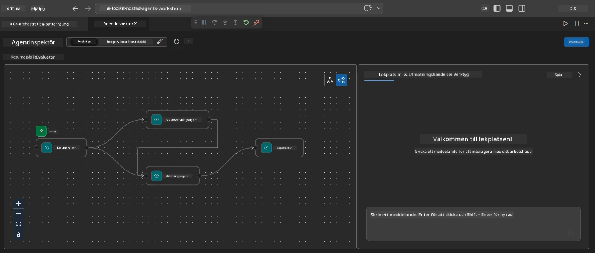
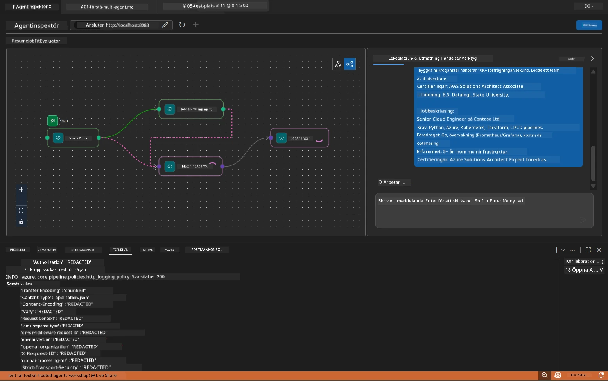
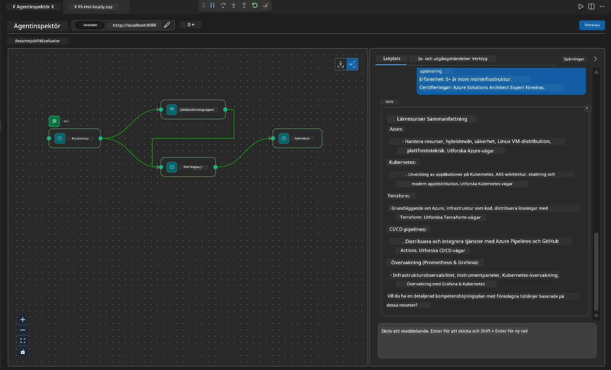

# Modul 5 - Testa Lokalt

⏱️ ~15 min

I denna modul kör du multi-agent-arbetsflödet lokalt, testar det med Agent Inspector och verifierar att alla fyra agenter och MCP-verktyget fungerar korrekt innan distribution.

---

## Steg 1: Starta agentservern

### Alternativ A: Använd VS Code-uppgiften (rekommenderat)

1. Öppna `workshop/lab02-multi-agent/PersonalCareerCopilot/` som din VS Code-mapp.
2. Tryck `Ctrl+Shift+P` → skriv **Tasks: Run Task** → välj **Run Agent HTTP Server**.
3. Uppgiften startar servern med debugpy kopplad på port `5679` och agenten på port `8088`.
4. Vänta tills utdata visar uppstartsmeldelande, följt av serverns eget redo-meddelande (andra loggrader visas emellan):

```
INFO:resume-job-fit:Starting Resume -> Job Fit Evaluator HTTP server...
...
INFO:hypercorn.error:Running on http://0.0.0.0:8088 (CTRL + C to quit)
```

### Alternativ B: Använd F5 (debugläge)

1. Tryck `F5` → välj **Debug Local Agent HTTP Server**.
2. Servern startar med fullt stöd för breakpoint – användbart för att inspektera MCP-svar eller agentutdata.

---

## Steg 2: Öppna Agent Inspector

1. Tryck `Ctrl+Shift+P` → skriv **Foundry Toolkit: Open Agent Inspector**.
2. Agent Inspector öppnas som en VS Code-panel kopplad till `http://localhost:8088`.
3. Du bör se agentens gränssnitt redo att ta emot meddelanden.



> **Om Agent Inspector inte öppnas:** Säkerställ att servern är helt startad (du ser `Running on http://0.0.0.0:8088`-loggen). Om port 5679 är upptagen, se [Modul 8 - Felsökning](08-troubleshooting.md).

---

## Steg 2b: (Valfritt) Öppna Workflow Visualizer

Foundry Toolkit inkluderar en realtids-**Workflow Visualizer** som visar hur agenter samverkar när grafen exekveras. Detta är särskilt användbart för multipel-agent-felsökning.

1. Tryck `Ctrl+Shift+P` → skriv **Foundry Toolkit: Open Visualizer for Hosted Agents**.
2. En ny VS Code-flik öppnas som visar live exekveringsgrafen.
3. När du skickar meddelanden i Agent Inspector uppdateras visualizern automatiskt – gröna noder indikerar slutförda agenter, och animerade kanter visar dataflöde mellan dem.

> **Portkonflikt:** Om visualizer-porten redan används, ändra den i VS Code-inställningar → **Extensions** → **Microsoft Foundry Configuration** → **Hosted Agents: Visualizer Port**.

---

## Steg 3: Kör röktester

Kör dessa två tester i följd. Varje test täcker successivt mer av arbetsflödet.

### Test 1: Grundläggande CV + jobbbeskrivning

Klistra in följande i Agent Inspector:

```
Resume:
Jane Doe
Senior Software Engineer with 5 years of experience in Python, Django, and AWS.
Built microservices handling 10K+ requests/second. Led a team of 4 developers.
Certifications: AWS Solutions Architect Associate.
Education: B.S. Computer Science, State University.

Job Description:
Senior Cloud Engineer at Contoso Ltd.
Required: Python, Azure, Kubernetes, Terraform, CI/CD pipelines.
Preferred: Go, monitoring (Prometheus/Grafana), cost optimization.
Experience: 5+ years in cloud infrastructure.
Certifications: Azure Solutions Architect Expert preferred.
```

**Förväntad outputstruktur:**

Svaret bör innehålla utdata från alla fyra agenter i följd:

1. **Resume Parser output** – Två märkta sektioner: `[PARSED RESUME]` (kandidatprofil med grupperade färdigheter) och `[JOB DESCRIPTION PASS-THROUGH]` (ordagrann JD-text som matar JD Agent)
2. **JD Agent output** – Strukturerade krav med separata obligatoriska och önskvärda färdigheter
3. **Matching Agent output** – Passningspoäng (0-100) med uppdelning, matchade färdigheter, saknade färdigheter, luckor
4. **Gap Analyzer output** – Individuella luckkort för varje saknad färdighet, var och en med Microsoft Learn-URL:er





### Vad att verifiera i Test 1

| Kontroll | Förväntat | Godkänt? |
|-------|----------|-------|
| Svaret innehåller en passningspoäng | Tal mellan 0-100 med uppdelning | |
| Matchade färdigheter listas | Python, CI/CD (delvis), etc. | |
| Saknade färdigheter listas | Azure, Kubernetes, Terraform, etc. | |
| Luckkort finns för varje saknad färdighet | Ett kort per färdighet | |
| Microsoft Learn URL:er finns | Verkliga `learn.microsoft.com` länkar | |
| Inga felmeddelanden i svaret | Ren och strukturerad output | |

### Test 2: Edge-fall - kandidat med hög passning

Klistra in ett CV som mycket väl matchar JD för att verifiera att GapAnalyzer hanterar högpassningssituationer:

```
Resume:
Alex Chen
Senior Cloud Engineer with 7 years of experience.
Skills: Python, Azure (AKS, Functions, DevOps), Kubernetes, Terraform, CI/CD (GitHub Actions, Azure Pipelines), Go, Prometheus, Grafana, cost optimization.
Certifications: Azure Solutions Architect Expert, Azure DevOps Engineer Expert.
Led infrastructure migration to Azure for 3 enterprise clients.
Education: M.S. Computer Science, Tech University.

Job Description:
Senior Cloud Engineer at Contoso Ltd.
Required: Python, Azure, Kubernetes, Terraform, CI/CD pipelines.
Preferred: Go, monitoring (Prometheus/Grafana), cost optimization.
Experience: 5+ years in cloud infrastructure.
Certifications: Azure Solutions Architect Expert preferred.
```

**Förväntat beteende:**
- Passningspoängen bör vara **80+** (de flesta färdigheter matchar)
- Luckkorten bör fokusera på finslipning/intervjuförberedelse snarare än grundläggande lärande
- GapAnalyzer-instruktionerna säger: "Om passning >= 80, fokusera på finslipning/intervjuförberedelse"

---

## Steg 4: Testa med egna data (valfritt)

Prova att klistra in ditt eget CV och en riktig jobbbeskrivning. Detta hjälper till att verifiera:

- Att agenterna hanterar olika CV-format (kronologiskt, funktionellt, hybrid)
- Att JD Agent hanterar olika JD-stilar (punktlistor, stycken, strukturerade)
- Att MCP-verktyget returnerar relevanta resurser för verkliga färdigheter
- Att luckkorten är personligt anpassade till din specifika bakgrund

> **Sekretess - Väg A (Foundry cloud):** CV och JD-text skickas till din Azure OpenAI-distribution för inferens. Det loggas eller lagras inte av workshopinfrastrukturen. Använd platshållarnamn (t.ex. "Jane Doe") om du föredrar.
>
> **Sekretess - Väg B (Foundry Local):** Alla fyra agentinferenser körs helt på din enhet. Ditt CV och din jobbbeskrivning **lämnar aldrig din dator**. Det enda utgående anropet är MCP-verktyget som hämtar resurser från `https://learn.microsoft.com/api/mcp`; den förfrågan innehåller endast färdighetsnamnet, inte din personliga data.

---

### Kontrollpunkt

- [ ] Servern startade framgångsrikt på port `8088` (loggen visar `Running on http://0.0.0.0:8088`)
- [ ] Agent Inspector öppnades och kopplades till agenten
- [ ] Test 1: Komplett svar med passningspoäng, matchade/saknade färdigheter, luckkort och Microsoft Learn-URL:er
- [ ] Test 2: Kandidat med hög passning får poäng 80+ med förslag fokuserade på finslipning
- [ ] Alla luckkort finns (ett per saknad färdighet, ingen trunkering)
- [ ] Inga fel eller stackspår i serverterminalen

---

**Föregående:** [04 - Orkestreringsmönster](04-orchestration-patterns.md) · **Nästa:** [06 - Distribuera till Foundry →](06-deploy-to-foundry.md)

---

<!-- CO-OP TRANSLATOR DISCLAIMER START -->
**Ansvarsfriskrivning**:
Detta dokument har översatts med hjälp av AI-översättningstjänsten [Co-op Translator](https://github.com/Azure/co-op-translator). Även om vi strävar efter noggrannhet, var vänlig notera att automatiska översättningar kan innehålla fel eller brister. Det ursprungliga dokumentet på dess modersmål bör betraktas som den auktoritativa källan. För kritisk information rekommenderas professionell mänsklig översättning. Vi ansvarar inte för några missförstånd eller feltolkningar som uppstår till följd av användningen av denna översättning.
<!-- CO-OP TRANSLATOR DISCLAIMER END -->