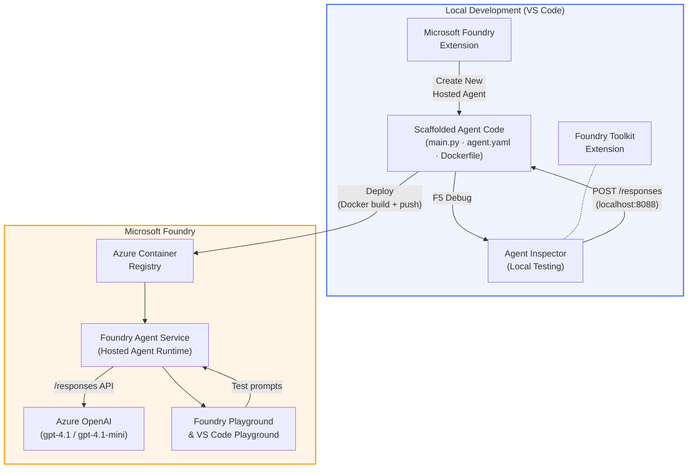

# Foundry Toolkit + Warsha ya Wakala Waliohifadhiwa wa Foundry

[](https://www.python.org/)
[](https://github.com/microsoft/agents)
[](https://learn.microsoft.com/azure/foundry/agents/concepts/hosted-agents)
[](https://ai.azure.com/)
[](https://learn.microsoft.com/azure/ai-services/openai/)
[](https://learn.microsoft.com/cli/azure/install-azure-cli)
[](https://learn.microsoft.com/azure/developer/azure-developer-cli/install-azd)
[](https://www.docker.com/)
[](https://marketplace.visualstudio.com/items?itemName=ms-windows-ai-studio.windows-ai-studio)
[](../../LICENSE)

Jenga, jaribu, na sambaza wakala za AI kwenye **Microsoft Foundry Agent Service** kama **Hosted Agents** - yote kutoka VS Code ukitumia **Microsoft Foundry extension** na **Foundry Toolkit**.

> **Hosted Agents are currently in preview.** Supported regions are limited - see [upatikanaji wa mikoa](https://learn.microsoft.com/azure/foundry/agents/concepts/hosted-agents#region-availability).

> Folda ya `agent/` ndani ya kila maabara imeundwa **kiotomatiki** na nyongeza ya Foundry - kisha ubinafsishe msimbo, ujaribu kwa ndani, na usambaze.

### 🌐 Msaada wa Lugha Nyingi

#### Inasaidiwa kupitia GitHub Action (Iliyejiendesha Kiotomatiki & Inayosasishwa Daima)

<!-- CO-OP TRANSLATOR LANGUAGES TABLE START -->
[Arabic](../ar/README.md) | [Bengali](../bn/README.md) | [Bulgarian](../bg/README.md) | [Burmese (Myanmar)](../my/README.md) | [Chinese (Simplified)](../zh-CN/README.md) | [Chinese (Traditional, Hong Kong)](../zh-HK/README.md) | [Chinese (Traditional, Macau)](../zh-MO/README.md) | [Chinese (Traditional, Taiwan)](../zh-TW/README.md) | [Croatian](../hr/README.md) | [Czech](../cs/README.md) | [Danish](../da/README.md) | [Dutch](../nl/README.md) | [Estonian](../et/README.md) | [Finnish](../fi/README.md) | [French](../fr/README.md) | [German](../de/README.md) | [Greek](../el/README.md) | [Hebrew](../he/README.md) | [Hindi](../hi/README.md) | [Hungarian](../hu/README.md) | [Indonesian](../id/README.md) | [Italian](../it/README.md) | [Japanese](../ja/README.md) | [Kannada](../kn/README.md) | [Khmer](../km/README.md) | [Korean](../ko/README.md) | [Lithuanian](../lt/README.md) | [Malay](../ms/README.md) | [Malayalam](../ml/README.md) | [Marathi](../mr/README.md) | [Nepali](../ne/README.md) | [Nigerian Pidgin](../pcm/README.md) | [Norwegian](../no/README.md) | [Persian (Farsi)](../fa/README.md) | [Polish](../pl/README.md) | [Portuguese (Brazil)](../pt-BR/README.md) | [Portuguese (Portugal)](../pt-PT/README.md) | [Punjabi (Gurmukhi)](../pa/README.md) | [Romanian](../ro/README.md) | [Russian](../ru/README.md) | [Serbian (Cyrillic)](../sr/README.md) | [Slovak](../sk/README.md) | [Slovenian](../sl/README.md) | [Spanish](../es/README.md) | [Swahili](./README.md) | [Swedish](../sv/README.md) | [Tagalog (Filipino)](../tl/README.md) | [Tamil](../ta/README.md) | [Telugu](../te/README.md) | [Thai](../th/README.md) | [Turkish](../tr/README.md) | [Ukrainian](../uk/README.md) | [Urdu](../ur/README.md) | [Vietnamese](../vi/README.md)

> **Unapendelea Kukopa Kwenye Kompyuta?**
>
> Hifadhi hii ina tafsiri zaidi ya lugha 50 ambazo zinaongeza ukubwa wa upakuaji kwa kiasi kikubwa. Ili kukopa bila tafsiri, tumia sparse checkout:
>
> **Bash / macOS / Linux:**
> ```bash
> git clone --filter=blob:none --sparse https://github.com/microsoft-foundry/Foundry_Toolkit_for_VSCode_Lab.git
> cd Foundry_Toolkit_for_VSCode_Lab
> git sparse-checkout set --no-cone '/*' '!translations' '!translated_images'
> ```
>
> **CMD (Windows):**
> ```cmd
> git clone --filter=blob:none --sparse https://github.com/microsoft-foundry/Foundry_Toolkit_for_VSCode_Lab.git
> cd Foundry_Toolkit_for_VSCode_Lab
> git sparse-checkout set --no-cone "/*" "!translations" "!translated_images"
> ```
>
> Hii inakupa kila kitu unachohitaji kukamilisha kozi kwa upakuaji wa haraka sana.
<!-- CO-OP TRANSLATOR LANGUAGES TABLE END -->

---

## Usanifu



**Mtiririko:** Nyongeza ya Foundry inaunda wakala → wewe ubinafsishe msimbo & maagizo → ujaribu kwa ndani na Agent Inspector → sambaza kwenye Foundry (imaji ya Docker itatupwa kwenye ACR) → thibitisha katika Playground.

---

## Kile Utakachojenga

| Maabara | Maelezo | Hali |
|-----|-------------|--------|
| **Lab 01 - Wakala Mmoja** | Jenga wakala **"Explain Like I'm an Executive"**, ujaribu kwa ndani, na usambaze kwenye Foundry | ✅ Inapatikana |
| **Lab 02 - Mtiririko wa Wakala Wengi** | Jenga **"Resume → Job Fit Evaluator"** - wakala 4 zinashirikiana kupima ubagayifu wa wasifu na kuunda ramani ya kujifunza | ✅ Inapatikana |

---

## Kutana na Wakala Mtendaji

Katika warsha hii utajenga wakala wa AI **"Explain Like I'm an Executive"** - wakala wa AI unaochukua istilahi tata za kiufundi na kuziweka katika muhtasari mtulivu, unaofaa kwa vikao vya bodi. Kwa ukweli, hakuna mtu katika ngazi ya uongozi anayetaka kusikia kuhusu "thread pool exhaustion caused by synchronous calls introduced in v3.2."

Niliunda wakala huyu baada ya matukio mengi ambapo post-mortem yangu iliyobuniwa kikamilifu ilipokelewa na jibu: *"Basi... tovuti imeanguka au la?"*

### Jinsi inavyofanya kazi

Unamupe taarifa ya kiufundi. Anakuletea muhtasari wa mtendaji - vifungu vitatu, bila istilahi ngumu, bila stack traces, bila hofu ya kiutu. Tu **kilichotokea**, **athari kwa biashara**, na **hatua inayofuata**.

### Uione Ikifanya Kazi

**Unasema:**
> "Ucheleweshaji wa API uliongezeka kutokana na uchovu wa thread pool uliosababishwa na miito ya synchronous iliyotolewa katika v3.2."

**Wakala anajibu:**

> **Muhtasari wa Mtendaji:**
> - **Kilichotokea:** Baada ya toleo la hivi karibuni, mfumo ulicheleweshwa.
> - **Athari kwa biashara:** Baadhi ya watumiaji walikumbwa na ucheleweshaji walipotumia huduma.
> - **Hatua inayofuata:** Mabadiliko yamerudishwa nyuma na marekebisho yanaandaliwa kabla ya kusambazwa tena.

### Kwanini wakala huyu?

Ni wakala rahisi kabisa, mwenye kusudi moja - mkamilifu kwa kujifunza mtiririko wa wakala waliohifadhiwa kutoka mwanzo hadi mwisho bila kuingia kwenye mnyororo wa zana tata. Na kwa ukweli? Kila timu ya uhandisi ingeweza kutumia mmoja wa hawa.

---

## Muundo wa Warsha

```
📂 Foundry_Toolkit_for_VSCode_Lab/
├── 📄 README.md                      ← You are here
└── 📂 workshop/
    ├── 📂 lab01-single-agent/        ← Full lab: docs + agent code
    │   ├── README.md                 ← Hands-on lab instructions
    │   ├── 📂 docs/                  ← Step-by-step tutorial modules
    │   │   ├── 00-prerequisites.md
    │   │   ├── 01-setup.md
    │   │   ├── 02-create-hosted-agent.md
    │   │   ├── 03-configure-and-code.md
    │   │   ├── 04-test-locally.md
    │   │   ├── 05-deploy-to-foundry.md
    │   │   ├── 06-verify-in-playground.md
    │   │   ├── 07-summary.md
    │   │   └── 08-troubleshooting.md
    │   └── 📂 agent/                 ← Reference solution (auto-scaffolded by Foundry extension)
    │       ├── agent.yaml
    │       ├── Dockerfile
    │       ├── main.py
    │       └── requirements.txt
    └── 📂 lab02-multi-agent/         ← Resume → Job Fit Evaluator
        ├── README.md                 ← Hands-on lab instructions (end-to-end)
        ├── 📂 docs/                  ← Step-by-step tutorial modules
        │   ├── 00-prerequisites.md
        │   ├── 01-understand-multi-agent.md
        │   ├── 02-scaffold-multi-agent.md
        │   ├── 03-configure-agents.md
        │   ├── 04-orchestration-patterns.md
        │   ├── 05-test-locally.md
        │   ├── 06-deploy-to-foundry.md
        │   ├── 07-verify-in-playground.md
        │   └── 08-troubleshooting.md
        └── 📂 PersonalCareerCopilot/ ← Reference solution (multi-agent workflow)
            ├── agent.yaml
            ├── Dockerfile
            ├── main.py
            └── requirements.txt
```

> **Kumbuka:** Folda ya `agent/` ndani ya kila maabara ndiyo inayoongoza na **Microsoft Foundry extension** unapoendesha `Microsoft Foundry: Create a New Hosted Agent` kutoka kwenye Command Palette. Faili kisha zinabinafsishwa kwa maagizo, zana, na usanidi wa wakala wako. Lab 01 inakuongoza jinsi ya kuunda hili kutoka mwanzo.

---

## Kuanzia

### 1. Clone the repository

```bash
git clone https://github.com/microsoft-foundry/Foundry_Toolkit_for_VSCode_Lab.git
cd Foundry_Toolkit_for_VSCode_Lab
```

### 2. Set up a Python virtual environment

```bash
python -m venv venv
```

Iwezeshwe:

- **Windows (PowerShell):**
  ```powershell
  .\venv\Scripts\Activate.ps1
  ```
- **macOS / Linux:**
  ```bash
  source venv/bin/activate
  ```

### 3. Sakinisha utegemezi

```bash
pip install -r workshop/lab01-single-agent/agent/requirements.txt
```

### 4. Sanidi vigezo vya mazingira

Nakili faili la mfano `.env` ndani ya folda ya wakala na ujaze thamani zako:

```bash
cp workshop/lab01-single-agent/agent/.env.example workshop/lab01-single-agent/agent/.env
```

Hariri `workshop/lab01-single-agent/agent/.env`:

```env
AZURE_AI_PROJECT_ENDPOINT=https://<your-account>.services.ai.azure.com/api/projects/<your-project>
AZURE_AI_MODEL_DEPLOYMENT_NAME=<your-model-deployment-name>
```

### 5. Fuata maabara za warsha

Kila maabara ni huru yenye moduli zake. Anza na **Lab 01** kujifunza misingi, kisha uende kwenye **Lab 02** kwa mitiririko ya wakala wengi.

#### Lab 01 - Wakala Mmoja ([maagizo kamili](workshop/lab01-single-agent/README.md))

| # | Moduli | Kiungo |
|---|--------|------|
| 1 | Soma mahitaji ya awali | [00-prerequisites.md](workshop/lab01-single-agent/docs/00-prerequisites.md) |
| 2 | Sakinisha Foundry Toolkit & nyongeza ya Foundry | [01-setup.md](workshop/lab01-single-agent/docs/01-setup.md) |
| 3 | Unda mradi wa Foundry | [01-setup.md](workshop/lab01-single-agent/docs/01-setup.md) |
| 4 | Tengeneza wakala uliohifadhiwa | [02-create-hosted-agent.md](workshop/lab01-single-agent/docs/02-create-hosted-agent.md) |
| 5 | Sanidi maagizo & mazingira | [03-configure-and-code.md](workshop/lab01-single-agent/docs/03-configure-and-code.md) |
| 6 | Jaribu kwa ndani | [04-test-locally.md](workshop/lab01-single-agent/docs/04-test-locally.md) |
| 7 | Sambaza kwenye Foundry | [05-deploy-to-foundry.md](workshop/lab01-single-agent/docs/05-deploy-to-foundry.md) |
| 8 | Thibitisha katika eneo la majaribio | [06-verify-in-playground.md](workshop/lab01-single-agent/docs/06-verify-in-playground.md) |
| 9 | Utatuzi wa matatizo | [08-troubleshooting.md](workshop/lab01-single-agent/docs/08-troubleshooting.md) |

#### Lab 02 - Mtiririko wa Wakala Wengi ([maagizo kamili](workshop/lab02-multi-agent/README.md))

| # | Moduli | Kiungo |
|---|--------|------|
| 1 | Mahitaji ya awali (Lab 02) | [00-prerequisites.md](workshop/lab02-multi-agent/docs/00-prerequisites.md) |
| 2 | Elewa usanifu wa wakala wengi | [01-understand-multi-agent.md](workshop/lab02-multi-agent/docs/01-understand-multi-agent.md) |
| 3 | Tengeneza mradi wa wakala wengi | [02-scaffold-multi-agent.md](workshop/lab02-multi-agent/docs/02-scaffold-multi-agent.md) |
| 4 | Sanidi wakala & mazingira | [03-configure-agents.md](workshop/lab02-multi-agent/docs/03-configure-agents.md) |
| 5 | Mifumo ya uratibu | [04-orchestration-patterns.md](workshop/lab02-multi-agent/docs/04-orchestration-patterns.md) |
| 6 | Jaribu kwa ndani (wakala wengi) | [05-test-locally.md](workshop/lab02-multi-agent/docs/05-test-locally.md) |
| 7 | Sambaza kwenye Foundry | [06-deploy-to-foundry.md](workshop/lab02-multi-agent/docs/06-deploy-to-foundry.md) |
| 8 | Thibitisha katika eneo la majaribio | [07-verify-in-playground.md](workshop/lab02-multi-agent/docs/07-verify-in-playground.md) |
| 9 | Utatuzi wa matatizo (wakala wengi) | [08-troubleshooting.md](workshop/lab02-multi-agent/docs/08-troubleshooting.md) |

---

## Msimamizi

<table>
<tr>
    <td align="center"><a href="https://github.com/ShivamGoyal03">
        <br />
        <sub><b>Shivam Goyal</b></sub>
    </a><br />
    </td>
</tr>
</table>

---

## Ruhusa zinazohitajika (marejeo ya haraka)

| Hali | Nafasi zinazohitajika |
|----------|---------------|
| Unda mradi mpya wa Foundry | **Azure AI Owner** on Foundry resource |
| Sambaza kwenye mradi uliopo (rasilimali mpya) | **Azure AI Owner** + **Contributor** on subscription |
| Sambaza kwenye mradi uliosanikishwa kikamilifu | **Reader** on account + **Azure AI User** on project |

> **Muhimu:** Azure `Owner` na `Contributor` roles only include *management* permissions, not *development* (data action) permissions. You need **Azure AI User** or **Azure AI Owner** to build and deploy agents.

---

## Marejeo

- [Mwanzo wa Haraka: Weka wakala wako wa kwanza mwenyeji (VS Code)](https://learn.microsoft.com/azure/foundry/agents/quickstarts/quickstart-hosted-agent)
- [Wakala wenyeji ni nini?](https://learn.microsoft.com/azure/foundry/agents/concepts/hosted-agents)
- [Tengeneza mtiririko wa kazi wa wakala mwenyeji katika VS Code](https://learn.microsoft.com/azure/foundry/agents/how-to/vs-code-agents-workflow-pro-code)
- [Weka wakala mwenyeji](https://learn.microsoft.com/azure/foundry/agents/how-to/deploy-hosted-agent)
- [RBAC kwa Microsoft Foundry](https://learn.microsoft.com/azure/foundry/concepts/rbac-foundry)
- [Mfano wa Wakala wa Ukaguzi wa Usanifu](https://github.com/Azure-Samples/agent-architecture-review-sample) - Wakala mwenyeji wa kweli na zana za MCP, michoro ya Excalidraw, na utekelezaji mara mbili

---


## Leseni

[MIT](../../LICENSE)

---

<!-- CO-OP TRANSLATOR DISCLAIMER START -->
**Kionyozo**:
Hati hii imetafsiriwa kwa kutumia huduma ya tafsiri ya AI [Co-op Translator](https://github.com/Azure/co-op-translator). Ingawa tunajitahidi kupata usahihi, tafadhali fahamu kwamba tafsiri za kiotomatiki zinaweza kuwa na makosa au upungufu wa usahihi. Hati ya asili katika lugha yake halisi inapaswa kuchukuliwa kama chanzo cha mamlaka. Kwa taarifa muhimu, tafsiri ya kitaalamu inayofanywa na binadamu inapendekezwa. Hatutojibu kwa kuelewa vibaya au tafsiri potofu zinazotokea kutokana na matumizi ya tafsiri hii.
<!-- CO-OP TRANSLATOR DISCLAIMER END -->
