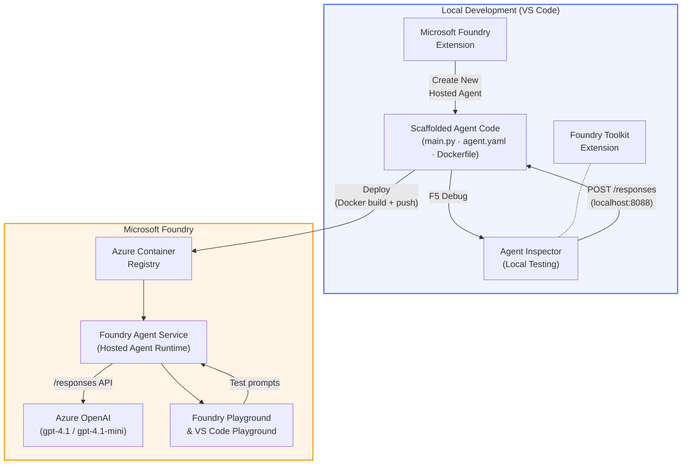

# Foundry Toolkit + Foundry Hosted Agents பணிமனை

[](https://www.python.org/)
[](https://github.com/microsoft/agents)
[](https://learn.microsoft.com/azure/foundry/agents/concepts/hosted-agents)
[](https://ai.azure.com/)
[](https://learn.microsoft.com/azure/ai-services/openai/)
[](https://learn.microsoft.com/cli/azure/install-azure-cli)
[](https://learn.microsoft.com/azure/developer/azure-developer-cli/install-azd)
[](https://www.docker.com/)
[](https://marketplace.visualstudio.com/items?itemName=ms-windows-ai-studio.windows-ai-studio)
[](LICENSE)

AI முகவரிகளை **Microsoft Foundry Agent Service** இல் **Hosted Agents** ஆக உருவாக்கவும், சோதிக்கவும் மற்றும் பிரசுரிக்கவும் - முழுமையாக VS குறியீட்டிலிருந்து **Microsoft Foundry விரிவாக்கம்** மற்றும் **Foundry Toolkit** கையாள்ந்து செய்க.

> **Hosted Agents தற்போதும் முன்னோட்ட நிலையில் உள்ளன.** ஆதரவு பெறும் பகுதிகள் சில வரையறுக்கப்பட்டுள்ளன - [பகுதி கிடைக்கும் விவரம்](https://learn.microsoft.com/azure/foundry/agents/concepts/hosted-agents#region-availability) பார்க்கவும்.

> Foundry விரிவாக்கம் ஒவ்வொரு லேபின் உள்ளே இருக்கும் `agent/` கோப்பகம் **தானாக உருவாக்கப்படுகிறது** - பின்னர் நீங்கள் குறியீட்டை மாற்றி, உள்ளகமாக சோதித்து பிரசுரிக்கலாம்.

### 🌐 பன்மொழி ஆதரவு

#### GitHub செயல் வழியாக ஆதரிக்கப்படுகிறது (தானியங்கி மற்றும் எப்போதும் புதுப்பிக்கப்படும்)

<!-- CO-OP TRANSLATOR LANGUAGES TABLE START -->
[அரபு](../ar/README.md) | [பெங்களி](../bn/README.md) | [பல்கேரியன்](../bg/README.md) | [புர்மீஸ் (மியான்மர்)](../my/README.md) | [சீன (எளிய)](../zh-CN/README.md) | [சீன (சம்பிரதாய, ஹொங்காங்)](../zh-HK/README.md) | [சீன (சம்பிரதாய, மாகாவ்)](../zh-MO/README.md) | [சீன (சம்பிரதாய, தைவான்)](../zh-TW/README.md) | [குரோஷியன்](../hr/README.md) | [செக்](../cs/README.md) | [டேனிஷ்](../da/README.md) | [டச்சு](../nl/README.md) | [எஸ்டோனியன்](../et/README.md) | [பின்னிஷ்](../fi/README.md) | [பிரான்சு](../fr/README.md) | [ஜெர்மன்](../de/README.md) | [கிரேக்கம்](../el/README.md) | [ஹீப்ரூ](../he/README.md) | [இந்தி](../hi/README.md) | [அங்கீரியன்](../hu/README.md) | [இந்தோனேஷியன்](../id/README.md) | [இத்தாலீ](../it/README.md) | [ஜப்பானீஸ்](../ja/README.md) | [கன்னடம்](../kn/README.md) | [க்மெர்](../km/README.md) | [கொரியன்](../ko/README.md) | [லிடுவேனியன்](../lt/README.md) | [மலே](../ms/README.md) | [மலையாளம்](../ml/README.md) | [மானிபுரி (மேட்டை மயெக்)](../mni/README.md) | [மராத்தி](../mr/README.md) | [நேபாளி](../ne/README.md) | [நைஜீரியன் பிஜின்](../pcm/README.md) | [நார்வேஜியன்](../no/README.md) | [பெர்சியன் (பார்ஸி)](../fa/README.md) | [போலிஷ்](../pl/README.md) | [போர்த்துக்கீசு (பிரேசில்)](../pt-BR/README.md) | [போர்த்துக்கீசு (போர்ச்சுகல்)](../pt-PT/README.md) | [பஞ்சாபி (குருமுகி)](../pa/README.md) | [ரோமேனியன்](../ro/README.md) | [ரஷியன்](../ru/README.md) | [செர்பியன் (சிரிலிக்)](../sr/README.md) | [ஸ்லோவாக்](../sk/README.md) | [ஸ்லோவேனியன்](../sl/README.md) | [ஸ்பானிஷ்](../es/README.md) | [ஸ்வாஹிலி](../sw/README.md) | [ஸ்வீடிஷ்](../sv/README.md) | [டகாலோக் (பிலிப்பைன்ஸ்)](../tl/README.md) | [தமில்](./README.md) | [தெலுங்கு](../te/README.md) | [தாய்](../th/README.md) | [துருக்கிஷ்](../tr/README.md) | [உக்ரைனியன்](../uk/README.md) | [உருது](../ur/README.md) | [வியட்நாமீஸ்](../vi/README.md)

> **உள்ளூர் கிளோன் செய்ய விருப்பமா?**
>
> இந்த சேமிப்பகம் 50+ மொழி மொழிபெயர்ப்புகளை உள்ளடக்குகிறது, இது பதிவிறக்க அளவை பெரிதாக அதிகரிக்கிறது. மொழிபெயர்ப்புகள் இல்லாமல் கிளோன் செய்ய sparse checkout பயன்படுத்தவும்:
>
> **Bash / macOS / Linux:**
> ```bash
> git clone --filter=blob:none --sparse https://github.com/microsoft-foundry/Foundry_Toolkit_for_VSCode_Lab.git
> cd Foundry_Toolkit_for_VSCode_Lab
> git sparse-checkout set --no-cone '/*' '!translations' '!translated_images'
> ```
>
> **CMD (Windows):**
> ```cmd
> git clone --filter=blob:none --sparse https://github.com/microsoft-foundry/Foundry_Toolkit_for_VSCode_Lab.git
> cd Foundry_Toolkit_for_VSCode_Lab
> git sparse-checkout set --no-cone "/*" "!translations" "!translated_images"
> ```
>
> இதனால் நீங்கள் மிகவும் வேகமாக பதிவிறக்கம் செய்து இந்த பாடத்திட்டத்தை முடிக்க தேவையான எல்லாவற்றையும் பெறலாம்.
<!-- CO-OP TRANSLATOR LANGUAGES TABLE END -->

---

## கட்டமைப்பு



**ஊசல்:** Foundry விரிவாக்கம் முகவரியை உருவாக்குகிறது → நீங்கள் குறியீடையும் வழிமுறைகளையும் தனிப்பயன் செய்கிறீர்கள் → முகவரி உள்நிலை ஆய்வாணியுடன் சோதிக்கப்படுகிறது → Foundry க்கு (Docker படம் ACR இல் தள்ளப்படுகிறது) பிரசுரிக்கப்படுகிறது → Playground இல் சரிபார்க்கிறது.

---

## நீங்கள் உருவாக்கப்போகும்

| லேப் | விளக்கம் | நிலை |
|-----|-------------|--------|
| **லேப் 01 - ஒரே முகவரி** | **"நான் ஒரு நிர்வாகியாக இருக்கிறேன் என்பதை விளக்கி"** முகவரியை உருவாக்கி, உள்ளகமாக சோதித்து, Foundry க்கு பிரசுரி செய்க | ✅ கிடைக்கிறது |
| **லேப் 02 - பன்முகவரி பணிமுறை** | **"ரிசுமே → வேலை பொருத்தல் மதிப்பீட்டாளர்"** - 4 முகவர்கள் ஒத்துழைத்து ரிசுமே பொருத்தத்தை மதிப்பீடு செய்து பயிற்சி திட்டம் உருவாக்குகின்றனர் | ✅ கிடைக்கிறது |

---

## நிர்வாக முகவரியை சந்திக்கவும்

இந்த பணிமனையில் நீங்கள் **"நான் ஒரு நிர்வாகியாக இருக்கிறேன் என்பதை விளக்கி"** முகவரியை உருவாக்கப்போகிறீர்கள் - இது ஒரு AI முகவர், கடுமையான தொழில்நுட்ப சொற்களை சாந்தமான, வாரிய அறைகளுக்கான சுருக்கங்களாக மாற்றுகின்றது. உண்மையில், C-தரம் நிர்வாகக் குழுவில் யாரும் "v3.2 அறிமுகம் செய்த ஒத்த செயல்பாடுகளால் ஏற்படும் திரெட் பூல் முடிவடைதல்" பற்றி கேட்க விரும்பவர் இல்லை.

நான் இந்த முகவரியை உருவாக்கினேன், ஏனெனில் என் முற்றிலும் தயாரிக்கப்பட்ட படி விசாரணைக்கு பதிலாக பெரும்பாலும் *"எனவே... தளம் வேலை செய்யவில்லையா?"* என்ற பதிலை பெற்றேன்.

### இது எப்படி வேலை செய்கிறது

நீங்கள் அதற்கு ஒரு தொழில்நுட்ப புதுப்பிப்பை பரிமாறுகிறீர்கள். அது ஒரு நிர்வாக சுருக்கத்தை உருவாக்குகிறது - மூன்று முனை புள்ளிகள், எந்த தொழில்நுட்ப வார்த்தைகளும் இல்லை, அடுக்கு தட்பவெப்பங்கள் இல்லை, கோப்புகள் இல்லை. இது மட்டும் தான்: **என்ன நடந்தது**, **வணிகத்தின் தாக்கம்**, மற்றும் **அடுத்த படி**.

### செயலில் அதை காண்க

**நீங்கள் கூறுகிறீர்கள்:**
> "API தாமதம் v3.2 அறிமுகப்படுத்திய ஒத்த செயல்பாடுகளால் ஏற்படும் திரெட் பூல் முடிவடைதலால் அதிகரித்தது."

**முகவர் பதில்:**

> **நிர்வாக சுருக்கம்:**
> - **என நடந்தது:** கடைசிப் பதிப்பிற்குப் பிறகு, அமைப்பு மெதுவாகியது.
> - **வணிக தாக்கம்:** சில பயன்படுத்துவோர்கள் சேவையைப் பயன்படுத்தும் போது தாமதங்களை அனுபவித்தனர்.
> - **அடுத்த படி:** மாற்றம் பின்வாங்கப்பட்டது மற்றும் மறுபிரசுரத்திற்கு முன் சரிசெய்தல் தயாராகிறது.

### ஏன் இந்த முகவர்?

இது மிகவும் எளிமையான, ஒரு நோக்குக்கு மட்டும் உருவாக்கப்பட்ட முகவர் - கடுமையான கருவிகள் இல்லாமல் வாடிக்கையாளர் முகவரி பணிமுறை முழுமையாக கற்றுக்கொள்ளுவதற்கு பரிபூரணமாகும். உண்மையிலேயே, ஒவ்வொரு பொறியியல் குழுவும் இதுபோன்ற ஒருவரை பயன்படுத்த வேண்டும்.

---

## பணிமனை கட்டமைப்பு

```
📂 Foundry_Toolkit_for_VSCode_Lab/
├── 📄 README.md                      ← You are here
└── 📂 workshop/
    ├── 📂 lab01-single-agent/        ← Full lab: docs + agent code
    │   ├── README.md                 ← Hands-on lab instructions
    │   ├── 📂 docs/                  ← Step-by-step tutorial modules
    │   │   ├── 00-prerequisites.md
    │   │   ├── 01-setup.md
    │   │   ├── 02-create-hosted-agent.md
    │   │   ├── 03-configure-and-code.md
    │   │   ├── 04-test-locally.md
    │   │   ├── 05-deploy-to-foundry.md
    │   │   ├── 06-verify-in-playground.md
    │   │   ├── 07-summary.md
    │   │   └── 08-troubleshooting.md
    │   └── 📂 agent/                 ← Reference solution (auto-scaffolded by Foundry extension)
    │       ├── agent.yaml
    │       ├── Dockerfile
    │       ├── main.py
    │       └── requirements.txt
    └── 📂 lab02-multi-agent/         ← Resume → Job Fit Evaluator
        ├── README.md                 ← Hands-on lab instructions (end-to-end)
        ├── 📂 docs/                  ← Step-by-step tutorial modules
        │   ├── 00-prerequisites.md
        │   ├── 01-understand-multi-agent.md
        │   ├── 02-scaffold-multi-agent.md
        │   ├── 03-configure-agents.md
        │   ├── 04-orchestration-patterns.md
        │   ├── 05-test-locally.md
        │   ├── 06-deploy-to-foundry.md
        │   ├── 07-verify-in-playground.md
        │   └── 08-troubleshooting.md
        └── 📂 PersonalCareerCopilot/ ← Reference solution (multi-agent workflow)
            ├── agent.yaml
            ├── Dockerfile
            ├── main.py
            └── requirements.txt
```

> **கவனிப்பு:** ஒவ்வொரு லேபினுள் உள்ள `agent/` கோப்பகம் **Microsoft Foundry விரிவாக்கம்** மூலம் `Microsoft Foundry: Create a New Hosted Agent` கமாண்டு ஒட்டியில் இயக்கும்போது உருவாக்கப்படுகிறது. கோப்புகள் பின்னர் உங்கள் முகவரியின் வழிமுறைகள், கருவிகள் மற்றும் கட்டமைப்புடன் தனிப்பயனாக்கப்படுகின்றன. லேப் 01 இதை ஆரம்பத்திலிருந்தே மறுபடியும் உருவாக்க வழிகாட்டுகிறது.

---

## தொடக்கம்

### 1. சேமிப்பகத்தை கிளோன் செய்க

```bash
git clone https://github.com/microsoft-foundry/Foundry_Toolkit_for_VSCode_Lab.git
cd Foundry_Toolkit_for_VSCode_Lab
```

### 2. Python மெய்நிகர் சூழலை அமைக்கவும்

```bash
python -m venv venv
```

இயக்கவும்:

- **Windows (PowerShell):**
  ```powershell
  .\venv\Scripts\Activate.ps1
  ```
- **macOS / Linux:**
  ```bash
  source venv/bin/activate
  ```

### 3. சார்புகளைக் நிறுவவும்

```bash
pip install -r workshop/lab01-single-agent/agent/requirements.txt
```

### 4. சுற்றுச்சூழல் மாறிலிகளை உள்ளமைக்கவும்

முகவரி கோப்பகத்திலுள்ள எடுத்துக்காட்டு `.env` கோப்பை நகலெடுத்து உங்கள் மதிப்புகளை நிரப்பவும்:

```bash
cp workshop/lab01-single-agent/agent/.env.example workshop/lab01-single-agent/agent/.env
```

`workshop/lab01-single-agent/agent/.env` என்பதை திருத்தவும்:

```env
AZURE_AI_PROJECT_ENDPOINT=https://<your-account>.services.ai.azure.com/api/projects/<your-project>
AZURE_AI_MODEL_DEPLOYMENT_NAME=<your-model-deployment-name>
```

### 5. பணிமனை லேப்களை பின்பற்றவும்

ஒவ்வொரு லேபும் தனிப்பட்ட தன்னுடைய தொகுதிகளுடன் உள்ளது. அடிப்படைகளை கற்றுக்கொள்ள **லேப் 01** க்கு துவங்கி, பின்னர் பன்முகவரி பணிமுறைக்காக **லேப் 02** க்கு செல்லவும்.

#### லேப் 01 - ஒரே முகவரி ([முழு விளக்கங்கள்](workshop/lab01-single-agent/README.md))

| # | தொகுதி | இணைப்பு |
|---|--------|------|
| 1 | முன்னோடியான தேவைகள் படிக்கவும் | [00-prerequisites.md](workshop/lab01-single-agent/docs/00-prerequisites.md) |
| 2 | Foundry Toolkit & Foundry விரிவாக்கம் நிறுவவும் | [01-setup.md](workshop/lab01-single-agent/docs/01-setup.md) |
| 3 | Foundry திட்டம் உருவாக்கவும் | [01-setup.md](workshop/lab01-single-agent/docs/01-setup.md) |
| 4 | ஒரு hosted முகவரியை உருவாக்கவும் | [02-create-hosted-agent.md](workshop/lab01-single-agent/docs/02-create-hosted-agent.md) |
| 5 | வழிமுறைகள் மற்றும் சுற்றுச்சூழலை மாற்றவும் | [03-configure-and-code.md](workshop/lab01-single-agent/docs/03-configure-and-code.md) |
| 6 | உள்ளகமாக சோதிக்கவும் | [04-test-locally.md](workshop/lab01-single-agent/docs/04-test-locally.md) |
| 7 | Foundry க்கு பிரசுரிக்கவும் | [05-deploy-to-foundry.md](workshop/lab01-single-agent/docs/05-deploy-to-foundry.md) |
| 8 | பயங்கரவாயில் சரிபார்க்கவும் | [06-verify-in-playground.md](workshop/lab01-single-agent/docs/06-verify-in-playground.md) |
| 9 | பிரச்சனைத் தீர்வு | [08-troubleshooting.md](workshop/lab01-single-agent/docs/08-troubleshooting.md) |

#### லேப் 02 - பன்முகவரி பணிமுறை ([முழு விளக்கங்கள்](workshop/lab02-multi-agent/README.md))

| # | தொகுதி | இணைப்பு |
|---|--------|------|
| 1 | முன்னோடியான தேவைகள் (லேப் 02) | [00-prerequisites.md](workshop/lab02-multi-agent/docs/00-prerequisites.md) |
| 2 | பன்முகவரி கட்டமைப்பை புரிந்துகொள்ளவும் | [01-understand-multi-agent.md](workshop/lab02-multi-agent/docs/01-understand-multi-agent.md) |
| 3 | பன்முகவரி திட்டத்தை உருவாக்கவும் | [02-scaffold-multi-agent.md](workshop/lab02-multi-agent/docs/02-scaffold-multi-agent.md) |
| 4 | முகவரிகள் மற்றும் சுற்றுச்சூழலை அமைக்கவும் | [03-configure-agents.md](workshop/lab02-multi-agent/docs/03-configure-agents.md) |
| 5 | ஒழுங்கமைப்பு முறைமைகள் | [04-orchestration-patterns.md](workshop/lab02-multi-agent/docs/04-orchestration-patterns.md) |
| 6 | உள்ளகமாக சோதிக்கவும் (பன்முகவரி) | [05-test-locally.md](workshop/lab02-multi-agent/docs/05-test-locally.md) |
| 7 | Foundry க்கு பிரசுரிக்கவும் | [06-deploy-to-foundry.md](workshop/lab02-multi-agent/docs/06-deploy-to-foundry.md) |
| 8 | பயங்கரவாயில் சரிபார்க்கவும் | [07-verify-in-playground.md](workshop/lab02-multi-agent/docs/07-verify-in-playground.md) |
| 9 | பிரச்சனை தீர்வு (பன்முகவரி) | [08-troubleshooting.md](workshop/lab02-multi-agent/docs/08-troubleshooting.md) |

---

## பராமரிப்பாளர்

<table>
<tr>
    <td align="center"><a href="https://github.com/ShivamGoyal03">
        <br />
        <sub><b>சிவம் கோயல்</b></sub>
    </a><br />
    </td>
</tr>
</table>

---

## தேவையான அனுமதிகள் (விரைவு குறிப்பு)

| சூழ்நிலை | தேவையான பங்குகள் |
|----------|---------------|
| புதிய Foundry திட்டம் உருவாக்குதல் | Foundry resource இல் **Azure AI Owner** |
| உள்ளதுபோன்று திட்டத்தில் (புது வளங்கள்) பிரசுரி செய்யல்பு | சந்தா அளவில் **Azure AI Owner** + **Contributor** |
| முழுமையாக கட்டமைக்கப்பட்ட திட்டத்திற்கு பிரசுரி | கணக்கில் **Reader** + திட்டத்தில் **Azure AI User** |

> **முக்கியம்:** Azure `Owner` மற்றும் `Contributor` பங்குகள் *மாணிலை* அனுமதிகளை மட்டும் கொண்டிருப்பதால் *உருவாக்கல்* (தரவு செயல்பாடு) அனுமதிகள் உள்ளடக்கமடையாது. முகவரிகளை கட்டமைக்க மற்றும் பிரசுரிக்க **Azure AI User** அல்லது **Azure AI Owner** தேவை.

---

## மேற்கோள்கள்

- [விரைவுச் தொடக்கம்: உங்கள் முதல் ஹோஸ்டட் ஏஜெண்டைப் பயன்படுத்தி அமல்படுத்துதல் (VS Code)](https://learn.microsoft.com/azure/foundry/agents/quickstarts/quickstart-hosted-agent)
- [ஹோஸ்டட் ஏஜெண்டுகள் என்ன?](https://learn.microsoft.com/azure/foundry/agents/concepts/hosted-agents)
- [VS Code-ல் ஹோஸ்டட் ஏஜெண்ட் பணியூக்கங்களை உருவாக்குதல்](https://learn.microsoft.com/azure/foundry/agents/how-to/vs-code-agents-workflow-pro-code)
- [ஒரு ஹோஸ்டட் ஏஜெண்டைப் பயன்படுத்தி அமல்படுத்துதல்](https://learn.microsoft.com/azure/foundry/agents/how-to/deploy-hosted-agent)
- [Microsoft Foundry க்கான RBAC](https://learn.microsoft.com/azure/foundry/concepts/rbac-foundry)
- [கொள்கை விமர்சன ஏஜெண்ட் மாதிரி](https://github.com/Azure-Samples/agent-architecture-review-sample) - MCP கருவிகள், Excalidraw வரைபடங்கள் மற்றும் இருமட்ட அமல்படுத்தலுடன் நடைமையான ஹோஸ்டட் ஏஜெண்ட்

---


## உரிமம்

[MIT](../../LICENSE)

---

<!-- CO-OP TRANSLATOR DISCLAIMER START -->
**மறுப்பு**:
இந்த ஆவணம் AI மொழிபெயர்ப்பு சேவை [Co-op Translator](https://github.com/Azure/co-op-translator) பயன்படுத்தி மொழிபெயர்க்கப்பட்டுள்ளது. நாங்கள் துல்லியத்திற்காக முயற்சி செய்துள்ளோம், ஆனால் தானாக செய்யப்படும் மொழிபெயர்ப்புகளில் பிழைகள் அல்லது தவறுகள் இருக்கலாம் என்பதை கவனத்தில் கொள்ளவும். அசல் ஆவணம் அதன் தாய்மொழியில் அதிகாரப்பூர்வ ஆதாரமாக கருதப்பட வேண்டும். முக்கியமான தகவல்களுக்கு, தொழில்நுட்பமான மனித மொழிபெயர்ப்பு பரிந்துரைக்கப்படுகிறது. இந்த மொழிபெயர்ப்பைப் பயன்படுத்துவதால் ஏற்படும் எந்த தவறான புரிதல்கள் அல்லது தவறான விளக்கத்திற்கும் நாங்கள் பொறுப்பில்வில்லை.
<!-- CO-OP TRANSLATOR DISCLAIMER END -->