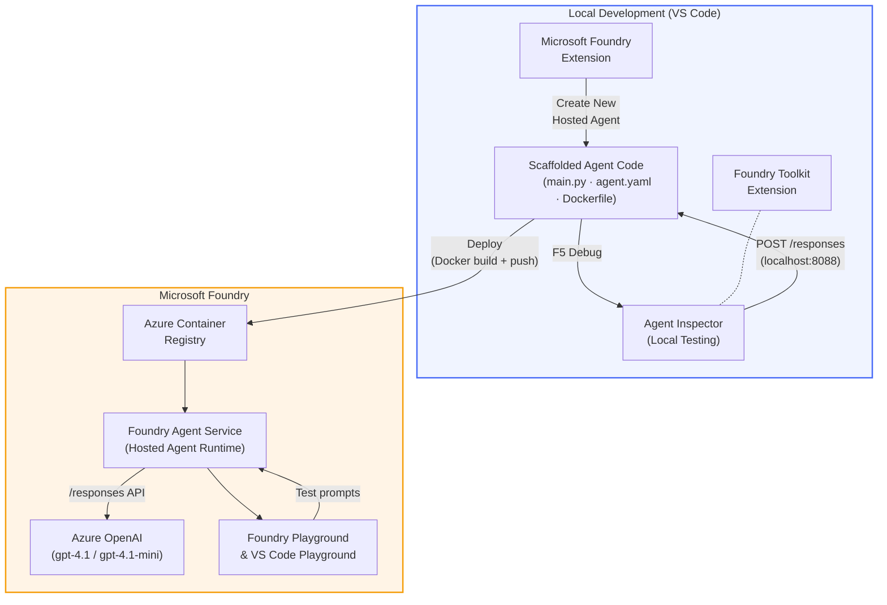

# Foundry Toolkit + Foundry Hosted Agents பணிமனை

[](https://www.python.org/)
[](https://learn.microsoft.com/agent-framework/)
[](https://learn.microsoft.com/azure/foundry/agents/concepts/hosted-agents)
[](https://ai.azure.com/)
[](https://learn.microsoft.com/azure/ai-services/openai/)
[](https://learn.microsoft.com/cli/azure/install-azure-cli)
[](https://learn.microsoft.com/azure/developer/azure-developer-cli/install-azd)
[](https://www.docker.com/)
[](https://marketplace.visualstudio.com/items?itemName=ms-windows-ai-studio.windows-ai-studio)
[](LICENSE)

**Microsoft Foundry Agent Service**இல் **Hosted Agents** ஆக AI முகவரிகளை கட்டியெழுது, சோதனை செய்து, வெளியிடுக - முழுக்க முழுக்க VS Code இல் இருந்து **Microsoft Foundry விரிவாக்கம்** மற்றும் **Foundry Toolkit** பயன்படுத்தி.

> **Hosted Agents தற்போது முன்னோட்ட நிலையில் உள்ளன.** ஆதரவு உள்ள பகுதிகள் வரையறுக்கப்பட்டுள்ளன - [பிரதேச கிடைப்பைக் காண்க](https://learn.microsoft.com/azure/foundry/agents/concepts/hosted-agents#region-availability).

> ஒவ்வொரு ஆய்வகத்திலும் உள்ள `agent/` கோப்புறை **Foundry விரிவாக்கத்தால் தானியங்கி கட்டமைக்கப்படுகிறது** - பின்னர் நீங்கள் கோட்டை தனிப்பயனாக்கி, உள்ளூர் சோதனை செய்து, வெளியிடலாம்.

### 🌐 பன்மொழி ஆதரவு

#### GitHub Action மூலம் ஆதரிக்கப்படுகிறது (தானாகவும் எப்பொழுதும் புதுப்பிக்கப்படும்)

<!-- CO-OP TRANSLATOR LANGUAGES TABLE START -->
[Arabic](../ar/README.md) | [Bengali](../bn/README.md) | [Bulgarian](../bg/README.md) | [Burmese (Myanmar)](../my/README.md) | [Chinese (Simplified)](../zh-CN/README.md) | [Chinese (Traditional, Hong Kong)](../zh-HK/README.md) | [Chinese (Traditional, Macau)](../zh-MO/README.md) | [Chinese (Traditional, Taiwan)](../zh-TW/README.md) | [Croatian](../hr/README.md) | [Czech](../cs/README.md) | [Danish](../da/README.md) | [Dutch](../nl/README.md) | [Estonian](../et/README.md) | [Finnish](../fi/README.md) | [French](../fr/README.md) | [German](../de/README.md) | [Greek](../el/README.md) | [Hebrew](../he/README.md) | [Hindi](../hi/README.md) | [Hungarian](../hu/README.md) | [Indonesian](../id/README.md) | [Italian](../it/README.md) | [Japanese](../ja/README.md) | [Kannada](../kn/README.md) | [Khmer](../km/README.md) | [Korean](../ko/README.md) | [Lithuanian](../lt/README.md) | [Malay](../ms/README.md) | [Malayalam](../ml/README.md) | [Marathi](../mr/README.md) | [Nepali](../ne/README.md) | [Nigerian Pidgin](../pcm/README.md) | [Norwegian](../no/README.md) | [Persian (Farsi)](../fa/README.md) | [Polish](../pl/README.md) | [Portuguese (Brazil)](../pt-BR/README.md) | [Portuguese (Portugal)](../pt-PT/README.md) | [Punjabi (Gurmukhi)](../pa/README.md) | [Romanian](../ro/README.md) | [Russian](../ru/README.md) | [Serbian (Cyrillic)](../sr/README.md) | [Slovak](../sk/README.md) | [Slovenian](../sl/README.md) | [Spanish](../es/README.md) | [Swahili](../sw/README.md) | [Swedish](../sv/README.md) | [Tagalog (Filipino)](../tl/README.md) | [Tamil](./README.md) | [Telugu](../te/README.md) | [Thai](../th/README.md) | [Turkish](../tr/README.md) | [Ukrainian](../uk/README.md) | [Urdu](../ur/README.md) | [Vietnamese](../vi/README.md)

> **உள்நாட்டு கிளோன் எடுக்க விரும்புகிறீர்களா?**
>
> இந்த களஞ்சியம் 50+ மொழிபெயர்ப்புகளைச் கொண்டுள்ளது, இது பதிவிறக்கம் அளவை மோசமாக எவ்வளவும் அதிகரிக்கும். மொழிபெயர்ப்புகளை இல்லாமல் கிளோன் செய்ய sparse checkout பயன்படுத்தவும்:
>
> **Bash / macOS / Linux:**
> ```bash
> git clone --filter=blob:none --sparse https://github.com/microsoft-foundry/Foundry_Toolkit_for_VSCode_Lab.git
> cd Foundry_Toolkit_for_VSCode_Lab
> git sparse-checkout set --no-cone '/*' '!translations' '!translated_images'
> ```
>
> **CMD (Windows):**
> ```cmd
> git clone --filter=blob:none --sparse https://github.com/microsoft-foundry/Foundry_Toolkit_for_VSCode_Lab.git
> cd Foundry_Toolkit_for_VSCode_Lab
> git sparse-checkout set --no-cone "/*" "!translations" "!translated_images"
> ```
>
> இது பாடத்தினை முடிக்க தேவையான அனைத்தையும் கொண்டு வருகிறது மேலும் மிக விரைவான பதிவிறக்கம் தருகிறது.
<!-- CO-OP TRANSLATOR LANGUAGES TABLE END -->

---

## நிரலமைப்பு



**செயல் ஓட்டம்:** Foundry விரிவக்கம் முகவரியை கட்டமைக்கிறது → நீங்கள் கோடை, வழிமுறைகளை தனிப்பயனாக்குகிறீர்கள் → Agent Inspector உடன் உள்ளூர் சோதனை செய்கிறீர்கள் → Foundry க்கு வெளியிடுகிறீர்கள் (Docker படம் ACR க்கு அழுத்தம்) → Playground இல் சரிபார்க்கவும்.

---

## நீங்கள் என்ன கட்டவோமோ

| ஆய்வகம் | விளக்கம் | நிலை |
|-----|-------------|--------|
| **ஆய்வகம் 01 - ஒரே முகவர்** | **"Explain Like I'm an Executive" முகவரியை** கட்டு, உள்ளூரில் சோதனை செய், Foundryக்கு வெளியிடு | ✅ கிடைக்கிறது |
| **ஆய்வகம் 02 - பன்முகவர் வேலைநடை** | **"Resume → Job Fit Evaluator"** - 4 முகவர்கள் சேர்ந்து ரெசுமே பொருத்தத்தை மதிப்பீடு செய்து கற்றல் திட்டத்தை உருவாக்குகின்றனர் | ✅ கிடைக்கிறது |

---

## Executive Agent ஐ காண்க

இந்த பணிமனையில் நீங்கள் **"Explain Like I'm an Executive" முகவரியை** கட்டுவீர்கள் - கடினமான தொழில்நுட்ப சொற்களை அமைதியான, குழு அறைக்கு பொருந்தக்கூடிய சுருக்கங்களுக்கு மொழிபெயர்க்கும் AI முகவரி. உண்மை சொல்லப்போனால், C-suite இல் யாரும் "thread pool exhaustion caused by synchronous calls introduced in v3.2." பற்றி கேட்க விரும்புவதில்லை.

நான் இந்த முகவரியை பல முறை என் நன்கு ரচিত post-mortemக்கு நடந்த எதிர்வினையைப் பார்த்து கட்டியுள்ளேன்: *"எனவே… இணையதளம் வேலைநிறுத்தம் ஆகி உள்ளதா இல்லையா?"*

### இது எப்படி செயல்படுகிறது

நீங்கள் ஒரு தொழில்நுட்ப புதுப்பிப்பை கொடுத்தால், அது ஒரு நிர்வாகத் துறைக் சுருக்கத்தை திருப்பி வழங்கும் - மூன்று முக்கிய அம்சங்கள், jargon இல்லாமல், stack traces இல்லாமல், அல்லது existential அச்சமின்றி. சீரான **என்ன நடந்தது**, **வேலைகளுக்கு தாக்கம்**, மற்றும் **அடுத்த படி** கூறப்படும்.

### செயலில் பார்க்கவும்

**நீங்கள் சொல்கிறீர்கள்:**
> "API நேர தாமதம் thread pool exhaustion காரணமாக வாக்களிக்கப்பட்ட synchronous அழைப்புகள் மூலம் v3.2 இல் ஏற்பட்டது."

**முகவர் பதில் அளிக்கிறார்:**

> **நிர்வாக சுருக்கம்:**
> - **என்ன நடந்தது:** சமீபத்திய வெளியீட்டுக்கு பிறகு, அமைப்பு மெதுவாகியது.
> - **வணிக தாக்கம்:** சில பயனர்கள் சேவையை பயன்படுத்தும் போது தாமதம் கண்டனர்.
> - **அடுத்த படி:** மாற்றம் மீண்டும் பழைய நிலைக்கு கொண்டு வரப்பட்டது மற்றும் மறுதுவக்கு முன் சரி செய்தல் தயாரிக்கப்படுகிறது.

### இந்த முகவரியை ஏன்?

இது மிகவும் எளிமையான, ஒரே நோக்கமுள்ள முகவரி - குழப்பமான கருவி சங்கிலியில் சிக்கவில்லாமல் hosted agent வேலைநடைமுறையை முழுமையாக கற்றுக்கொள்ள சிறந்தது. மற்றும் உண்மையாக சொல்கிறேன்? ஒவ்வொரு பொறியியல் குழுவுக்கும் இதுபோன்று ஒன்று இருந்தால் பயனாக இருக்கும்.

---

## பணிமனை அமைப்பு

```
📂 Foundry_Toolkit_for_VSCode_Lab/
├── 📄 README.md                      ← You are here
└── 📂 workshop/
    ├── 📂 lab01-single-agent/        ← Full lab: docs + agent code
    │   ├── README.md                 ← Hands-on lab instructions
    │   ├── 📂 docs/                  ← Step-by-step tutorial modules
    │   │   ├── 00-prerequisites.md
    │   │   ├── 01-setup.md
    │   │   ├── 02-create-hosted-agent.md
    │   │   ├── 03-configure-and-code.md
    │   │   ├── 04-test-locally.md
    │   │   ├── 05-deploy-to-foundry.md
    │   │   ├── 06-verify-in-playground.md
    │   │   ├── 07-summary.md
    │   │   └── 08-troubleshooting.md
    │   └── 📂 agent/                 ← Reference solution (auto-scaffolded by Foundry extension)
    │       ├── agent.yaml
    │       ├── Dockerfile
    │       ├── main.py
    │       └── requirements.txt
    └── 📂 lab02-multi-agent/         ← Resume → Job Fit Evaluator
        ├── README.md                 ← Hands-on lab instructions (end-to-end)
        ├── 📂 docs/                  ← Step-by-step tutorial modules
        │   ├── 00-prerequisites.md
        │   ├── 01-understand-multi-agent.md
        │   ├── 02-scaffold-multi-agent.md
        │   ├── 03-configure-agents.md
        │   ├── 04-orchestration-patterns.md
        │   ├── 05-test-locally.md
        │   ├── 06-deploy-to-foundry.md
        │   ├── 07-verify-in-playground.md
        │   ├── 08-troubleshooting.md
        │   └── 09-summary.md
        └── 📂 PersonalCareerCopilot/ ← Reference solution (multi-agent workflow)
            ├── agent.yaml
            ├── Dockerfile
            ├── main.py
            └── requirements.txt
```

> **குறிப்பு:** ஒவ்வொரு ஆய்வகத்திலும் உள்ள `agent/` கோப்புறை **Microsoft Foundry விரிவாக்கம்** `Microsoft Foundry: Create a New Hosted Agent` கட்டளை பேலட் இல் இயக்கப்படும் போது உருவாக்கப்படுகிறது. பின்னர் அந்த கோப்புக்கள் உங்கள் முகவரின் வழிமுறைகள், கருவிகள் மற்றும் அமைப்புகளுடன் தனிப்பயனாக்கப்படுகின்றன. ஆய்வகம் 01 இல் இதனைத் தோற்று திரும்ப கொள்வது கற்பிக்கப்படுகிறது.

---

## தொடங்குவது எப்படி

### 1. களஞ்சியத்தை கிளோன் செய்யவும்

```bash
git clone https://github.com/microsoft-foundry/Foundry_Toolkit_for_VSCode_Lab.git
cd Foundry_Toolkit_for_VSCode_Lab
```

### 2. Python கூடுதல் சூழல் அமைக்கவும்

```bash
python -m venv venv
```

அதை இயக்கவும்:

- **Windows (PowerShell):**
  ```powershell
  .\venv\Scripts\Activate.ps1
  ```
- **macOS / Linux:**
  ```bash
  source venv/bin/activate
  ```

### 3. சார்புகளை நிறுவுக

```bash
pip install -r workshop/lab01-single-agent/agent/requirements.txt
```

### 4. சூழல் மாறிலிகள் அமைக்கவும்

முகவரிக் கோப்புறையில் உள்ள `.env` எடுத்துக்காட்டை நகலெடுத்துக் கொண்டு உங்கள் மதிப்புகளை நிரப்பவும்:

```bash
cp workshop/lab01-single-agent/agent/.env.example workshop/lab01-single-agent/agent/.env
```

`workshop/lab01-single-agent/agent/.env` மாற்றங்கள் செய்யவும்:

```env
FOUNDRY_PROJECT_ENDPOINT=https://<your-account>.services.ai.azure.com/api/projects/<your-project>
AZURE_AI_MODEL_DEPLOYMENT_NAME=<your-model-deployment-name>
```

### 5. பணிமனை ஆய்வகங்களை பின்பற்றவும்

ஒவ்வொரு ஆய்வகமும் தனித்த modules உடன் வருகிறத. **ஆய்வகம் 01** மூலம் அடிப்படைகளை கற்றுக்கொள்ளவும் பின்னர் **ஆய்வகம் 02** பன்முகவர் வேலைநடைகளை கற்றுக்கொள்ளவும்.

#### ஆய்வகம் 01 - ஒரே முகவர் ([முழு வழிமுறைகள்](workshop/lab01-single-agent/README.md))

| # | தொகுதி | இணைப்பு |
|---|--------|------|
| 1 | முன்னோக்கியதைப் படிக்கவும் | [00-prerequisites.md](workshop/lab01-single-agent/docs/00-prerequisites.md) |
| 2 | Foundry Toolkit மற்றும் Foundry விரிவாக்கத்தை நிறுவவும் | [01-setup.md](workshop/lab01-single-agent/docs/01-setup.md) |
| 3 | Foundry திட்டத்தை உருவாக்குங்கள் | [01-setup.md](workshop/lab01-single-agent/docs/01-setup.md) |
| 4 | ஒரு hosted முகவரியை உருவாக்குங்கள் | [02-create-hosted-agent.md](workshop/lab01-single-agent/docs/02-create-hosted-agent.md) |
| 5 | வழிமுறைகள் மற்றும் சூழல் அமைப்பை மாற்றவும் | [03-configure-and-code.md](workshop/lab01-single-agent/docs/03-configure-and-code.md) |
| 6 | உள்ளூரில் சோதனை செய்க | [04-test-locally.md](workshop/lab01-single-agent/docs/04-test-locally.md) |
| 7 | Foundryக்கு வெளியிடு | [05-deploy-to-foundry.md](workshop/lab01-single-agent/docs/05-deploy-to-foundry.md) |
| 8 | விளையாட்டு தளத்தில் சரிபார்க்கவும் | [06-verify-in-playground.md](workshop/lab01-single-agent/docs/06-verify-in-playground.md) |
| 9 | சுருக்கம் மற்றும் அடுத்த படிகள் | [07-summary.md](workshop/lab01-single-agent/docs/07-summary.md) |
| 10 | பிரச்சினைகள் தீர்வு | [08-troubleshooting.md](workshop/lab01-single-agent/docs/08-troubleshooting.md) |

#### ஆய்வகம் 02 - பன்முகவர் வேலைநடை ([முழு வழிமுறைகள்](workshop/lab02-multi-agent/README.md))

| # | தொகுதி | இணைப்பு |
|---|--------|------|
| 1 | முன்னோக்கியவை (ஆய்வகம் 02) | [00-prerequisites.md](workshop/lab02-multi-agent/docs/00-prerequisites.md) |
| 2 | பன்முகவர் நிரலமைப்பை புரிந்து கொள்ளவும் | [01-understand-multi-agent.md](workshop/lab02-multi-agent/docs/01-understand-multi-agent.md) |
| 3 | பன்முகவர் திட்டத்தை கட்டமைக்கவும் | [02-scaffold-multi-agent.md](workshop/lab02-multi-agent/docs/02-scaffold-multi-agent.md) |
| 4 | முகவரிகளும் சூழலும் அமைப்பு | [03-configure-agents.md](workshop/lab02-multi-agent/docs/03-configure-agents.md) |
| 5 | ஒருங்கிணைப்பு மாதிரிகள் | [04-orchestration-patterns.md](workshop/lab02-multi-agent/docs/04-orchestration-patterns.md) |
| 6 | உள்ளூர் சோதனை (பன்முகவர்) | [05-test-locally.md](workshop/lab02-multi-agent/docs/05-test-locally.md) |
| 7 | Foundryக்கு வெளியிடு | [06-deploy-to-foundry.md](workshop/lab02-multi-agent/docs/06-deploy-to-foundry.md) |
| 8 | விளையாட்டு தளத்தில் சரிபார்க்கவும் | [07-verify-in-playground.md](workshop/lab02-multi-agent/docs/07-verify-in-playground.md) |
| 9 | பிரச்சினைகள் தீர்வு (பன்முகவர்) | [08-troubleshooting.md](workshop/lab02-multi-agent/docs/08-troubleshooting.md) |
| 10 | சுருக்கம் மற்றும் அடுத்த படிகள் | [09-summary.md](workshop/lab02-multi-agent/docs/09-summary.md) |

---

## பராமரிப்பாளர்

<table>
<tr>
    <td align="center"><a href="https://github.com/ShivamGoyal03">
        <br />
        <sub><b>ஷிவாம் கோயல்</b></sub>
    </a><br />
    </td>
</tr>
</table>

---

## தேவையான அனுமதிகள் (விரைவு குறிப்பு)

| சூழ்நிலை | தேவையான பங்கு வகிகள் |
|----------|--------------------|
| புதிய Foundry திட்டத்தை உருவாக்குதல் | Foundry வளத்தில் **Azure AI உரிமையாளர்** |
| உள்ளாட்சி திட்டத்தில் (புதிய வளங்களை) வெளியிடுதல் | சந்தா மீது **Azure AI உரிமையாளர்** + **கொடுப்பனவு நபர்** |
| முழுமையாக அமைக்கப்பட்ட திட்டத்தில் வெளியிடுதல் | கணக்கில் **வாசிப்பவர்** + திட்டத்தில் **Azure AI பயனர்** |

> **முக்கியம்:** Azure `Owner` மற்றும் `Contributor` பங்களிப்புகள் *மேலாண்மை* அனுமதிகளையே கொண்டிருக்கின்றன, *வரைவு* (தரவு செயல்) அனுமதிகளை அல்ல. முகவர்கள் உருவாக்க மற்றும் பின்வரிசைப்படுத்த **Azure AI User** அல்லது **Azure AI Owner** வேண்டியது அவசியம்.

---

## குறிப்புகள்

- [முதலாம் ஹோஸ்ட் செய்யப்பட்ட முகவரை விரைவிலேயே 배포 செய்வது (VS Code)](https://learn.microsoft.com/azure/foundry/agents/quickstarts/quickstart-hosted-agent)
- [ஹோஸ்ட் செய்யப்பட்ட முகவர்கள் என்ன?](https://learn.microsoft.com/azure/foundry/agents/concepts/hosted-agents)
- [VS Code-ல் ஹோஸ்ட் செய்யப்பட்ட முகவர் வேலைப்பாடுகளை உருவாக்குதல்](https://learn.microsoft.com/azure/foundry/agents/how-to/vs-code-agents-workflow-pro-code)
- [ஹோஸ்ட் செய்யப்பட்ட முகவரை 배포 செய்யல்](https://learn.microsoft.com/azure/foundry/agents/how-to/deploy-hosted-agent)
- [Microsoft Foundry සඳහා RBAC](https://learn.microsoft.com/azure/foundry/concepts/rbac-foundry)
- [வமைப்பு மதிப்பாய்வு முகவர் உதாரணம்](https://github.com/Azure-Samples/agent-architecture-review-sample) - MCP கருவிகள், Excalidraw வரைபடங்கள் மற்றும் இரட்டை 배포 உடன் உண்மையான ஹோஸ்ட் செய்யப்பட்ட முகவர்

---


## உரிமம்

[MIT](../../LICENSE)

---

<!-- CO-OP TRANSLATOR DISCLAIMER START -->
**மறுப்பு**:
இந்த ஆவணம் AI மொழிபெயர்ப்பு சேவை [Co-op Translator](https://github.com/Azure/co-op-translator) பயன்படுத்தி மொழிபெயர்க்கப்பட்டுள்ளது. நாங்கள் துல்லியத்திற்காக முயற்சி செய்துள்ளோம், ஆனால் தானாக செய்யப்படும் மொழிபெயர்ப்புகளில் பிழைகள் அல்லது தவறுகள் இருக்கலாம் என்பதை கவனத்தில் கொள்ளவும். அசல் ஆவணம் அதன் தாய்மொழியில் அதிகாரப்பூர்வ ஆதாரமாக கருதப்பட வேண்டும். முக்கியமான தகவல்களுக்கு, தொழில்நுட்பமான மனித மொழிபெயர்ப்பு பரிந்துரைக்கப்படுகிறது. இந்த மொழிபெயர்ப்பைப் பயன்படுத்துவதால் ஏற்படும் எந்த தவறான புரிதல்கள் அல்லது தவறான விளக்கத்திற்கும் நாங்கள் பொறுப்பில்வில்லை.
<!-- CO-OP TRANSLATOR DISCLAIMER END -->