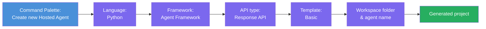
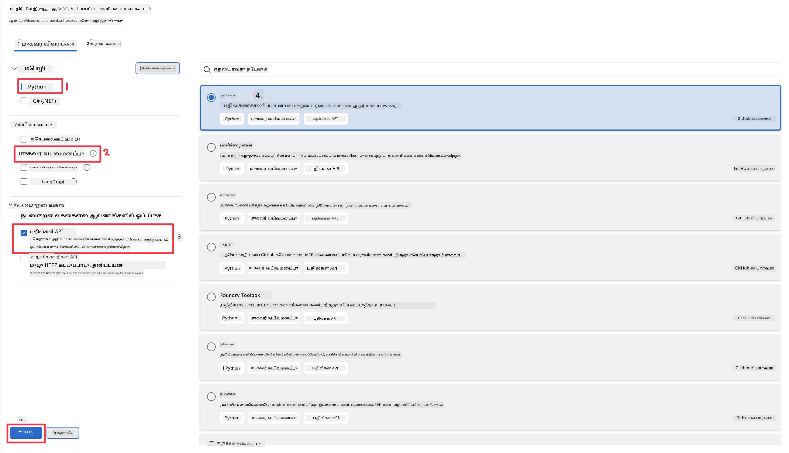
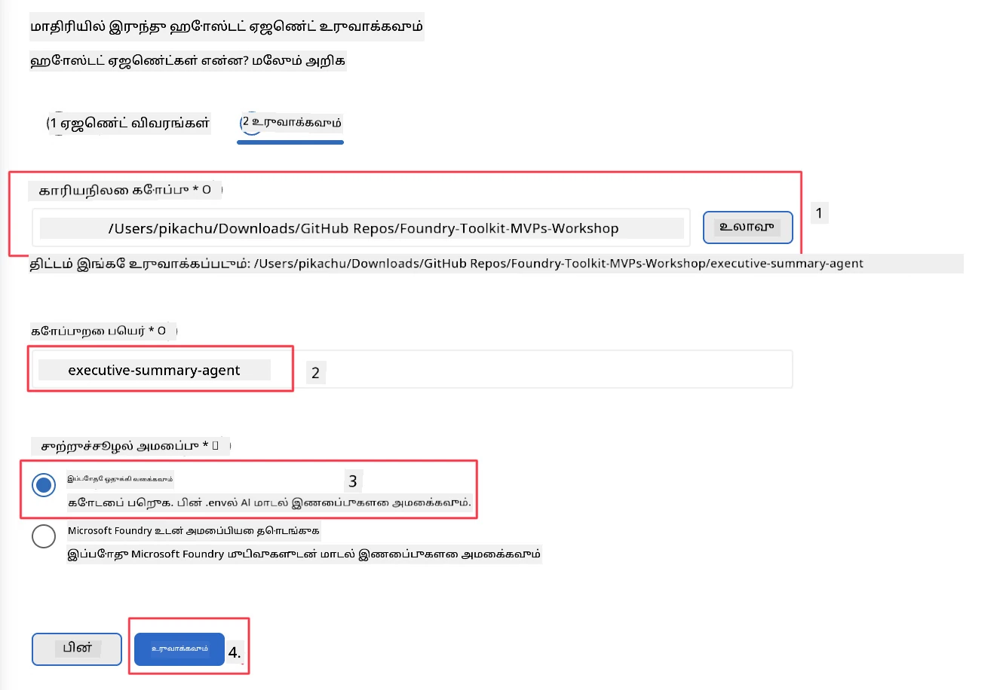

# மொடியூல் 2 - புதிய ஹோஸ்ட் செய்யப்பட்ட முகவரியை உருவாக்கவும்

⏱️ ~5 நிமிடங்கள்

இம்மொடியூலில், நீங்கள் Foundry Toolkit ஐ பயன்படுத்தி **ஹோஸ்ட் செய்யப்பட்ட முகவர் திட்டத்தை உருவாக்குவீர்கள்**. இந்த உருவாக்கி முழு திட்ட அமைப்பையும் உருவாக்குகிறது - `agent.yaml`, `main.py`, `Dockerfile`, `requirements.txt` மற்றும் VS கோட் டீபக் உள்ளமைவு - ஆகையால் நீங்கள் முகவரியின் செயல்பாட்டை தனிப்பயனாக்குவதில் கவனம் செலுத்தலாம்.

> **முக்கிய கருத்து:** இந்த ஆய்வகத்தில் `agent/` папையம் Foundry Toolkit உருவாக்கும் உதாரணமாகும். நீங்கள் இக்கோப்புகளை ஆரம்பத்திலிருந்து எழுத தேவையில்லை.

### உருவாக்கி வழிகாட்டி ஓட்டம்



---

## படி 1: Create Hosted Agent வழிகாட்டியை திறக்கவும்

1. `Ctrl+Shift+P` அழுத்தி **கமாண்ட் பாத்லெட்** ஐ திறக்கவும்.
2. تایپ செய்யவும்: **Foundry Toolkit: Create new Hosted Agent** மற்றும் அதை தேர்வுசெய்க.

> **மாற்று வழி: Foundry க واسம் மூலம் உருவாக்கவும்**
> உலாவியில் விருப்பமிருக்கின், நீங்கள் உங்கள் திட்டத்தை [https://ai.azure.com](https://ai.azure.com) இல் உருவாக்கலாம். திட்டம் ஏற்படுத்தப்பட்ட பின்னர் VS கோடிற்கு திரும்பி, **Foundry Toolkit** பக்கவழியை பயன்படுத்தி அதுடன் இணைக்கவும்.

> **மாற்று வழி:** Foundry Toolkit பக்கவழியில், உங்கள் திட்டத்தின் கீழ் உள்ள **Agents** மீது மவுஸ் கொண்டு, **+** ஐகானை சொடுக்கி, தொடர்ந்து **Create in Code With Template** ஐ தேர்ந்தெடுக்கவும்.

## படி 2: அமைப்புக்களை தேர்ந்தெடு



1. இடது வழிசெலுத்தல்/விருப்ப பகுதியில் கீழ்கண்டவற்றை தேர்ந்தெடுக்கவும்:

| மெனு | தேர்வு | குறிப்பு |
|--------|-----------|-------|
| **மொழி** | Python | C# கூட ஆதரிக்கப்படுகிறது |
| **சட்டமைப்பு** | Agent Framework | Agent Framework SDK மூலம் எளிய தொடக்க புள்ளி |
| **API வகை** | Response API | `POST /responses` - உரையாடல்மயமானது, பிளாட்பார்ம் நடத்தும் வரலாறு உண்டு |
| **தொலைப்பு** | Basic | Agent Framework SDK மூலம் எளிய தொடக்க புள்ளி |

2. தேர்ந்தெடுத்த பின் **Next** ஐ சொடுக்கவும்



3. அடுத்த சாளரத்தில் கீழ்கண்டவற்றை தேர்ந்தெடுக்கவும்:

| மெனு | தேர்வு | குறிப்பு |
|--------|-----------|-------|
| **கார்யப்பாகம் கோப்புறை** | இலக்கு கோப்புறையை தேர்வு செய்க | எடுத்துக்காட்டாக, `/workspace/Foundry_Toolkit_for_VSCode_Lab/` அல்லது இந்த ரூபோவில் ஒரு துணைக்கோப்புறை |
| **முகவர் பெயர்** | ஒரு பெயரை உள்ளிடவும் | எடுத்துக்காட்டாக, `executive-summary-agent` |
| **சுற்றுச்சூழல் அமைப்பு** | தற்போது அமைப்பை தவிர்க்கவும் |  |

**create** ஐ சொடுத்து உள்ள முகவரியை உருவாக்கவும். புதிய கோப்புறை உருவாக்கப்பட்ட முகவர் பெயருடன் உருவாகும்.

## படி 3: உருவாக்கப்பட்ட திட்டத்தை ஆய்வு செய்க

உருவாக்கி முடிந்த பிறகு, Exploler இல் (`Ctrl+Shift+E`) இக்கோப்புக்களை காண்கிறீர்கள் என்பதை உறுதிப்படுத்தவும்:

```
📂 executive-summary-agent/
├── .env                ← Environment variables (placeholders)
├── .vscode/
│   ├── launch.json     ← Debug config (F5 → run + Agent Inspector)
│   └── tasks.json      ← VS Code task definitions
├── agent.yaml          ← Agent definition (kind: hosted)
├── Dockerfile          ← Container config for deployment
├── main.py             ← Agent entry point (your main code)
└── requirements.txt    ← Python dependencies
```

### முக்கியமான கோப்புகள் விளக்கம்

| கோப்பு | நோக்கம் |
|------|---------|
| `agent.yaml` | முகவரியை `kind: hosted` என்று அறிவிக்கும், சுற்றுச்சூழல் மாறிலிகளுக்கு வரைபடம் செய்கிறது, `/responses` கட்டளைகளை வரையறுக்கிறது |
| `main.py` | ஒரு `FoundryChatClient` உருவாக்குகிறது → அதனை `Agent` இல் பொருத்தி → `ResponsesHostServer` மூலம் 8088 போர்டில் சேவை செய்கிறது |
| `Dockerfile` | `python:3.12-slim` பயன்படுத்துகிறது, சார்புகளை நிறுவுகிறது, 8088 போர்டை வெளிப்படுத்துகிறது, `main.py` ஓடும் |
| `requirements.txt` | `agent-framework-foundry`, `agent-framework-foundry-hosting`, `mcp`, `debugpy` |

> **முக்கியம்:** scaffold செய்யப்பட்ட முகவர் கோப்புறையை நேரடியாக VS கோடில் (ஆன்டை `agent/` கோப்புறை) திறக்கவும் மேலும் `.vscode/launch.json` மற்றும் `tasks.json` சரியாக F5 டீபக்கிங் இயங்கும்.

---

### ✅ பரிசோதனைப் புள்ளி

- [ ] Scaffolded திட்டம் எதிர்பார்க்கப்பட்ட அனைத்து கோப்புகளோடு உருவாக்கப்பட்டது
- [ ] `agent.yaml` `kind: hosted` மற்றும் `protocol: responses` காண்பிக்கிறது
- [ ] `main.py` `Agent`, `FoundryChatClient`, `ResponsesHostServer` இறக்குமதி செய்கிறது
- [ ] முகவர் கோப்புறை VS கோடில் கார்யப்பாகம் ரூட் ஆக திறக்கப்பட்டுள்ளது

---

**முந்தைய:** [01 - அமைப்பு](01-setup.md) · **அடுத்தது:** [03 - கட்டமைப்பு மற்றும் குறியீடு →](03-configure-and-code.md)

---

<!-- CO-OP TRANSLATOR DISCLAIMER START -->
**மறுப்பு**:
இந்த ஆவணம் AI மொழிபெயர்ப்பு சேவை [Co-op Translator](https://github.com/Azure/co-op-translator) பயன்படுத்தி மொழிபெயர்க்கப்பட்டுள்ளது. நாங்கள் துல்லியத்திற்காக முயற்சி செய்துள்ளோம், ஆனால் தானாக செய்யப்படும் மொழிபெயர்ப்புகளில் பிழைகள் அல்லது தவறுகள் இருக்கலாம் என்பதை கவனத்தில் கொள்ளவும். அசல் ஆவணம் அதன் தாய்மொழியில் அதிகாரப்பூர்வ ஆதாரமாக கருதப்பட வேண்டும். முக்கியமான தகவல்களுக்கு, தொழில்நுட்பமான மனித மொழிபெயர்ப்பு பரிந்துரைக்கப்படுகிறது. இந்த மொழிபெயர்ப்பைப் பயன்படுத்துவதால் ஏற்படும் எந்த தவறான புரிதல்கள் அல்லது தவறான விளக்கத்திற்கும் நாங்கள் பொறுப்பில்வில்லை.
<!-- CO-OP TRANSLATOR DISCLAIMER END -->