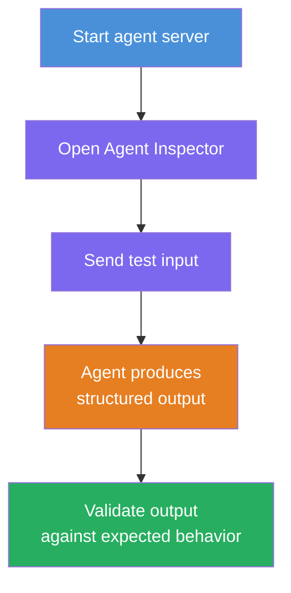
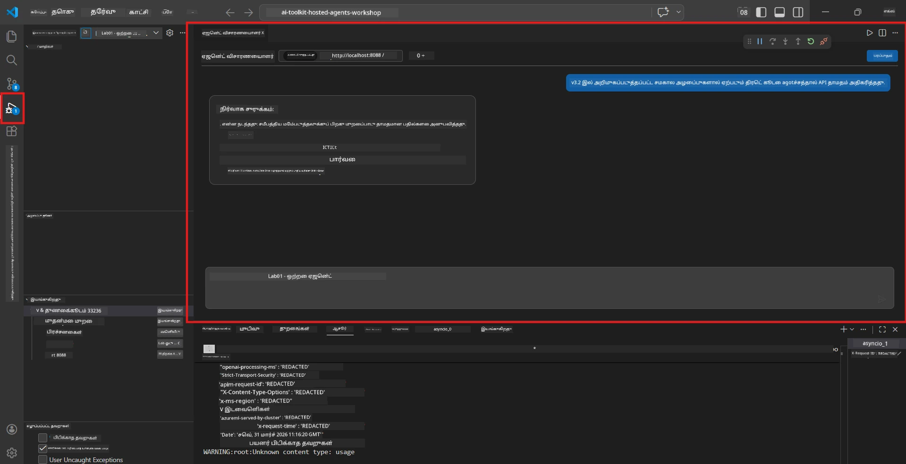
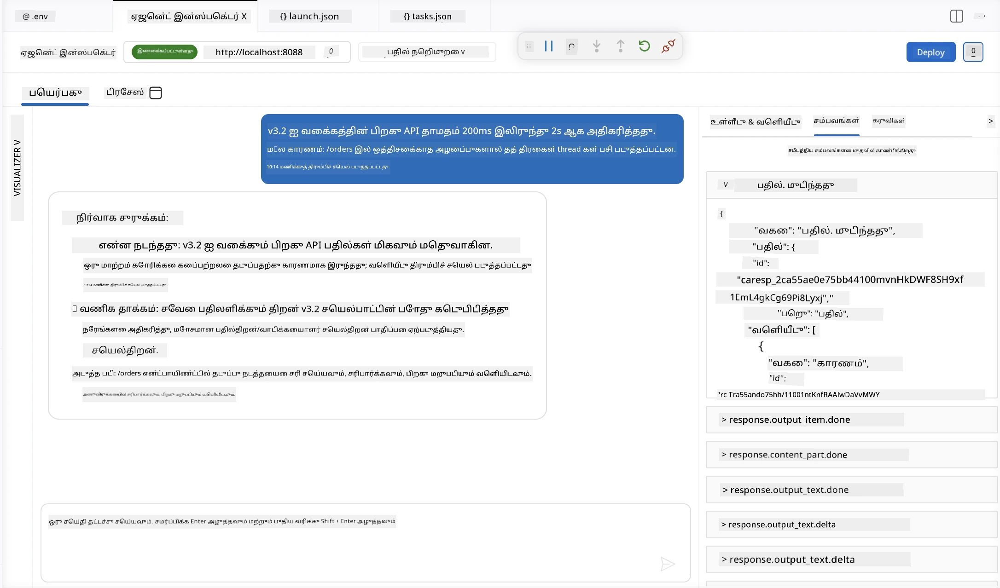

# தொகுதி 4 - உள்ளுரையில் சோதனை செய்க

⏱️ ~10 நிமிடம்

இந்த தொகுதியில், நீங்கள் உங்கள் முகவரியை உள்ளுரையில் இயக்கி **மகிழ்ச்சி பாதை செயல்பாட்டு சோதனைகள்** மூலம் அது சரியாக செயல்படுகிறதா என்பதை உறுதிப்படுத்துவீர்கள். முகவரியInspector (காட்சி UI) அல்லது நேரடி HTTP அழைப்புகளைப் பயன்படுத்தி முகவர் கட்டமைக்கப்பட்ட, துல்லியமான பதில்களை உற்பத்தி செய்கிறது என்பதை உறுதி செய்வீர்கள்.

### உள்ளூர் சோதனை சுழற்சி



---

## விருப்பம்செயல் 1: F5 ஐ நுனுக்கவும் - முகவரியInspector உடன் பிழைத்திருத்தம் (சிபாரசு செய்யப்படுகிறது)

### பிழைத்திருத்தியை துவக்குங்கள்

1. **executive-summary-agent/** கோப்புறையை நேரடி முறையில் VS Code (`File → Open Folder`) இல் திறக்கவும்.
2. **Run and Debug** குழுவை திறக்கவும் (`Ctrl+Shift+D`).
3. பட்டியில் இருந்து **Debug Local Agent HTTP Server** ஐ தேர்ந்தெடுக்கவும்.
4. **F5** ஐ நுனுக்கவும் (அல்லது ▶ பிழைத்திருத்தத்தை துவக்கவும் கிளிக் செய்யவும்).

> ⚠️ **முக்கியம்: உங்கள் Python Interpreter ஐ தேர்ந்தெடுக்கவும்**
> நீங்கள் "ModuleNotFoundError" ஐப் பெறினால் அல்லது பிழைத்திருத்தி துவங்காமல் இருந்தால், உங்கள் கட்டமைப்புப் பயன்பாட்டை பயன்படுத்த VS Code ஐ அறிவிக்க வேண்டும்:
  > 1. அழுத்தவும் `Ctrl+Shift+P` $\rightarrow$ தட்டச்சு செய்யவும் **Python: Select Interpreter**.
  > 2. உங்கள் திட்டத்தின் `.venv` அடைவை உள்ளாகி இருக்கும் interpreter-ஐ தேர்ந்தெடுக்கவும் (எடுத்துக்காட்டு, வின்டோஸில் `.\.venv\Scripts\python.exe`).
  > 3. டிபக் அமர்வை மீண்டும் துவக்கவும்.
> நீங்கள் இன்னும் பிழைகள் பெறுகிறீர்களானால், உங்கள் கோப்பு `tasks.json`-ஐ கீழ்காணும் விதமாக கைமுறையாக புதுப்பிக்கவும்:
  > 1. `.vscode/tasks.json` கோப்பிற்குச் செல்லவும்
  > 2. `Run Agent HTTP Server` எனும் குறிச்சொல்லுடன் உள்ள பணிக்கு செல்லவும்
  > 3. கட்டளை மதிப்பை கீழ்காணும் விதமாக புதுப்பிக்கவும்:
  >    - **Windows:** `"value": "${workspaceFolder}/.venv/Scripts/python.exe",`
  >    - **macOS/Linux:** `"value": "${workspaceFolder}/.venv/bin/python",`

### என்ன நடக்கிறது

1. HTTP சேவையகம் `http://localhost:8088/responses`ல் துவங்கும்.
2. **Agent Inspector** பலகை தானாக திறக்கப்படும் - சோதனைக்கான காட்சிப் பேசுதல் இடைமுகம்.
3. `main.py`ல் இடையீட்டு புள்ளிகள் செயல்படுத்தப்படுகின்றன.

டெர்மினல்-ஐ கவனியுங்கள்:
```
Starting executive summary hosted agent
Executive agent server running on http://localhost:8088
```

> **Agent Inspector திறக்கப்படவில்லையெனில்:** அழுத்தவும் `Ctrl+Shift+P` → **Foundry Toolkit: Open Agent Inspector**.



> *திரைபடம் இருக்கலாம் பழைய 'AI TOOLKIT' வரையறுப்பை காட்டும், முன்னாள் இதயவியல் பதிப்பிலிருந்து.*

---

## விருப்பம் 2: டெர்மினல் வழியாக சோதனை (மாற்று வழி)

ஒரே டெர்மினலில் முகவரியைக் துவக்கவும், மற்றொன்றில் கோரிக்கைகள் அனுப்பவும்:

```bash
# Terminal 1: Start agent
cd executive-summary-agent/
source .venv/bin/activate
python main.py
```

```bash
# Terminal 2: Send test (curl)
curl -sS -X POST http://localhost:8088/responses \
  -H "Content-Type: application/json" \
  -d '{"input": "The API latency increased due to thread pool exhaustion caused by sync calls in v3.2.", "stream": false}'
```

---

## தருண சோதனைகள்: சந்தோஷமான பாதை செயல்பாட்டு சரிபார்ப்பு

கீழ்காணும் **மூன்று** தருணங்களையும் இயக்கவும். இவை உங்கள் முகவர் சரியான, கட்டமைக்கப்பட்ட வெளியீடு வழங்குகின்றதா என்பதை உண்மையான உள்ளீடுகளுக்கு சரிபார்க்கின்றன.



### தருணம் 1: ஐடி சம்பவம் - API தாமத உயர்வு

**உள்ளீடு:**
```
The API latency increased from 200ms to 2s after deploying v3.2.
Root cause: thread pool starvation from synchronous calls in /orders.
Rolled back at 10:14.
```

**எதிர்பார்க்கப்படும் நடத்தை:**
- ✅ "Executive Summary" அமைப்பை பின்பற்றுகிறது (என்ன நடந்தது / வணிக பாதிப்பு / அடுத்த படி)
- ✅ தொழில்நுட்ப சொற்கள் இல்லை ("thread pool" இல்லை, "/orders" இல்லை, "v3.2" இல்லை)
- ✅ தெளிவாக வணிக பாதிப்பை கூறுகிறது (எ.கா., பயனர்கள் தாமதங்களை சந்தித்தனர்)
- ✅ அடுத்த படி உள்ளடக்குகிறது (எ.கா., சரி செய்தல், கண்காணிப்பு நடவடிக்கை)

---

### தருணம் 2: தரவுத் தொற்று - ETL தோல்வி

**உள்ளீடு:**
```
The nightly ETL job failed because the upstream schema changed. APAC dashboards show missing data.
```

**எதிர்பார்க்கப்படும் நடத்தை:**
- ✅ தரவு புதுப்பிப்பு தோல்வியை எளிய மொழியில் சுருக்குகிறது
- ✅ APAC டாஷ்போர்டின் பாதிப்பை குறிப்பிடுகிறது
- ✅ முறையீடு அடுத்த படியை உள்ளடக்கியது
- ✅ "ETL", "schema", அல்லது பிற தொழில்நுட்ப சொற்களை குறிப்பிடவில்லை

---

### தருணம் 3: பாதுகாப்பு - வெளிப்படையான அங்கீகாரம்

**உள்ளீடு:**
```
Static analysis flagged a hardcoded secret in the repository.
The secret may have been exposed in commit history.
```

**எதிர்பார்க்கப்படும் நடத்தை:**
- ✅ அங்கீகாரம்/பாதுகாப்பு பிரச்சனையை நிர்வாகி புரிந்துகொள்ளக்கூடிய மொழியில் விவரிக்கிறது
- ✅ சாத்தியமான ஆபத்தை குறிப்பிடுகிறது (அனுமதியின்றி அணுகல்)
- ✅ முறையீட்டு நடவடிக்கையை தெரிவிக்கிறது (அங்கீகாரம் மறு சுழற்சி, ஆகியவை)
- ✅ "static analysis", "commit history", அல்லது "hardcoded" போன்ற சொற்களை சேர்க்கவில்லை

---

## சரிபார்க்கும் அளவுருக்கள்

ஒவ்வொரு தருணத்திற்குமான சரிபார்ப்பு:

| # | அளவுகோல் | கடப்பாட்டு நிபந்தனை |
|---|----------|---------------|
| 1 | **கட்டமைப்பு** | பதில் "Executive Summary" வடிவம் மற்றும் மூன்று புள்ளிகளையும் உடையது |
| 2 | **எளிய மொழி** | நிர்வாகி புரியாத தொழில்நுட்ப சொற்ற்களில் இல்லாமல் இருக்க வேண்டும் |
| 3 | **துல்லியம்** | சுருக்கம் உள்ளீட்டிற்கு ஏற்ப - போலி விவரங்கள் இல்லை |
| 4 | **சுருக்கம்** | பதில் 100 வார்த்தைகளுக்குள் இருக்க வேண்டும் |
| 5 | **அடுத்த படி** | தெளிவான நடவடிக்கை அல்லது குறைப்புத்தன்மை கூறப்பட்டுள்ளது |

---

## டிபக் சிக்கல்கள் மற்றும் தீர்வுகள்

| சிக்கல் | தீர்வு |
|-------|-----|
| முகவர் துவங்குவதில்லை | `.env` மதிப்புகளைப் பரிசோதிக்கவும், venv இயங்குதலை உறுதி செய்யவும், `pip install -r requirements.txt` இயக்கவும் |
| வெறும் பதில் அல்லது பொது பதில் | `main.py`-இல் உள்ள விளக்கங்களை அணுகவும் - வெளியீட்டு வடிவம் குறிப்பிடப்பட்டுள்ளதா எனப் பார்த்துக் கொள்ளவும் |
| பதில் தொழில்நுட்ப சொற்களைக் கொண்டுள்ளது | "தொழில்நுட்ப சொற்களை அகற்றவும்" விதிகளை வலுப்படுத்தவும் |
| Agent Inspector திறக்கப்படுவதில்லை | `Ctrl+Shift+P` → **Foundry Toolkit: Open Agent Inspector** |
| டெர்மினலில் மாதிரி பிழைகள் | `AZURE_AI_MODEL_DEPLOYMENT_NAME` சரியாக பொருந்துகிறதா சரிபார்க்கவும் (கேஸ்-சென்சிட்டிவ்) |

---

### ✅ சரிபார்ப்பு இடைநிலை

- [ ] முகவர் உள்ளுரலில் பிழைகளின்றி துவங்கும்
- [ ] Agent Inspector திறந்து உரையாடல் இடைமுகத்தை காட்டுகிறது (F5 பயன்படுத்தின்)
- [ ] **தருணம் 1** (ஐடி சம்பவம்) - கட்டமைக்கப்பட்ட Executive Summary, குறும்பதிவு இல்லாமல்
- [ ] **தருணம் 2** (தரவு தொற்று) - தொடர்புடைய சுருக்கம் மற்றும் வணிக பாதிப்பு
- [ ] **தருணம் 3** (பாதுகாப்பு அறிவிப்பு) - பொருத்தமான ஆபத்து தொடர்பான தகவல்
- [ ] அனைத்து பதில்களும் வரையறுக்கப்பட்ட வெளியீட்டு கட்டமைப்பை பின்பற்றுகின்றன

> **உங்கள் பதில்களை பாதுகாக்கவும்** (பிரதி எடுக்க அல்லது திரைபடம் எடுக்கவும்) - Module 06-இல் மேகம் முடிவுகளோடு ஒப்பிடுவீர்கள்.

---

**முந்தைய:** [03 - Configure & Code](03-configure-and-code.md) · **இறுபடுத்தல்:** [05 - Deploy to Foundry →](05-deploy-to-foundry.md)

---

<!-- CO-OP TRANSLATOR DISCLAIMER START -->
**மறுப்பு**:
இந்த ஆவணம் AI மொழிபெயர்ப்பு சேவை [Co-op Translator](https://github.com/Azure/co-op-translator) பயன்படுத்தி மொழிபெயர்க்கப்பட்டுள்ளது. நாங்கள் துல்லியத்திற்காக முயற்சி செய்துள்ளோம், ஆனால் தானாக செய்யப்படும் மொழிபெயர்ப்புகளில் பிழைகள் அல்லது தவறுகள் இருக்கலாம் என்பதை கவனத்தில் கொள்ளவும். அசல் ஆவணம் அதன் தாய்மொழியில் அதிகாரப்பூர்வ ஆதாரமாக கருதப்பட வேண்டும். முக்கியமான தகவல்களுக்கு, தொழில்நுட்பமான மனித மொழிபெயர்ப்பு பரிந்துரைக்கப்படுகிறது. இந்த மொழிபெயர்ப்பைப் பயன்படுத்துவதால் ஏற்படும் எந்த தவறான புரிதல்கள் அல்லது தவறான விளக்கத்திற்கும் நாங்கள் பொறுப்பில்வில்லை.
<!-- CO-OP TRANSLATOR DISCLAIMER END -->