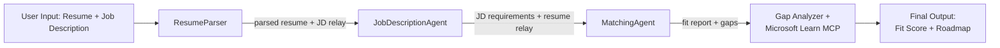

# PersonalCareerCopilot - சுயவிவரம் → வேலை பொருத்த நிலை மதிப்பீட்டாளர்

ஒரு வேலைநடைமுறை முதன்மை பல முகவர்களுக்கான செயலி, இது சுயவிவரம் எந்த அளவுக்கு வேலை விளக்கத்துடன் பொருந்துகிறது என்பதைக் கணக்கிட்டு, பின்னர் திறப்புக்களை மூட個்நியக்க தனிப்பயன் கற்றல் போக்குறை கருவியை உருவாக்குகிறது.

---

## முகவர்கள்

| முகவர் | பங்கு | கருவிகள் |
|-------|------|-------|
| **ResumeParser** | சுயவிவர எழுத்துக்களில் இருந்து கட்டமைப்போற்பட்ட திறன்கள், அனுபவம், சான்றிதழ்களை எடுக்கும் | - |
| **JobDescriptionAgent** | வேலை விளக்கத்திலிருந்து தேவை/விரும்பப்படும் திறன்கள், அனுபவம், சான்றிதழ்களை எடுக்கும் | - |
| **MatchingAgent** | சுயவிவரப் ப்ரொஃபைல் மற்றும் தேவைகளைப் பொருத்தி → பொருத்த மதிப்பெண் (0-100) + பொருந்திய/பொறுக்கப்பட்ட திறன்கள் | - |
| **GapAnalyzer** | Microsoft Learn வளங்கள் கூடிய தனிப்பயன் கற்றல் போக்குறை உருவாக்குகிறது | `search_microsoft_learn_for_plan` (MCP) |

## வேலைநடைமுறை



---

## விரைவு தொடக்கம்

### 1. சுற்றுப்புறத்தை அமைக்கவும்

இந்த கோப்புறை வேலைநடைமுறை அடிப்படையிலான Labor 02 கட்டமைப்புக்கான குறிப்பு செயலாக்கமாகும். அதன் `main.py` தற்போது உள்ள முன்வைக்கப்பட்டத் தொகுதிகள் மற்றும் `WorkflowBuilder` ஐ பயன்படுத்தி நான்கு முகவர்களை இணைக்கிறது.

```powershell
cd workshop\lab02-multi-agent\PersonalCareerCopilot
python -m venv .venv
.\.venv\Scripts\Activate.ps1          # Windows PowerShell
# source .venv/bin/activate            # macOS / Linux
pip install -r requirements.txt
```

### 2. அங்கீகாரங்களை அமைக்கவும்

இந்த கோப்புறையில் ஒரு `.env` கோப்பை உருவாக்கவும்:

```powershell
copy .env .env.bak 2>$null; echo $null > .env
```

`.env` ஐ தொகுக்கவும்:

```env
FOUNDRY_PROJECT_ENDPOINT=https://<your-account>.services.ai.azure.com/api/projects/<your-project>
AZURE_AI_MODEL_DEPLOYMENT_NAME=gpt-4.1-mini
```

| மதிப்பு | எங்கே கிடைக்கும் |
|-------|------------------|
| `FOUNDRY_PROJECT_ENDPOINT` | Foundry கருவித்தொகுதி பக்கவாரப்பக்கம் → உங்கள் திட்டத்தை வலது கிளிக் → **திட்ட முடிவிற்கு நகல்** |
| `AZURE_AI_MODEL_DEPLOYMENT_NAME` | Foundry பக்கவாரப்பக்கம் → திட்டம் விரிவாக்கம் → **மாடல்கள் + முடிவுகள்** → 배치ப்பெயர் |

### 3. உள்ளூர் இயக்கவும்

```powershell
python -m debugpy --listen 127.0.0.1:5679 main.py --port 8088
```

அல்லது VS Code பணியைப் பயன்படுத்தவும்: `Ctrl+Shift+P` → **பணிகள்: பணியை இயக்கவும்** → **Agent HTTP சர்வரை இயக்கவும்**.

F5 பிழைத்திருத்தத்துக்காக, **உள்ளூர் Agent HTTP சர்வரை பிழைத்திருத்தவும்** பயன்படுத்தவும்.

### 4. Agent ஆய்வாளருடன் சோதிக்கவும்

Agent ஆய்வாளரைத் திறக்கவும்: `Ctrl+Shift+P` → **Foundry கருவித்தொகுதி: Agent ஆய்வாளரைத் திறக்கவும்**.

இந்த சோதனை முன்வைக்கையை ஒட்டவும்:

```
Resume:
Jane Doe
Senior Software Engineer with 5 years of experience in Python, Django, and AWS.
Built microservices handling 10K+ requests/second. Led a team of 4 developers.
Certifications: AWS Solutions Architect Associate.
Education: B.S. Computer Science, State University.

Job Description:
Senior Cloud Engineer at Contoso Ltd.
Required: Python, Azure, Kubernetes, Terraform, CI/CD pipelines.
Preferred: Go, monitoring (Prometheus/Grafana), cost optimization.
Experience: 5+ years in cloud infrastructure.
Certifications: Azure Solutions Architect Expert preferred.
```

**எதிர்பார்ப்பு:** பொருத்து மதிப்பெண் (0-100), பொருந்திய/மாய்ந்த திறன்கள், மற்றும் Microsoft Learn URL களை கொண்ட தனிப்பயன் கற்றல் போக்குரை.

### 5. Foundry இல் வெளியிடவும்

`Ctrl+Shift+P` → **Foundry கருவித்தொகுதி: ஹோஸ்ட் செய்யப்பட்ட முகவர்களை வெளியிடவும்** → உங்கள் திட்டத்தைத் தேர்வுசெய்க → உறுதிப்படுத்தவும்.

---

## திட்ட அமைப்பு

```
PersonalCareerCopilot/
├── .env                ← Your credentials (git-ignored)
├── agent.yaml          ← Hosted agent definition (name, resources, env vars)
├── Dockerfile          ← Container image for Foundry deployment
├── main.py             ← 4-agent workflow (instructions, MCP tool, WorkflowBuilder)
└── requirements.txt    ← Python dependencies
```

## முக்கிய கோப்புக்கள்

### `agent.yaml`

Foundry முகவர் சேவைக்கான ஹோஸ்ட் செய்யப்பட்ட முகவரைக் குறிக்கிறது:
- `kind: hosted` - ஒரு நிர்வகிக்கப்பட்ட கன்டெய்னராக இயக்கப்படுகிறது
- `protocols` - `responses` வைதிகத்தை `version: 2.0.0` மூலம் செயல்படுத்துகிறது, `/responses` HTTP முடிவை வெளிப்படுத்துகிறது
- `environment_variables` - `AZURE_AI_MODEL_DEPLOYMENT_NAME` இங்கு அறிக்கை செய்யப்படுகிறது; `FOUNDRY_PROJECT_ENDPOINT` ப்ரயாண நேரத்தில் தானாகச் சேர்க்கப்படுகிறது

### `main.py`

உள்ளடக்கம்:
- **முகவர் வழிகாட்டுதல்கள்** - நான்கு `*_INSTRUCTIONS` ஒற்றுமை, ஒரு முகவருக்கு ஒன்று
- **MCP கருவி** - `search_microsoft_learn_for_plan()` Streamable HTTP மூலம் `https://learn.microsoft.com/api/mcp` ஐ அழைக்கும்
- **முகவர் உருவாக்கம்** - நான்கு `Agent()` மற்றும் `AgentExecutor()` உருவாக்கங்கள் ஒரே `FoundryChatClient` ஐ பகிர்கின்றன
- **வேலைநடைமுறை வரைபடம்** - `WorkflowBuilder` முகவர்களை தொடர் குழாய் போல இணைக்கின்றது: ResumeParser → JD Agent → MatchingAgent → GapAnalyzer
- **சர்வர் துவக்கம்** - `ResponsesHostServer` போர்டு 8088 இல் இயங்கும்

### `requirements.txt`

| தொகுப்பு | நோக்கம் |
|---------|----------|
| `agent-framework-foundry` | மூல நேரடி இயக்கச் சூழல்: `Agent`, `AgentExecutor`, `WorkflowBuilder`, `@tool`, `FoundryChatClient` |
| `agent-framework-foundry-hosting` | `ResponsesHostServer` + Foundry ஹோஸ்டிங் ஒருங்கிணைப்பு |
| `mcp<2,>=1.24.0` | GapAnalyzer இற்கான MCP கிளையண்ட் (`streamable_http_client`) |
| `debugpy` | பைத்தான் பிழைதிருத்தல் (VS Code இல் F5) |

---

## சிக்கல் தீர்வு

| சிக்கல் | தீர்வு |
|-------|-----|
| `KeyError: 'FOUNDRY_PROJECT_ENDPOINT'` அல்லது `KeyError: 'AZURE_AI_MODEL_DEPLOYMENT_NAME'` | இரண்டையும் அமைத்த `.env` கோப்பை உருவாக்கவும்: `FOUNDRY_PROJECT_ENDPOINT` மற்றும் `AZURE_AI_MODEL_DEPLOYMENT_NAME` |
| `ModuleNotFoundError: No module named 'agent_framework'` | venv ஐ இயக்கு மற்றும் `pip install -r requirements.txt` ஐ இயக்கவும் |
| வெளியீட்டில் Microsoft Learn URL இிங் கிடையாது | இணைய இணைப்பை `https://learn.microsoft.com/api/mcp` உடன் சரிபார்க்கவும் |
| ஒன்றே ஒரு குறைபாடு அட்டை (மேற்குறுக்கப்பட்டவை) | `GAP_ANALYZER_INSTRUCTIONS` இல் `CRITICAL:` தொகுதி உள்ளது என்பதை உறுதிசெய்க |
| போர்ட் 8088 பயன்படுத்தப்பட்டு வருகிறது | மற்ற சர்வர்களை நிறுத்தவும்: `netstat -ano \| findstr :8088` |

விரிவான சிக்கல் தீர்வுகளுக்கு, [Module 8 - Troubleshooting](../docs/08-troubleshooting.md) பார்க்கவும்.

---

**முழு நடைமுறை விளக்கம்:** [Lab 02 Docs](../docs/README.md) · **தொடர்ந்து:** [Lab 02 README](../README.md) · [Workshop Home](../../../README.md)

---

<!-- CO-OP TRANSLATOR DISCLAIMER START -->
**மறுப்பு**:
இந்த ஆவணம் AI மொழிபெயர்ப்பு சேவை [Co-op Translator](https://github.com/Azure/co-op-translator) பயன்படுத்தி மொழிபெயர்க்கப்பட்டுள்ளது. நாங்கள் துல்லியத்திற்காக முயற்சி செய்துள்ளோம், ஆனால் தானாக செய்யப்படும் மொழிபெயர்ப்புகளில் பிழைகள் அல்லது தவறுகள் இருக்கலாம் என்பதை கவனத்தில் கொள்ளவும். அசல் ஆவணம் அதன் தாய்மொழியில் அதிகாரப்பூர்வ ஆதாரமாக கருதப்பட வேண்டும். முக்கியமான தகவல்களுக்கு, தொழில்நுட்பமான மனித மொழிபெயர்ப்பு பரிந்துரைக்கப்படுகிறது. இந்த மொழிபெயர்ப்பைப் பயன்படுத்துவதால் ஏற்படும் எந்த தவறான புரிதல்கள் அல்லது தவறான விளக்கத்திற்கும் நாங்கள் பொறுப்பில்வில்லை.
<!-- CO-OP TRANSLATOR DISCLAIMER END -->