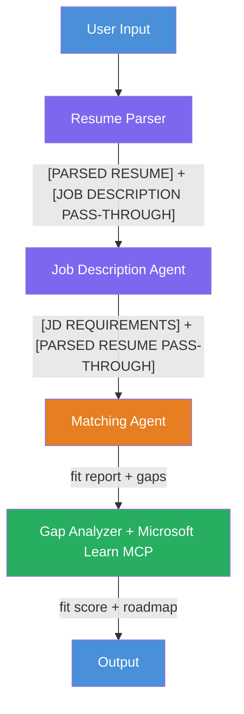

# ஆய்வகம் 02 - பன்முகப்பட்ட செயல்: சுயவிவரம் → வேலை பொருந்தும் மதிப்பீடு

## பார்வை

இந்த செய்முறை ஆய்வகத்தில், நீங்கள் VS கோடில் Foundry கருவித்தொகுப்பை பயன்படுத்தி **செயற்பாடு-முதன்மை பன்முகப்பட்ட செயலி** உருவாக்கி அதை Microsoft Foundry Agent சேவைக்கு அனுப்புவீர்கள்.

**நீங்கள் உருவாக்கப்போகும்து:** ஒரு சுயவிவரம் → வேலை பொருந்தும் மதிப்பீடு செயலி, இது ஒரு சுயவிவரத்தையும் வேலை விளக்கத்தையும் பகுப்பாய்வு செய்து, பொருந்துதலை மதிப்பிட்டு, Microsoft Learn வளங்களைப் பயன்படுத்தி தனிப்பயன் கற்றல் திட்டத்தைக் கொடுக்கிறது.

---

## கட்டமைப்பு

**எப்படி வேலை செய்கிறது:**
1. பயனர் ஒரு சுயவிவரத்தையும் வேலை விளக்கத்தையும் ஒட்டுகிறார்.
2. **ResumeParser** சுயவிவரத்தைப் பகுப்பாய்வு செய்து, வேலை விளக்கத்தை `[JOB DESCRIPTION PASS-THROUGH]` பகுதியில் நகலெடுக்கிறது.
3. **JD Agent** பாத்திரத்திலிருந்து கட்டமைக்கப்பட்ட தேவைகளை எடுக்கிறது, பின்னர் `[PARSED RESUME]` ஐ `[PARSED RESUME PASS-THROUGH]` ஆக முன்னெடுக்கும்.
4. **MatchingAgent** `[PARSED RESUME PASS-THROUGH]` மற்றும் `[JD REQUIREMENTS]` ஐ ஒப்பிட்டு பொருந்துதலைக் கணக்கிடுகிறது.
5. **GapAnalyzer** இடைவெளிகளை நடைமுறைப்பட்ட திட்டமாக மாற்றி, MCP மூலம் உண்மையான Microsoft Learn இணைப்புகளை எடுக்கும்.

---

## முன்பிரதிகள்

முதலில் ஆய்வகம் 01 ஐ முடிக்கவும்:

- [லேப் 01 - ஒரே முகவர்](../lab01-single-agent/README.md)

---

## பகுதி 1: தொகுதிகளை வரிசையில் படியுங்கள்

முழு கற்றல் பாதையை காணவும்:

- [லேப் 2 ஆவணங்கள் - முன்பிரதிகள்](docs/00-prerequisites.md)
- [லேப் 2 ஆவணங்கள் - முழு கற்றல் பாதை](docs/README.md)
- [PersonalCareerCopilot இயக்க கையேடு](PersonalCareerCopilot/README.md)

---

## பகுதி 2: செயல்முறை கட்டமைத்து சோதனைசெய்யவும்

1. Foundry கருவித்தொகுப்பின் வழிகாட்டியுடன் செயல்முறை அடிப்படையிலான திட்டத்தை உருவாக்கவும்.
2. `PersonalCareerCopilot/main.py` இலிருந்து உரையாடல் தகடுகள் மற்றும் செயல்முறை படத்தை உங்கள் பணியிடத்துக்கு நகலெடுக்கவும்.
3. முகவர் பார்வையாளர் மூலம் உள்ளகமாக இயக்கி நான்கு முகவர்களுக்கும் MCP கருவியும் சரியாக உள்ளதா என்பதை உறுதிப்படுத்தவும்.
4. உள்ளக சோதனை வெற்றியடைந்த பின் Foundry ஆக ஓர்முகவரை வெளியிடவும்.

---

## ஒருங்கிணைப்பு மாதிரிகள்

ஆய்வகம் 02 **வரிசைப்படுத்தப்பட்ட குழாய்** முறையை பின்பற்றுகிறது: ஒவ்வொரு முகவரின் வெளியீடு அடுத்ததற்க்கு இன்குட்டாகும், மற்றும் செயல்முறை இறுதியான முகவரின் பதிலைத் திரும்ப வழங்கும். இரண்டு மாதிரிகள் இதை செயல்படுத்துகின்றன:

- **வரிசை சங்கிலி** - `WorkflowBuilder` ResumeParser → JD Agent → MatchingAgent → GapAnalyzer ஐ ஒவ்வொரு படியிலும் ஒரு `add_edge()` அழைப்புடன் இணைக்கிறது
- **உள்ளடக்க பரிமாற்றம்** - ஒவ்வொரு முகவரும் தன் நேரடியான முன் முகவரின் வெளியீட்டை மட்டுமே காணும் காரணத்தால், ResumeParser மற்றும் JD Agent தேவையான தரவை குறிச்சொற்கள் கொண்ட பகுப் பகுதியை உருவாக்கி கீழேயுள்ள முகவர்களுக்கு அனுப்புகின்றன

ஆவணங்கள் ஏன் fan-out/fan-in பயன்படுத்தப்படவில்லை என்பதை விளக்குகின்றன மற்றும் மேலும் ஒரு முகவருடன் செயல்முறை வரைபடத்தை எவ்வாறு விரிவாக்குவது என்பதையும் விளக்குகின்றன.

பார்க்க [docs/04-orchestration-patterns.md](docs/04-orchestration-patterns.md).

---

**முந்தையது:** [ஆராய்ச்சிக் கூடம் 01 - ஒரே முகவர்](../lab01-single-agent/README.md) · **திரும்ப செல்:** [பயிற்சிக் கூடம் முகப்பு](../../README.md)

---

<!-- CO-OP TRANSLATOR DISCLAIMER START -->
**மறுப்பு**:
இந்த ஆவணம் AI மொழிபெயர்ப்பு சேவை [Co-op Translator](https://github.com/Azure/co-op-translator) பயன்படுத்தி மொழிபெயர்க்கப்பட்டுள்ளது. நாங்கள் துல்லியத்திற்காக முயற்சி செய்துள்ளோம், ஆனால் தானாக செய்யப்படும் மொழிபெயர்ப்புகளில் பிழைகள் அல்லது தவறுகள் இருக்கலாம் என்பதை கவனத்தில் கொள்ளவும். அசல் ஆவணம் அதன் தாய்மொழியில் அதிகாரப்பூர்வ ஆதாரமாக கருதப்பட வேண்டும். முக்கியமான தகவல்களுக்கு, தொழில்நுட்பமான மனித மொழிபெயர்ப்பு பரிந்துரைக்கப்படுகிறது. இந்த மொழிபெயர்ப்பைப் பயன்படுத்துவதால் ஏற்படும் எந்த தவறான புரிதல்கள் அல்லது தவறான விளக்கத்திற்கும் நாங்கள் பொறுப்பில்வில்லை.
<!-- CO-OP TRANSLATOR DISCLAIMER END -->