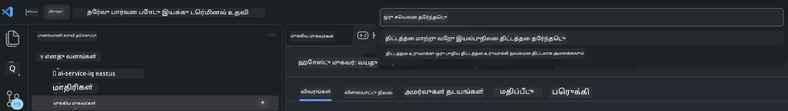

# Module 0 - அறிமுகம்

⏱️ ~10 நிமிடம்

> [!WARNING]
> **முன்னூட்டமும் வரம்புகளும்:** [Hosted Agents](https://learn.microsoft.com/azure/foundry/agents/concepts/hosted-agents) தற்போது **பொது முன்னூட்டத்தில்** உள்ளன - உற்பத்தி வேலைப்பதிவுகளுக்கு பரிந்துரைக்கப்படவில்லை. இந்த பயிற்சி நிலையத்தில் காண்பிக்கப்பட்ட சில அம்சங்கள் சேவை GA நோக்கி நகரும்போது மாற்றப்படலாம்.

## நீங்கள் உருவாக்கப்போகும் விஷயம்

இந்த ஆய்வகத்தில், நீங்கள் Lab 01 இல் இருந்த ஒரே முகவரின் திறன்களை விரிவுபடுத்தி **பல முகவர் பணியூடாகம்** உருவாக்குகிறீர்கள் - ரெஸ்யூம் → வேலை பொருத்தம் மதிப்பாய்வாளி.

நீங்கள் ஒரு **ரெஸ்யூமை** மற்றும் ஒரு **வேலை விளக்கக்குறிப்பை** நகலெடுத்து ஒட்டுகிறீர்கள். நான்கு சிறப்பு முகவர்கள் வரிசையாக உள்ளீட்டை செயலாக்கி, பின்னர் திருப்பி விடுகிறார்கள்:
- பொருத்த மதிப்பெண் (0–100 scoring பகுப்புடன்)
- திறன் மற்றும் சான்றிதழ் குறைபாடுகளின் பட்டியல்
- ஒவ்வொரு குறைபாடுக்கும் Microsoft Learn இல் இருந்து உண்மையான கற்றல் வள இணைப்புகளுடன் தனிப்பயன் கற்றல் திட்டம்

**இந்த பணியூடாகம் பயன்படுத்துகிறது:**
- **Microsoft Agent Framework** - வரிசையாக பைப்ப்லைன் ஒருங்கிணைப்புக்கான `WorkflowBuilder`
- **Foundry Toolkit for VS Code** - கண்காணிப்பு, உள்ளூரில் சோதனை, நிரல்படுத்தல்
- **ஒரு AI மாதிரியானது** (எ.கா., `gpt-4.1-mini`) - நான்கு முகவர்களும் பயன்படுத்தும் 
- **Microsoft Learn MCP சேவையகம்** - ஒவ்வொரு திறன் குறைபாடுக்கும் உண்மையான கற்றல் வள இணைப்புகளை வழங்குகிறது

---

## உங்கள் வழியை தேர்ந்தெடுக்கவும்

> ⚠️ **Lab 01 இல் பயன்படுத்திய அதே பாதையை தொடரவும்.**

<details open>
<summary><strong>🅰️ பாதை A - Azure மேகம் (Azure சந்தா தேவை)</strong></summary>

| | விவரங்கள் |
|---|---|
| **இது யாருக்காக?** | நீங்கள் Lab 01 ஐ Azure சந்தாவுடன் முடித்துள்ளீர்கள் |
| **மாதிரி** | Foundry மூலம் Azure OpenAI (எ.கா., `gpt-4.1-mini`) |
| **முடிக்கப்பட்ட தொகுதிகள்** | அனைத்து தொகுதிகளும் (00–09) |
| **மேகத்திற்கு நிரல்படுத்துவீர்களா?** | ✅ ஆம் - முழுமையான முழு நிறைவு நிரல்படுத்தல் |

</details>

<details open>
<summary><strong>🅱️ பாதை B - Foundry உள்ளூர் (Azure சந்தா தேவையில்லை)</strong></summary>

| | விவரங்கள் |
|---|---|
| **இது யாருக்காக?** | நீங்கள் Lab 01 ஐ Foundry உள்ளூர் மூலம் முடித்துள்ளீர்கள் |
| **மாதிரி** | Foundry உள்ளூர் (இலவசம், உங்கள் இயந்திரத்தில் இயங்குகிறது) |
| **முடிக்கப்பட்ட தொகுதிகள்** | தொகுதிகள் 00–05 (06–07 தவிர்க்கவும் - நிரல்படுத்தல் மற்றும் மேகம் சரிபார்க்கும்) |
| **மேகத்திற்கு நிரல்படுத்துவீர்களா?** | ❌ இல்லை - முகவர் பார்வையாளர் மூலம் உள்ளூரில் மட்டுமே சோதனை |

</details>

---

## Lab 01 சரிபார்ப்பு

Lab 02 நேரடியாக Lab 01 இல் அடிப்படையாகக் கொண்டுள்ளது. இங்கே தொடங்குவதற்கு முன் Lab 01 முடிக்கவும்.

இன்னும் Lab 01 செய்யவில்லை என்றால்? இங்கே தொடங்குங்கள்: [Lab 01 - அறிமுகம்](../../lab01-single-agent/docs/00-prerequisites.md)

<details open>
<summary><strong>🅰️ பாதை A - Azure மேகம்</strong></summary>

```powershell
az account show --query "{name:name, id:id}" --output table
```

இது தோல்வியடைந்தால், `az login` இயக்கவும். பின்னர் VS Code இல் சரிபார்க்கவும்:

1. `Ctrl+Shift+P` → **Foundry Toolkit** என தட்டச்சு செய்யவும் → கட்டளைகள் தோன்றுவதை உறுதிசெய்யவும்.
2. **Foundry Toolkit** ஐ கிளிக் செய்யவும் → உங்கள் திட்டம் மற்றும் நிரல்படுத்தப்பட்ட மாதிரி **வெற்றி** எனக் காண்பிக்கும்.



> **RBAC:** நீங்கள் Lab 01 இல் **Foundry User** ஆக நியமித்துள்ளீர்கள். மறுபடியும் நியமிக்க வேண்டுமானால், [Lab 01, Module 1](../../lab01-single-agent/docs/01-setup.md#deploy-a-model--assign-rbac) ஐ பார்க்கவும். முன்பு இந்த உரிமை **Azure AI User** என்று அழைக்கப்படுவதாக இருந்தது - ஒன்றே உரிமைகள்.

</details>

<details open>
<summary><strong>🅱️ பாதை B - Foundry உள்ளூர்</strong></summary>

```powershell
Invoke-WebRequest -Uri "http://localhost:5273/v1/health" -UseBasicParsing | Select-Object StatusCode
```

எதிர்பார்க்கப்படுகிறது: `StatusCode: 200`. இல்லையெனில், Foundry Toolkit பக்கசாளரை மறுதொடக்கம் செய்து Foundry உள்ளூரை மீண்டும் தொடங்கவும்.

> அனைத்து பிரிக்கப்படும் செயல்கள் உங்கள் இயந்திரத்தில் நடைபெறுகின்றன. ஒரே வெளியே செல்லும் அழைப்பு MCP கருவி மூலம் `https://learn.microsoft.com/api/mcp` க்கு தான்.

</details>

---

## Lab 02 இல் என்ன புதிது உள்ளது

| | Lab 01 | Lab 02 |
|--|--------|--------|
| முகவர்கள் | 1 | 4 (WorkflowBuilder மூலம் சங்கிலி செய்யப்பட்டவை) |
| கட்டமைப்பு மாதிரி | அடிப்படை - முகவர் கட்டமைப்பு | பணியூடாகங்கள் - முகவர் கட்டமைப்பு |
| புதிய தொகுப்பு | - | `mcp` |
| ஒருங்கிணைப்பு | தனி உரையாடல் முகவர் | வரிசைப்படுத்தப்பட்ட பைப்ப்லைன் (WorkflowBuilder) |
| புதிய கருவி | - | `search_microsoft_learn_for_plan` (MCP) |

---

**அடுத்து:** [01 - கட்டமைப்பை புரிந்துகொள்ளவும் →](01-understand-multi-agent.md)

---

<!-- CO-OP TRANSLATOR DISCLAIMER START -->
**மறுப்பு**:
இந்த ஆவணம் AI மொழிபெயர்ப்பு சேவை [Co-op Translator](https://github.com/Azure/co-op-translator) பயன்படுத்தி மொழிபெயர்க்கப்பட்டுள்ளது. நாங்கள் துல்லியத்திற்காக முயற்சி செய்துள்ளோம், ஆனால் தானாக செய்யப்படும் மொழிபெயர்ப்புகளில் பிழைகள் அல்லது தவறுகள் இருக்கலாம் என்பதை கவனத்தில் கொள்ளவும். அசல் ஆவணம் அதன் தாய்மொழியில் அதிகாரப்பூர்வ ஆதாரமாக கருதப்பட வேண்டும். முக்கியமான தகவல்களுக்கு, தொழில்நுட்பமான மனித மொழிபெயர்ப்பு பரிந்துரைக்கப்படுகிறது. இந்த மொழிபெயர்ப்பைப் பயன்படுத்துவதால் ஏற்படும் எந்த தவறான புரிதல்கள் அல்லது தவறான விளக்கத்திற்கும் நாங்கள் பொறுப்பில்வில்லை.
<!-- CO-OP TRANSLATOR DISCLAIMER END -->