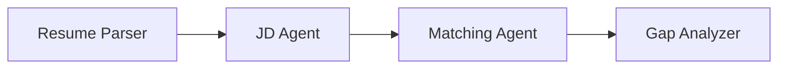
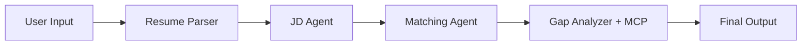

# Module 4 - ஒருங்கிணைக்கும் மாதிரிகள்

⏱️ ~10 நிமிடங்கள்

இந்த மொடியூலில், நீங்கள் Resume Job Fit Evaluator இல் பயன்படுத்தப்படும் ஒருங்கிணைக்கும் மாதிரிகளை ஆராய்ந்து, வேலைபட்டயக் கட்டத்தை படிக்க, மாற்ற, மற்றும் விரிவாக்க கற்றுக்கொள்கிறீர்கள். இந்த மாதிரிகளை புரிந்து கொள்வது தரவு ஓட்டம் பிரச்சினைகளை பிழைத்திருத்தவும் உங்கள் சொந்த [பன்முக முகவர் பணிவழிகள்](https://learn.microsoft.com/agent-framework/workflows/) உருவாக்கவும் அவசியம்.

---

## மாதிரி 1: தொடர் சங்கிலி

வேலைபட்டயத்தில் அடிப்படைக் கட்டமைப்பு என்பது **தொடர் சங்கிலி** - ஒவ்வொரு முகவரின் வெளியீடு அடுத்ததற்கு நேரடியாக காணப்படுகிறது.



குறியீட்டில், ஒவ்வொரு `add_edge()` அழைப்பும் சங்கிலியில் ஒரு நிலையை உருவாக்குகிறது:

```python
.add_edge(resume_executor, jd_executor)       # ResumeParser output → JD Agent
.add_edge(jd_executor, matching_executor)     # JD Agent output → MatchingAgent
.add_edge(matching_executor, gap_executor)    # MatchingAgent output → GapAnalyzer
```

> **ஏன் தொடர், fan-out/fan-in அல்ல?** `WorkflowBuilder` வரும் ஓட்டங்களுக்கு **OR-அர்த்தம்** பயன்படுத்துகிறது: ஒரு கீழ்தர இயக்கி அதன் **ஏதாவது** முன்னோடிகள் முடிந்தவுடன் செயல்படும். `matching_executor`க்கு இரண்டு வரும் ஓட்டங்கள் இருந்தால் (`resume_executor` மற்றும் `jd_executor` இரண்டிலிருந்தும்), அது இரண்டு முறை செயலில் சேரும் - ஒரு முறை ResumeParser முடிந்தபோது மற்றும் மற்றொன்று JD Agent முடிந்தபோது - இதனால் GapAnalyzer இருமுறை ஓட செய்யும் மற்றும் வெளியீடு இருமுறை தோன்றும். தொடர் பைப்லைன் இதனை முற்றிலும் தவிர்க்கிறது.

## முறை 2: உள்ளடக்க ஒப்படைப்பு

`context_mode="last_agent"` பிரதி இயக்கியும் அதன் **நேரடி முன்னோடிகளின் வெளியீடு** மட்டுமே காண்பதைக் கருத்தில் கொண்டு, தொடர்ச்சியான சங்கிலியில் உள்ள முகவர்கள் கீழ்தர முகவர்கள் தேவையாக்கும் எந்த தரவையும் முன்னோக்கி தெளிவாக அனுப்ப வேண்டும்.

இந்த வேலைசெய்கையில்:
- **ResumeParser** JD சொற்பொழிவை `[JOB DESCRIPTION PASS-THROUGH]`க்குள் நகலெடுக்கிறது (அதனால் JD Agent அதை கண்டுபிடிக்க முடியும்).
- **JD Agent** `[PARSED RESUME]` சொற்பொழிவை `[PARSED RESUME PASS-THROUGH]`க்கு நகலெடுக்கிறது (அதனால் MatchingAgent இரு சுயவிவரங்களையும் ஒப்பிட முடியும்).

```
ResumeParser output
└─ [PARSED RESUME]               ← extracted by JD Agent
└─ [JOB DESCRIPTION PASS-THROUGH] ← extracted by JD Agent

JD Agent output
└─ [JD REQUIREMENTS]             ← extracted by MatchingAgent
└─ [PARSED RESUME PASS-THROUGH]  ← extracted by MatchingAgent
```

ஒவ்வொரு ஒப்படைப்பும் **சரியாக** நகலெடுக்கப்பட வேண்டும் - சுருக்கம் அல்லது மாற்றம் அதை சார்ந்த கீழ்தர முகவரைக் குறைக்கும்.

---

## முழுமையான விளக்கக்கூறு வரைபடம்

தொடர் சங்கிலி மற்றும் உள்ளடக்க ஒப்படைப்பு முறைமைகளை ஒன்றாக்கி முழு வேலைநடை உருவாக்கப்படுகிறது:



முகவர் ஆய்வாளர் முகவரி இயங்கும் போது இதே வரைபட அமைப்பை காட்டுகிறது. ஸ்கிரீன்ஷாட்களுக்காக [Module 5 - Test Locally](05-test-locally.md) பார்க்கவும்.

---

## WorkflowBuilder குறியீட்டைக் வாசித்தல்

வேலைநடை வரைபடம் `main()` செயல்பாட்டில் [`PersonalCareerCopilot/main.py`](../../../../../workshop/lab02-multi-agent/PersonalCareerCopilot/main.py) என்னும் கோப்பில் உருவாக்கபடுகிறது. மூன்று `add_edge()` அழைப்புகள் தொடர் பைப்லைனைக் கட்டமைக்கின்றன:

| # | ஓட்டை | விளைவுகள் |
|---|------|--------|
| 1 | `resume_executor → jd_executor` | JD Agentக்கு `[PARSED RESUME]` + `[JOB DESCRIPTION PASS-THROUGH]` கிடைக்கும் |
| 2 | `jd_executor → matching_executor` | MatchingAgentக்கு `[JD REQUIREMENTS]` + `[PARSED RESUME PASS-THROUGH]` கிடைக்கும் |
| 3 | `matching_executor → gap_executor` | GapAnalyzerக்கு பொருத்த அறிக்கை + இடைவெளி பட்டியல் கிடைக்கும் |

---

## வரைபடத்தை மாற்றுதல்

### புதிய முகவரைக் கூட்டல்

ஐந்தாவது முகவராக (எ.கா., GapAnalyzerக்கு பின்வரும் **InterviewPrepAgent**) சேர்க்க:

1. `INTERVIEW_PREP_INSTRUCTIONS` எனும் நிலையானத்தை வரையறு.
2. `Agent` + `AgentExecutor` பொருட்களை உருவாக்கு (பழைய நான்குக்கு அதே முறை).
3. `.add_edge(gap_executor, interview_exec)` ஐ `WorkflowBuilder` இல் சேர்க்கவும்.
4. `output_executors=[interview_exec]` ஐ புதுப்பிக்கவும்.

> **முக்கியம்:** `start_executor` மட்டுமே மூல பயனர் உள்ளீட்டைக் பெறும் முகவர். மற்ற அனைத்தும் மேல்தர ஓட்டத்தின் வெளியீட்டை பெறுகின்றன.

---

## பொதுவான வரைபட பிழைகள்

| பிழை | அறிகுறி | தீர்வு |
|---------|---------|-----|
| `output_executors`க்கு நுழைவு ஓட்டை இல்லை | முகவர் ஓடுகிறது ஆனால் வெளியீடு வெறுமை | `start_executor` இಂದ `output_executors` உள்ள ஒவ்வொரு முகவருக்கும் பாதை இருக்க வேண்டும் என்பதைக் காண்க |
| சுற்றுப்பாதை சார்பு | முடிவில்லாத சுற்று அல்லது நேரம் முடிவடைவு | எந்த முகவரும் மேல்தர முகவருக்கு மறுபடியும் வழங்கவில்லை என்பதைப் பார் |
| `output_executors` இருப்பிடத்தில் முகவர் நுழைவு ஓட்டமின்றி | வெற்று வெளியீடு | குறைந்தது ஒரு `add_edge(source, that_agent)` சேர்க்கவும் |
| பல `output_executors` பின்வாங்கல் இல்லாமல் | வெளியீடு ஒரு முகவரின் பதிலையே கொண்டுள்ளது | ஒருங்கிணைந்த வெளியீடு முகவரியைப் பயன்படுத்தவும், அல்லது பல வெளியீடுகளை ஏற்றுக்கொள்ளவும் |
| `start_executor` காணவில்லை | கட்டுமான நேரத்தில் `ValueError` | எப்போதும் `start_executor` ஐ `WorkflowBuilder()` இல் குறிப்பிடவும் |

---

## வரைபடத்தை பிழைத்திருத்தல்

### முகவரி ஆய்வாளரை பயன்படுத்துதல்

1. முகவரியை உள்ளூர் முறையில் F5 வைத்து துவங்கவும்.
2. முகவரி ஆய்வாளரை திறக்கவும் (`Ctrl+Shift+P` → **Foundry Toolkit: முகவரி ஆய்வாளரைத் திறக்கவும்**).
3. ஒரு சோதனை செய்தியை அனுப்பவும்.
4. ஆய்வாளரின் பதில்ப் பலகையில், **பரிமாற்ற வெளியீட்டை** பாருங்கள் - இது ஒவ்வொரு முகவரின் பங்களிப்பையும் வரிசைப்படுத்தியில் காட்டுகிறது.


### பதிவு செய்யல் பயன்படுத்துதல்

தரவு ஒடுக்கு பாய்ச்சலினைப் பின்தொடர பதிவுக்களை `main.py` இல் சேர்க்கவும்:

```python
import logging
logger = logging.getLogger("resume-job-fit")

# In main(), after building the workflow:
logger.info("Workflow graph built with edges: RP→JD, JD→MA, MA→GA")
```

சர்வர் பதிவுகள் முகவர் செயல்பாட்டு வரிசை மற்றும் MCP கருவி அழைப்புகளை காட்டுகின்றன:

```
INFO:agent_framework:Executing agent: ResumeParser
INFO:agent_framework:Executing agent: JobDescriptionAgent
INFO:agent_framework:Executing agent: MatchingAgent
INFO:agent_framework:Executing agent: GapAnalyzer
INFO:agent_framework:Tool call: search_microsoft_learn_for_plan(skill="Kubernetes")
POST https://learn.microsoft.com/api/mcp → 200
INFO:agent_framework:Tool call: search_microsoft_learn_for_plan(skill="Terraform")
POST https://learn.microsoft.com/api/mcp → 200
```

---

### ஒப்பீடு புள்ளி

- [ ] பணிவழிச் செயற்திட்டத்தில் இரு ஒருங்கிணைப்பு மாதிரிகளையும் நீங்கள் அடையாளம் காணலாம்: தொடர் சங்கிலி மற்றும் உள்ளடக்கிய பரிமாற்றம்
- [ ] `context_mode="last_agent"` ஏன் முகவர்களுக்கிடையில் தெளிவான தரவு பரிமாற்றம் தேவை என்பதை நீங்கள் புரிந்துகொள்கிறீர்கள்
- [ ] `WorkflowBuilder` குறியீட்டை நீங்கள் படித்து, ஒவ்வொரு `add_edge()` அழைப்பையும் காட்சிப்படுத்தும் வரைபடத்துடன் இணைக்கலாம்
- [ ] குழாயின் முடிவில் புதிய முகவரை சேர்க்கும் முறையை நீங்கள் அறிவீர்கள்
- [ ] பொதுவான வரைபட பிழைகளையும் அவற்றின் அறிகுறிகளையும் நீங்கள் அடையாளம் காணலாம்

---

**முந்தையது:** [03 - முகவர்களையும் சூழலையும் அமைத்தல்](03-configure-agents.md) · **அடுத்தது:** [05 - உள்ளூரில் சோதனை →](05-test-locally.md)

---

<!-- CO-OP TRANSLATOR DISCLAIMER START -->
**மறுப்பு**:
இந்த ஆவணம் AI மொழிபெயர்ப்பு சேவை [Co-op Translator](https://github.com/Azure/co-op-translator) பயன்படுத்தி மொழிபெயர்க்கப்பட்டுள்ளது. நாங்கள் துல்லியத்திற்காக முயற்சி செய்துள்ளோம், ஆனால் தானாக செய்யப்படும் மொழிபெயர்ப்புகளில் பிழைகள் அல்லது தவறுகள் இருக்கலாம் என்பதை கவனத்தில் கொள்ளவும். அசல் ஆவணம் அதன் தாய்மொழியில் அதிகாரப்பூர்வ ஆதாரமாக கருதப்பட வேண்டும். முக்கியமான தகவல்களுக்கு, தொழில்நுட்பமான மனித மொழிபெயர்ப்பு பரிந்துரைக்கப்படுகிறது. இந்த மொழிபெயர்ப்பைப் பயன்படுத்துவதால் ஏற்படும் எந்த தவறான புரிதல்கள் அல்லது தவறான விளக்கத்திற்கும் நாங்கள் பொறுப்பில்வில்லை.
<!-- CO-OP TRANSLATOR DISCLAIMER END -->