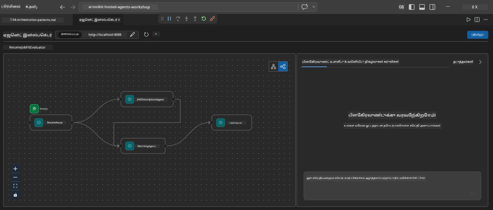
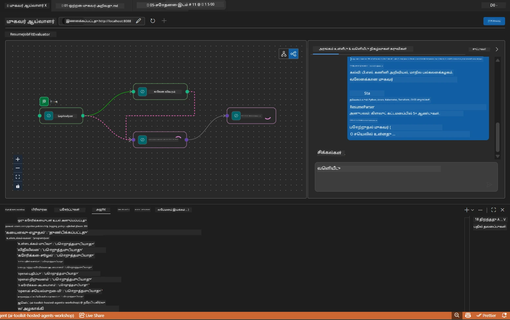
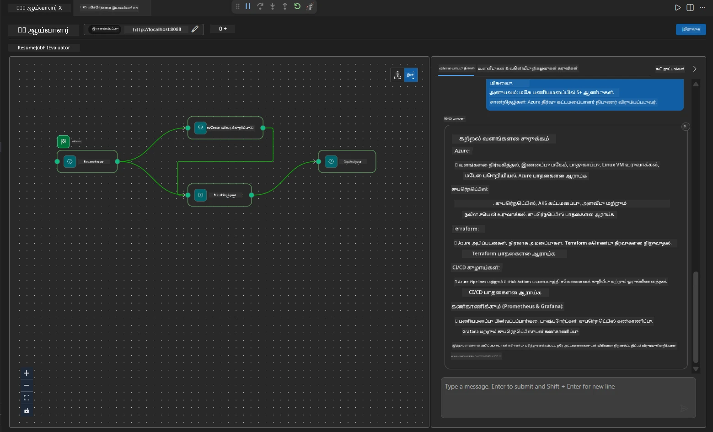

# தொகுதி 5 - உள்ளூர் பரிசோதனை

⏱️ ~15 நிமிடம்

இந்த தொகுதியில், நீங்கள் பன்முக முகவர் பணிமுறையை உள்ளூரில் இயக்குகிறீர்கள், Agent Inspector மூலம் சோதனை செய்கிறீர்கள், மற்றும் அனைத்து நான்கு முகவர்களும் மற்றும் MCP கருவி சரியாக இயங்குகிறதா என்பதை பணிவிடுவதை முன்பே உறுதிப்படுத்துகிறீர்கள்.

---

## படி 1: முகவர் சேவையகத்தைத் தொடங்கு

### விருப்பம் A: VS கோட் பணியை பயன்படுத்துதல் (பரிந்துரைக்கப்படுகிறது)

1. `workshop/lab02-multi-agent/PersonalCareerCopilot/` உங்கள் VS கோட் கோப்புறை ஆக திறக்கவும்.
2. `Ctrl+Shift+P` அழுத்தவும் → **Tasks: Run Task** என टைப்செய்யவும் → **Run Agent HTTP Server** ஐ தேர்வு செய்யவும்.
3. பணி debugpy இணைக்கப்பட்ட நிலையில் `5679` போர்ட்டில் சேவையகத்தை மற்றும் `8088` போர்ட்டில் முகவர்களை துவக்கிறது.
4. வெளியீடு துவக்க செய்தியுடன், பின்னர் சேவையகத்தின் தயார் செய்தியுடன் பின் தொடரும் வரை காத்திருங்கள் (மற்ற பதிவு வரிகள் இடையில் தோன்றலாம்):

```
INFO:resume-job-fit:Starting Resume -> Job Fit Evaluator HTTP server...
...
INFO:hypercorn.error:Running on http://0.0.0.0:8088 (CTRL + C to quit)
```

### விருப்பம் B: F5 ஐ பயன்படுத்துதல் (டைபக் நிலையில்)

1. `F5` அழுத்தவும் → **Debug Local Agent HTTP Server** ஐ தேர்வு செய்யவும்.
2. சேவையகம் முழு இடைநிலை இடைவிடுப்பு ஆதரவுடன் துவங்கும் - MCP பதில்கள் அல்லது முகவர் வெளியீடுகள் ஆய்வுக்கு பயன்படும்.

---

## படி 2: Agent Inspector ஐ திறக்கவும்

1. `Ctrl+Shift+P` அழுத்தவும் → **Foundry Toolkit: Open Agent Inspector** என்று தட்டச்சு செய்யவும்.
2. Agent Inspector VS Code குழுவாக திறந்து `http://localhost:8088` இணைக்கப்படும்.
3. நீங்கள் முகவர் இடைமுகம் செய்திகளை ஏற்கத் தயாராக இருப்பதை காண வேண்டும்.



> **Agent Inspector திறக்காமல் இருந்தால்:** சேவையகம் முழுமையாக துவங்கியுள்ளதா (நீங்கள் `Running on http://0.0.0.0:8088` பதிவை காண்கிறீர்களா) என்பதை உறுதிசெய்யவும். போர்ட் 5679 பிஸியாக இருந்தால், [தரம் 8 - பிழைத்திருத்தம்](08-troubleshooting.md) பார்க்கவும்.

---

## படி 2b: (விருப்பம்) பணிமுறை காட்சிப்படுத்தியைத் திறக்கவும்

Foundry Toolkit நேரடி **Workflow Visualizer** ஐ கொண்டுள்ளது, இது முகவர்கள் எப்படி சார்பு செயலைச் செயல்படுத்துகின்றன என்பதை காட்டுகிறது. இது முக்கோணிய சந்தேக நிவாரணத்திற்கு சிறப்பாக பயன்படும்.

1. `Ctrl+Shift+P` அழுத்தவும் → **Foundry Toolkit: Open Visualizer for Hosted Agents** என தட்டச்சு செய்யவும்.
2. புதிய VS Code தாவல் நேரடி செயல்பாட்டு வரைபடத்தை காட்டும்.
3. Agent Inspectorவில் நீங்கள் செய்திகளை அனுப்பும்போது, காட்சிப்படுத்தி தானாக புதுப்பிக்கப்படும் - பச்சை முனைகள் முடிந்து முடிந்த முகவர்களை குறிக்கின்றன, மற்றும் இயக்கும் கரிகள் இடையே தரவு ஓடுதலைக் காண்பிக்கின்றன.

> **போர்ட் மோதல்:** காட்சிப்படுத்தி போர்ட் ஏற்கனவே பயன்படுத்தப்பட்டால், அதை VS Code அமைப்புகளில் மாற்றவும் → **Extensions** → **Microsoft Foundry Configuration** → **Hosted Agents: Visualizer Port**.

---

## படி 3: ஸ்மோக் சோதனைகள் ஓட்டவும்

இந்த இரண்டு சோதனைகளை வரிசையாக ஓட்டவும். ஒவ்வொன்றும் பணிமுறையின் மேலும் பகுதியை சோதிக்கிறது.

### சோதனை 1: அடிப்படைக் தொடர்ச்சி + வேலை விளக்கம்

கீழ்காணும் உள்ளடக்கத்தை Agent Inspector இல் ஒட்டவும்:

```
Resume:
Jane Doe
Senior Software Engineer with 5 years of experience in Python, Django, and AWS.
Built microservices handling 10K+ requests/second. Led a team of 4 developers.
Certifications: AWS Solutions Architect Associate.
Education: B.S. Computer Science, State University.

Job Description:
Senior Cloud Engineer at Contoso Ltd.
Required: Python, Azure, Kubernetes, Terraform, CI/CD pipelines.
Preferred: Go, monitoring (Prometheus/Grafana), cost optimization.
Experience: 5+ years in cloud infrastructure.
Certifications: Azure Solutions Architect Expert preferred.
```

**எதிர்பார்க்கப்படும் வெளியீடு கட்டமைப்பு:**

பதில் அனைத்து நான்கு முகவர்களின் வெளியீட்டையும் தொடர்ச்சியாகக் கொண்டிருக்க வேண்டும்:

1. **Resume Parser output** - இரண்டு பெயரிடப்பட்ட பகுதி: `[PARSED RESUME]` (கோட்பாட்டாளர் சுயவிவரம் குழுவாகக் கற்றறிவுகள்) மற்றும் `[JOB DESCRIPTION PASS-THROUGH]` (பொருள் வேலை விளக்க உரை, JD முகவர்க்கு ஊக்கம் தரும்)
2. **JD Agent output** - கட்டமைக்கப்பட்ட தேவைகள் தேவையான மற்றும் விரும்பத்தக்கத் திறன்கள் பிரிக்கப்பட்டவை
3. **Matching Agent output** - பொருத்த மதிப்பெண் (0-100) உடன் பகுப்பு, பொருத்தப்பட்ட திறன்கள், குறைவான திறன்கள், இடைவெளிகள்
4. **Gap Analyzer output** - ஒவ்வொரு குறைந்த திறனுக்கான தனிப்பட்ட இடைவெளி அட்டைகள், ஒவ்வொன்றும் Microsoft Learn URL களை கொண்டவை





### சோதனை 1 இல் சரிபார்க்க வேண்டியவை

| சரிபார்க்கவும் | எதிர்பார்ப்பு | வாய்ப்பு? |
|------------|----------|-------|
| பதில் பொருத்த மதிப்பெண்ணைக் கொண்டிருக்கிறது | 0-100 இல் உள்ள எண், பகுப்புடன் | |
| பொருத்தப்பட்ட திறன்கள் பட்டியலிடப்பட்டுள்ளன | Python, CI/CD (பகுதி), முதலியவை | |
| குறைந்த திறன்கள் பட்டியலிடப்பட்டுள்ளன | Azure, Kubernetes, Terraform, முதலியவை | |
| குறைந்த ஒவ்வொரு திறனுக்கும் இடைவெளி அட்டைகள் உள்ளன | ஒரு அட்டை ஒரு திறனுக்கு | |
| Microsoft Learn URLகள் உள்ளன | உண்மையான `learn.microsoft.com` இணைப்புகள் | |
| பதிலில் பிழை செய்திகள் எதுவும் இல்லை | சுத்தமான கட்டமைக்கப்பட்ட வெளியீடு | |

### சோதனை 2: எல்லை நிலை - அதிக பொருத்தம் வாய்ந்த விண்ணப்பதாரர்

JDக்கு மிக அணுகுமுறை கொண்ட ஒரு தொடர்ச்சியை ஒட்டவும், GapAnalyzer அதிக பொருத்த நிலைகளைக் கையாளுவதை சரிபார்க்க:

```
Resume:
Alex Chen
Senior Cloud Engineer with 7 years of experience.
Skills: Python, Azure (AKS, Functions, DevOps), Kubernetes, Terraform, CI/CD (GitHub Actions, Azure Pipelines), Go, Prometheus, Grafana, cost optimization.
Certifications: Azure Solutions Architect Expert, Azure DevOps Engineer Expert.
Led infrastructure migration to Azure for 3 enterprise clients.
Education: M.S. Computer Science, Tech University.

Job Description:
Senior Cloud Engineer at Contoso Ltd.
Required: Python, Azure, Kubernetes, Terraform, CI/CD pipelines.
Preferred: Go, monitoring (Prometheus/Grafana), cost optimization.
Experience: 5+ years in cloud infrastructure.
Certifications: Azure Solutions Architect Expert preferred.
```

**எதிர்பார்க்கப்படும் செயல்பாடு:**
- பொருத்த மதிப்பெண் **80+** ஆக இருக்க வேண்டும் (அधिकமான திறன்கள் பொருந்தும்)
- இடைவெளி அட்டைகள் அடிப்படைக் கற்றல் அல்லாமல் மேம்பாடு/பேச்சு தயார் கவனம் செலுத்த வேண்டும்
- GapAnalyzer வழிகாட்டி: "பொருத்தம் >= 80 என்றால், மேம்பாடு/பேச்சு தயார் கவனம் செலுத்தவும்"

---

## படி 4: உங்கள் சொந்த தரவுடன் சோதனை (விருப்பம்)

உங்கள் சொந்த தொடர்ச்சி மற்றும் ஒரு உண்மையான வேலையிட விளக்கத்தை ஒட்ட முயற்சி செய்யவும். இதனால் உறுதிசெய்ய உதவும்:

- முகவர்கள் வெவ்வேறு தொடர்ச்சி வடிவங்களை கையாள்கின்றனர் (காலவரிசை, செயல்பாட்டு, கலவை)
- JD முகவர் வெவ்வேறு JD வகைகளை கையாள்கிறது (புள்ளி குறிப்பிடுகைகள், பழைய உரை, கட்டமைக்கப்பட்டவை)
- MCP கருவி உண்மையான திறன்களுக்கு உடன்பட்ட வளங்களை வழங்குகிறது
- இடைவெளி அட்டைகள் உங்கள் தனிப்பட்ட பின்னணியுடன் தனிப்பட்டவை

> **தனியுரிமை - பாதை A (Foundry மேகம்):** தொடர்ச்சி மற்றும் JD உரை உங்கள் Azure OpenAI வரைநடத்தைக்கு அனுப்பப்படுகிறது. இது பட்டியலோடு கட்டபடுத்தப்படாது அல்லது சேமிக்கப்படாது. நீங்கள் விரும்பினால் இடமையாளர்கள் பெயர்களைப் பயன்படுத்தவும் (எ.கா., "ஜேன் டோ").
>
> **தனியுரிமை - பாதை B (Foundry உள்ளூர்):** அனைத்து நான்கு முகவர் ஊக்கங்கள் முழுமையாக உங்கள் சாதனத்தில் இயங்கும். உங்கள் தொடர்ச்சி மற்றும் வேலை விளக்க உரை **எப்படியும் உங்கள் கருவியில் இருந்து வெளியேறாது**. வெளிப்புற அழைப்பு ஒன்றே கொண்டுள்ளது - MCP கருவி வழியாக `https://learn.microsoft.com/api/mcp` இலிருந்து வளங்களை பெறுவது; அந்த கேள்வியில் திறன் பெயர்களே உள்ளன, உங்கள் தனிப்பட்ட தரவு இல்லை.

---

### சரிபார்ப்பு புள்ளி

- [ ] சேவையகம் `8088` போர்ட்டில் வெற்றிகரமாக துவங்கியது (பதிவு `Running on http://0.0.0.0:8088` காட்டுகிறது)
- [ ] Agent Inspector திறக்கப்பட்டு முகவருடன் இணைக்கப்பட்டது
- [ ] சோதனை 1: முழு பதில் பொருத்த மதிப்பெண், பொருந்திய/குறைந்த திறன்கள், இடைவெளி அட்டைகள், மற்றும் Microsoft Learn URLகள்
- [ ] சோதனை 2: அதிக பொருத்த விண்ணப்பதாரர் 80+ மதிப்பெண் மற்றும் மேம்பாட்டுக்கான பரிந்துரைகளைப் பெறுகிறார்
- [ ] அனைத்து இடைவெளி அட்டைகளும் உள்ளன (ஒன்றொன்று குறைந்த திறனுக்கு, வெட்டி கிடையாது)
- [ ] சேவையகத் தனிமை திரையில் பிழைகள் அல்லது பின்வட்டார குறியீடுகள் எதுவும் இல்லை

---

**முன்னையது:** [04 - ஒருங்கிணைப்பு மாதிரிகள்](04-orchestration-patterns.md) · **அடுத்தது:** [06 - Foundryக்கு பரப்புதல் →](06-deploy-to-foundry.md)

---

<!-- CO-OP TRANSLATOR DISCLAIMER START -->
**மறுப்பு**:
இந்த ஆவணம் AI மொழிபெயர்ப்பு சேவை [Co-op Translator](https://github.com/Azure/co-op-translator) பயன்படுத்தி மொழிபெயர்க்கப்பட்டுள்ளது. நாங்கள் துல்லியத்திற்காக முயற்சி செய்துள்ளோம், ஆனால் தானாக செய்யப்படும் மொழிபெயர்ப்புகளில் பிழைகள் அல்லது தவறுகள் இருக்கலாம் என்பதை கவனத்தில் கொள்ளவும். அசல் ஆவணம் அதன் தாய்மொழியில் அதிகாரப்பூர்வ ஆதாரமாக கருதப்பட வேண்டும். முக்கியமான தகவல்களுக்கு, தொழில்நுட்பமான மனித மொழிபெயர்ப்பு பரிந்துரைக்கப்படுகிறது. இந்த மொழிபெயர்ப்பைப் பயன்படுத்துவதால் ஏற்படும் எந்த தவறான புரிதல்கள் அல்லது தவறான விளக்கத்திற்கும் நாங்கள் பொறுப்பில்வில்லை.
<!-- CO-OP TRANSLATOR DISCLAIMER END -->