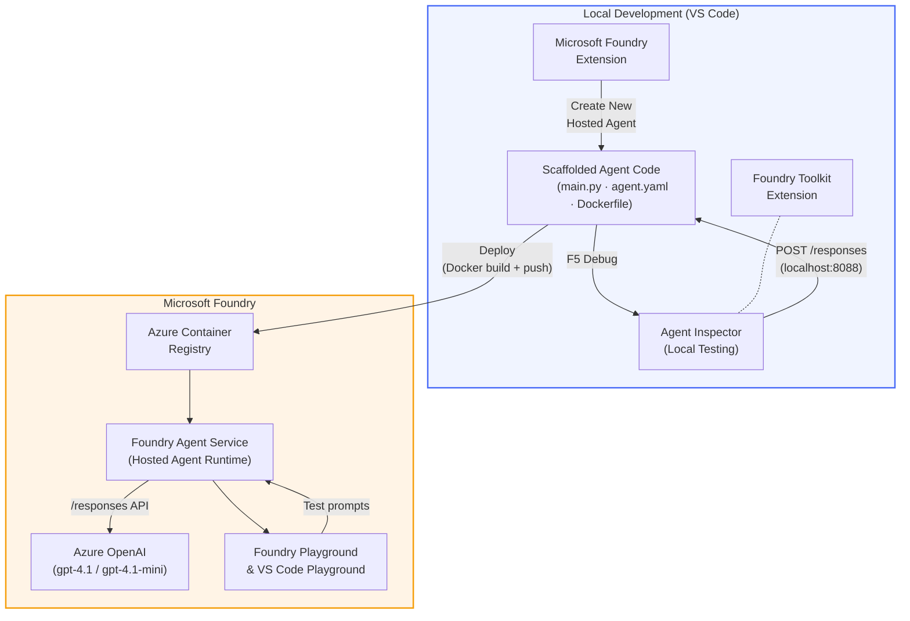

# ఫౌండ్రి టూల్‌కిట్ + ఫౌండ్రి హోస్టెడ్ ఏజెంట్స్ వర్క్‌షాప్

[](https://www.python.org/)
[](https://learn.microsoft.com/agent-framework/)
[](https://learn.microsoft.com/azure/foundry/agents/concepts/hosted-agents)
[](https://ai.azure.com/)
[](https://learn.microsoft.com/azure/ai-services/openai/)
[](https://learn.microsoft.com/cli/azure/install-azure-cli)
[](https://learn.microsoft.com/azure/developer/azure-developer-cli/install-azd)
[](https://www.docker.com/)
[](https://marketplace.visualstudio.com/items?itemName=ms-windows-ai-studio.windows-ai-studio)
[](LICENSE)

**మైక్రోసాఫ్ట్ ఫౌండ్రి ఏజెంట్ సర్వీస్**కు **హోస్టెడ్ ఏజెంట్స్**గా AI ఏజెంట్లను నిర్మించండి, పరీక్షించండి మరియు నిర్వహించండి - పూర్తిగా VS కోడ్ నుండి **Microsoft Foundry విస్తరణ** మరియు **Foundry Toolkit** ఉపయోగించి.

> **హోస్టెడ్ ఏజెంట్స్ ప్రస్తుతం ప్రివ్యూ లో ఉన్నాయి.** మద్దతు పొందిన ప్రాంతాలు పరిమితం చేయబడ్డాయి - చూడండి [ప్రాంత ఉనికి](https://learn.microsoft.com/azure/foundry/agents/concepts/hosted-agents#region-availability).

> ప్రతి ప్రయోగశాలలో ఉన్న `agent/` ఫోల్‌డర్ **Foundry విస్తరణ ద్వారా ఆటోమేటిక్‌గా స్కాఫోల్డింగ్** చేయబడింది - ఆ తరువాత మీరు కోడ్‌ను అనుకూలీకరించి, స్థానికంగా పరీక్షించి, డిప్లాయ్ చేయవచ్చు.

### 🌐 బహుభాషా మద్దతు

#### GitHub యాక్షన్ ద్వారా మద్దతు పొందింది (ఆటోమేటెడ్ & ఎల్లప్పుడూ తాజా)

<!-- CO-OP TRANSLATOR LANGUAGES TABLE START -->
[Arabic](../ar/README.md) | [Bengali](../bn/README.md) | [Bulgarian](../bg/README.md) | [Burmese (Myanmar)](../my/README.md) | [Chinese (Simplified)](../zh-CN/README.md) | [Chinese (Traditional, Hong Kong)](../zh-HK/README.md) | [Chinese (Traditional, Macau)](../zh-MO/README.md) | [Chinese (Traditional, Taiwan)](../zh-TW/README.md) | [Croatian](../hr/README.md) | [Czech](../cs/README.md) | [Danish](../da/README.md) | [Dutch](../nl/README.md) | [Estonian](../et/README.md) | [Finnish](../fi/README.md) | [French](../fr/README.md) | [German](../de/README.md) | [Greek](../el/README.md) | [Hebrew](../he/README.md) | [Hindi](../hi/README.md) | [Hungarian](../hu/README.md) | [Indonesian](../id/README.md) | [Italian](../it/README.md) | [Japanese](../ja/README.md) | [Kannada](../kn/README.md) | [Khmer](../km/README.md) | [Korean](../ko/README.md) | [Lithuanian](../lt/README.md) | [Malay](../ms/README.md) | [Malayalam](../ml/README.md) | [Marathi](../mr/README.md) | [Nepali](../ne/README.md) | [Nigerian Pidgin](../pcm/README.md) | [Norwegian](../no/README.md) | [Persian (Farsi)](../fa/README.md) | [Polish](../pl/README.md) | [Portuguese (Brazil)](../pt-BR/README.md) | [Portuguese (Portugal)](../pt-PT/README.md) | [Punjabi (Gurmukhi)](../pa/README.md) | [Romanian](../ro/README.md) | [Russian](../ru/README.md) | [Serbian (Cyrillic)](../sr/README.md) | [Slovak](../sk/README.md) | [Slovenian](../sl/README.md) | [Spanish](../es/README.md) | [Swahili](../sw/README.md) | [Swedish](../sv/README.md) | [Tagalog (Filipino)](../tl/README.md) | [Tamil](../ta/README.md) | [Telugu](./README.md) | [Thai](../th/README.md) | [Turkish](../tr/README.md) | [Ukrainian](../uk/README.md) | [Urdu](../ur/README.md) | [Vietnamese](../vi/README.md)

> **స్థానికంగా క్లోన్ చేయాలని ఇష్టమా?**
>
> ఈ రిపాజిటరీ 50+ భాషల్లో అనువాదాలను కలిగి ఉంది, ఇది డౌన్లోడ్ పరిమాణాన్ని గణనీయంగా పెంచుతుంది. అనువాదాల లేకుండా క్లోన్ చేయడానికి, స్పార్స్ చెకౌట్ ఉపయోగించండి:
>
> **Bash / macOS / Linux:**
> ```bash
> git clone --filter=blob:none --sparse https://github.com/microsoft-foundry/Foundry_Toolkit_for_VSCode_Lab.git
> cd Foundry_Toolkit_for_VSCode_Lab
> git sparse-checkout set --no-cone '/*' '!translations' '!translated_images'
> ```
>
> **CMD (Windows):**
> ```cmd
> git clone --filter=blob:none --sparse https://github.com/microsoft-foundry/Foundry_Toolkit_for_VSCode_Lab.git
> cd Foundry_Toolkit_for_VSCode_Lab
> git sparse-checkout set --no-cone "/*" "!translations" "!translated_images"
> ```
>
> ఇవి కోర్సును పూర్తి చేయడానికి మీరు కావలసిన అన్ని అంశాలను చాలా వేగంగా డౌన్లోడ్ చేస్తుంది.
<!-- CO-OP TRANSLATOR LANGUAGES TABLE END -->

---

## నిర్మాణం



**ప్రవాహం:** Foundry విస్తరణ ఏజెంట్‌ను స్కాఫోల్డ్ చేస్తుంది → మీరు కోడ్ & సూచనలను అనుకూలీకరిస్తారు → Agent Inspector తో స్థానికంగా పరీక్షించడం → Foundry కి డిప్లాయ్ చేయడం (Docker చిత్రం ACR కి పుష్ చేయబడింది) → ప్లేగ్రౌండ్ లో ధృవీకరించడం.

---

## మీరు ఏమి నిర్మించబోతున్నారు

| ప్రయోగశాల | వివరణ | స్థితి |
|-----|-------------|--------|
| **ప్రయోగశాల 01 - సింగిల్ ఏజెంట్** | **"నన్ను ఎగ్జిక్యూటివ్ లా వివరించు" ఏజెంట్**ను నిర్మించండి, స్థానికంగా పరీక్షించండి, మరియు Foundry కు డిప్లాయ్ చేయండి | ✅ అందుబాటులో ఉంది |
| **ప్రయోగశాల 02 - మల్టీ-ఏజెంట్ వర్క్‌ఫ్లో** | **"రిస్యూమ్ → ఉద్యోగమేలుకల్పన పరీక్షకుడు"**ను నిర్మించండి - 4 ఏజెంట్లు రిజ్యూమ్ అనుకూలతకు స్కోరు ఇవ్వడానికి కలసి పనిచేయడం మరియు లెర్నింగ్ రోడ్‌మ్యాప్ సృష్టించడం | ✅ అందుబాటులో ఉంది |

---

## ఎగ్జిక్యూటివ్ ఏజెంట్‌ను పరిచయం చేసుకోండి

ఈ వర్క్‌షాప్‌లో మీరు **"నన్ను ఎగ్జిక్యూటివ్ లా వివరించు" ఏజెంట్**ను నిర్మించబోతున్నారు - ఒక AI ఏజెంట్ ఇది క్లిష్ట టెక్నికల్ జార్గన్లను తీసుకుని అతి సాంత్వనకరమైన, బోర్డ్రూం-ప్రసిద్ధ సారాంశాలలోకి అనువదిస్తుంది. నిజానికి, C-సూట్ లో ఎవరూ "v3.2 లో ప్రవేశపెట్టిన సింక్రనస్ కాల్స్ వల్ల ఏర్పడిన త్రెడ్ పూల్ ఎగ్జాస్ట్‌షన్" గురించి వింటారు అనుకోను.

నా సరైన రీతిలో తయారు చేసిన పోస్ట్-మార్టెమ్ కు వచ్చిన స్పందన "*కాబట్టి... వెబ్‌సైట్ డౌన్ అయిందా లేదా?*" అనే ప్రసంగాల తరువాతనే నేను ఈ ఏజెంట్‌ను నిర్మించాను.

### ఇది ఎలా పనిచేస్తుంది

మీరు టెక్నికల్ అప్డేట్ ఇస్తారు. ఇది మూడు బుల్లెట్ పాయింట్లు, జార్గన్ లేదు, స్టాక్ ట్రేస్‌లేదు, ఉన్నతమైన ధైర్యం లేదు - కేవలం **ఏ జరిగింది**, **వ్యాపార ప్రభావం**, మరియు **తరువాతి దశ** అనే ఎగ్జిక్యూటివ్ సారాంశాన్ని ఇస్తుంది.

### ఇది క్రియాశీలంలో చూడండి

**మీరు చెబుతారు:**
> "విభాగం పొరపాట్ల కారణంగా API లేటెన్సీ పెరిగింది."

**ఏజెంట్ సమాధానం ఇస్తుంది:**

> **ఎగ్జిక్యూటివ్ సారాంశం:**
> - **ఏ జరిగింది:** తాజా విడుదల తర్వాత, సిస్టం నెమ్మదిగా పని చేసింది.
> - **వ్యాపార ప్రభావం:** కొన్ని వినియోగదారులకు సేవ వాడే సమయంలో ఆలస్యం అనుభవించాము.
> - **తరువాతి దశ:** మార్పు తిరిగి తీసుకోబడింది మరియు మళ్లీ విడుదలకు ముందు పరిష్కారం తయారు చేస్తోంది.

### ఈ ఏజెంట్ ఎందుకు?

ఇది ఒక సులభమైన, ఒక్కే ఉద్దేశ్యం గల ఏజెంట్ - హోస్టెడ్ ఏజెంట్ వర్క్‌ఫ్లోని పూర్తిగా నేర్చుకోవడానికి గొప్పది, క్లిష్టమైన టూల్ చైన్‌లో చిక్కకుండా. నిజంగా? ప్రతి ఇంజనీరింగ్ బృందం ఇలాంటి ఏజెంట్ అవసరం.

---

## వర్క్‌షాప్ నిర్మాణం

```
📂 Foundry_Toolkit_for_VSCode_Lab/
├── 📄 README.md                      ← You are here
└── 📂 workshop/
    ├── 📂 lab01-single-agent/        ← Full lab: docs + agent code
    │   ├── README.md                 ← Hands-on lab instructions
    │   ├── 📂 docs/                  ← Step-by-step tutorial modules
    │   │   ├── 00-prerequisites.md
    │   │   ├── 01-setup.md
    │   │   ├── 02-create-hosted-agent.md
    │   │   ├── 03-configure-and-code.md
    │   │   ├── 04-test-locally.md
    │   │   ├── 05-deploy-to-foundry.md
    │   │   ├── 06-verify-in-playground.md
    │   │   ├── 07-summary.md
    │   │   └── 08-troubleshooting.md
    │   └── 📂 agent/                 ← Reference solution (auto-scaffolded by Foundry extension)
    │       ├── agent.yaml
    │       ├── Dockerfile
    │       ├── main.py
    │       └── requirements.txt
    └── 📂 lab02-multi-agent/         ← Resume → Job Fit Evaluator
        ├── README.md                 ← Hands-on lab instructions (end-to-end)
        ├── 📂 docs/                  ← Step-by-step tutorial modules
        │   ├── 00-prerequisites.md
        │   ├── 01-understand-multi-agent.md
        │   ├── 02-scaffold-multi-agent.md
        │   ├── 03-configure-agents.md
        │   ├── 04-orchestration-patterns.md
        │   ├── 05-test-locally.md
        │   ├── 06-deploy-to-foundry.md
        │   ├── 07-verify-in-playground.md
        │   ├── 08-troubleshooting.md
        │   └── 09-summary.md
        └── 📂 PersonalCareerCopilot/ ← Reference solution (multi-agent workflow)
            ├── agent.yaml
            ├── Dockerfile
            ├── main.py
            └── requirements.txt
```

> **గమనిక:** ప్రతి ప్రయోగశాలలో ఉన్న `agent/` ఫోల్‌డర్ **Microsoft Foundry విస్తరణ** నిర్వహిస్తుంది, మీరు కమాండ్ ప్యాలెట్ నుండి `Microsoft Foundry: Create a New Hosted Agent` ని అమలు చేసినప్పుడు. ఆపై ఫైళ్లు మీ ఏజెంట్ సూచనలు, టూల్స్ మరియు కాన్ఫిగరేషన్‌తో అనుకూలీకరించబడతాయి. ప్రయోగశాల 01 ఈ ప్రక్రియను పూర్తిగా మళ్ళీ సృష్టించడం నేర్పుతుంది.

---

## ప్రారంభించడం

### 1. రిపాజిటరీని క్లోన్ చేయండి

```bash
git clone https://github.com/microsoft-foundry/Foundry_Toolkit_for_VSCode_Lab.git
cd Foundry_Toolkit_for_VSCode_Lab
```

### 2. Python వర్చువల్ ఎన్విరాన్‌మెంట్ సెటప్ చేయండి

```bash
python -m venv venv
```

దీన్ని యాక్టివేట్ చేయండి:

- **Windows (PowerShell):**
  ```powershell
  .\venv\Scripts\Activate.ps1
  ```
- **macOS / Linux:**
  ```bash
  source venv/bin/activate
  ```

### 3. డిపెండెన్సీలను ఇన్‌స్టాల్ చేయండి

```bash
pip install -r workshop/lab01-single-agent/agent/requirements.txt
```

### 4. ఎన్విరాన్‌మెంట్ వేరియబుల్స్ సెట్ చేయండి

ఏజెంట్ ఫోల్డర్ లో ఉన్న ఉదాహరణ `.env` ఫైల్‌ని కాపీ చేసి మీ విలువలు చేర్చి ఫిలప్ చేయండి:

```bash
cp workshop/lab01-single-agent/agent/.env.example workshop/lab01-single-agent/agent/.env
```

`workshop/lab01-single-agent/agent/.env`ను ఎడిట్ చేయండి:

```env
FOUNDRY_PROJECT_ENDPOINT=https://<your-account>.services.ai.azure.com/api/projects/<your-project>
AZURE_AI_MODEL_DEPLOYMENT_NAME=<your-model-deployment-name>
```

### 5. వర్క్‌షాప్ ప్రయోగశాలలను అనుసరించండి

ప్రతి ప్రయోగశాల దాని స్వంత మాడ్యూల్స్‌తో స్వయంపూర్తిగా ఉంటుంది. ప్రాథమికంగా నేర్చుకోవడానికి **ప్రయోగశాల 01** నుండి ప్రారంభించండి, ఆపై **ప్రయోగశాల 02**కి వెళ్ళి మల్టీ-ఏజెంట్ వర్క్‌ఫ్లోలను అధ్యయనం చేయండి.

#### ప్రయోగశాల 01 - సింగిల్ ఏజెంట్ ([పూర్తి సూచనలు](workshop/lab01-single-agent/README.md))

| # | మాడ్యూల్ | లింక్ |
|---|--------|------|
| 1 | ప్రీరిక్విజిట్స్ చదవండి | [00-prerequisites.md](workshop/lab01-single-agent/docs/00-prerequisites.md) |
| 2 | Foundry Toolkit & Foundry విస్తరణ ఇన్‌స్టాల్ చేయండి | [01-setup.md](workshop/lab01-single-agent/docs/01-setup.md) |
| 3 | Foundry ప్రాజెక్ట్ నిర్మించండి | [01-setup.md](workshop/lab01-single-agent/docs/01-setup.md) |
| 4 | హోస్టెడ్ ఏజెంట్ సృష్టించండి | [02-create-hosted-agent.md](workshop/lab01-single-agent/docs/02-create-hosted-agent.md) |
| 5 | సూచనలు & ఎన్విరాన్‌మెంట్ కాన్ఫిగర్ చేయండి | [03-configure-and-code.md](workshop/lab01-single-agent/docs/03-configure-and-code.md) |
| 6 | స్థానికంగా పరీక్షించండి | [04-test-locally.md](workshop/lab01-single-agent/docs/04-test-locally.md) |
| 7 | Foundry కి డిప్లాయ్ చేయండి | [05-deploy-to-foundry.md](workshop/lab01-single-agent/docs/05-deploy-to-foundry.md) |
| 8 | ప్లేగ్రౌండ్ లో ధృవీకరించండి | [06-verify-in-playground.md](workshop/lab01-single-agent/docs/06-verify-in-playground.md) |
| 9 | సమ్మరీ & తదుపరి దశలు | [07-summary.md](workshop/lab01-single-agent/docs/07-summary.md) |
| 10 | సమస్యలు పరిష్కారం | [08-troubleshooting.md](workshop/lab01-single-agent/docs/08-troubleshooting.md) |

#### ప్రయోగశాల 02 - మల్టీ-ఏజెంట్ వర్క్‌ఫ్లో ([పూర్తి సూచనలు](workshop/lab02-multi-agent/README.md))

| # | మాడ్యూల్ | లింక్ |
|---|--------|------|
| 1 | ప్రీరిక్విజిట్స్ (ప్రయోగశాల 02) | [00-prerequisites.md](workshop/lab02-multi-agent/docs/00-prerequisites.md) |
| 2 | మల్టీ-ఏజెంట్ నిర్మాణాన్ని అర్థం చేసుకోండి | [01-understand-multi-agent.md](workshop/lab02-multi-agent/docs/01-understand-multi-agent.md) |
| 3 | మల్టీ-ఏజెంట్ ప్రాజెక్ట్ స్కాఫోల్డ్ చేయండి | [02-scaffold-multi-agent.md](workshop/lab02-multi-agent/docs/02-scaffold-multi-agent.md) |
| 4 | ఏజెంట్లు & ఎన్విరాన్‌మెంట్ కాన్ఫిగర్ చేయండి | [03-configure-agents.md](workshop/lab02-multi-agent/docs/03-configure-agents.md) |
| 5 | ఆర్కెస్ట్రేషన్ నమూనాలు | [04-orchestration-patterns.md](workshop/lab02-multi-agent/docs/04-orchestration-patterns.md) |
| 6 | స్థానికంగా పరీక్షించండి (మల్టీ-ఏజెంట్) | [05-test-locally.md](workshop/lab02-multi-agent/docs/05-test-locally.md) |
| 7 | Foundry కి డిప్లాయ్ చేయండి | [06-deploy-to-foundry.md](workshop/lab02-multi-agent/docs/06-deploy-to-foundry.md) |
| 8 | ప్లేగ్రౌండ్ లో ధృవీకరించండి | [07-verify-in-playground.md](workshop/lab02-multi-agent/docs/07-verify-in-playground.md) |
| 9 | సమస్యలు పరిష్కారం (మల్టీ-ఏజెంట్) | [08-troubleshooting.md](workshop/lab02-multi-agent/docs/08-troubleshooting.md) |
| 10 | సమ్మరీ & తదుపరి దశలు | [09-summary.md](workshop/lab02-multi-agent/docs/09-summary.md) |

---

## నిర్వహణ

<table>
<tr>
    <td align="center"><a href="https://github.com/ShivamGoyal03">
        <br />
        <sub><b>శివం గోయల్</b></sub>
    </a><br />
    </td>
</tr>
</table>

---

## అవసరమైన అనుమతులు (త్వరిత సూచిక)

| పరిస్థితి | అవసరమైన పాత్రలు |
|----------|---------------|
| కొత్త Foundry ప్రాజెక్ట్ సృష్టించండి | Foundry వనరుపై **Azure AI ఓనర్** |
| ఉన్న ప్రాజెక్ట్‌కు డిప్లాయ్ చేయండి (కొత్త వనరులు) | సబ్స్క్రిప్షన్‌పై **Azure AI ఓనర్** + **కాంట్రిబ్యూట‌ర్** |
| పూర్తిగా కాన్ఫిగర్ చేయబడిన ప్రాజెక్ట్‌కు డిప్లాయ్ చేయండి | ఖాతాపై **రీడర్** + ప్రాజెక్ట్ పై **Azure AI యూజర్** |

> **ముఖ్యమైనది:** Azure `Owner` మరియు `Contributor` పాత్రలు *వ్యవస్థాపనా* అనుమతులనే కలిగి ఉంటాయి, *అభివృద్ధి* (డేటా చర్య) అనుమతులు కలిగి ఉండవు. మీరు ఏజెంట్లను నిర్మించి, వినియోగించడానికి **Azure AI User** లేదా **Azure AI Owner** కావలసి ఉంటుంది.

---

## సూచనలు

- [త్వరితప్రారంభం: మీ మొదటి హోస్టెడ్ ఏజెంట్ను డిప్లాయ్ చేయండి (VS కోడ్)](https://learn.microsoft.com/azure/foundry/agents/quickstarts/quickstart-hosted-agent)
- [హోస్టెడ్ ఏజెంట్లు అంటే ఏమిటి?](https://learn.microsoft.com/azure/foundry/agents/concepts/hosted-agents)
- [VS కోడ్‌లో హోస్టెడ్ ఏజెంట్ వర్క్‌ఫ్లోలను సృష్టించండి](https://learn.microsoft.com/azure/foundry/agents/how-to/vs-code-agents-workflow-pro-code)
- [హోస్టెడ్ ఏజెంట్ను డిప్లాయ్ చేయండి](https://learn.microsoft.com/azure/foundry/agents/how-to/deploy-hosted-agent)
- [Microsoft Foundry కోసం RBAC](https://learn.microsoft.com/azure/foundry/concepts/rbac-foundry)
- [ఆర్కిటెక్చర్ రివ్యూ ఏజెంట్ నమూనా](https://github.com/Azure-Samples/agent-architecture-review-sample) - MCP టూల్స్, ఎక్స్కలిడ్రా డయాగ్రామ్స్ మరియు ద్వ Domenployment కలిగిన వాస్తవ హోస్టెడ్ ఏజెంట్

---


## లైసెన్స్

[MIT](../../LICENSE)

---

<!-- CO-OP TRANSLATOR DISCLAIMER START -->
**అస్వీకరణ**:
ఈ పత్రం AI అనువాద సేవ [Co-op Translator](https://github.com/Azure/co-op-translator) ఉపయోగించి అనువదించబడింది. మేము ఖచ్చితత్వానికి ప్రయత్నిస్తున్నప్పటికీ, ఆటోమేటెడ్ అనువాదాలు తప్పులు లేదా అసమగ్రతలను కలిగి ఉండవచ్చు. దాని స్వదేశ భాషలో ఉన్న అసలు పత్రాన్ని అధికారం కలిగిన మూలంగా పరిగణించాలి. కీలకమైన సమాచారం కోసం, ప్రొఫెషనల్ మానవ అనువాదాన్ని సిఫారసు చేస్తాము. ఈ అనువాదం ఉపయోగం వల్ల కలిగే ఏవైనా అపార్థాలు లేదా తప్పుదారులు కోసం మేము బాధ్యత వహించము.
<!-- CO-OP TRANSLATOR DISCLAIMER END -->