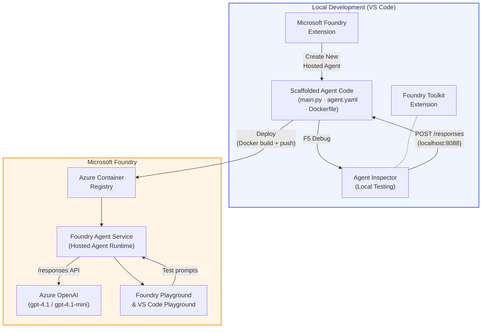

# Foundry Toolkit + Foundry Hosted Agents వర్క్‌షాప్

[](https://www.python.org/)
[](https://github.com/microsoft/agents)
[](https://learn.microsoft.com/azure/foundry/agents/concepts/hosted-agents)
[](https://ai.azure.com/)
[](https://learn.microsoft.com/azure/ai-services/openai/)
[](https://learn.microsoft.com/cli/azure/install-azure-cli)
[](https://learn.microsoft.com/azure/developer/azure-developer-cli/install-azd)
[](https://www.docker.com/)
[](https://marketplace.visualstudio.com/items?itemName=ms-windows-ai-studio.windows-ai-studio)
[](../../LICENSE)

AI ఏజెంట్లను **Microsoft Foundry Agent Service**లో **Hosted Agents**గా నిర్మించండి, పరీక్షించండి మరియు డిప్లాయ్ చేయండి - పూర్తిగా VS Code నుండి **Microsoft Foundry extension** మరియు **Foundry Toolkit** ఉపయోగించి.

> **Hosted Agents ప్రస్తుతం ప్రివ్యూ లో ఉన్నాయి.** మద్దతు పొందే ప్రాంతాలు పరిమితంగా ఉన్నాయి - చూడండి [ప్రాంతాల లభ్యత](https://learn.microsoft.com/azure/foundry/agents/concepts/hosted-agents#region-availability).

> ప్రతి ల్యాబ్‌లోని `agent/` ఫోల్డర్ Foundry విస్తరణ ద్వారా **స్వయంచాలకంగా స్కాఫోల్డ్** చేయబడుతుంది - మీరు తరువాత కోడ్‌ను అనుకూలీకరించి, లోకల్‌గా పరీక్షించి, ఆపై డిప్లాయ్ చేస్తారు.

### 🌐 బహుభాషా మద్దతు

#### GitHub Action ద్వారా మద్దతు (స్వయంచాలక మరియు ఎప్పుడూ తాజా)

<!-- CO-OP TRANSLATOR LANGUAGES TABLE START -->
[అరబిక్](../ar/README.md) | [బెంగాలీ](../bn/README.md) | [బల్గేరియన్](../bg/README.md) | [బర్మీస్ (మ్యాన్మార్)](../my/README.md) | [చైనీస్ (సరళీకృత)](../zh-CN/README.md) | [చైనీస్ (పారంపర్య, హాంకాంగ్)](../zh-HK/README.md) | [చైనీస్ (పారంపర్య, మకావు)](../zh-MO/README.md) | [చైనీస్ (పారంపర్య, తైవాన్)](../zh-TW/README.md) | [క్రొయేషియన్](../hr/README.md) | [చెక్](../cs/README.md) | [డానిష్](../da/README.md) | [డచ్](../nl/README.md) | [ఎస్టోనియన్](../et/README.md) | [ఫిన్నిష్](../fi/README.md) | [ఫ్రెంచ్](../fr/README.md) | [జర్మన్](../de/README.md) | [గ్రీక్](../el/README.md) | [హీబ్రూ](../he/README.md) | [హిందీ](../hi/README.md) | [హంగేరియన్](../hu/README.md) | [ఇండోనేషియన్](../id/README.md) | [ఇటాలియన్](../it/README.md) | [జపనీస్](../ja/README.md) | [కన్నడ](../kn/README.md) | [ఖ్మేర్](../km/README.md) | [కొరియన్](../ko/README.md) | [లిథువేనియాన్](../lt/README.md) | [మలయ్](../ms/README.md) | [మలయాళం](../ml/README.md) | [మరాఠీ](../mr/README.md) | [నేపాలి](../ne/README.md) | [నైజీరియన్ పిడ్జిన్](../pcm/README.md) | [నార్వేజియన్](../no/README.md) | [పర్షియన్ (ఫార్సీ)](../fa/README.md) | [పోలిష్](../pl/README.md) | [పోర్చుగీస్ (బ్రెజిల్)](../pt-BR/README.md) | [పోర్చుగీస్ (పోర్చుగల్)](../pt-PT/README.md) | [పంజాబీ (గుర్ముఖి)](../pa/README.md) | [రోమేనియన్](../ro/README.md) | [రష్యన్](../ru/README.md) | [సెర్బియన్ (సిరిలిక్)](../sr/README.md) | [స్లోవాక్](../sk/README.md) | [స్లోవేనియన్](../sl/README.md) | [స్పానిష్](../es/README.md) | [స్వాహిలి](../sw/README.md) | [స్వీడిష్](../sv/README.md) | [టాగలాగ్ (ఫిలిపినో)](../tl/README.md) | [తమిళం](../ta/README.md) | [తెలుగు](./README.md) | [థాయ్](../th/README.md) | [టర్కిష్](../tr/README.md) | [ఉక్రేనియన్](../uk/README.md) | [ఉర్దూ](../ur/README.md) | [వియత్నామీస్](../vi/README.md)

> **స్థానికంగా క్లోన్ చేయాలని ఇష్టపడుతున్నారా?**
>
> ఈ రిపోజిటరీలో 50+ భాషా అనువాదాలు ఉన్నాయి, అవి డౌన్‌లోడ్ పరిమాణాన్ని గణనీయంగా పెంచుతాయి. అనువాదాలు లేకుండా క్లోన్ చేయాలంటే, sparse checkout ఉపయోగించండి:
>
> **Bash / macOS / Linux:**
> ```bash
> git clone --filter=blob:none --sparse https://github.com/microsoft-foundry/Foundry_Toolkit_for_VSCode_Lab.git
> cd Foundry_Toolkit_for_VSCode_Lab
> git sparse-checkout set --no-cone '/*' '!translations' '!translated_images'
> ```
>
> **CMD (Windows):**
> ```cmd
> git clone --filter=blob:none --sparse https://github.com/microsoft-foundry/Foundry_Toolkit_for_VSCode_Lab.git
> cd Foundry_Toolkit_for_VSCode_Lab
> git sparse-checkout set --no-cone "/*" "!translations" "!translated_images"
> ```
>
> ఇది మీకు కోర్సును పూర్తి చేయడానికి అవసరమైన ప్రతిదాన్ని, చాలా వేగవంతమైన డౌన్లోడ్‌తో అందిస్తుంది.
<!-- CO-OP TRANSLATOR LANGUAGES TABLE END -->

---

## ఆర్కిటెక్చర్



**Flow:** Foundry విస్తరణ ఏజెంట్‌ను స్కాఫోల్డ్ చేస్తుంది → మీరు కోడ్ & సూచనలను అనుకూలీకరిస్తారు → Agent Inspector తో లోకల్‌గా పరీక్షిస్తారు → Foundryకు డిప్లాయ్ చేయండి (Docker image ను ACRకు పుష్ చేయబడుతుంది) → Playgroundలో ధృవీకరించండి.

---

## మీరు ఏమి నిర్మించబోతున్నారు

| ల్యాబ్ | వివరణ | స్థితి |
|-----|-------------|--------|
| **Lab 01 - Single Agent** | **"Explain Like I'm an Executive" Agent** ను నిర్మించండి, దాన్ని లోకల్‌గా పరీక్షించి, Foundryకి డిప్లాయ్ చేయండి | ✅ అందుబాటులో |
| **Lab 02 - Multi-Agent Workflow** | **"Resume → Job Fit Evaluator"** ను నిర్మించండి - 4 ఏజెంట్లు రిజ్యూమ్ ఫిట్‌ను స్కోర్ చేయడానికి సహకరించుకుని, ఒక నేర్చుకునే రోడ్‌మ్యాప్‌ను రూపొందిస్తాయి | ✅ అందుబాటులో |

---

## ఎగ్జిక్యూటివ్ ఏజెంట్‌ను పరిచయం చేసుకోండి

ఈ వర్క్‌షాప్లో మీరు **"Explain Like I'm an Executive" Agent** ను నిర్మించబోతారు - ఇది ఒక AI ఏజెంట్, ఇది క్లిష్టమైన సాంకేతిక జార్గాన్‌ను తీసుకుని శాంతమైన, బోర్డు-మీటింగ్‌కు సిద్ధమైన సారాంశాలలోకి అనువదిస్తుంది. నిజంగా చెప్పాలంటే, C-suiteలో ఎవ్వరూ "thread pool exhaustion caused by synchronous calls introduced in v3.2." గురించి వినాలని కోరుకోరు.

నేను ఈ ఏజెంట్‌ను కొన్ని సంఘటనల తర్వాత నిర్మించాను, ఎక్కడ నా ఖచ్చితంగా రూపొందించిన పోస్ట్-మార్టెంకు ప్రతిస్పందన వచ్చింది: *"అంటే... వెబ్‌సైట్ డౌన్ అయిందా లేక కాదు?"*

### ఇది ఎలా పని చేస్తుంది

మీరు దీనికి ఒక సాంకేతిక నవీకరణ ఇస్తారు. అది తిరిగి ఒక ఎగ్జిక్యూటివ్ సారాంశాన్ని ఇస్తుంది - మూడు బుల్లెట్ పాయింట్లు, జార్గాన్ లేదు, స్టాక్ ట్రేస్‌లు నివ్వలేదు, aucune existential dread లేదు. కేవలం **ఏం జరిగింది**, **వ్యాపార ప్రభావం**, మరియు **తదుపరి దశ**.

### దీనిని కార్యాచరణలో చూడండి

**మీరు అంటారు:**
> "v3.2లో పరిచయమైన synchronous calls కారణంగా thread pool ఆక్రమణ వల్ల API లేటెన్సీ పెరిగింది."

**ఏజెంట్ ఇలా సమాధానం ఇస్తుంది:**

> **ఎగ్జిక్యూటివ్ సారాంశం:**
> - **ఏం జరిగింది:** తాజా విడుదల తర్వాత సిస్టమ్ మందగించింది.
> - **వ్యాపార ప్రభావం:** కొంత మంది వినియోగదారులకు సేవ ఉపయోగించేటప్పుడు ఆలస్యం అనుభవమయ్యింది.
> - **తదుపరి దశ:** మార్పు రోల్బ్యాక్ చేయబడింది మరియు తిరిగి డిప్లాయ్ చేయడానికి ముందు పరిష్కారం సిద్ధం చేయబడుతోంది.

### ఈ ఏజెంట్ ఎందుకు?

ఇది ఒక బాగా సింపుల్, ఒకే ఉద్దేశ్యంతో తెలిసిన ఏజెంట్ — క్లిష్టమైన టూల్ గొలుసుల్లో చిక్కకుండా హోస్టెడ్ ఏజెంట్ వర్క్‌ఫ్లోని మొదటి నుండి చివరి వరకు నేర్చుకోవడానికి పరిపూర్ణం. నిజంగా? ప్రతి ఇంజనీరింగ్ టీమ్ ఈవిధంగా ఒకటి ఉపయోగించుకోవచ్చు.

---

## వర్క్‌షాప్ నిర్మాణం

```
📂 Foundry_Toolkit_for_VSCode_Lab/
├── 📄 README.md                      ← You are here
└── 📂 workshop/
    ├── 📂 lab01-single-agent/        ← Full lab: docs + agent code
    │   ├── README.md                 ← Hands-on lab instructions
    │   ├── 📂 docs/                  ← Step-by-step tutorial modules
    │   │   ├── 00-prerequisites.md
    │   │   ├── 01-setup.md
    │   │   ├── 02-create-hosted-agent.md
    │   │   ├── 03-configure-and-code.md
    │   │   ├── 04-test-locally.md
    │   │   ├── 05-deploy-to-foundry.md
    │   │   ├── 06-verify-in-playground.md
    │   │   ├── 07-summary.md
    │   │   └── 08-troubleshooting.md
    │   └── 📂 agent/                 ← Reference solution (auto-scaffolded by Foundry extension)
    │       ├── agent.yaml
    │       ├── Dockerfile
    │       ├── main.py
    │       └── requirements.txt
    └── 📂 lab02-multi-agent/         ← Resume → Job Fit Evaluator
        ├── README.md                 ← Hands-on lab instructions (end-to-end)
        ├── 📂 docs/                  ← Step-by-step tutorial modules
        │   ├── 00-prerequisites.md
        │   ├── 01-understand-multi-agent.md
        │   ├── 02-scaffold-multi-agent.md
        │   ├── 03-configure-agents.md
        │   ├── 04-orchestration-patterns.md
        │   ├── 05-test-locally.md
        │   ├── 06-deploy-to-foundry.md
        │   ├── 07-verify-in-playground.md
        │   └── 08-troubleshooting.md
        └── 📂 PersonalCareerCopilot/ ← Reference solution (multi-agent workflow)
            ├── agent.yaml
            ├── Dockerfile
            ├── main.py
            └── requirements.txt
```

> **గమనిక:** ప్రతి ల్యాబ్‌లోని `agent/` ఫోల్డర్ **Microsoft Foundry extension** ద్వారా Command Palette నుంచి `Microsoft Foundry: Create a New Hosted Agent` నడిపినప్పుడు రూపొందించబడుతుంది. ఫైళ్లను తర్వాత మీ ఏజెంట్ సూచనల, టూల్స్, మరియు కాన్ఫిగరేషన్‌తో అనుకూలీకరించవచ్చు. ల్యాబ్ 01 దీనిని మొదట నుంచే మళ్లీ సృష్టించడం ఎలా చేయాలో మీకు చూపిస్తుంది.

---

## ప్రారంభించడం

### 1. రిపోజిటరీను క్లోన్ చేయండి

```bash
git clone https://github.com/microsoft-foundry/Foundry_Toolkit_for_VSCode_Lab.git
cd Foundry_Toolkit_for_VSCode_Lab
```

### 2. Python వర్చువల్ ఎన్విరాన్‌మెంట్ సెట్ చేయండి

```bash
python -m venv venv
```

Activate it:

- **Windows (PowerShell):**
  ```powershell
  .\venv\Scripts\Activate.ps1
  ```
- **macOS / Linux:**
  ```bash
  source venv/bin/activate
  ```

### 3. డిపెండెన్సీలను ఇన్‌స్టాల్ చేయండి

```bash
pip install -r workshop/lab01-single-agent/agent/requirements.txt
```

### 4. ఎన్విరాన్‌మెంట్ వేరియబుల్స్‌ని కాన్ఫిగర్ చేయండి

ఏజెంట్ ఫోల్డర్‌లోని ఉదాహరణ `.env` ఫైల్‌ను కాపీ చేసి మీ విలువలను పూరించండి:

```bash
cp workshop/lab01-single-agent/agent/.env.example workshop/lab01-single-agent/agent/.env
```

`workshop/lab01-single-agent/agent/.env` ను సవరించండి:

```env
AZURE_AI_PROJECT_ENDPOINT=https://<your-account>.services.ai.azure.com/api/projects/<your-project>
AZURE_AI_MODEL_DEPLOYMENT_NAME=<your-model-deployment-name>
```

### 5. వర్క్‌షాప్ ల్యాబ్స్‌ను అనుసరించండి

ప్రతి ల్యాబ్ స్వయం-సంపూర్ణంగా ఉంటుంది, తమ స్వంత మాడ్యూల్‌లతో. ప్రాథమికాలను నేర్చుకోవడానికి **Lab 01** తో ప్రారంభించి, ఆపై బహుఎజెంట్ వర్క్‌ఫ్లో కోసం **Lab 02** కి వెళ్లండి.

#### Lab 01 - Single Agent ([పూర్తి సూచనలు](workshop/lab01-single-agent/README.md))

| # | మాడ్యూల్ | లింక్ |
|---|--------|------|
| 1 | అవశ్యకతలు చదవండి | [00-prerequisites.md](workshop/lab01-single-agent/docs/00-prerequisites.md) |
| 2 | Foundry Toolkit & Foundry extension ను ఇన్‌స్టాల్ చేయండి | [01-setup.md](workshop/lab01-single-agent/docs/01-setup.md) |
| 3 | Foundry ప్రాజెక్ట్ సృష్టించండి | [01-setup.md](workshop/lab01-single-agent/docs/01-setup.md) |
| 4 | హోస్టెడ్ ఏజెంట్ సృష్టించండి | [02-create-hosted-agent.md](workshop/lab01-single-agent/docs/02-create-hosted-agent.md) |
| 5 | సూచనలు & ఎన్విరాన్‌మెంట్ ని కాన్ఫిగర్ చేయండి | [03-configure-and-code.md](workshop/lab01-single-agent/docs/03-configure-and-code.md) |
| 6 | లోకల్‌గా పరీక్షించండి | [04-test-locally.md](workshop/lab01-single-agent/docs/04-test-locally.md) |
| 7 | Foundryకి డిప్లాయ్ చేయండి | [05-deploy-to-foundry.md](workshop/lab01-single-agent/docs/05-deploy-to-foundry.md) |
| 8 | Playgroundలో ధృవీకరించండి | [06-verify-in-playground.md](workshop/lab01-single-agent/docs/06-verify-in-playground.md) |
| 9 | సమస్యల పరిష్కారం | [08-troubleshooting.md](workshop/lab01-single-agent/docs/08-troubleshooting.md) |

#### Lab 02 - Multi-Agent Workflow ([పూర్తి సూచనలు](workshop/lab02-multi-agent/README.md))

| # | మాడ్యూల్ | లింక్ |
|---|--------|------|
| 1 | అవశ్యకతలు (Lab 02) | [00-prerequisites.md](workshop/lab02-multi-agent/docs/00-prerequisites.md) |
| 2 | బహుఎజెంట్ ఆర్కిటెక్చర్‌ను అర్థం చేసుకోండి | [01-understand-multi-agent.md](workshop/lab02-multi-agent/docs/01-understand-multi-agent.md) |
| 3 | బహుఎజెంట్ ప్రాజెక్ట్‌ను స్కాఫోల్డ్ చేయండి | [02-scaffold-multi-agent.md](workshop/lab02-multi-agent/docs/02-scaffold-multi-agent.md) |
| 4 | ఏజెంట్లు & ఎన్విరాన్‌మెంట్‌ను కాన్ఫిగర్ చేయండి | [03-configure-agents.md](workshop/lab02-multi-agent/docs/03-configure-agents.md) |
| 5 | సమన్వయ నమూనాలు | [04-orchestration-patterns.md](workshop/lab02-multi-agent/docs/04-orchestration-patterns.md) |
| 6 | లోకల్‌గా పరీక్షించండి (బహుఎజెంట్) | [05-test-locally.md](workshop/lab02-multi-agent/docs/05-test-locally.md) |
| 7 | Foundryకి డిప్లాయ్ చేయండి | [06-deploy-to-foundry.md](workshop/lab02-multi-agent/docs/06-deploy-to-foundry.md) |
| 8 | Playgroundలో ధృవీకరించండి | [07-verify-in-playground.md](workshop/lab02-multi-agent/docs/07-verify-in-playground.md) |
| 9 | సమస్యల పరిష్కారం (బహుఎజెంట్) | [08-troubleshooting.md](workshop/lab02-multi-agent/docs/08-troubleshooting.md) |

---

## నిర్వహణకర్త

<table>
<tr>
    <td align="center"><a href="https://github.com/ShivamGoyal03">
        <br />
        <sub><b>Shivam Goyal</b></sub>
    </a><br />
    </td>
</tr>
</table>

---

## అవసరమైన అనుమతులు (త్వరిత సూచిక)

| సన్నివేశం | అవసరమైన పాత్రలు |
|----------|---------------|
| కొత్త Foundry ప్రాజెక్ట్ సృష్టించండి | Foundry రిసోర్స్‌పై **Azure AI Owner** |
| ఉన్న ప్రాజెక్ట్‌కు (కొత్త రిసోర్సులు) డిప్లాయ్ చేయండి | సబ్స్క్రిప్షన్‌పై **Azure AI Owner** + **Contributor** |
| పూర్తిగా కాన్ఫిగర్ చేయబడిన ప్రాజెక్ట్‌కు డిప్లాయ్ చేయండి | ఖాతాపై **Reader** + ప్రాజెక్ట్‌పై **Azure AI User** |

> **ముఖ్యమైనది:** Azure `Owner` మరియు `Contributor` పాత్రలు కేవలం *management* అనుమతులను మాత్రమే కలిగి ఉంటాయి, *development* (డేటా చర్య) అనుమతులు కాదు. ఏజెంట్లు నిర్మించడానికి మరియు డిప్లాయ్ చేయడానికి మీకు **Azure AI User** లేదా **Azure AI Owner** అవసరం.

---

## రిఫరెన్సులు

- [త్వరిత ప్రారంభం: మీ మొదటి హోస్టెడ్ ఏజెంట్‌ను డిప్లాయ్ చేయండి (VS Code)](https://learn.microsoft.com/azure/foundry/agents/quickstarts/quickstart-hosted-agent)
- [హోస్టెడ్ ఏజెంట్లు ఏమిటి?](https://learn.microsoft.com/azure/foundry/agents/concepts/hosted-agents)
- [VS Codeలో హోస్టెడ్ ఏజెంట్ వర్క్‌ఫ్లోలను సృష్టించండి](https://learn.microsoft.com/azure/foundry/agents/how-to/vs-code-agents-workflow-pro-code)
- [హోస్టెడ్ ఏజెంట్‌ను డిప్లాయ్ చేయండి](https://learn.microsoft.com/azure/foundry/agents/how-to/deploy-hosted-agent)
- [Microsoft Foundry కోసం RBAC](https://learn.microsoft.com/azure/foundry/concepts/rbac-foundry)
- [ఆర్కిటెక్చర్ సమీక్ష ఏజెంట్ నమూనా](https://github.com/Azure-Samples/agent-architecture-review-sample) - వాస్తవ-ప్రపంచ హోస్టెడ్ ఏజెంట్ MCP టూల్స్, Excalidraw డయాగ్రామ్‌లు, మరియు ద్వైపాక్షిక డిప్లాయ్‌మెంట్‌తో

---


## లైసెన్స్

[MIT](../../LICENSE)

---

<!-- CO-OP TRANSLATOR DISCLAIMER START -->
**అస్వీకరణ**:
ఈ పత్రం AI అనువాద సేవ [Co-op Translator](https://github.com/Azure/co-op-translator) ఉపయోగించి అనువదించబడింది. మేము ఖచ్చితత్వానికి ప్రయత్నిస్తున్నప్పటికీ, ఆటోమేటెడ్ అనువాదాలు తప్పులు లేదా అసమగ్రతలను కలిగి ఉండవచ్చు. దాని స్వదేశ భాషలో ఉన్న అసలు పత్రాన్ని అధికారం కలిగిన మూలంగా పరిగణించాలి. కీలకమైన సమాచారం కోసం, ప్రొఫెషనల్ మానవ అనువాదాన్ని సిఫారసు చేస్తాము. ఈ అనువాదం ఉపయోగం వల్ల కలిగే ఏవైనా అపార్థాలు లేదా తప్పుదారులు కోసం మేము బాధ్యత వహించము.
<!-- CO-OP TRANSLATOR DISCLAIMER END -->
