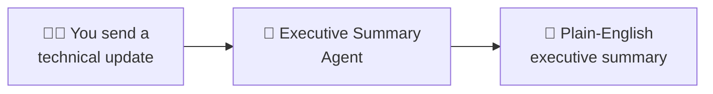

# మాడ్యూల్ 0 - పరిచయం

⏱️ సుమారు 10 నిమిషాలు

> [!WARNING]
> **పรีవ్యూ & పరిమితులు:** [హోస్టెడ్ ఏజెంట్స్](https://learn.microsoft.com/azure/foundry/agents/concepts/hosted-agents) ప్రస్తుతం **పబ్లిక్ ప్రివ్యూ** లో ఉన్నాయి - ఉత్పత్తి వర్క్‌లోడ్‌ల కోసం సిఫార్సు చేయబడవు. ఈ క్రింది విషయాలు గమనించాలి:
> - **మద్దతు పొందిన ప్రాంతాలు పరిమితంగా ఉన్నాయి** - రిసోర్సులు సృష్టించడానికి ముందు [ప్రాంతం లభ్యత](https://learn.microsoft.com/azure/foundry/agents/concepts/hosted-agents#region-availability) తనిఖీ చేయండి. మద్దతు లేని ప్రాంతాన్ని ఎంచుకుంటే, డిప్లాయ్‌మెంట్ విఫలమవుతుంది.
> - `agent-framework-foundry-hosting` ప్యాకేజీ ప్రీ-రివిజన్‌లో ఉంది - వర్షన్ల మధ్య APIs మారవచ్చు.
> - స్కేల్ పరిమితులు: హోస్టెడ్ ఏజెంట్లు 0–5 రిప్లికాలు (స్కేల్-టు-జీరోతో సహా) మద్దతు ఇస్తాయి.
> - ఈ వర్క్‌షాప్‌లో చూపించబడిన కొన్ని ఫీచర్లు సర్వీస్ GA వైపు ప్రభావితం అయ్యే అవకాశాలు ఉన్నాయి.

## మీరు ఏమి నిర్మించబోతున్నారు

ఈ వర్క్‌షాప్‌లో, మీరు **"నాకోసం సులభంగా వివరించు"** అనే హోస్టెడ్ AI ఏజెంట్ ని నిర్మిస్తారు - ఇది సాంకేతిక నవీకరణలను సాధారణ ఆంగ్ల ఎగ్జిక్యూటివ్ సారాంశాలుగా తిరిగి రాస్తుంది.

**ఏజెంట్ ఉపయోగించేవి:**
- **Microsoft Agent Framework** - ఏజెంట్ లాజిక్ మరియు నిర్మాణం కోసం
- **Foundry Toolkit for VS Code** - స్కాఫోల్‌డ్ చేయడానికి, స్థానికంగా పరీక్షించడానికి, మరియు డిప్లాయ్ చేయడానికి
- **ఓ AI మోడల్** (ఉదాహరణకు `gpt-4.1-mini/gpt-5-mini`) - సారాంశాలను సృష్టించడానికి

ఈ ప్రయోగం చివరికి, మీరు Agent Inspector ద్వారా స్థానికంగా పరీక్షించగలిగే మరియు ఐచ్చికంగా క్లౌడ్‌లో డిప్లాయ్ చేయగలిగే పని చేసే ఏజెంట్ ని పొందుతారు.

---

## హోస్టెడ్ ఏజెంట్లు అంటే ఏమిటి?

**హోస్టెడ్ ఏజెంట్** అనేది Microsoft Foundryలో నిర్వహణాత్మక సేవగా నడిచే AI ఏజెంట్. మీ సొంత మౌలిక సదుపాయాలను నిర్వహించటం కాకుండా, మీరు మీ ఏజెంట్ కోడ్ ను ఒక కంటెయినర్‌లో ప్యాకేజ్ చేస్తారు మరియు Foundry స్కేలింగ్, హోస్టింగ్, మరియు స్టాండర్డ్ HTTP ఎండ్‌పాయింట్ ద్వారా అందుబాటులో ఉంచుతుంది.

| భావన | అర్థం |
|---------|--------------|
| **ఏజెంట్** | వినియోగదారు సందేశం పొందే, AI మోడల్‌ను పిలవటం, మరియు నిర్మిత స్పందనను కలిగి ఉండుటకు మీ Python కోడ్ |
| **హోస్టెడ్** | Foundry మీ కంటెయినర్‌ను నడుపుతుంది - ఎటువంటి VMలు, కుబెర్నేటిస్, లేదా మౌలిక సదుపాయ నిర్వహణ లేదు |
| **స్పందనలు ప్రోటోకాల్స్** | ఏ క్లయింట్ కాల్ చేయగల స్టాండర్డ్ HTTP API (`POST /responses`) మీ ఏజెంట్ తో ఇంటరాక్ట్ అవ్వడానికి |
| **ఏజెంట్ ఇన్స్‌పెక్టర్** | స్థానిక పరీక్ష UI (Foundry Toolkit లో నిర్మించబడింది) మీరు డిప్లాయ్‌మెంట్ ముందు మీ ఏజెంట్ తో చాట్ చేయగలదు |

ఈ వర్క్‌షాప్‌లో, మీరు జీరో నుండి పూర్తిగా హోస్టెడ్ ఏజెంట్ ని పొందుతారు - లేదా మీరు ఇష్టపడి ఉంటే స్థానిక పరీక్ష వద్ద ఆపు చేసుకోవచ్చు.

---

## మీ మార్గాన్ని ఎంచుకోండి

> ⚠️ **కొనసాగడానికి ఒక మార్గాన్ని ఎంచుకోండి.** మీ ఎంపిక ఏ టూల్స్ ఇన్‌స్టాల్ చేయాలో మరియు ఏ మాడ్యూల్‌లు వర్తిస్తాయో నిర్ణయిస్తుంది. మీరుతర్వాత Path B → Path A కు మారవచ్చు.

<strong>🅰️ మార్గం A - Azure క్లౌడ్ (Azure సబ్‌స్క్రిప్షన్ అవసరం)</strong>

| | వివరాలు |
|---|---|
| **ఎవరు ఈ మార్గం కోసం?** | మీరు ఒక చురుకైన Azure సబ్‌స్క్రిప్షన్ ఉన్నారు మరియు Foundry వనరులు సృష్టించగలరు |
| **మోడల్** | Foundry ద్వారా Azure OpenAI (ఉదా: `gpt-4.1-mini/gpt-5-mini`) |
| **మాడ్యూల్స్ కవరింగ్** | అన్ని మాడ్యూల్స్ (00–07) |
| **క్లౌడ్‌కు డిప్లాయ్ చేయాలా?** | ✅ అవును - పూర్తి ఎండ్టు ఎండ్తో డిప్లాయ్‌మెంట్ |

<strong>🅱️ మార్గం B - స్థానిక / ఉచిత స్థాయి (Azure సబ్‌స్క్రిప్షన్ అవసరం లేదు)</strong>

| | వివరాలు |
|---|---|
| **ఎవరు ఈ మార్గం కోసం?** | MVPలు, విద్యార్థులు, లేదా Azure యాక్సెస్ లేని వారు |
| **మోడల్** | **Foundry Local** (ఉచితం, మీ మెషీన్ పై నడుస్తుంది) |
| **మాడ్యూల్స్ కవరింగ్** | మాడ్యూల్స్ 00–04 (డిప్లాయ్ & క్లౌడ్ ధృవీకరణ దాటవేయండి) |
| **క్లౌడ్‌కు డిప్లాయ్ చేయాలా?** | ❌ లేదు - Agent Inspector ద్వారా స్థానికంగా మాత్రమే పరీక్షించండి |

---

## అన్ని మార్గాలు: అవసరమైన టూల్స్

క్రింద అనిచే ప్రతి టూల్‌ను ఇన్‌స్టాల్ చేయండి. ఇన్‌స్టాల్ చేసిన తరువాత, క్రింది చెక్ కమాండ్‌తో ఇది పనిచేస్తుందో లేనిదో నిర్ధారించుకోండి.

| # | టూల్ | వెర్షన్ | ఇన్‌స్టాల్ చేయు | ధృవీకరణ (అనుకున్న అవుట్‌పుట్) |
|---|------|---------|---------|---------------------------|
| 1 | **విజువల్ స్టూడియో కోడ్** | తాజా | [code.visualstudio.com](https://code.visualstudio.com/) | ఎర్రర్ల లేని ఓపెనింగ్ |
| 2 | **పైథాన్** | 3.12 లేదా అంతకుపై | [python.org/downloads](https://www.python.org/downloads/) | `python --version` $\rightarrow$ `Python 3.12.x` |
| 3 | **Foundry Toolkit for VS Code** | తాజా | ఎక్స్‌టెన్షన్ ID: `ms-windows-ai-studio.windows-ai-studio` | Activity Bar లో Foundry ఐకాన్ |
| 4 | **Python extension for VS Code** | తాజా | ఎక్స్‌టెన్షన్ ID: `ms-python.python` | ఎక్స్‌టెన్షన్ ప్యానెల్‌లో ఇన్‌స్టాల్ అయింది |

> [!TIP]
> **ఇన్‌స్టాలేషన్ కోసం ప్రో-టిప్స్:**
> - **Python PATH (విండోస్):** Python ఇన్‌స్టాలర్ మొదటి స్క్రీన్ లో ఎప్పుడూ **"Add Python to PATH"** ఎంచుకోండి. లేకపోతే `python` మీ టెర్మినల్లో గుర్తించబడదు.
> - **అనేక Python వెర్షన్లు:** Python 3.10 మరియు 3.12 రెండూ ఉన్నప్పుడు, మీరు సరైన వెర్షన్ వర్చువల్ ఎన్విరాన్మెంట్‌ కోసం ఉపయోగించేందుకు `python3.12 -m venv .venv` వాడండి.
> - **డాకర్ WSL 2 (విండోస్):** డాకర్ డెస్క్‌టాప్ ఇన్‌స్టాలేషన్ సమయంలో **WSL 2 బ్యాక్‌ఎండ్** ఎంచుకోండి. Hyper-V తో డాకర్ నెమ్మదిగా ఉంటుంది మరియు Foundry కంటెయినర్ బిల్డులతో సమస్య రావచ్చు.
> - **డాకర్ స్టార్ట్ అవకపోతే?** డాకర్ డెస్క్‌టాప్ ప్రారంభించిన తర్వాత 30-60 సెకన్లు వేచి ఉండండి. `docker info` నడిపించండి - "Cannot connect to the Docker daemon" దొరికితే, డాకర్ ఇంకా ప్రారంభమవుతోంది.
> - **VS కోడ్ ఎక్స్‌టెన్షన్లు లోడ్ అవకపోతే?** ఎక్స్‌టెన్షన్లు ఇన్‌స్టాల్ చేసిన తర్వాత విండోను రీలోడ్ చేయండి: `Ctrl+Shift+P` → `Developer: Reload Window`.

> **విండోస్ యూజర్లు:** Python ఇన్‌స్టాలేషన్ సమయంలో **"Add Python to PATH"** ను తనిఖీ చేయండి.

**తదుపరి:** [01 - సెటప్ →](01-setup.md)

---

<!-- CO-OP TRANSLATOR DISCLAIMER START -->
**అస్వీకరణ**:
ఈ పత్రం AI అనువాద సేవ [Co-op Translator](https://github.com/Azure/co-op-translator) ఉపయోగించి అనువదించబడింది. మేము ఖచ్చితత్వానికి ప్రయత్నిస్తున్నప్పటికీ, ఆటోమేటెడ్ అనువాదాలు తప్పులు లేదా అసమగ్రతలను కలిగి ఉండవచ్చు. దాని స్వదేశ భాషలో ఉన్న అసలు పత్రాన్ని అధికారం కలిగిన మూలంగా పరిగణించాలి. కీలకమైన సమాచారం కోసం, ప్రొఫెషనల్ మానవ అనువాదాన్ని సిఫారసు చేస్తాము. ఈ అనువాదం ఉపయోగం వల్ల కలిగే ఏవైనా అపార్థాలు లేదా తప్పుదారులు కోసం మేము బాధ్యత వహించము.
<!-- CO-OP TRANSLATOR DISCLAIMER END -->