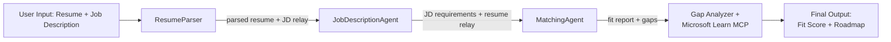

# PersonalCareerCopilot - రిజ్యూమ్ → ఉద్యోగ అనుకూలత అంచనాదారు

రిజ్యూమ్ ఉద్యోగ వివరణకు ఎంతవరకు సరిపోయిందో అంచనా వేసే, తర్వాత తగిన శిక్షణ పథకాన్ని రూపొందించే వర్క్‌ఫ్లో-మొదటి బహుళ-ఏజెంట్ యాప్.

---

## ఏజెంట్లు

| ఏజెంట్ | పాత్ర | ఉపకరణాలు |
|-------|------|-------|
| **ResumeParser** | రిజ్యూమ్ పాఠ్యత్తొనుండి నిర్మాణాత్మక నైపుణ్యాలు, అనుభవం, సర్టిఫికెషన్స్ తొలగిస్తుంది | - |
| **JobDescriptionAgent** | JD నుండి అవసరమైన/ప్రాధాన్యమైన నైపుణ్యాలు, అనుభవం, సర్టిఫికెషన్స్ తీసివేస్తుంది | - |
| **MatchingAgent** | ప్రొఫైన్ సంభంధిత అవసరాలతో పోల్చి → फिट్స్కోరు (0-100) + సరిపోతున్న/లేని నైపుణ్యాలు | - |
| **GapAnalyzer** | Microsoft Learn వనరులతో వ్యక్తిగతరీతి శిక్షణ పథకం తయారు చేస్తుంది | `search_microsoft_learn_for_plan` (MCP) |

## వర్క్‌ఫ్లో



---

## త్వరిత ప్రారంభం

### 1. పరిసరాన్ని సెట్ చేయండి

ఈ ఫోల్డర్ వర్క్‌ఫ్లో-ఆధారిత Lab 02 స్కాఫోల్డ్ కోసం రిఫరెన్స్ అమలుదారిత విజ్ఞాపన. దీనిలో `main.py` ప్రసిద్ధ ప్రాంప్ట్ బ్లాక్స్ మరియు `WorkflowBuilder` ద్వారా నాలుగు ఏజెంట్లను కలుపుతుంది.

```powershell
cd workshop\lab02-multi-agent\PersonalCareerCopilot
python -m venv .venv
.\.venv\Scripts\Activate.ps1          # Windows PowerShell
# source .venv/bin/activate            # macOS / Linux
pip install -r requirements.txt
```

### 2. గుర్తింపుపత్రాలు కన్ఫిగర్ చేయండి

ఈ ఫోల్డర్లో `.env` ఫైలు సృష్టించండి:

```powershell
copy .env .env.bak 2>$null; echo $null > .env
```

మార్చండి `.env`:

```env
FOUNDRY_PROJECT_ENDPOINT=https://<your-account>.services.ai.azure.com/api/projects/<your-project>
AZURE_AI_MODEL_DEPLOYMENT_NAME=gpt-4.1-mini
```

| విలువ | దాన్ని ఎక్కడ కనుగొనాలి |
|-------|------------------|
| `FOUNDRY_PROJECT_ENDPOINT` | Foundry టూల్కిట్ సైడ్‌బార్ → మీ ప్రాజెక్ట్‌పై రైట్ క్లిక్ → **ప్రాజెక్ట్ ఎండ్పాయింట్ కాపీ చేయి** |
| `AZURE_AI_MODEL_DEPLOYMENT_NAME` | Foundry సైడ్‌బార్ → ప్రాజెక్ట్ విస్తరించండి → **మోడల్స్ + ఎండ్పాయింట్స్** → డిప్లాయ్‌మెంట్ పేరు |

### 3. స్థానికంగా నడపండి

```powershell
python -m debugpy --listen 127.0.0.1:5679 main.py --port 8088
```

లేదా VS Code టాస్క్‌ను ఉపయోగించండి: `Ctrl+Shift+P` → **టాస్క్స్: రన్ టాస్క్** → **ఏజెంట్ HTTP సర్వర్ నడపండి**.

F5 డీబగ్గింగ్ కోసం, **డీబగ్ లోకల్ ఏజెంట్ HTTP సర్వర్** ఉపయోగించండి.

### 4. ఏజెంట్ ఇన్స్పెక్టర్ తో పరీక్షించండి

ఏజెంట్ ఇన్స్పెక్టర్ ఓపెన్ చేయండి: `Ctrl+Shift+P` → **Foundry Toolkit: ఏజెంట్ ఇన్స్పెక్టర్ ఓపెన్ చేయండి**.

ఈ పరీక్ష ప్రాంప్ట్ పేస్ట్ చేయండి:

```
Resume:
Jane Doe
Senior Software Engineer with 5 years of experience in Python, Django, and AWS.
Built microservices handling 10K+ requests/second. Led a team of 4 developers.
Certifications: AWS Solutions Architect Associate.
Education: B.S. Computer Science, State University.

Job Description:
Senior Cloud Engineer at Contoso Ltd.
Required: Python, Azure, Kubernetes, Terraform, CI/CD pipelines.
Preferred: Go, monitoring (Prometheus/Grafana), cost optimization.
Experience: 5+ years in cloud infrastructure.
Certifications: Azure Solutions Architect Expert preferred.
```

**అంచనాలు:** ఒక ఫిట్‌స్కోర్ (0-100), సరిపోతున్న/లేని నైపుణ్యాలు, మరియు Microsoft Learn URLs తో వ్యక్తిగత శిక్షణ పథకం.

### 5. Foundryకు డిప్లాయ్ చేయండి

`Ctrl+Shift+P` → **Foundry Toolkit: హోస్టెడ్ ఏజెంట్‌ను డిప్లాయ్ చేయండి** → మీ ప్రాజెక్ట్ ఎంచుకొని → నిర్ధారించండి.

---

## ప్రాజెక్ట్ నిర్మాణం

```
PersonalCareerCopilot/
├── .env                ← Your credentials (git-ignored)
├── agent.yaml          ← Hosted agent definition (name, resources, env vars)
├── Dockerfile          ← Container image for Foundry deployment
├── main.py             ← 4-agent workflow (instructions, MCP tool, WorkflowBuilder)
└── requirements.txt    ← Python dependencies
```

## కీలక ఫైళ్లు

### `agent.yaml`

Foundry ఏజెంట్ సర్వీస్ కోసం హోస్టెడ్ ఏజెంట్ నిర్వచిస్తుంది:
- `kind: hosted` - నిర్వహణ ఉత్పత్తిగా నడుస్తుంది
- `protocols` - `responses` ప్రోటోకాల్‌తో `version: 2.0.0` ను ఉపయోగించి, `/responses` HTTP ఎండ్పాయింట్ ను బయటపెడుతుంది
- `environment_variables` - `AZURE_AI_MODEL_DEPLOYMENT_NAME` ఇక్కడ ప్రకటించబడింది; `FOUNDRY_PROJECT_ENDPOINT` అనుసంధానం సమయాన్ని ఆటోమేటిక్‌గా ఇంజెక్ట్ చేస్తుంది

### `main.py`

కలిగివుంటుంది:
- **ఏజెంట్ సూచనలు** - నాలుగు `*_INSTRUCTIONS` కాంస్టెంట్స్, ఒకటి ప్రతి ఏజెంట్కు
- **MCP టూల్** - `search_microsoft_learn_for_plan()` Streamable HTTP ద్వారా `https://learn.microsoft.com/api/mcp` ను కాల్ చేస్తుంది
- **ఏజెంట్ సృష్టి** - నాలుగు `Agent()` + `AgentExecutor()` ఉదాహరణలు ఒకటి `FoundryChatClient`ను పంచుకుంటాయి
- **వర్క్‌ఫ్లో గ్రాఫ్** - `WorkflowBuilder` ఏజెంట్లను అనుక్రమ శ్రేణిగా కలుపుతుంది: ResumeParser → JD ఏజెంట్ → MatchingAgent → GapAnalyzer
- **సర్వర్ ప్రారంభం** - `ResponsesHostServer` పోర్ట్ 8088 పై నడుస్తుంది

### `requirements.txt`

| ప్యాకేజీ | ప్రయోజనం |
|---------|----------|
| `agent-framework-foundry` | కోర్ రన్‌టైమ్: `Agent`, `AgentExecutor`, `WorkflowBuilder`, `@tool`, `FoundryChatClient` |
| `agent-framework-foundry-hosting` | `ResponsesHostServer` + Foundry హోస్టింగ్ ఇంటిగ్రేషన్ |
| `mcp<2,>=1.24.0` | GapAnalyzer కోసం MCP క్లయింట్ (`streamable_http_client`) |
| `debugpy` | Python డీబగింగ్ (VS Code లో F5) |

---

## సమస్య పరిష్కారం

| సమస్య | పరిష్కారం |
|-------|-----|
| `KeyError: 'FOUNDRY_PROJECT_ENDPOINT'` లేదా `KeyError: 'AZURE_AI_MODEL_DEPLOYMENT_NAME'` | `.env` సృష్టించండి, లో `FOUNDRY_PROJECT_ENDPOINT` మరియు `AZURE_AI_MODEL_DEPLOYMENT_NAME` రెండూ సెట్ చెయ్యండి |
| `ModuleNotFoundError: No module named 'agent_framework'` | వర్చువల్ ఎన్విరాన్మెంట్ ప్రారంభించి `pip install -r requirements.txt` నడపండి |
| అవుట్‌పుట్‌లో Microsoft Learn URLs కనిపించడం లేదు | ఇంటర్నెట్ కనెక్టివిటీ `https://learn.microsoft.com/api/mcp` కు తనిఖీ చేయండి |
| ఒకటి మాత్రమే గ్యాప్ కార్డ్ (తగ్గిపోయింది) | `GAP_ANALYZER_INSTRUCTIONS` లో `CRITICAL:` బ్లాక్ ఉందా అని చూడండి |
| పోర్ట్ 8088 ఉపయోగంలో ఉంది | ఇతర సర్వర్లను ఆపు: `netstat -ano \| findstr :8088` |

పూర్తిగా సమస్య పరిష్కారం కోసం, [Module 8 - Troubleshooting](../docs/08-troubleshooting.md) చూడండి.

---

**పూర్తిగా వాక్‍త్రూ:** [Lab 02 డాక్స్](../docs/README.md) · **తిరిగి:** [Lab 02 README](../README.md) · [ప్రదర్శన హోమ్](../../../README.md)

---

<!-- CO-OP TRANSLATOR DISCLAIMER START -->
**అస్వీకరణ**:
ఈ పత్రం AI అనువాద సేవ [Co-op Translator](https://github.com/Azure/co-op-translator) ఉపయోగించి అనువదించబడింది. మేము ఖచ్చితత్వానికి ప్రయత్నిస్తున్నప్పటికీ, ఆటోమేటెడ్ అనువాదాలు తప్పులు లేదా అసమగ్రతలను కలిగి ఉండవచ్చు. దాని స్వదేశ భాషలో ఉన్న అసలు పత్రాన్ని అధికారం కలిగిన మూలంగా పరిగణించాలి. కీలకమైన సమాచారం కోసం, ప్రొఫెషనల్ మానవ అనువాదాన్ని సిఫారసు చేస్తాము. ఈ అనువాదం ఉపయోగం వల్ల కలిగే ఏవైనా అపార్థాలు లేదా తప్పుదారులు కోసం మేము బాధ్యత వహించము.
<!-- CO-OP TRANSLATOR DISCLAIMER END -->