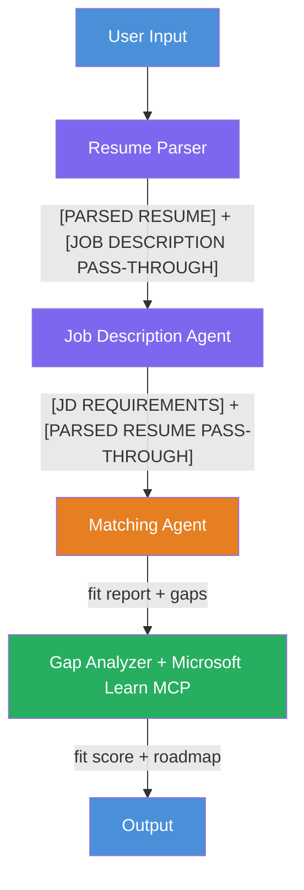

# ల్యాబ్ 02 - బహుళ-ఏజెంట్ వర్క్‌ఫ్లో: రిజ్యూమ్ → ఉద్యోగ సరిపోయే అంచనా

## అవలోకనం

ఈ హ్యాండ్స్-ఆన్ ల్యాబ్‌లో, మీరు VS కోడ్లో Foundry Toolkit ఉపయోగించి ఒక **వర్క్‌ఫ్లో-ముఖ్యమైన బహుళ-ఏజెంట్ యాప్** ను నిర్మించి దాన్ని Microsoft Foundry Agent Serviceకి నిల్వ చేస్తారు.

**మీరు నిర్మించబోయేది:** రిజ్యూమ్ → ఉద్యోగ సరిపోయే అంచనా చేసే యాప్, ఇది రిజ్యూమ్ మరియు ఉద్యోగ వివరణను పార్స్ చేసి, సరిపోయే అంచనాను ఇవ్వగా, Microsoft Learn వనరులను ఉపయోగించి వ్యక్తిగతీకరించిన విద్యా మార్గదర్శకాన్ని తయారుచేస్తుంది.

---

## నిర్మాణకళ

**ఇది ఎలా పనిచేస్తుంది:**
1. వినియోగదారు రిజ్యూమ్ మరియు ఉద్యోగ వివరణను పేస్ట్ చెయగలడు.
2. **ResumeParser** రిజ్యూమ్ ని పార్స్ చేసి JDని అచ్చంగా `[JOB DESCRIPTION PASS-THROUGH]` విభాగంలో ప్రతిలిపి చేస్తుంది.
3. **JD Agent** పాస్-త్రూ నుండి నిర్మిత అవసరాలను తీసుకుని, తర్వాత `[PARSED RESUME]` ను `[PARSED RESUME PASS-THROUGH]` గా ఫార్వర్డ్ చేస్తుంది.
4. **MatchingAgent** `[PARSED RESUME PASS-THROUGH]` ను `[JD REQUIREMENTS]` తో పోల్చి సరిపోయే స్కోరు ఇవ్వగా.
5. **GapAnalyzer** లోపాలను ఒక ప్రాయోజనకరమైన రోడ్‌మ్యాప్ గా మార్చి MCP ద్వారా వాస్తవ Microsoft Learn లింకుల్ని తెస్తుంది.

---

## ముందస్తు అవసరాలు

ముందుగా ల్యాబ్ 01 పూర్తి చేయండి:

- [Lab 01 - Single Agent](../lab01-single-agent/README.md)

---

## భాగం 1: మాడ్యూల్స్‌ను క్రమంలో చదవండి

పూర్తి శిక్షణ మార్గాన్ని చూడండి:

- [Lab 2 Docs - Prerequisites](docs/00-prerequisites.md)
- [Lab 2 Docs - Full Learning Path](docs/README.md)
- [PersonalCareerCopilot run guide](PersonalCareerCopilot/README.md)

---

## భాగం 2: వర్క్‌ఫ్లోని నిర్మించండి మరియు పరీక్షించండి

1. Foundry Toolkit విజార్డు ఉపయోగించి వర్క్‌ఫ్లో ఆధారిత ప్రాజెక్ట్ ను స్కాఫోల్డ్ చేయండి.
2. `PersonalCareerCopilot/main.py` నుండి ప్రాంప్ట్ బ్లాక్స్ మరియు వర్క్‌ఫ్లో గ్రాఫ్ ను మీ వర్క్‌స్పేస్‌లో కాపీ చేసుకోండి.
3. ఏజెంట్ ఇన్స్పెక్టర్‌తో స్థానికంగా నడిపించి అన్ని నాలుగు ఏజెంట్లు మరియు MCP టూల్ ని ధృవీకరించండి.
4. స్థానిక పరీక్షలు విజయవంతమైతే హోస్టెడ్ ఏజెంట్ ను Foundryకి పంపండి.

---

## సమన్వయం నమూనాలు

ల్యాబ్ 02 ఒక **ক্রমాక్రమ Pipeline** ను ఉపయోగిస్తుంది: ప్రతి ఏజెంట్ యొక్క అవుట్‌పుట్ తదుపరి ఏజెంట్ ని ఆహారపరుస్తుంది, మరియు వర్క్‌ఫ్లో చివరి ఏజెంట్ యొక్క ప్రతిస్పందనను తిరిగి ఇస్తుంది. ఈ పనికి రెండు నమూనాలు ఉన్నాయి:

- **క్రమబద్ధమైన శృంఖ‌ల** - `WorkflowBuilder` ResumeParser → JD Agent → MatchingAgent → GapAnalyzer ను ఒక్కో దశకు ఒక `add_edge()` కాల్ తో అనుసంధానం చేస్తుంది
- **కంటెంట్ రీలే** - ప్రతి ఏజెంట్ తన నేరుగా ముందు ఉన్నది మాత్రమే అవుట్‌పుట్ ను చూస్తున్నందున, ResumeParser మరియు JD Agent డేటాను డౌన్‌స్ట్రీమ్ ఏజెంట్లు అవసరమైన లేబుల్ ఉన్న పాస్-త్రూ విభాగాలలో ప్రతిలిపి చేస్తాయి

డాక్యూమెంట్లు కూడా వివరిస్తాయి ల్యాబ్ ఫ్యాన్-అవుట్/ఫ్యాన్-ఇన్ ఉపయోగించని కారణాలు మరియు మరొక ఏజెంట్తో గ్రాఫ్‌ను ఎలా పొడగించాలో.

చూడండి [docs/04-orchestration-patterns.md](docs/04-orchestration-patterns.md).

---

**మునుపటి:** [Lab 01 - Single Agent](../lab01-single-agent/README.md) · **వెళ్ళండి:** [Workshop Home](../../README.md)

---

<!-- CO-OP TRANSLATOR DISCLAIMER START -->
**అస్వీకరణ**:
ఈ పత్రం AI అనువాద సేవ [Co-op Translator](https://github.com/Azure/co-op-translator) ఉపయోగించి అనువదించబడింది. మేము ఖచ్చితత్వానికి ప్రయత్నిస్తున్నప్పటికీ, ఆటోమేటెడ్ అనువాదాలు తప్పులు లేదా అసమగ్రతలను కలిగి ఉండవచ్చు. దాని స్వదేశ భాషలో ఉన్న అసలు పత్రాన్ని అధికారం కలిగిన మూలంగా పరిగణించాలి. కీలకమైన సమాచారం కోసం, ప్రొఫెషనల్ మానవ అనువాదాన్ని సిఫారసు చేస్తాము. ఈ అనువాదం ఉపయోగం వల్ల కలిగే ఏవైనా అపార్థాలు లేదా తప్పుదారులు కోసం మేము బాధ్యత వహించము.
<!-- CO-OP TRANSLATOR DISCLAIMER END -->