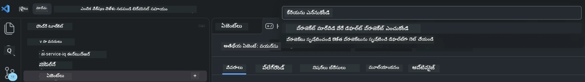

# మాడ్యూల్ 0 - పరిచయం

⏱️ సుమారు 10 నిమిషాలు

> [!WARNING]
> **ప్రివ్యూ & పరిమితులు:** [Hosted Agents](https://learn.microsoft.com/azure/foundry/agents/concepts/hosted-agents) ప్రస్తుతం **పబ్లిక్ ప్రివ్యూ** లో ఉన్నాయి - ఉత్పాదక లోడ్స్ కోసం సిఫార్సు చేయబడలేదు. ఈ వర్క్‌షాప్‌లో చూపించిన కొన్ని ఫీచర్లు సర్వీస్ GA వైపు వేగం తీసుకోవడంతో మారవచ్చు.

## మీరు తయారు చేసేది

ఈ ప్రయోగంలో, మీరు Lab 01 నుండి సింగిల్-ఏజెంట్ నిపుణతలను విస్తరించి **బహుఎజెంట్ వర్క్‌ఫ్లో** - రిజ్యూమ్ → జాబ్ ఫిట్ ఈవాల్యుటర్‌ను నిర్మిస్తారు.

మీరు ఒక **రిజ్యూమ్** మరియు ఒక **జాబ్ వివరణ** ను పేస్ట్ చేస్తారు. నల్గురు ప్రత్యేక ఏజెంట్లు సీక్వెన్షియల్‌గా ఇన్‌పుట్‌ను ప్రాసెస్ చేసి, తర్వాత ఈవి ఇస్తారు:
- ఒక ఫిట్ స్కోరు (0–100తో స్కోరింగ్ విభజన)
- ఒక నైపుణ్యం మరియు సర్టిఫికేషన్ గ్యాప్ జాబితా
- ప్రతి గ్యాప్ కి నిజమైన Microsoft Learn లింకులను కలిగిన వ్యక్తిగత శిక్షణ రోడ్‌మ్యాప్

**వర్క్‌ఫ్లోలో ఉపయోగించే:**
- **Microsoft Agent Framework** - `WorkflowBuilder` సీక్వెన్షియల్ పైప్‌లైన్ ఆర్కెస్ట్రేషన్ కోసం
- **Foundry Toolkit for VS Code** - స్కాఫోల్డ్, స్థానికంగా టెస్ట్ చేయండి, డిప్లాయ్ చేయండి
- **ఒక AI మోడల్** (ఉదా., `gpt-4.1-mini`) - అన్ని నల్గురు ఏజెంట్లు ఉపయోగిస్తారు
- **Microsoft Learn MCP సర్వర్** - ప్రతి నైపుణ్యం గ్యాప్ కోసం నిజమైన శిక్షణ వనరుల లింకులు అందిస్తుంది

---

## మీ మార్గాన్ని ఎంచుకోండి

> ⚠️ **Lab 01 లో మీరు ఉపయోగించిన అదే మార్గంతో కొనసాగండి.**

<details open>
<summary><strong>🅰️ మార్గం A - Azure క్లౌడ్ (Azure సబ్స్క్రిప్షన్ అవసరం)</strong></summary>

| | వివరాలు |
|---|---|
| **ఇది ఎవరిదికీ?** | మీరు Azure సబ్స్క్రిప్షన్ ఉపయోగించి Lab 01 పూర్తిచేసారు |
| **మోడల్** | Foundry ద్వారా Azure OpenAI (ఉదా., `gpt-4.1-mini`) |
| **మాడ్యూల్స్ కవరెడ్** | అన్ని మాడ్యూల్స్ (00–09) |
| **క్లౌడ్‌కు డిప్లాయ్ చేయాలా?** | ✅ అవును - పూర్తి ఎండ్-టు-ఎండ్ డిప్లాయ్‌మెంట్ |

</details>

<details open>
<summary><strong>🅱️ మార్గం B - Foundry లోకల్ (Azure సబ్స్క్రిప్షన్ అవసరం లేదు)</strong></summary>

| | వివరాలు |
|---|---|
| **ఇది ఎవరిదికీ?** | మీరు Foundry లోకల్ ఉపయోగించి Lab 01 పూర్తిచేశారు |
| **మోడల్** | Foundry లోకల్ (ఉచితం, మీ యంత్రంపై నడుస్తుంది) |
| **మాడ్యూల్స్ కవరెడ్** | Modules 00–05 (06–07 అనవసరం - డిప్లాయ్ & క్లౌడ్ వెరిఫై) |
| **క్లౌడ్‌కు డిప్లాయ్ చేయాలా?** | ❌ కాదు - Agent Inspector ద్వారా స్థానిక టెస్టింగ్ మాత్రమే |

</details>

---

## Lab 01 తనిఖీ

Lab 02 నేరుగా Lab 01 మీద నిర్మించబడింది. ఇక్కడ మొదలు పెట్టేముందు ముందుగా Lab 01 పూర్తి చేయండి.

ఇంతవరకు Lab 01 చేయకపోయారా? ఇక్కడ నుండి ప్రారంభించండి: [Lab 01 - పరిచయం](../../lab01-single-agent/docs/00-prerequisites.md)

<details open>
<summary><strong>🅰️ మార్గం A - Azure క్లౌడ్</strong></summary>

```powershell
az account show --query "{name:name, id:id}" --output table
```

ఇది విఫలమైతే, `az login` నడపండి. తరువాత VS Codeలో ధృవీకరించండి:

1. `Ctrl+Shift+P` → **Foundry Toolkit** టైప్ చేయండి → కమాండ్లు కనిపించవచ్చు ఖచ్చితంగా చూడండి.
2. **Foundry Toolkit** ఐకాన్ క్లిక్ చేయండి → మీ ప్రాజెక్ట్ మరియు డిప్లాయ్ చేసిన మోడల్ **Succeeded** అని చూపిస్తుంది.



> **RBAC:** మీరు Lab 01 లో **Foundry User** ను ఆపాదించారు. మళ్లీ ఆపాదించాల్సిన అవసరం ఉంటే, [Lab 01, మాడ్యూల్ 1](../../lab01-single-agent/docs/01-setup.md#deploy-a-model--assign-rbac) ను చూడండి. ఈ పాత్రకు పూర్వం **Azure AI User** అన్నది పేరు, అదే అనుమతులు.

</details>

<details open>
<summary><strong>🅱️ మార్గం B - Foundry లోకల్</strong></summary>

```powershell
Invoke-WebRequest -Uri "http://localhost:5273/v1/health" -UseBasicParsing | Select-Object StatusCode
```

అంచనా: `StatusCode: 200`. కనుక కాకపోతే, Foundry Toolkit సైడ్బార్ నుండి Foundryలోకల్‌ను పునఃప్రారంభించండి.

> అన్ని ఇన్ఫరెన్స్ మీ యంత్రంపై అమలవుతాయి. ఒంటరి అవుట్‌బౌండ్ కాల్ MCP టూల్ ద్వారా `https://learn.microsoft.com/api/mcp` మరోరైండు.

</details>

---

## Lab 02 లో కొత్తదేంటి

| | Lab 01 | Lab 02 |
|--|--------|--------|
| ఏజెంట్లు | 1 | 4 (WorkflowBuilder తో చైన్లో ఉన్నవి) |
| స్కాఫోల్డ్ టెంప్లేట్ | బేసిక్ - ఏజెంట్ ఫ్రేమ్‌వర్క్ | వర్క్‌ఫ్లోల్స్ - ఏజెంట్ ఫ్రేమ్‌వర్క్ |
| కొత్త ప్యాకేజ్ | - | `mcp` |
| ఆర్కెస్ట్రేషన్ | సింగిల్ సంభాషణ ఏజెంట్ | సీక్వెన్షియల్ పైప్‌లైన్ (WorkflowBuilder) |
| కొత్త టూల్ | - | `search_microsoft_learn_for_plan` (MCP) |

---

**తర్వాత:** [01 - ఆర్కిటెక్చర్ అర్థం చేసుకోవడం →](01-understand-multi-agent.md)

---

<!-- CO-OP TRANSLATOR DISCLAIMER START -->
**అస్వీకరణ**:
ఈ పత్రం AI అనువాద సేవ [Co-op Translator](https://github.com/Azure/co-op-translator) ఉపయోగించి అనువదించబడింది. మేము ఖచ్చితత్వానికి ప్రయత్నిస్తున్నప్పటికీ, ఆటోమేటెడ్ అనువాదాలు తప్పులు లేదా అసమగ్రతలను కలిగి ఉండవచ్చు. దాని స్వదేశ భాషలో ఉన్న అసలు పత్రాన్ని అధికారం కలిగిన మూలంగా పరిగణించాలి. కీలకమైన సమాచారం కోసం, ప్రొఫెషనల్ మానవ అనువాదాన్ని సిఫారసు చేస్తాము. ఈ అనువాదం ఉపయోగం వల్ల కలిగే ఏవైనా అపార్థాలు లేదా తప్పుదారులు కోసం మేము బాధ్యత వహించము.
<!-- CO-OP TRANSLATOR DISCLAIMER END -->