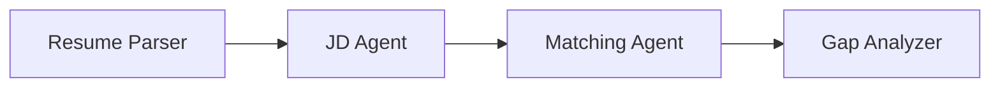
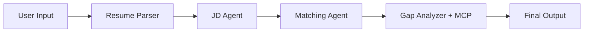

# మాడ్యూల్ 4 - ఆర్కెస్ట్రేషన్ నమూనాలు

⏱️ సుమారు 10 నిమిషాలు

ఈ మాడ్యూల్‌లో, మీరు Resume Job Fit Evaluatorలో ఉపయోగించబడే ఆర్కెస్ట్రేషన్ నమూనాలను అన్వేషించి, వర్క్‌ఫ్లో గ్రాఫ్‌ని ఎలా చదవాలో, మార్చాలో, విస్తరించాలో నే learn learn. ఈ నమూనాలను అర్థం చేసుకోవటం డేటా ఫ్లో సమస్యలను డీబగ్గింగ్ చేసుకోవటానికి మరియు మీ స్వంత [బహుళ ఏజెంట్ వర్క్‌ఫ్లోలను](https://learn.microsoft.com/agent-framework/workflows/) నిర్మించుకోవటానికి అవసరం.

---

## నమూనా 1: క్రమబद्ध చైన్

వర్క్‌ఫ్లోలో ప్రాథమిక నమూనా ఒక **క్రమబద్ధ చైన్** - ప్రతి ఏజెంట్ యొక్క అవుట్‌పుట్ నేరుగా తదుపరి కి ఫీడ్ అవుతుంది.



కోడులో, ప్రతి `add_edge()` కాల్ చైన్‌లో ఒక దశను సృష్టిస్తుంది:

```python
.add_edge(resume_executor, jd_executor)       # ResumeParser output → JD Agent
.add_edge(jd_executor, matching_executor)     # JD Agent output → MatchingAgent
.add_edge(matching_executor, gap_executor)    # MatchingAgent output → GapAnalyzer
```

> **ఎందుకు క్రమబద్ధం, ఫ్యాన్-ఆઉట్ / ఫ్యాన్-ఇన్ కాకుండా?** `WorkflowBuilder` వచ్చే ఎడ్జ్‌ల కోసం **OR-సెమెంటిక్స్** ఉపయోగిస్తుంది: ఒక డౌన్‌స్ట్రీమ్ ఎగ్జిక్యూటర్ ఎప్పుడైతే **ఏదైనా** పూర్వ వర్గం పూర్తయితే వెంటనే ప్రారంభిస్తుంది. `matching_executor`కి రెండు ఇనుపుట్ ఎడ్జ్‌లు ఉంటాయని (రెండు వర్గాల నుండి - `resume_executor` మరియు `jd_executor`), అది రెండు సార్లు ప్రారంభమవుతుంది - ఒకసారి ResumeParser ముగియగానే మరియు మరొకసారి JD Agent ముగియగానే - దాంతో GapAnalyzer కూడా రెండు సార్లు పరిగణింపబడుతుంది మరియు అవుట్‌పుట్ కూడా రెండు సార్లు కనిపిస్తుంది. క్రమబద్ధ పైప్‌లైన్ ఇది పూర్తిగా నివారిస్తుంది.

## నమూనా 2: కంటెంట్ రిలే

ఎందుకంటే `context_mode="last_agent"` అర్థం ప్రతి ఎగ్జిక్యూటర్ తన **సూస్థిర పూర్వవర్గం అవుట్‌పుట్** మాత్రమే చూస్తుంది, క్రమబద్ధ చైన్‌లోని ఏజెంట్లు డౌన్‌స్ట్రీమ్ ఏజెంట్లు అవసరమైన డేటాను స్పష్టంగా ముందుకు పంపాలి.

ఈ వర్క్‌ఫ్లోలో:
- **ResumeParser** JD ని నేరుగా `[JOB DESCRIPTION PASS-THROUGH]`కు కాపీ చేస్తుంది (కాబట్టి JD Agent దాన్ని కనుగొనగలదు).
- **JD Agent** `[PARSED RESUME]` ని నేరుగా `[PARSED RESUME PASS-THROUGH]`కు కాపీ చేస్తుంది (మాట్చింగ్ ఏజెంట్ ఇద్దరు ప్రొఫైల్స్‌ను పోల్చటానికి).

```
ResumeParser output
└─ [PARSED RESUME]               ← extracted by JD Agent
└─ [JOB DESCRIPTION PASS-THROUGH] ← extracted by JD Agent

JD Agent output
└─ [JD REQUIREMENTS]             ← extracted by MatchingAgent
└─ [PARSED RESUME PASS-THROUGH]  ← extracted by MatchingAgent
```

ప్రతి రిలే భాగం తప్పకుండా **నేరుగా కాపీ చేయాలి** - దీన్ని సంక్షిప్తంగా చెప్పడం లేదా పునఃవ్యాఖ్యానం చేస్తే అదే ఆధారపడే డౌన్‌స్ట్రీమ్ ఏజెంట్ విఫలమవుతుంది.

---

## పూర్తి గ్రాఫ్

క్రమబద్ధ చైన్ మరియు కంటెంట్ రిలే నమూనాలను కలిపితే పూర్తి వర్క్‌ఫ్లో లభిస్తుంది:



ఏజెంట్ ఇన్స్పెక్టర్ ఏజెంట్ స్థానికంగా పని చేస్తున్నప్పుడు ఇదే గ్రాఫ్ నిర్మాణాన్ని చూపిస్తుంది. స్క్రీన్‌షాట్ల కోసం [మాడ్యూల్ 5 - స్థానికంగా పరీక్షించండి](05-test-locally.md) ను సంప్రదించండి.

---

## WorkflowBuilder కోడ్ చదవడం

వర్క్‌ఫ్లో గ్రాఫ్ `main()` ఫంక్షన్‌లో నిర్మించబడింది [`PersonalCareerCopilot/main.py`](../../../../../workshop/lab02-multi-agent/PersonalCareerCopilot/main.py)లో. మూడు `add_edge()` కాల్స్ క్రమంగా పైప్లైన్‌ను నిర్మిస్తాయి:

| # | ఎడ్జ్ | ప్రభావం |
|---|------|--------|
| 1 | `resume_executor → jd_executor` | JD ఏజెంట్ `[PARSED RESUME]` + `[JOB DESCRIPTION PASS-THROUGH]` స్వీకరిస్తుంది |
| 2 | `jd_executor → matching_executor` | MatchingAgent `[JD REQUIREMENTS]` + `[PARSED RESUME PASS-THROUGH]` స్వీకరిస్తుంది |
| 3 | `matching_executor → gap_executor` | GapAnalyzer ఫిట్ రిపోర్ట్ + గ్యాప్ లిస్ట్ స్వీకరిస్తుంది |

---

## గ్రాఫ్‌ను మార్చడం

### కొత్త ఏజెంట్‌ని జోడించడం

ఐదవ ఏజెంట్ (ఉదాహరణకు, GapAnalyzer తర్వాత **InterviewPrepAgent**) జోడించడానికి:

1. `INTERVIEW_PREP_INSTRUCTIONS` కాన్స్టెంట్‌ను నిర్వచించండి.
2. `Agent` + `AgentExecutor` ఆబ్జెక్టులను సృష్టించండి (ఇప్పటి నాలుగు ఏజెంట్ల నమూనా ప్రకారం).
3. `.add_edge(gap_executor, interview_exec)` ను `WorkflowBuilder` లో చేర్చండి.
4. `output_executors=[interview_exec]` ను నవీకరించండి.

> **ముఖ్యమైనది:** `start_executor` అనేది ముడి వినియోగదారుని ఇన్‌పుట్ స్వీకరించే ఏకైక ఏజెంట్. అన్ని ఇతర ఏజెంట్లు వారి అప్‌స్ట్రీం ఎడ్జ్ నుండి అవుట్పుట్‌ను స్వీకరిస్తాయి.

---

## సాధారణ గ్రాఫ్ పొరపాట్లు

| పొరపాటు | లక్షణం | పరిష్కారం |
|---------|---------|-----|
| `output_executors` కి ఎడ్జ్ లేకపోవడం | ఏజెంట్ నడుస్తుంది కానీ అవుట్పుట్ ఖాళీగా ఉంటుంది | `start_executor` నుండి ప్రతి ఏజెంట్ కు `output_executors` లో మార్గం ఉన్నట్లుచూడండి |
| సర్కులర్ డిపెండెన్సీ | అంతరాయం లేకపోవటం లేదా టైమ్‌అవుట్ | ఏ ఏజెంట్ కూడా అప్‌స్ట్రీం ఏజెంట్ కీకి తిరిగి ఫీడ్ చేయకపోవడం చూసుకోండి |
| `output_executors` లో ఏజెంట్ incoming edge లేకపోవడం | అవుట్పుట్ ఖాళీగా ఉంటుంది | కనీసం ఒక `add_edge(source, that_agent)` జోడించండి |
| ఫాన్-ఇన్ లేకుండా బహు `output_executors` | అవుట్పుట్ లో ఒక్క ఏజెంట్ స్పందనే ఉంటుంది | ఒకే అవుట్పుట్ ఏజెంట్ ఉపయోగించండి లేదా బహు అవుట్పుట్‌లు ఒప్పుకోండి |
| `start_executor` లోపించడం | నిర్మాణ సమయంలో `ValueError` | ఎల్లప్పుడూ `start_executor` ను `WorkflowBuilder()` లో స్పెసిఫై చేయండి |

---

## గ్రాఫ్ డీబగ్గింగ్

### ఏజెంట్ ఇన్స్పెక్టర్ ఉపయోగించడం

1. ఏజెంట్‌ను స్థానికంగా F5 తో ప్రారంభించండి.
2. ఏజెంట్ ఇన్స్పెక్టర్‌ తెరవండి (`Ctrl+Shift+P` → **Foundry Toolkit: Open Agent Inspector**).
3. ఒక పరీక్ష సందేశం పంపండి.
4. ఇన్స్పెక్టర్ స్పందన ప్యానెల్లో **స్ట్రీమింగ్ అవుట్పుట్** కోసం చూడండి - ఇది ప్రతి ఏజెంట్ క్రమంగా చేసిన కాంట్రిబ్యూషన్‌ను చూపిస్తుంది.


### లాగ్గింగ్ ఉపయోగించడం

డేటా ప్రవాహం ట్రేస్ చేయడానికి `main.py`లో లాగ్గింగ్ జోడించండి:

```python
import logging
logger = logging.getLogger("resume-job-fit")

# In main(), after building the workflow:
logger.info("Workflow graph built with edges: RP→JD, JD→MA, MA→GA")
```

సర్వర్ లాగ్స్ ఏజెంట్ ఎగ్జిక్యూషన్ ఆర్డర్ మరియు MCP టూల్ కాల్స్‌ను చూపిస్తాయి:

```
INFO:agent_framework:Executing agent: ResumeParser
INFO:agent_framework:Executing agent: JobDescriptionAgent
INFO:agent_framework:Executing agent: MatchingAgent
INFO:agent_framework:Executing agent: GapAnalyzer
INFO:agent_framework:Tool call: search_microsoft_learn_for_plan(skill="Kubernetes")
POST https://learn.microsoft.com/api/mcp → 200
INFO:agent_framework:Tool call: search_microsoft_learn_for_plan(skill="Terraform")
POST https://learn.microsoft.com/api/mcp → 200
```

---

### చెక్ఫాయింట్

- [ ] మీరు వర్క్‌ఫ్లోలో రెండు ఆర్చెస్ట్రేషన్ నమూనాలు గుర్తించగలరు: క్రమం మార్చిన శ్రేణి మరియు కంటెంట్ రీలే
- [ ] మీరు ఎందుకు `context_mode="last_agent"` ఏజెంట్ల మధ్య స్పష్టమైన డేటా రీలే అవసరం అవుతుంది తెలుసుకున్నారు
- [ ] మీరు `WorkflowBuilder` కో드를 చదవగలరు మరియు ప్రతి `add_edge()` కాల్ ను విజువల్ గ్రాఫ్ కు మ్యాప్ చేయగలరు
- [ ] మీరు పైప్లైన్ చివర కొత్త ఏజెంట్ ను ఎలా జోడించాలో తెలుసుకున్నారు
- [ ] సాధారణ గ్రాఫ్ పొరపాట్లు మరియు అవి కలిగించే లక్షణాలను గుర్తించగలరు

---

**మునుపటి:** [03 - ఏజెంట్లు & పర్యావరణం సెటప్ చేయడం](03-configure-agents.md) · **తర్వాత:** [05 - స్థానికంగా పరీక్షించండి →](05-test-locally.md)

---

<!-- CO-OP TRANSLATOR DISCLAIMER START -->
**అస్వీకరణ**:
ఈ పత్రం AI అనువాద సేవ [Co-op Translator](https://github.com/Azure/co-op-translator) ఉపయోగించి అనువదించబడింది. మేము ఖచ్చితత్వానికి ప్రయత్నిస్తున్నప్పటికీ, ఆటోమేటెడ్ అనువాదాలు తప్పులు లేదా అసమగ్రతలను కలిగి ఉండవచ్చు. దాని స్వదేశ భాషలో ఉన్న అసలు పత్రాన్ని అధికారం కలిగిన మూలంగా పరిగణించాలి. కీలకమైన సమాచారం కోసం, ప్రొఫెషనల్ మానవ అనువాదాన్ని సిఫారసు చేస్తాము. ఈ అనువాదం ఉపయోగం వల్ల కలిగే ఏవైనా అపార్థాలు లేదా తప్పుదారులు కోసం మేము బాధ్యత వహించము.
<!-- CO-OP TRANSLATOR DISCLAIMER END -->