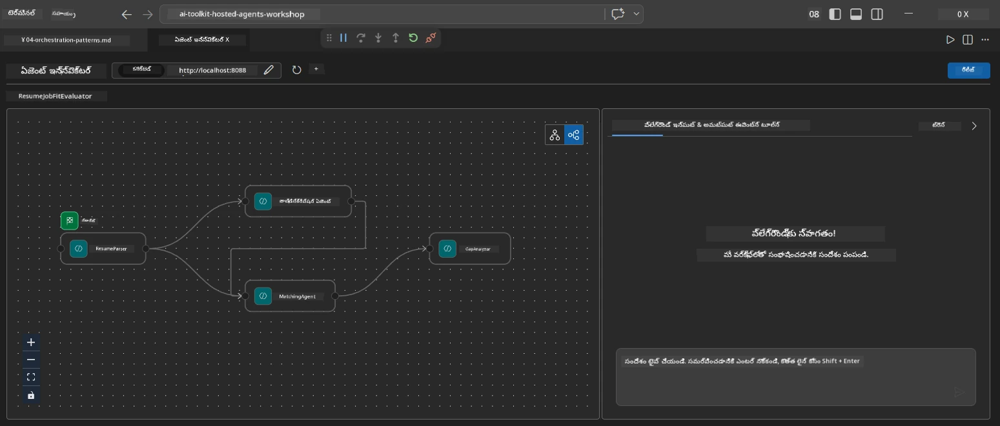
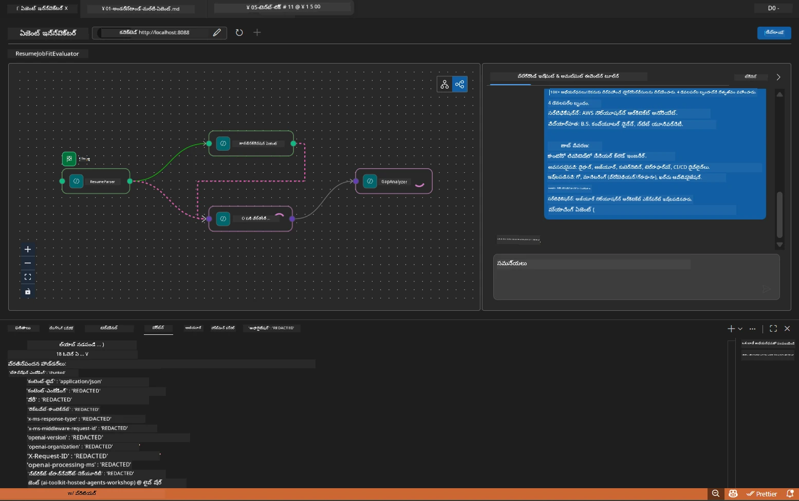
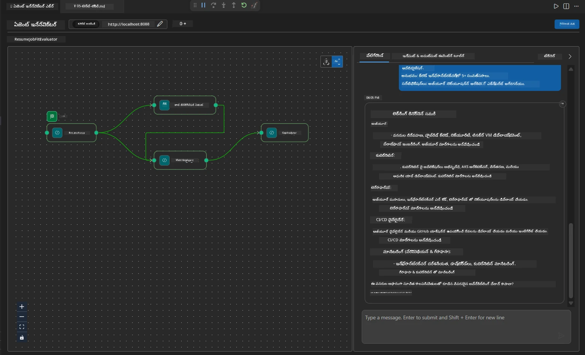

# మాడ్యూల్ 5 - స్థానికంగా పరీక్షించండి

⏱️ ~15 నిమిషాలు

ఈ మాడ్యూల్‌లో, మీరు మల్టీ-ఏజెంట్ వర్క్‌ఫ్లోను స్థానికంగా నడిపించి, Agent Inspector‌తో పరీక్షించి, అన్ని నాలుగు ఏజెంట్లు మరియు MCP టూల్ సరైనంగా పనిచేస్తున్నాయో లేదో ధృవీకరించాలి తద్వారా డిప్లాయ్ చేసేముందు.

---

## దశ 1: ఏజెంట్ సర్వర్ ప్రారంభించండి

### ఎంపిక A: VS కోడ్ టాస్క్ ఉపయోగించడం (సిఫార్సు చేయబడింది)

1. మీ VS కోడ్ ఫోల్డర్‌గా `workshop/lab02-multi-agent/PersonalCareerCopilot/`ని తెరువు.
2. `Ctrl+Shift+P` నొక్కండి → టైప్ చేయండి **Tasks: Run Task** → ఎంచుకోండి **Run Agent HTTP Server**.
3. ఈ టాస్క్ సర్వర్‌ను పೋರ್ಟ್ `5679` పై debugpyతో మరియు ఏజెంట్‌ను పোর্ট `8088` పై ప్రారంభిస్తుంది.
4. ప్రారంభ సందేశం కనిపించి, తరువాత సర్వర్ సన్నద్ధ సందేశం చూపించిన వరకూ వేచి ఉండండి (ఇతర లాగ్ లైన్లు మధ్యలో కనిపిస్తాయి):

```
INFO:resume-job-fit:Starting Resume -> Job Fit Evaluator HTTP server...
...
INFO:hypercorn.error:Running on http://0.0.0.0:8088 (CTRL + C to quit)
```

### ఎంపిక B: F5 (డీబగ్ మోడ్) ఉపయోగించడం

1. `F5` నొక్కండి → ఎంచుకోండి **Debug Local Agent HTTP Server**.
2. సర్వర్ పూర్తి బ్రేక్‌పాయింట్ మద్దతుతో ప్రారంభమవుతుంది - MCP స్పందనలు లేదా ఏజెంట్ ఔట్‌పుట్‌లను పరిశీలించడానికి ఉపయోగకరంగా ఉంటుంది.

---

## దశ 2: Agent Inspector తెరవండి

1. `Ctrl+Shift+P` నొక్కండి → టైప్ చేయండి **Foundry Toolkit: Open Agent Inspector**.
2. Agent Inspector VS కోడ్ ప్యానెల్‌గా తెరుస్తుంది మరియు `http://localhost:8088` కి కనెక్ట్ అవుతుంది.
3. మీకు ఏజెంట్ ఇంటర్ఫేస్ సందేశాలను స్వీకరించడానికి సిద్ధంగా కనిపించాలి.



> **Agent Inspector తెరవకపోతే:** సర్వర్ పూర్తిగా ప్రారంభమై ఉందని నిర్ధారించుకోండి (మీకు `Running on http://0.0.0.0:8088` లాగ్ కనిపిస్తుంది). 5679 పోర్ట్ బిజీ అయితే, [మాడ్యూల్ 8 - సమస్య పరిష్కారం](08-troubleshooting.md) చూడండి.

---

## దశ 2b: (ఐచ్ఛికం) Workflow Visualizer తెరవండి

Foundry Toolkit లో నిజ సమయ **Workflow Visualizer** ఉంటుంది ఇది ఏజెంట్లు ఎలా పరస్పరం చెలామణీ అవుతాయో చూపిస్తుంది. ఇది మల్టీ-ఏజెంట్లు డీబగ్‌కి ప్రత్యేకంగా ఉపయోగకరం.

1. `Ctrl+Shift+P` నొక్కండి → టైప్ చేయండి **Foundry Toolkit: Open Visualizer for Hosted Agents**.
2. ఒక కొత్త VS కోడ్ టాబ్ సజీవ అమలు గ్రాఫ్‌ను చూపిస్తూ తెరుస్తుంది.
3. మీరు Agent Inspector లో సందేశాలు పంపుకుంటున్నప్పుడు, Visualizer స్వయంచాలకంగా నవీకరించబడుతుంది - గ్రీన్ నోడ్లు పూర్తయిన ఏజెంట్లను, మరియు అనిమేటెడ్ ఎడ్జ్‌లు వాటి మద్యలో డేటా ప్రవాహాన్ని సూచిస్తాయి.

> **పోర్ట్ పోటీ:** Visualizer పోర్ట్ ఇప్పటికే ఉపయోగంలో ఉంటే, VS కోడ్ సెట్టింగ్స్ → **Extensions** → **Microsoft Foundry Configuration** → **Hosted Agents: Visualizer Port**లో మార్చండి.

---

## దశ 3: స్మోక్ టెస్టులు నడిపించండి

ఈ రెండు పరీక్షలను క్రమంగా నడిపించండి. ప్రతి ఒకటి వర్క్‌ఫ్లోను ప్రగతిశీలు పరీక్షిస్తుంది.

### పరీక్ష 1: బేసిక్ రిజ్యూమ్ + ఉద్యోగ వివరణ

క్రింది విషయాలను Agent Inspectorలో పేస్ట్ చేయండి:

```
Resume:
Jane Doe
Senior Software Engineer with 5 years of experience in Python, Django, and AWS.
Built microservices handling 10K+ requests/second. Led a team of 4 developers.
Certifications: AWS Solutions Architect Associate.
Education: B.S. Computer Science, State University.

Job Description:
Senior Cloud Engineer at Contoso Ltd.
Required: Python, Azure, Kubernetes, Terraform, CI/CD pipelines.
Preferred: Go, monitoring (Prometheus/Grafana), cost optimization.
Experience: 5+ years in cloud infrastructure.
Certifications: Azure Solutions Architect Expert preferred.
```

**ఎంపికైన ఫలిత నిర్మాణం:**

స్పందనలో మొత్తం నాలుగు ఏజెంట్ల ఔట్‌పుట్ వరుసగా ఉండాలి:

1. **Resume Parser ఔట్‌పుట్** - రెండు లేబుల్ సెక్షన్స్: `[PARSED RESUME]` (క్యాండిడేట్ ప్రొఫైల్, సమూహం చేసిన నైపుణ్యాలతో) మరియు `[JOB DESCRIPTION PASS-THROUGH]` (JD Agentకు ఫీడ్ చేసే JD వచనం)
2. **JD Agent ఔట్‌పుట్** - అవసరమైన మరియు ప్రాధాన్యమైన నైపుణ్యాలను వేరుచేసిన నిర్మాణాత్మక అవసరాలు
3. **Matching Agent ఔట్‌పుట్** - 0-100 మధ్య ఫిట్ స్కోరు, విభజన, సరిపడిన నైపుణ్యాలు, లేమి నైపుణ్యాలు, గ్యాప్‌లను చూపిస్తుంది
4. **Gap Analyzer ఔట్‌పుట్** - ప్రతి లేమి నైపుణ్యానికి వ్యక్తిగత గ్యాప్ కార్డులు, ప్రతి ఒక్కటికి Microsoft Learn URLs





### పరీక్ష 1లో ఏమి పరిశీలించాలి

| పరిశీలన | అంచనా | పాసయ్యాయా? |
|-------|----------|-------|
| స్పందనలో ఫిట్ స్కోరు ఉంటుంది | 0-100 మధ్య సంఖ్య విభజంతో | |
| సరిపోయే నైపుణ్యాలు జాబితా | Python, CI/CD (పైశాచిక), మొదలైనవి | |
| లేమి నైపుణ్యాలు జాబితాలో | Azure, Kubernetes, Terraform, మొదలైనవి | |
| ప్రతి లేమి నైపుణ్యానికి గ్యాప్ కార్డులు | ఒక్కో నైపుణ్యానికి ఒక్కో కార్డు | |
| Microsoft Learn URLs ఉన్నాయి | వాస్తవ `learn.microsoft.com` లింకులు | |
| స్పందనలో తప్పులు లేవు | క్లియర్ నిర్మాణాత్మక ఔట్‌పుట్ | |

### పరీక్ష 2: ఎడ్జ్ కేస్ - హై-ఫిట్ అభ్యర్థి

JDకి సన్నిహితంగా సరిపోయే రిజ్యూమ్‌ను పేస్ట్ చేసి GapAnalyzer హై-ఫిట్ పరిస్థితుల్లో సహకరిస్తుందాని ధృవీకరించండి:

```
Resume:
Alex Chen
Senior Cloud Engineer with 7 years of experience.
Skills: Python, Azure (AKS, Functions, DevOps), Kubernetes, Terraform, CI/CD (GitHub Actions, Azure Pipelines), Go, Prometheus, Grafana, cost optimization.
Certifications: Azure Solutions Architect Expert, Azure DevOps Engineer Expert.
Led infrastructure migration to Azure for 3 enterprise clients.
Education: M.S. Computer Science, Tech University.

Job Description:
Senior Cloud Engineer at Contoso Ltd.
Required: Python, Azure, Kubernetes, Terraform, CI/CD pipelines.
Preferred: Go, monitoring (Prometheus/Grafana), cost optimization.
Experience: 5+ years in cloud infrastructure.
Certifications: Azure Solutions Architect Expert preferred.
```

**ఎంపికైన ప్రవర్త అందించవలసినది:**
- ఫిట్ స్కోరు **80+** ఉండాలి (అధిక నైపుణ్యాలు సరిపోతున్నాయి)
- గ్యాప్ కార్డులు బేసిక్ నేర్చుకునే కంటే పొలిష్/ఇంటర్వ్యూ తయారీపై కేంద్రీకరించాలి
- GapAnalyzer సూచనలు చెబుతాయి: "ఫిట్ >= 80 అయితే, పొలిష్/ఇంటర్వ్యూ సిద్ధతపై కేంద్రీకరించండి"

---

## దశ 4: మీ స్వంత డేటాతో పరీక్షించండి (ఐచ్ఛికం)

మీ స్వంత రిజ్యూమ్ మరియు వాస్తవ ఉద్యోగ వివరణను పేస్ట్ చేయండి. ఇది నిర్ధారించడంలో సహాయపడుతుంది:

- ఏజెంట్లు వివిధ రిజ్యూమ్ ఫార్మాట్లను (క్రమబద్ధమైనది, ఫంక్షనల్, హైబ్రిడ్) హ్యాండిల్ చేస్తాయో
- JD ఏజెంట్ వివిధ JD శైలులను (బుల్లెట్ పాయింట్లు, పేరాగ్రాఫ్లు, నిర్మాణాత్మక) హ్యాండిల్ చేస్తుందో
- MCP టూల్ వాస్తవ నైపుణ్యాలకు సంబంధించిన వనరులను తిరిగి ఇస్తుందో
- గ్యాప్ కార్డులు మీ ప్రత్యేక నేపథ్యానికి అనుకూలంగా ఉంటాయో

> **గోప్యత - మార్గ A (Foundry క్లౌడ్):** రిజ్యూమ్ మరియు JD వచనం ఇన్ఫరెన్స్ కొరకు మీ Azure OpenAI డిప్లాయ్‌మెంట్‌కు పంపబడుతుంది. ఇది వర్క్‌షాప్ ఇన్‌ఫ్రాస్ట్రక్చర్ ద్వారా లాగ్ లేదా నిల్వ చేయబడదు. మీరు ఇష్టపడితే ప్లేస్‌హోల్డర్ పేర్లను (ఉదా: "Jane Doe") ఉపయోగించండి.
>
> **గోప్యత - మార్గ B (Foundry స్థానిక):** నాలుగు ఏజెంట్ల ఇన్ఫరెన్సులు పూర్తిగా మీ పరికరంలోనే నడుస్తాయి. మీ రిజ్యూమ్ మరియు ఉద్యోగ వివరణ వచనం **ఏ మాత్రం మీ యంత్రం నుండి బయటకు వెళ్లదు**. ఏకైక అవుట్‌బౌండ్ కాల్ MCP టూల్ నుండి వనరులు పొందడం మాత్రమే `https://learn.microsoft.com/api/mcp`; ఆ ప్రశ్నలో కేవలం నైపుణ్య పేరు మాత్రమే ఉంటుంది, మీ వ్యక్తిగత డేటా కాదు.

---

### చెక్‌పాయింట్

- [ ] సర్వర్ విజయవంతంగా ప్రారంభించబడింది, పోర్ట్ `8088` (లాగ్‌లో `Running on http://0.0.0.0:8088` చూపిస్తుంది)
- [ ] Agent Inspector తెరవబడింది మరియు ఏజెంట్‌కు కనెక్ట్ అయింది
- [ ] పరీక్ష 1: పూర్తైన స్పందన ఫిట్ స్కోరు, సరిపోయిన/లేమి నైపుణ్యాలు, గ్యాప్ కార్డులు, Microsoft Learn URLs తో
- [ ] పరీక్ష 2: హై-ఫిట్ అభ్యర్థి స్కోరు 80+ తో పొలిష్-ఫోకస్డ్ సిఫార్సులు పొందుతారు
- [ ] అన్ని గ్యాప్ కార్డులు ఉన్నవి (ప్రతి లేమి నైపుణ్యానికి ఒక్కోటి, కట్ చేయబడలేదు)
- [ ] సర్వర్ టెర్మినల్‌లో తప్పులు లేదా స్టాక్ ట్రేస్‌లు లేవు

---

**గతం:** [04 - ఆర్కెస్ట్రేషన్ ప్యాట్రన్స్](04-orchestration-patterns.md) · **తరువాత:** [06 - Foundryకి డిప్లాయ్ చేయండి →](06-deploy-to-foundry.md)

---

<!-- CO-OP TRANSLATOR DISCLAIMER START -->
**అస్వీకరణ**:
ఈ పత్రం AI అనువాద సేవ [Co-op Translator](https://github.com/Azure/co-op-translator) ఉపయోగించి అనువదించబడింది. మేము ఖచ్చితత్వానికి ప్రయత్నిస్తున్నప్పటికీ, ఆటోమేటెడ్ అనువాదాలు తప్పులు లేదా అసమగ్రతలను కలిగి ఉండవచ్చు. దాని స్వదేశ భాషలో ఉన్న అసలు పత్రాన్ని అధికారం కలిగిన మూలంగా పరిగణించాలి. కీలకమైన సమాచారం కోసం, ప్రొఫెషనల్ మానవ అనువాదాన్ని సిఫారసు చేస్తాము. ఈ అనువాదం ఉపయోగం వల్ల కలిగే ఏవైనా అపార్థాలు లేదా తప్పుదారులు కోసం మేము బాధ్యత వహించము.
<!-- CO-OP TRANSLATOR DISCLAIMER END -->