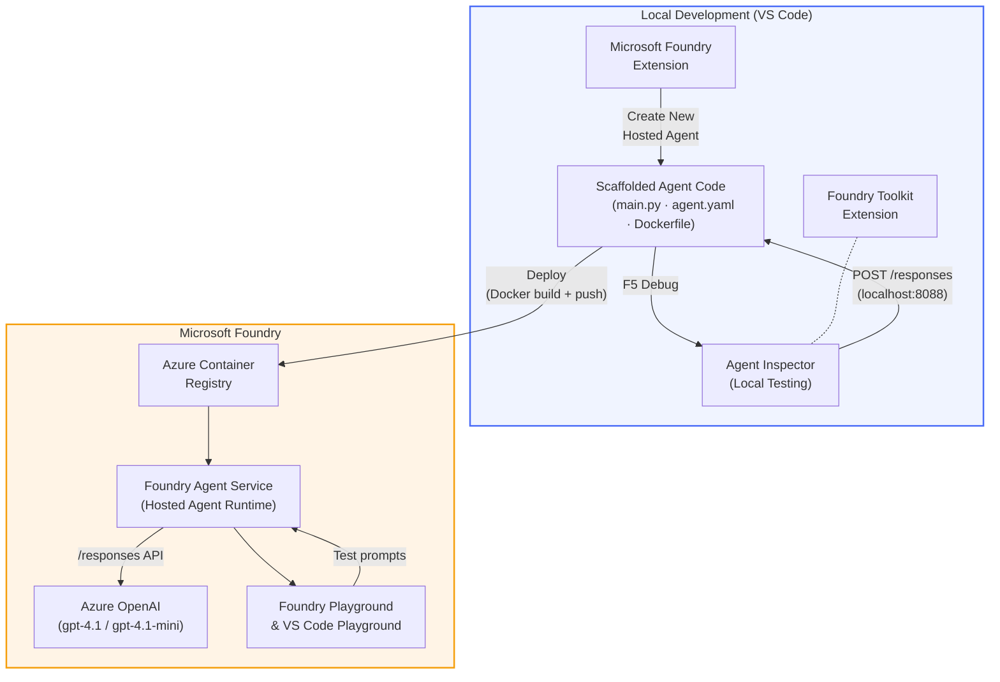

# เวิร์กช็อป Foundry Toolkit + Foundry Hosted Agents  

[](https://www.python.org/)  
[](https://learn.microsoft.com/agent-framework/)  
[](https://learn.microsoft.com/azure/foundry/agents/concepts/hosted-agents)  
[](https://ai.azure.com/)  
[](https://learn.microsoft.com/azure/ai-services/openai/)  
[](https://learn.microsoft.com/cli/azure/install-azure-cli)  
[](https://learn.microsoft.com/azure/developer/azure-developer-cli/install-azd)  
[](https://www.docker.com/)  
[](https://marketplace.visualstudio.com/items?itemName=ms-windows-ai-studio.windows-ai-studio)  
[](LICENSE)  

สร้าง ทดสอบ และปรับใช้เอเย่นต์ AI ไปยัง **บริการ Foundry Agent ของ Microsoft** ในรูปแบบ **Hosted Agents** - ทั้งหมดผ่าน VS Code โดยใช้ **ส่วนขยาย Microsoft Foundry** และ **Foundry Toolkit**  

> **Hosted Agents อยู่ในสถานะพรีวิวในขณะนี้** ภูมิภาคที่รองรับมีจำกัด - ดูเพิ่มเติมได้ที่ [region availability](https://learn.microsoft.com/azure/foundry/agents/concepts/hosted-agents#region-availability).

> โฟลเดอร์ `agent/` ภายในแต่ละแล็บจะถูก **สร้างขึ้นโดยอัตโนมัติ** โดยส่วนขยาย Foundry - แล้วคุณสามารถปรับแต่งโค้ด ทดสอบในเครื่อง และปรับใช้ได้

### 🌐 รองรับหลายภาษา

#### รองรับผ่าน GitHub Action (อัตโนมัติ & อัปเดตตลอดเวลา)

<!-- CO-OP TRANSLATOR LANGUAGES TABLE START -->
[Arabic](../ar/README.md) | [Bengali](../bn/README.md) | [Bulgarian](../bg/README.md) | [Burmese (Myanmar)](../my/README.md) | [Chinese (Simplified)](../zh-CN/README.md) | [Chinese (Traditional, Hong Kong)](../zh-HK/README.md) | [Chinese (Traditional, Macau)](../zh-MO/README.md) | [Chinese (Traditional, Taiwan)](../zh-TW/README.md) | [Croatian](../hr/README.md) | [Czech](../cs/README.md) | [Danish](../da/README.md) | [Dutch](../nl/README.md) | [Estonian](../et/README.md) | [Finnish](../fi/README.md) | [French](../fr/README.md) | [German](../de/README.md) | [Greek](../el/README.md) | [Hebrew](../he/README.md) | [Hindi](../hi/README.md) | [Hungarian](../hu/README.md) | [Indonesian](../id/README.md) | [Italian](../it/README.md) | [Japanese](../ja/README.md) | [Kannada](../kn/README.md) | [Khmer](../km/README.md) | [Korean](../ko/README.md) | [Lithuanian](../lt/README.md) | [Malay](../ms/README.md) | [Malayalam](../ml/README.md) | [Marathi](../mr/README.md) | [Nepali](../ne/README.md) | [Nigerian Pidgin](../pcm/README.md) | [Norwegian](../no/README.md) | [Persian (Farsi)](../fa/README.md) | [Polish](../pl/README.md) | [Portuguese (Brazil)](../pt-BR/README.md) | [Portuguese (Portugal)](../pt-PT/README.md) | [Punjabi (Gurmukhi)](../pa/README.md) | [Romanian](../ro/README.md) | [Russian](../ru/README.md) | [Serbian (Cyrillic)](../sr/README.md) | [Slovak](../sk/README.md) | [Slovenian](../sl/README.md) | [Spanish](../es/README.md) | [Swahili](../sw/README.md) | [Swedish](../sv/README.md) | [Tagalog (Filipino)](../tl/README.md) | [Tamil](../ta/README.md) | [Telugu](../te/README.md) | [Thai](./README.md) | [Turkish](../tr/README.md) | [Ukrainian](../uk/README.md) | [Urdu](../ur/README.md) | [Vietnamese](../vi/README.md)

> **ต้องการโคลนในเครื่องแทนหรือไม่?**
>
> ที่เก็บนี้มีการแปลมากกว่า 50 ภาษา ซึ่งจะทำให้ขนาดการดาวน์โหลดเพิ่มขึ้นอย่างมาก หากต้องการโคลนโดยไม่รวมการแปล ให้ใช้ sparse checkout:
>
> **Bash / macOS / Linux:**
> ```bash
> git clone --filter=blob:none --sparse https://github.com/microsoft-foundry/Foundry_Toolkit_for_VSCode_Lab.git
> cd Foundry_Toolkit_for_VSCode_Lab
> git sparse-checkout set --no-cone '/*' '!translations' '!translated_images'
> ```
>
> **CMD (Windows):**
> ```cmd
> git clone --filter=blob:none --sparse https://github.com/microsoft-foundry/Foundry_Toolkit_for_VSCode_Lab.git
> cd Foundry_Toolkit_for_VSCode_Lab
> git sparse-checkout set --no-cone "/*" "!translations" "!translated_images"
> ```
>
> วิธีนี้จะมอบทุกสิ่งที่คุณต้องใช้เพื่อทำหลักสูตรให้เสร็จและดาวน์โหลดได้เร็วขึ้นมาก
<!-- CO-OP TRANSLATOR LANGUAGES TABLE END -->

---

## สถาปัตยกรรม



**ลำดับการทำงาน:** ส่วนขยาย Foundry สร้างโครงร่างเอเย่นต์ → คุณปรับแต่งโค้ดและคำสั่ง → ทดสอบในเครื่องด้วย Agent Inspector → ปรับใช้กับ Foundry (รูปภาพ Docker ถูกผลักดันไปยัง ACR) → ตรวจสอบใน Playground

---

## สิ่งที่คุณจะสร้าง

| Lab | คำอธิบาย | สถานะ |
|-----|-------------|--------|
| **Lab 01 - Single Agent** | สร้าง **"Explain Like I'm an Executive" Agent** ทดสอบในเครื่อง และปรับใช้กับ Foundry | ✅ พร้อมใช้งาน |
| **Lab 02 - Multi-Agent Workflow** | สร้าง **"Resume → Job Fit Evaluator"** - เอเย่นต์ 4 ตัวทำงานร่วมกันเพื่อให้คะแนนความเหมาะสมของเรซูเม่และสร้างแผนการเรียนรู้ | ✅ พร้อมใช้งาน |

---

## รู้จัก Executive Agent

ในเวิร์กช็อปนี้คุณจะสร้าง **"Explain Like I'm an Executive" Agent** - เอเย่นต์ AI ที่นำคำศัพท์ทางเทคนิคที่ซับซ้อนมาแปลงเป็นสรุปที่ชัดเจนและพร้อมสำหรับการบรรยายในห้องประชุมระดับสูง เพราะยอมรับเถอะว่าไม่มีใครในระดับ C-suite อยากได้ยินเรื่อง "thread pool exhaustion ที่เกิดจากการเรียกแบบ synchronous ที่เพิ่มเข้ามาใน v3.2"

ฉันสร้างเอเย่นต์นี้หลังจากประสบการณ์หลายครั้งที่บทวิเคราะห์ปัญหาที่ฉันเขียนอย่างประณีตได้รับคำตอบว่า: *"งั้น... เว็บไซต์ล่มหรือเปล่า?"*

### วิธีการทำงาน

คุณป้อนข้อมูลอัปเดตทางเทคนิคเข้าไป เอเย่นต์จะออกสรุปสำหรับผู้บริหารกลับมา - สามข้อสั้น ๆ ไม่มีศัพท์เฉพาะ ไม่มีการแสดง error stack trace ไม่มีความวิตกกังวลแฝง แค่ **เกิดอะไรขึ้น**, **ผลกระทบกับธุรกิจ**, และ **ขั้นตอนถัดไป**

### ดูมันทำงาน

**คุณพูดว่า:**
> "ความหน่วงของ API เพิ่มขึ้นเนื่องจาก thread pool exhaustion ที่เกิดจากการเรียกแบบ synchronous ที่เพิ่มเข้ามาใน v3.2"

**เอเย่นต์ตอบว่า:**

> **สรุปสำหรับผู้บริหาร:**
> - **เกิดอะไรขึ้น:** หลังการปล่อยเวอร์ชันล่าสุด ระบบทำงานช้าลง
> - **ผลกระทบธุรกิจ:** ผู้ใช้บางส่วนประสบความล่าช้าในการใช้บริการ
> - **ขั้นตอนถัดไป:** ได้ทำการย้อนกลับการเปลี่ยนแปลงและกำลังเตรียมแก้ไขก่อนปรับใช้ใหม่

### ทำไมต้องเอเย่นต์นี้?

มันเป็นเอเย่นต์ง่าย ๆ ที่เน้นงานเดียว - เหมาะอย่างยิ่งสำหรับการเรียนรู้กระบวนการทำงานของ hosted agent ตั้งแต่ต้นจนจบโดยไม่ต้องวุ่นวายกับเครื่องมือที่ซับซ้อน และพูดตรง ๆ เลยว่า? ทีมวิศวกรรมทุกทีมควรจะมีแบบนี้สักตัว

---

## โครงสร้างเวิร์กช็อป

```
📂 Foundry_Toolkit_for_VSCode_Lab/
├── 📄 README.md                      ← You are here
└── 📂 workshop/
    ├── 📂 lab01-single-agent/        ← Full lab: docs + agent code
    │   ├── README.md                 ← Hands-on lab instructions
    │   ├── 📂 docs/                  ← Step-by-step tutorial modules
    │   │   ├── 00-prerequisites.md
    │   │   ├── 01-setup.md
    │   │   ├── 02-create-hosted-agent.md
    │   │   ├── 03-configure-and-code.md
    │   │   ├── 04-test-locally.md
    │   │   ├── 05-deploy-to-foundry.md
    │   │   ├── 06-verify-in-playground.md
    │   │   ├── 07-summary.md
    │   │   └── 08-troubleshooting.md
    │   └── 📂 agent/                 ← Reference solution (auto-scaffolded by Foundry extension)
    │       ├── agent.yaml
    │       ├── Dockerfile
    │       ├── main.py
    │       └── requirements.txt
    └── 📂 lab02-multi-agent/         ← Resume → Job Fit Evaluator
        ├── README.md                 ← Hands-on lab instructions (end-to-end)
        ├── 📂 docs/                  ← Step-by-step tutorial modules
        │   ├── 00-prerequisites.md
        │   ├── 01-understand-multi-agent.md
        │   ├── 02-scaffold-multi-agent.md
        │   ├── 03-configure-agents.md
        │   ├── 04-orchestration-patterns.md
        │   ├── 05-test-locally.md
        │   ├── 06-deploy-to-foundry.md
        │   ├── 07-verify-in-playground.md
        │   ├── 08-troubleshooting.md
        │   └── 09-summary.md
        └── 📂 PersonalCareerCopilot/ ← Reference solution (multi-agent workflow)
            ├── agent.yaml
            ├── Dockerfile
            ├── main.py
            └── requirements.txt
```

> **หมายเหตุ:** โฟลเดอร์ `agent/` ภายในแต่ละแล็บคือสิ่งที่ **Microsoft Foundry extension** สร้างขึ้นเมื่อคุณรัน `Microsoft Foundry: Create a New Hosted Agent` จาก Command Palette แล้วไฟล์เหล่านั้นจะถูกปรับแต่งด้วยคำสั่ง เครื่องมือ และการกำหนดค่าของเอเย่นต์คุณ แล็บ 01 จะพาคุณสร้างใหม่ตั้งแต่ต้น

---

## เริ่มต้นใช้งาน

### 1. โคลนที่เก็บโค้ด

```bash
git clone https://github.com/microsoft-foundry/Foundry_Toolkit_for_VSCode_Lab.git
cd Foundry_Toolkit_for_VSCode_Lab
```

### 2. ตั้งค่าสภาพแวดล้อมเสมือน Python

```bash
python -m venv venv
```

เปิดใช้งาน:

- **Windows (PowerShell):**
  ```powershell
  .\venv\Scripts\Activate.ps1
  ```
- **macOS / Linux:**
  ```bash
  source venv/bin/activate
  ```

### 3. ติดตั้ง dependencies

```bash
pip install -r workshop/lab01-single-agent/agent/requirements.txt
```

### 4. กำหนดค่าตัวแปรสภาพแวดล้อม

คัดลอกไฟล์ตัวอย่าง `.env` ในโฟลเดอร์ agent และใส่ค่าของคุณลงไป:

```bash
cp workshop/lab01-single-agent/agent/.env.example workshop/lab01-single-agent/agent/.env
```

แก้ไข `workshop/lab01-single-agent/agent/.env`:

```env
FOUNDRY_PROJECT_ENDPOINT=https://<your-account>.services.ai.azure.com/api/projects/<your-project>
AZURE_AI_MODEL_DEPLOYMENT_NAME=<your-model-deployment-name>
```

### 5. ทำตามแล็บเวิร์กช็อป

แต่ละแล็บเป็นโมดูลอิสระ เริ่มด้วย **Lab 01** เพื่อเรียนรู้พื้นฐาน แล้วไปต่อที่ **Lab 02** สำหรับเวิร์กโฟลว์หลายเอเย่นต์

#### Lab 01 - Single Agent ([คำแนะนำฉบับเต็ม](workshop/lab01-single-agent/README.md))

| # | โมดูล | ลิงก์ |
|---|--------|------|
| 1 | อ่านความต้องการเบื้องต้น | [00-prerequisites.md](workshop/lab01-single-agent/docs/00-prerequisites.md) |
| 2 | ติดตั้ง Foundry Toolkit & Foundry extension | [01-setup.md](workshop/lab01-single-agent/docs/01-setup.md) |
| 3 | สร้างโปรเจกต์ Foundry | [01-setup.md](workshop/lab01-single-agent/docs/01-setup.md) |
| 4 | สร้าง hosted agent | [02-create-hosted-agent.md](workshop/lab01-single-agent/docs/02-create-hosted-agent.md) |
| 5 | กำหนดคำสั่ง & สภาพแวดล้อม | [03-configure-and-code.md](workshop/lab01-single-agent/docs/03-configure-and-code.md) |
| 6 | ทดสอบในเครื่อง | [04-test-locally.md](workshop/lab01-single-agent/docs/04-test-locally.md) |
| 7 | ปรับใช้กับ Foundry | [05-deploy-to-foundry.md](workshop/lab01-single-agent/docs/05-deploy-to-foundry.md) |
| 8 | ยืนยันใน playground | [06-verify-in-playground.md](workshop/lab01-single-agent/docs/06-verify-in-playground.md) |
| 9 | สรุป & ขั้นตอนถัดไป | [07-summary.md](workshop/lab01-single-agent/docs/07-summary.md) |
| 10 | แก้ปัญหา | [08-troubleshooting.md](workshop/lab01-single-agent/docs/08-troubleshooting.md) |

#### Lab 02 - Multi-Agent Workflow ([คำแนะนำฉบับเต็ม](workshop/lab02-multi-agent/README.md))

| # | โมดูล | ลิงก์ |
|---|--------|------|
| 1 | ความต้องการเบื้องต้น (Lab 02) | [00-prerequisites.md](workshop/lab02-multi-agent/docs/00-prerequisites.md) |
| 2 | ทำความเข้าใจสถาปัตยกรรมหลายเอเย่นต์ | [01-understand-multi-agent.md](workshop/lab02-multi-agent/docs/01-understand-multi-agent.md) |
| 3 | สร้างโครงร่างโปรเจกต์หลายเอเย่นต์ | [02-scaffold-multi-agent.md](workshop/lab02-multi-agent/docs/02-scaffold-multi-agent.md) |
| 4 | กำหนดค่าเอเย่นต์ & สภาพแวดล้อม | [03-configure-agents.md](workshop/lab02-multi-agent/docs/03-configure-agents.md) |
| 5 | รูปแบบการจัดการงานร่วม | [04-orchestration-patterns.md](workshop/lab02-multi-agent/docs/04-orchestration-patterns.md) |
| 6 | ทดสอบในเครื่อง (หลายเอเย่นต์) | [05-test-locally.md](workshop/lab02-multi-agent/docs/05-test-locally.md) |
| 7 | ปรับใช้กับ Foundry | [06-deploy-to-foundry.md](workshop/lab02-multi-agent/docs/06-deploy-to-foundry.md) |
| 8 | ยืนยันใน playground | [07-verify-in-playground.md](workshop/lab02-multi-agent/docs/07-verify-in-playground.md) |
| 9 | แก้ปัญหา (หลายเอเย่นต์) | [08-troubleshooting.md](workshop/lab02-multi-agent/docs/08-troubleshooting.md) |
| 10 | สรุป & ขั้นตอนถัดไป | [09-summary.md](workshop/lab02-multi-agent/docs/09-summary.md) |

---

## ผู้ดูแล

<table>
<tr>
    <td align="center"><a href="https://github.com/ShivamGoyal03">
        <br />
        <sub><b>ชิวัม โกยัล</b></sub>
    </a><br />
    </td>
</tr>
</table>

---

## สิทธิ์ที่ต้องใช้ (อ้างอิงด่วน)

| กรณีการใช้งาน | บทบาทที่ต้องใช้ |
|----------|---------------|
| สร้างโปรเจกต์ Foundry ใหม่ | **Azure AI Owner** สำหรับทรัพยากร Foundry |
| ปรับใช้กับโปรเจกต์ที่มีอยู่ (ทรัพยากรใหม่) | **Azure AI Owner** + **Contributor** ใน subscription |
| ปรับใช้กับโปรเจกต์ที่กำหนดค่าเสร็จสมบูรณ์ | **Reader** ในบัญชี + **Azure AI User** ในโปรเจกต์ |

> **สำคัญ:** บทบาท Azure `Owner` และ `Contributor` รวมเฉพาะสิทธิ์ *การจัดการ* เท่านั้น ไม่รวมสิทธิ์ *การพัฒนา* (การดำเนินการข้อมูล) คุณต้องมี **Azure AI User** หรือ **Azure AI Owner** ในการสร้างและติดตั้งตัวแทน

---

## บรรณานุกรม

- [เริ่มอย่างรวดเร็ว: ติดตั้งตัวแทนโฮสต์ตัวแรกของคุณ (VS Code)](https://learn.microsoft.com/azure/foundry/agents/quickstarts/quickstart-hosted-agent)
- [ตัวแทนโฮสต์คืออะไร?](https://learn.microsoft.com/azure/foundry/agents/concepts/hosted-agents)
- [สร้างเวิร์กโฟลว์ตัวแทนโฮสต์ใน VS Code](https://learn.microsoft.com/azure/foundry/agents/how-to/vs-code-agents-workflow-pro-code)
- [ติดตั้งตัวแทนโฮสต์](https://learn.microsoft.com/azure/foundry/agents/how-to/deploy-hosted-agent)
- [RBAC สำหรับ Microsoft Foundry](https://learn.microsoft.com/azure/foundry/concepts/rbac-foundry)
- [ตัวอย่างตัวแทนตรวจสอบสถาปัตยกรรม](https://github.com/Azure-Samples/agent-architecture-review-sample) - ตัวแทนโฮสต์ในโลกแห่งความจริงพร้อมเครื่องมือ MCP, แผนภาพ Excalidraw, และการติดตั้งแบบคู่

---


## ใบอนุญาต

[MIT](../../LICENSE)

---

<!-- CO-OP TRANSLATOR DISCLAIMER START -->
**ปฏิเสธความรับผิดชอบ**:
เอกสารนี้ได้รับการแปลโดยใช้บริการแปลภาษา AI [Co-op Translator](https://github.com/Azure/co-op-translator) ขณะที่เราพยายามให้ความถูกต้อง โปรดทราบว่าการแปลโดยอัตโนมัติอาจมีข้อผิดพลาดหรือความไม่ถูกต้อง เอกสารต้นฉบับในภาษาต้นทางควรถูกพิจารณาเป็นแหล่งข้อมูลที่เชื่อถือได้ สำหรับข้อมูลที่สำคัญ แนะนำให้ใช้การแปลโดยมนุษย์มืออาชีพ เราไม่รับผิดชอบต่อความเข้าใจผิดหรือการตีความที่ผิดพลาดที่เกิดขึ้นจากการใช้การแปลนี้
<!-- CO-OP TRANSLATOR DISCLAIMER END -->