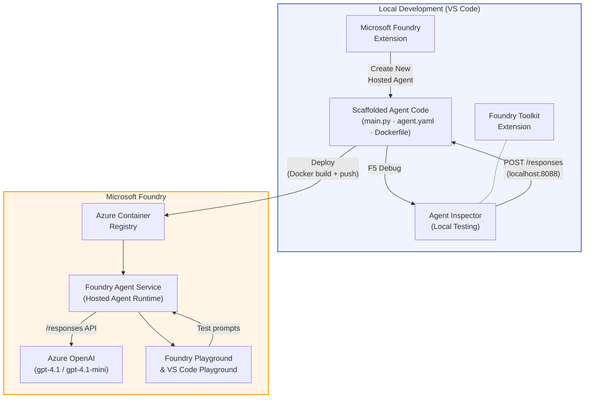

# เวิร์กช็อป Foundry Toolkit + Foundry Hosted Agents

[](https://www.python.org/)
[](https://github.com/microsoft/agents)
[](https://learn.microsoft.com/azure/foundry/agents/concepts/hosted-agents)
[](https://ai.azure.com/)
[](https://learn.microsoft.com/azure/ai-services/openai/)
[](https://learn.microsoft.com/cli/azure/install-azure-cli)
[](https://learn.microsoft.com/azure/developer/azure-developer-cli/install-azd)
[](https://www.docker.com/)
[](https://marketplace.visualstudio.com/items?itemName=ms-windows-ai-studio.windows-ai-studio)
[](../../LICENSE)

สร้าง ทดสอบ และปรับใช้เอเจนต์ AI ไปยัง **Microsoft Foundry Agent Service** ในรูปแบบ **Hosted Agents** - ทั้งหมดจาก VS Code โดยใช้ **Microsoft Foundry extension** และ **Foundry Toolkit**.

> **Hosted Agents กำลังอยู่ในช่วงพรีวิวในขณะนี้.** ภูมิภาคที่รองรับมีจำกัด - ดู [ความพร้อมใช้งานตามภูมิภาค](https://learn.microsoft.com/azure/foundry/agents/concepts/hosted-agents#region-availability).

> โฟลเดอร์ `agent/` ภายในแต่ละแลบจะถูก **สร้างโครงร่างโดยอัตโนมัติ** โดยส่วนขยาย Foundry - จากนั้นคุณปรับแต่งโค้ด ทดสอบในเครื่อง และปรับใช้.

### 🌐 รองรับหลายภาษา

#### รองรับผ่าน GitHub Action (อัตโนมัติและอัปเดตเสมอ)

<!-- CO-OP TRANSLATOR LANGUAGES TABLE START -->
[อาหรับ](../ar/README.md) | [เบงกาลี](../bn/README.md) | [บัลแกเรีย](../bg/README.md) | [พม่า (เมียนมาร์)](../my/README.md) | [จีน (ตัวย่อ)](../zh-CN/README.md) | [จีน (ตัวเต็ม, ฮ่องกง)](../zh-HK/README.md) | [จีน (ตัวเต็ม, มาเก๊า)](../zh-MO/README.md) | [จีน (ตัวเต็ม, ไต้หวัน)](../zh-TW/README.md) | [โครเอเชีย](../hr/README.md) | [เช็ก](../cs/README.md) | [เดนมาร์ก](../da/README.md) | [ดัตช์](../nl/README.md) | [เอสโตเนีย](../et/README.md) | [ฟินแลนด์](../fi/README.md) | [ฝรั่งเศส](../fr/README.md) | [เยอรมัน](../de/README.md) | [กรีก](../el/README.md) | [ฮีบรู](../he/README.md) | [ฮินดี](../hi/README.md) | [ฮังการี](../hu/README.md) | [อินโดนีเซีย](../id/README.md) | [อิตาลี](../it/README.md) | [ญี่ปุ่น](../ja/README.md) | [กันนาดา](../kn/README.md) | [เขมร](../km/README.md) | [เกาหลี](../ko/README.md) | [ลิทัวเนีย](../lt/README.md) | [มลายู](../ms/README.md) | [มาลายาลัม](../ml/README.md) | [มราฐี](../mr/README.md) | [เนปาลี](../ne/README.md) | [ไนจีเรีย พิดจิน](../pcm/README.md) | [นอร์เวย์](../no/README.md) | [เปอร์เซีย (ฟาร์ซี)](../fa/README.md) | [โปแลนด์](../pl/README.md) | [โปรตุเกส (บราซิล)](../pt-BR/README.md) | [โปรตุเกส (โปรตุเกส)](../pt-PT/README.md) | [ปัญจาบี (Gurmukhi)](../pa/README.md) | [โรมาเนีย](../ro/README.md) | [รัสเซีย](../ru/README.md) | [เซอร์เบียน (คีริลลิก)](../sr/README.md) | [สโลวัก](../sk/README.md) | [สโลวีเนีย](../sl/README.md) | [สเปน](../es/README.md) | [สวาฮิลี](../sw/README.md) | [สวีเดน](../sv/README.md) | [ตากาล็อก (ฟิลิปปินส์)](../tl/README.md) | [ทมิฬ](../ta/README.md) | [เตลูกู](../te/README.md) | [ไทย](./README.md) | [ตุรกี](../tr/README.md) | [ยูเครน](../uk/README.md) | [อูรดู](../ur/README.md) | [เวียดนาม](../vi/README.md)

> **ต้องการโคลนลงเครื่องแทนไหม?**
>
> ที่เก็บนี้มีการแปลมากกว่า 50 ภาษา ซึ่งจะทำให้ขนาดการดาวน์โหลดเพิ่มขึ้นอย่างมาก เพื่อโคลนโดยไม่รวมการแปล ให้ใช้ sparse checkout:
>
> **Bash / macOS / Linux:**
> ```bash
> git clone --filter=blob:none --sparse https://github.com/microsoft-foundry/Foundry_Toolkit_for_VSCode_Lab.git
> cd Foundry_Toolkit_for_VSCode_Lab
> git sparse-checkout set --no-cone '/*' '!translations' '!translated_images'
> ```
>
> **CMD (Windows):**
> ```cmd
> git clone --filter=blob:none --sparse https://github.com/microsoft-foundry/Foundry_Toolkit_for_VSCode_Lab.git
> cd Foundry_Toolkit_for_VSCode_Lab
> git sparse-checkout set --no-cone "/*" "!translations" "!translated_images"
> ```
>
> วิธีนี้จะให้ทุกอย่างที่คุณต้องการเพื่อทำคอร์สให้เสร็จโดยดาวน์โหลดได้เร็วขึ้นมาก
<!-- CO-OP TRANSLATOR LANGUAGES TABLE END -->

---

## สถาปัตยกรรม



**ลำดับการทำงาน:** ส่วนขยาย Foundry สร้างโครงร่างเอเจนต์ → คุณปรับแต่งโค้ด & คำสั่ง → ทดสอบในเครื่องด้วย Agent Inspector → ปรับใช้ไปยัง Foundry (Docker image ถูกผลักไปยัง ACR) → ยืนยันใน Playground.

---

## สิ่งที่คุณจะสร้าง

| Lab | คำอธิบาย | สถานะ |
|-----|-------------|--------|
| **แลบ 01 - เอเจนต์เดี่ยว** | สร้างเอเจนต์ **"Explain Like I'm an Executive"** ทดสอบในเครื่อง และปรับใช้ไปยัง Foundry | ✅ พร้อมใช้งาน |
| **แลบ 02 - เวิร์กโฟลว์หลายเอเจนต์** | สร้าง **"Resume → Job Fit Evaluator"** - เอเจนต์ 4 ตัวร่วมกันให้คะแนนความเหมาะสมของเรซูเม่และสร้างแผนการเรียนรู้ | ✅ พร้อมใช้งาน |

---

## ทำความรู้จักกับเอเจนต์ Executive

ในเวิร์กช็อปนี้คุณจะสร้างเอเจนต์ **"Explain Like I'm an Executive"** — เอเจนต์ AI ที่นำศัพท์เทคนิคที่ซับซ้อนมาแปลเป็นสรุปที่สงบและพร้อมสำหรับการประชุมคณะกรรมการ เพราะพูดตามจริงแล้ว ไม่มีใครในระดับ C-suite อยากฟังเกี่ยวกับ "thread pool exhaustion caused by synchronous calls introduced in v3.2."

ผมสร้างเอเจนต์นี้หลังจากเหตุการณ์หลายครั้งที่โพสต์มอร์เท็มที่ผมร่างอย่างสมบูรณ์ได้รับการตอบกลับ: *"แล้ว... เว็บไซต์ล่มหรือไม่?"*

### วิธีการทำงาน

คุณป้อนการอัปเดตเชิงเทคนิคเข้าไป มันจะตอบกลับด้วยสรุปสำหรับผู้บริหาร - สามประเด็นสั้นๆ ไม่มีศัพท์เทคนิค, ไม่มี stack traces, และไม่มีความวิตกกังวลเชิงปรัชญา แค่ **สิ่งที่เกิดขึ้น**, **ผลกระทบทางธุรกิจ**, และ **ขั้นตอนถัดไป**.

### ดูการทำงานจริง

**คุณกล่าวว่า:**
> "ความหน่วงของ API เพิ่มขึ้นเนื่องจาก thread pool หมดจากการเรียกแบบ synchronous ที่เพิ่มเข้ามาใน v3.2."

**เอเจนต์ตอบกลับ:**

> **สรุปสำหรับผู้บริหาร:**
> - **สิ่งที่เกิดขึ้น:** หลังการปล่อยเวอร์ชันล่าสุด ระบบทำงานช้าลง.
> - **ผลกระทบทางธุรกิจ:** ผู้ใช้บางรายพบความล่าช้าในการใช้งานบริการ.
> - **ขั้นตอนถัดไป:** การเปลี่ยนแปลงถูกย้อนกลับแล้วและกำลังเตรียมการแก้ไขก่อนปรับใช้ใหม่.

### ทำไมต้องใช้เอเจนต์นี้?

มันเป็นเอเจนต์ที่เรียบง่ายและมีวัตถุประสงค์เดียว - เหมาะอย่างยิ่งสำหรับการเรียนรู้เวิร์กโฟลว์ของ hosted agent ตั้งแต่ต้นจนจบโดยไม่ต้องติดอยู่กับชุดเครื่องมือที่ซับซ้อน. และพูดตรงๆ แล้ว? ทุกทีมนักวิศวกรรมควรมีหนึ่งตัวนี้.

---

## โครงสร้างเวิร์กช็อป

```
📂 Foundry_Toolkit_for_VSCode_Lab/
├── 📄 README.md                      ← You are here
└── 📂 workshop/
    ├── 📂 lab01-single-agent/        ← Full lab: docs + agent code
    │   ├── README.md                 ← Hands-on lab instructions
    │   ├── 📂 docs/                  ← Step-by-step tutorial modules
    │   │   ├── 00-prerequisites.md
    │   │   ├── 01-setup.md
    │   │   ├── 02-create-hosted-agent.md
    │   │   ├── 03-configure-and-code.md
    │   │   ├── 04-test-locally.md
    │   │   ├── 05-deploy-to-foundry.md
    │   │   ├── 06-verify-in-playground.md
    │   │   ├── 07-summary.md
    │   │   └── 08-troubleshooting.md
    │   └── 📂 agent/                 ← Reference solution (auto-scaffolded by Foundry extension)
    │       ├── agent.yaml
    │       ├── Dockerfile
    │       ├── main.py
    │       └── requirements.txt
    └── 📂 lab02-multi-agent/         ← Resume → Job Fit Evaluator
        ├── README.md                 ← Hands-on lab instructions (end-to-end)
        ├── 📂 docs/                  ← Step-by-step tutorial modules
        │   ├── 00-prerequisites.md
        │   ├── 01-understand-multi-agent.md
        │   ├── 02-scaffold-multi-agent.md
        │   ├── 03-configure-agents.md
        │   ├── 04-orchestration-patterns.md
        │   ├── 05-test-locally.md
        │   ├── 06-deploy-to-foundry.md
        │   ├── 07-verify-in-playground.md
        │   └── 08-troubleshooting.md
        └── 📂 PersonalCareerCopilot/ ← Reference solution (multi-agent workflow)
            ├── agent.yaml
            ├── Dockerfile
            ├── main.py
            └── requirements.txt
```

> **หมายเหตุ:** โฟลเดอร์ `agent/` ภายในแต่ละแลบคือสิ่งที่ **Microsoft Foundry extension** สร้างเมื่อคุณรัน `Microsoft Foundry: Create a New Hosted Agent` จาก Command Palette ไฟล์เหล่านี้จะถูกปรับแต่งด้วยคำสั่ง เครื่องมือ และการกำหนดค่าของเอเจนต์ของคุณ แลบ 01 จะนำทางคุณในการสร้างสิ่งนี้ใหม่ตั้งแต่ต้น.

---

## เริ่มต้นใช้งาน

### 1. Clone the repository

```bash
git clone https://github.com/microsoft-foundry/Foundry_Toolkit_for_VSCode_Lab.git
cd Foundry_Toolkit_for_VSCode_Lab
```

### 2. ตั้งค่าสภาพแวดล้อมเสมือนของ Python

```bash
python -m venv venv
```

เปิดใช้งาน:

- **Windows (PowerShell):**
  ```powershell
  .\venv\Scripts\Activate.ps1
  ```
- **macOS / Linux:**
  ```bash
  source venv/bin/activate
  ```

### 3. ติดตั้ง dependencies

```bash
pip install -r workshop/lab01-single-agent/agent/requirements.txt
```

### 4. กำหนดค่าตัวแปรสภาพแวดล้อม

คัดลอกไฟล์ตัวอย่าง `.env` ภายในโฟลเดอร์เอเจนต์ แล้วกรอกค่าของคุณ:

```bash
cp workshop/lab01-single-agent/agent/.env.example workshop/lab01-single-agent/agent/.env
```

แก้ไข `workshop/lab01-single-agent/agent/.env`:

```env
AZURE_AI_PROJECT_ENDPOINT=https://<your-account>.services.ai.azure.com/api/projects/<your-project>
AZURE_AI_MODEL_DEPLOYMENT_NAME=<your-model-deployment-name>
```

### 5. ทำตามแลบในเวิร์กช็อป

แต่ละแลบเป็นเนื้อหาที่แยกเป็นอิสระโดยมีโมดูลของตัวเอง เริ่มที่ **Lab 01** เพื่อเรียนรู้พื้นฐาน จากนั้นไปที่ **Lab 02** สำหรับเวิร์กโฟลว์หลายเอเจนต์.

#### แลบ 01 - เอเจนต์เดี่ยว ([คำแนะนำฉบับเต็ม](workshop/lab01-single-agent/README.md))

| # | โมดูล | ลิงก์ |
|---|--------|------|
| 1 | อ่านข้อกำหนดเบื้องต้น | [00-prerequisites.md](workshop/lab01-single-agent/docs/00-prerequisites.md) |
| 2 | ติดตั้ง Foundry Toolkit & Foundry extension | [01-setup.md](workshop/lab01-single-agent/docs/01-setup.md) |
| 3 | สร้างโปรเจกต์ Foundry | [01-setup.md](workshop/lab01-single-agent/docs/01-setup.md) |
| 4 | สร้าง hosted agent | [02-create-hosted-agent.md](workshop/lab01-single-agent/docs/02-create-hosted-agent.md) |
| 5 | กำหนดคำสั่ง & สภาพแวดล้อม | [03-configure-and-code.md](workshop/lab01-single-agent/docs/03-configure-and-code.md) |
| 6 | ทดสอบในเครื่อง | [04-test-locally.md](workshop/lab01-single-agent/docs/04-test-locally.md) |
| 7 | ปรับใช้ไปยัง Foundry | [05-deploy-to-foundry.md](workshop/lab01-single-agent/docs/05-deploy-to-foundry.md) |
| 8 | ยืนยันใน playground | [06-verify-in-playground.md](workshop/lab01-single-agent/docs/06-verify-in-playground.md) |
| 9 | แก้ไขปัญหา | [08-troubleshooting.md](workshop/lab01-single-agent/docs/08-troubleshooting.md) |

#### แลบ 02 - เวิร์กโฟลว์หลายเอเจนต์ ([คำแนะนำฉบับเต็ม](workshop/lab02-multi-agent/README.md))

| # | โมดูล | ลิงก์ |
|---|--------|------|
| 1 | ข้อกำหนดเบื้องต้น (แลบ 02) | [00-prerequisites.md](workshop/lab02-multi-agent/docs/00-prerequisites.md) |
| 2 | เข้าใจสถาปัตยกรรมหลายเอเจนต์ | [01-understand-multi-agent.md](workshop/lab02-multi-agent/docs/01-understand-multi-agent.md) |
| 3 | สร้างโครงร่างโปรเจกต์หลายเอเจนต์ | [02-scaffold-multi-agent.md](workshop/lab02-multi-agent/docs/02-scaffold-multi-agent.md) |
| 4 | กำหนดค่าเอเจนต์ & สภาพแวดล้อม | [03-configure-agents.md](workshop/lab02-multi-agent/docs/03-configure-agents.md) |
| 5 | รูปแบบการประสานงาน | [04-orchestration-patterns.md](workshop/lab02-multi-agent/docs/04-orchestration-patterns.md) |
| 6 | ทดสอบในเครื่อง (หลายเอเจนต์) | [05-test-locally.md](workshop/lab02-multi-agent/docs/05-test-locally.md) |
| 7 | ปรับใช้ไปยัง Foundry | [06-deploy-to-foundry.md](workshop/lab02-multi-agent/docs/06-deploy-to-foundry.md) |
| 8 | ยืนยันใน playground | [07-verify-in-playground.md](workshop/lab02-multi-agent/docs/07-verify-in-playground.md) |
| 9 | แก้ไขปัญหา (หลายเอเจนต์) | [08-troubleshooting.md](workshop/lab02-multi-agent/docs/08-troubleshooting.md) |

---

## ผู้ดูแล

<table>
<tr>
    <td align="center"><a href="https://github.com/ShivamGoyal03">
        <br />
        <sub><b>Shivam Goyal</b></sub>
    </a><br />
    </td>
</tr>
</table>

---

## สิทธิ์ที่ต้องการ (อ้างอิงด่วน)

| สถานการณ์ | บทบาทที่จำเป็น |
|----------|---------------|
| สร้างโปรเจกต์ Foundry ใหม่ | **Azure AI Owner** บนทรัพยากร Foundry |
| ปรับใช้ไปยังโปรเจกต์ที่มีอยู่ (ทรัพยากรใหม่) | **Azure AI Owner** + **Contributor** ใน subscription |
| ปรับใช้ไปยังโปรเจกต์ที่กำหนดค่าครบถ้วน | **Reader** บนบัญชี + **Azure AI User** บนโปรเจกต์ |

> **สำคัญ:** บทบาท Azure `Owner` และ `Contributor` รวมเฉพาะ *สิทธิ์การจัดการ* เท่านั้น ไม่รวมสิทธิ์ *การพัฒนา* (การดำเนินการกับข้อมูล). คุณต้องการ **Azure AI User** หรือ **Azure AI Owner** เพื่อสร้างและปรับใช้เอเจนต์.

---

## เอกสารอ้างอิง

- [เริ่มต้นอย่างรวดเร็ว: ปรับใช้เอเจนต์โฮสต์ตัวแรกของคุณ (VS Code)](https://learn.microsoft.com/azure/foundry/agents/quickstarts/quickstart-hosted-agent)
- [เอเจนต์โฮสต์คืออะไร?](https://learn.microsoft.com/azure/foundry/agents/concepts/hosted-agents)
- [สร้างเวิร์กโฟลว์ของเอเจนต์โฮสต์ใน VS Code](https://learn.microsoft.com/azure/foundry/agents/how-to/vs-code-agents-workflow-pro-code)
- [ปรับใช้เอเจนต์โฮสต์](https://learn.microsoft.com/azure/foundry/agents/how-to/deploy-hosted-agent)
- [RBAC สำหรับ Microsoft Foundry](https://learn.microsoft.com/azure/foundry/concepts/rbac-foundry)
- [ตัวอย่างเอเจนต์สำหรับการทบทวนสถาปัตยกรรม](https://github.com/Azure-Samples/agent-architecture-review-sample) - เอเจนต์โฮสต์ในโลกความจริงที่มีเครื่องมือ MCP, แผนภาพ Excalidraw, และการปรับใช้สองรูปแบบ

---


## ใบอนุญาต

[MIT](../../LICENSE)

---

<!-- CO-OP TRANSLATOR DISCLAIMER START -->
**ปฏิเสธความรับผิดชอบ**:
เอกสารนี้ได้รับการแปลโดยใช้บริการแปลภาษา AI [Co-op Translator](https://github.com/Azure/co-op-translator) ขณะที่เราพยายามให้ความถูกต้อง โปรดทราบว่าการแปลโดยอัตโนมัติอาจมีข้อผิดพลาดหรือความไม่ถูกต้อง เอกสารต้นฉบับในภาษาต้นทางควรถูกพิจารณาเป็นแหล่งข้อมูลที่เชื่อถือได้ สำหรับข้อมูลที่สำคัญ แนะนำให้ใช้การแปลโดยมนุษย์มืออาชีพ เราไม่รับผิดชอบต่อความเข้าใจผิดหรือการตีความที่ผิดพลาดที่เกิดขึ้นจากการใช้การแปลนี้
<!-- CO-OP TRANSLATOR DISCLAIMER END -->
