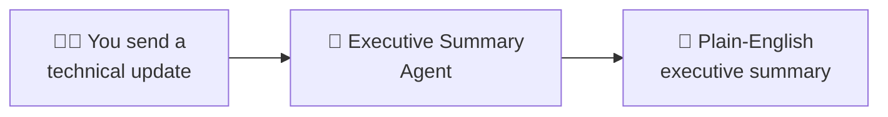

# โมดูล 0 - บทนำ

⏱️ ~10 นาที

> [!WARNING]
> **ตัวอย่างและข้อจำกัด:** [Hosted Agents](https://learn.microsoft.com/azure/foundry/agents/concepts/hosted-agents) ขณะนี้อยู่ในสถานะ **ตัวอย่างสาธารณะ** - ไม่แนะนำให้ใช้กับงานในสภาพแวดล้อมการผลิต โปรดทราบสิ่งต่อไปนี้:
> - **ภูมิภาคที่รองรับมีจำนวนจำกัด** - ตรวจสอบ [ความพร้อมของภูมิภาค](https://learn.microsoft.com/azure/foundry/agents/concepts/hosted-agents#region-availability) ก่อนสร้างทรัพยากร หากเลือกภูมิภาคที่ไม่รองรับ การปรับใช้จะล้มเหลว
> - แพ็กเกจ `agent-framework-foundry-hosting` อยู่ในสถานะก่อนเผยแพร่ - API อาจเปลี่ยนแปลงระหว่างเวอร์ชัน
> - ข้อจำกัดการปรับขนาด: hosted agents รองรับ 0–5 ตัวทำซ้ำ (รวมถึงการปรับขนาดเป็นศูนย์)
> - คุณสมบัติบางอย่างที่แสดงในเวิร์กช็อปนี้อาจเปลี่ยนแปลงเมื่อบริการเข้าสู่สถานะ GA

## สิ่งที่คุณจะสร้าง

ในเวิร์กช็อปนี้ คุณจะสร้างเอเจนต์ **"อธิบายเหมือนฉันเป็นผู้บริหาร"** — เอเจนต์ AI ที่โฮสต์ซึ่งรับการอัปเดตทางเทคนิคที่ซับซ้อนและเขียนใหม่ให้อยู่ในรูปแบบสรุปสำหรับผู้บริหารที่เข้าใจง่าย

**เอเจนต์ใช้:**
- **Microsoft Agent Framework** - สำหรับตรรกะและโครงสร้างของเอเจนต์
- **Foundry Toolkit สำหรับ VS Code** - เพื่อสร้างโครงร่าง ทดสอบภายในเครื่อง และปรับใช้
- **โมเดล AI** (เช่น `gpt-4.1-mini/gpt-5-mini`) - เพื่อสร้างสรุป

เมื่อจบห้องปฏิบัติการนี้ คุณจะมีเอเจนต์ที่ใช้งานได้ซึ่งสามารถทดสอบได้ภายในเครื่องผ่าน Agent Inspector และสามารถปรับใช้ในคลาวด์ได้ถ้าต้องการ

---

## Hosted agents คืออะไร?

**Hosted agent** คือเอเจนต์ AI ที่ทำงานในฐานะบริการที่จัดการโดย Microsoft Foundry แทนที่จะจัดการโครงสร้างพื้นฐานด้วยตัวเอง คุณทำแพ็กเกจโค้ดเอเจนต์ในคอนเทนเนอร์ แล้ว Foundry จะดูแลการปรับขนาด โฮสต์ และเปิดใช้งานผ่านจุดปลาย HTTP มาตรฐาน

| แนวคิด | ความหมาย |
|---------|--------------|
| **Agent** | โค้ด Python ของคุณที่รับข้อความจากผู้ใช้ เรียกใช้โมเดล AI และส่งคืนการตอบสนองแบบมีโครงสร้าง |
| **Hosted** | Foundry รันคอนเทนเนอร์ของคุณให้ — ไม่มี VM ไม่มี Kubernetes และไม่มีโครงสร้างพื้นฐานให้จัดการ |
| **โปรโตคอลการตอบสนอง** | API HTTP มาตรฐาน (`POST /responses`) ที่ไคลเอนต์ใดก็ได้สามารถเรียกเพื่อโต้ตอบกับเอเจนต์ของคุณ |
| **Agent Inspector** | UI การทดสอบภายในเครื่อง (ฝังใน Foundry Toolkit) ที่ให้คุณสนทนากับเอเจนต์ก่อนปรับใช้ |

ในเวิร์กช็อปนี้ คุณจะเริ่มจากศูนย์จนได้เอเจนต์ที่โฮสต์อย่างเต็มรูปแบบ — หรือหยุดแค่การทดสอบภายในเครื่องก็ได้ถ้าคุณต้องการ

---

## เลือกเส้นทางของคุณ

> ⚠️ **เลือกเส้นทางหนึ่งก่อนดำเนินการต่อ** ตัวเลือกของคุณจะกำหนดเครื่องมือที่ต้องติดตั้งและโมดูลที่เกี่ยวข้อง คุณสามารถเปลี่ยนจากเส้นทาง B → เส้นทาง A ได้ในภายหลังถ้าคุณสมัครใช้งาน

<strong>🅰️ เส้นทาง A - คลาวด์ Azure (ต้องมีบัญชีสมัครใช้งาน Azure)</strong>

| | รายละเอียด |
|---|---|
| **สำหรับใคร?** | คุณมีบัญชี Azure ที่ใช้งานอยู่และสามารถสร้างทรัพยากรใน Foundry ได้ |
| **โมเดล** | Azure OpenAI ผ่าน Foundry (เช่น `gpt-4.1-mini/gpt-5-mini`) |
| **โมดูลที่ครอบคลุม** | ทุกโมดูล (00–07) |
| **ปรับใช้ในคลาวด์?** | ✅ ใช่ — ปรับใช้แบบครบวงจร |

<strong>🅱️ เส้นทาง B - ภายในเครื่อง/ฟรีเทียร์ (ไม่ต้องใช้บัญชี Azure)</strong>

| | รายละเอียด |
|---|---|
| **สำหรับใคร?** | MVPs, นักเรียน หรือใครก็ตามที่ไม่มีสิทธิ์เข้าใช้ Azure |
| **โมเดล** | **Foundry Local** (ฟรี รันบนเครื่องของคุณ) |
| **โมดูลที่ครอบคลุม** | โมดูล 00–04 (ข้ามการปรับใช้และตรวจสอบคลาวด์) |
| **ปรับใช้ในคลาวด์?** | ❌ ไม่ — ทดสอบภายในเครื่องเท่านั้นผ่าน Agent Inspector |

---

## ทุกเส้นทาง: เครื่องมือที่ต้องติดตั้ง

ติดตั้งเครื่องมือแต่ละตัวด้านล่างนี้ หลังติดตั้งแล้ว ให้ตรวจสอบว่าใช้งานได้โดยรันคำสั่งตรวจสอบ

| # | เครื่องมือ | เวอร์ชัน | ติดตั้ง | ตรวจสอบ (ผลลัพธ์ที่คาดหวัง) |
|---|------|---------|---------|---------------------------|
| 1 | **Visual Studio Code** | ล่าสุด | [code.visualstudio.com](https://code.visualstudio.com/) | เปิดโดยไม่มีข้อผิดพลาด |
| 2 | **Python** | 3.12 หรือสูงกว่า | [python.org/downloads](https://www.python.org/downloads/) | `python --version` $\rightarrow$ `Python 3.12.x` |
| 3 | **Foundry Toolkit สำหรับ VS Code** | ล่าสุด | ID ส่วนขยาย: `ms-windows-ai-studio.windows-ai-studio` | ไอคอน Foundry ในแถบกิจกรรม |
| 4 | **ส่วนขยาย Python สำหรับ VS Code** | ล่าสุด | ID ส่วนขยาย: `ms-python.python` | ติดตั้งในแผงส่วนขยาย |

> [!TIP]
> **เคล็ดลับสำหรับการติดตั้ง:**
> - **Python PATH (Windows):** ตรวจสอบให้แน่ใจว่าได้เลือก **"เพิ่ม Python ลงใน PATH"** ในหน้าจอแรกของการติดตั้ง Python หากไม่เลือก `python` จะไม่ถูกจดจำในเทอร์มินัลของคุณ
> - **หลายเวอร์ชันของ Python:** ถ้าคุณติดตั้ง Python 3.10 และ 3.12 พร้อมกัน ให้ใช้ `python3.12 -m venv .venv` เพื่อให้แน่ใจว่าเวอร์ชันที่ถูกต้องถูกใช้สำหรับสภาพแวดล้อมเสมือน
> - **Docker WSL 2 (Windows):** ระหว่างการติดตั้ง Docker Desktop ให้แน่ใจว่าเลือก **WSL 2 backend** การใช้ Docker กับ Hyper-V จะช้ากว่าและอาจทำให้เกิดปัญหาในการสร้างคอนเทนเนอร์ Foundry
> - **Docker ไม่เริ่ม?** รอ 30–60 วินาทีหลังจากเปิด Docker Desktop รัน `docker info` – ถ้าเห็นข้อความ "ไม่สามารถเชื่อมต่อกับ Docker daemon," Docker กำลังเริ่มต้นอยู่
> - **ส่วนขยาย VS Code ไม่โหลด?** หลังติดตั้งส่วนขยาย ให้โหลดหน้าต่างใหม่: `Ctrl+Shift+P` → `Developer: Reload Window`

> **ผู้ใช้ Windows:** ตรวจสอบ **"เพิ่ม Python ลงใน PATH"** ระหว่างติดตั้ง Python

**ถัดไป:** [01 - ตั้งค่า →](01-setup.md)

---

<!-- CO-OP TRANSLATOR DISCLAIMER START -->
**ปฏิเสธความรับผิดชอบ**:
เอกสารนี้ได้รับการแปลโดยใช้บริการแปลภาษา AI [Co-op Translator](https://github.com/Azure/co-op-translator) ขณะที่เราพยายามให้ความถูกต้อง โปรดทราบว่าการแปลโดยอัตโนมัติอาจมีข้อผิดพลาดหรือความไม่ถูกต้อง เอกสารต้นฉบับในภาษาต้นทางควรถูกพิจารณาเป็นแหล่งข้อมูลที่เชื่อถือได้ สำหรับข้อมูลที่สำคัญ แนะนำให้ใช้การแปลโดยมนุษย์มืออาชีพ เราไม่รับผิดชอบต่อความเข้าใจผิดหรือการตีความที่ผิดพลาดที่เกิดขึ้นจากการใช้การแปลนี้
<!-- CO-OP TRANSLATOR DISCLAIMER END -->