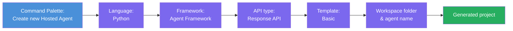
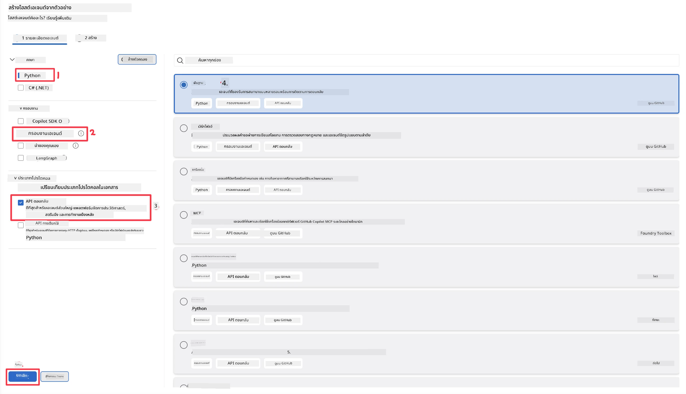
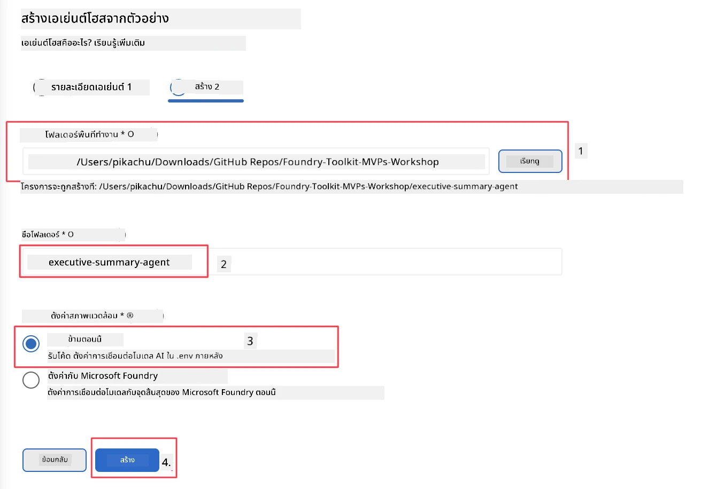

# โมดูล 2 - สร้างเอเย่นต์โฮสต์ใหม่

⏱️ ~5 นาที

ในโมดูลนี้ คุณจะใช้ Foundry Toolkit เพื่อ **สร้างโครงร่างโปรเจกต์เอเย่นต์โฮสต์** โครงร่างจะสร้างโครงสร้างโปรเจกต์ทั้งหมด - `agent.yaml`, `main.py`, `Dockerfile`, `requirements.txt`, และการตั้งค่า debug ของ VS Code - เพื่อให้คุณสามารถมุ่งเน้นไปที่การปรับแต่งพฤติกรรมของเอเย่นต์

> **แนวคิดสำคัญ:** โฟลเดอร์ `agent/` ในแลปนี้เป็นตัวอย่างของสิ่งที่ Foundry Toolkit สร้างขึ้น คุณไม่ต้องเขียนไฟล์เหล่านี้จากศูนย์

### ขั้นตอนเวิร์กโฟลว์สร้างโครงร่าง



---

## ขั้นตอนที่ 1: เปิดตัวช่วยสร้าง Create Hosted Agent

1. กด `Ctrl+Shift+P` เพื่อเปิด **Command Palette**.
2. พิมพ์: **Foundry Toolkit: Create new Hosted Agent** แล้วเลือกมัน

> **ทางเลือก: สร้างผ่าน Foundry Portal**
> หากคุณชอบใช้เบราว์เซอร์ คุณสามารถสร้างโปรเจกต์ของคุณได้ที่ [https://ai.azure.com](https://ai.azure.com) หลังจากโปรเจกต์ถูกตั้งค่าแล้ว ให้กลับไปที่ VS Code และใช้แถบด้านข้าง **Foundry Toolkit** เพื่อเชื่อมต่อกับมัน

> **ทางเลือก:** ในแถบด้านข้าง Foundry Toolkit ให้เลื่อนเมาส์ไปที่ **Agents** ภายใต้โปรเจกต์ของคุณ คลิกไอคอน **+** แล้วเลือก **Create in Code With Template**

## ขั้นตอนที่ 2: เลือกการตั้งค่า



1. ในส่วนเมนู/ตัวเลือกด้านซ้ายให้เลือกดังนี้:

| เมนู | การเลือก | หมายเหตุ |
|--------|-----------|-------|
| **Language** | Python | รองรับ C# ด้วย |
| **Framework** | Agent Framework | จุดเริ่มต้นง่าย ๆ โดยใช้ Agent Framework SDK |
| **API type** | Response API | `POST /responses` - โต้ตอบสนทนา พร้อมประวัติที่จัดการโดยแพลตฟอร์ม |
| **Template** | Basic | จุดเริ่มต้นง่าย ๆ โดยใช้ Agent Framework SDK |

2. เมื่อเลือกเสร็จแล้ว คลิก **Next**



3. ในหน้าต่างถัดไป ให้เลือกดังนี้:

| เมนู | การเลือก | หมายเหตุ |
|--------|-----------|-------|
| **Workspace folder** | เลือกโฟลเดอร์เป้าหมาย | เช่น `/workspace/Foundry_Toolkit_for_VSCode_Lab/` หรือโฟลเดอร์ย่อยในรีโปนี้ |
| **Agent name** | กรอกชื่อ | เช่น `executive-summary-agent` |
| **Environment Setup** | ข้ามการตั้งค่าไว้ก่อน |  |

คลิก **create** เพื่อสร้างเอเจนต์ของเรา โฟลเดอร์ใหม่จะถูกสร้างขึ้นโดยใช้ชื่อเอเจนต์ที่โฮสต์ไว้

## ขั้นตอนที่ 3: ตรวจสอบโปรเจกต์ที่สร้างขึ้น

หลังจากการสร้างเสร็จสิ้น ให้ตรวจสอบว่าคุณเห็นไฟล์เหล่านี้ใน Explorer (`Ctrl+Shift+E`):

```
📂 executive-summary-agent/
├── .env                ← Environment variables (placeholders)
├── .vscode/
│   ├── launch.json     ← Debug config (F5 → run + Agent Inspector)
│   └── tasks.json      ← VS Code task definitions
├── agent.yaml          ← Agent definition (kind: hosted)
├── Dockerfile          ← Container config for deployment
├── main.py             ← Agent entry point (your main code)
└── requirements.txt    ← Python dependencies
```

### อธิบายไฟล์สำคัญ

| ไฟล์ | วัตถุประสงค์ |
|------|---------|
| `agent.yaml` | ประกาศเอเจนต์เป็น `kind: hosted`, แมปตัวแปรแวดล้อม, กำหนดโปรโตคอล `/responses` |
| `main.py` | สร้าง `FoundryChatClient` → ห่อหุ้มใน `Agent` พร้อมคำสั่ง → ให้บริการผ่าน `ResponsesHostServer` ที่พอร์ต 8088 |
| `Dockerfile` | ใช้ `python:3.12-slim`, ติดตั้ง dependencies, เปิดพอร์ต 8088, รัน `main.py` |
| `requirements.txt` | `agent-framework-foundry`, `agent-framework-foundry-hosting`, `mcp`, `debugpy` |

> **สำคัญ:** เปิดโฟลเดอร์เอเจนต์ที่สร้างไว้โดยตรงใน VS Code (โฟลเดอร์ `agent/` เอง) เพื่อให้ `.vscode/launch.json` และ `tasks.json` ทำงานถูกต้องสำหรับการดีบัก F5

---

### ✅ จุดตรวจสอบ

- [ ] สร้างโปรเจกต์ scaffolding พร้อมไฟล์ทั้งหมดที่คาดไว้
- [ ] `agent.yaml` แสดง `kind: hosted` และ `protocol: responses`
- [ ] `main.py` นำเข้า `Agent`, `FoundryChatClient`, `ResponsesHostServer`
- [ ] เปิดโฟลเดอร์เอเจนต์ใน VS Code เป็นรากของ workspace

---

**ก่อนหน้า:** [01 - Setup](01-setup.md) · **ถัดไป:** [03 - Configure & Code →](03-configure-and-code.md)

---

<!-- CO-OP TRANSLATOR DISCLAIMER START -->
**ปฏิเสธความรับผิดชอบ**:
เอกสารนี้ได้รับการแปลโดยใช้บริการแปลภาษา AI [Co-op Translator](https://github.com/Azure/co-op-translator) ขณะที่เราพยายามให้ความถูกต้อง โปรดทราบว่าการแปลโดยอัตโนมัติอาจมีข้อผิดพลาดหรือความไม่ถูกต้อง เอกสารต้นฉบับในภาษาต้นทางควรถูกพิจารณาเป็นแหล่งข้อมูลที่เชื่อถือได้ สำหรับข้อมูลที่สำคัญ แนะนำให้ใช้การแปลโดยมนุษย์มืออาชีพ เราไม่รับผิดชอบต่อความเข้าใจผิดหรือการตีความที่ผิดพลาดที่เกิดขึ้นจากการใช้การแปลนี้
<!-- CO-OP TRANSLATOR DISCLAIMER END -->