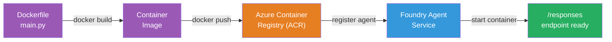
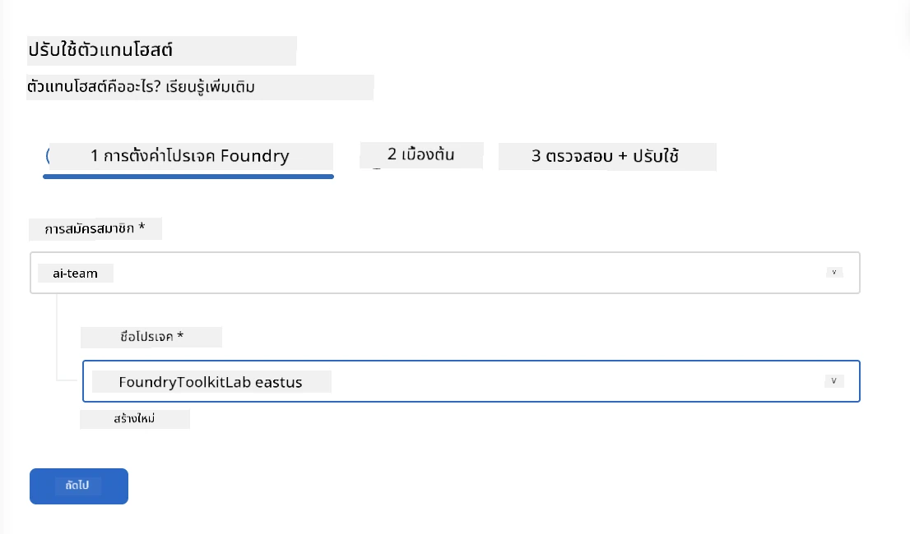
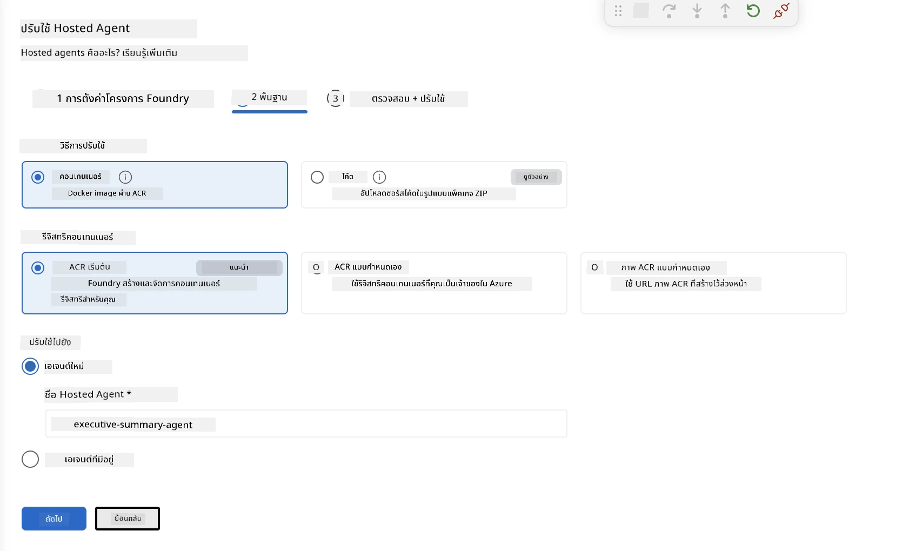
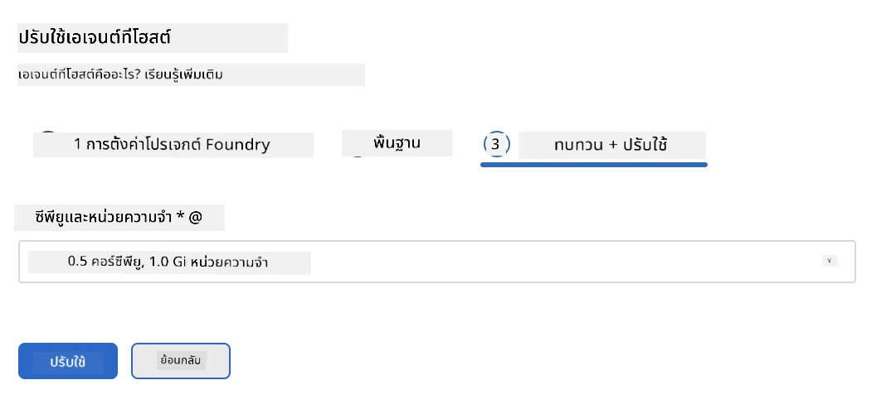
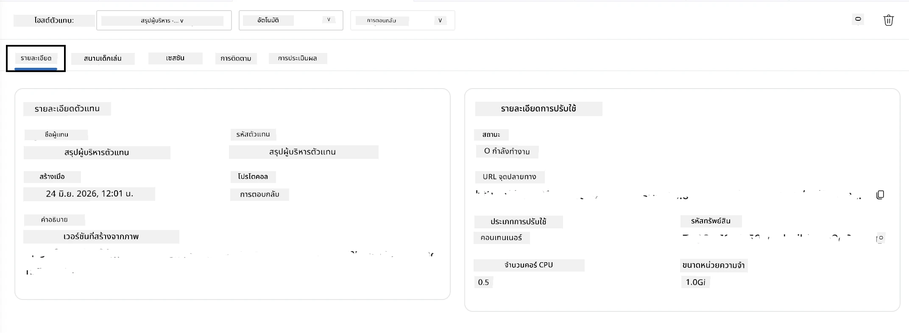

# โมดูล 5 - การปรับใช้ไปยังบริการ Foundry Agent

⏱️ ~10 นาที

> ⚠️ **ผู้ใช้เส้นทาง B:** โมดูลนี้ต้องการการสมัคร Foundry หากคุณกำลังใช้ Foundry Local ข้ามไปที่ [โมดูล 07 - สรุป](07-summary.md) คุณได้ทำงานในกระบวนการพัฒนาแบบโลคัลเสร็จสมบูรณ์แล้ว!

ในโมดูลนี้ คุณจะปรับใช้เอเย่นต์ที่ทดสอบในเครื่องไปยัง Microsoft Foundry ในฐานะ **Hosted Agent** การปรับใช้จะสร้างอิมเมจคอนเทนเนอร์ ดันขึ้นไปยัง Azure Container Registry และเริ่มเอเย่นต์ในโครงสร้างพื้นฐานที่จัดการโดย Foundry

### กระบวนการปรับใช้

---

## ตรวจสอบข้อกำหนดพื้นฐาน

ก่อนการปรับใช้ ให้ตรวจสอบว่า:

- [ ] เอเย่นต์ผ่านสถานการณ์ท้องถิ่นทั้ง 3 จาก [โมดูล 04](04-test-locally.md)
- [ ] คุณมีบทบาท **Azure AI User** ในระดับโปรเจกต์ ([โมดูล 01, การมอบหมาย RBAC](01-setup.md#deploy-a-model--assign-rbac))
- [ ] คุณเข้าสู่ระบบ Azure ใน VS Code (ไอคอนบัญชีแสดงชื่อของคุณ)

---

## ขั้นตอนที่ 1: เริ่มการปรับใช้

### ตัวเลือก A: ปรับใช้จาก Agent Inspector (แนะนำ)

หาก Agent Inspector เปิดอยู่ (จากการทดสอบ):
1. คลิกปุ่ม **Deploy** ที่มุมบนขวา (ไอคอนรูปเมฆ ↑)

### ตัวเลือก B: ปรับใช้จาก Command Palette

1. กด `Ctrl+Shift+P` → **Foundry Toolkit: Deploy Hosted Agent**.

---

## ขั้นตอนที่ 2: กำหนดค่าการปรับใช้งาน

ตัวช่วยเหลือจะขอข้อมูลจากคุณดังนี้:

| คำถาม | ตัวเลือก |
|--------|-----------|
| **Subscription** | การสมัครใช้งาน Azure ของคุณ |
| **Target project** | โครงการ Foundry ของคุณ (เช่น `workshop-agents`) |

คลิก **ถัดไป** เพื่อกำหนดค่า agent ของคุณ

| คำถาม | ตัวเลือก |
|--------|-----------|
| **Deployment Method** | Container |
| **Container registry** | **ACR เริ่มต้น** (Microsoft Foundry สร้างและจัดการให้คุณ) |
| **Deploy to** | Agent ใหม่ (ชื่อ, `executive-summary-agent`) |

คลิก **ถัดไป** เพื่อตรวจสอบและปรับใช้งาน agent ของคุณ

| คำถาม | ตัวเลือก |
|--------|-----------|
| **CPU and memory** | **0.5 CPU cores, 1.0 Gi memory** (ค่าเริ่มต้น - เหมาะสำหรับเวิร์กช็อป) |

---

## ขั้นตอนที่ 3: ปรับใช้งานและติดตาม

1. คลิก **Deploy**.
2. ดูแผง **Output** (เลือก **Microsoft Foundry** จากเมนูแบบเลื่อนลง).
3. การปรับใช้งานจะดำเนินการตามขั้นตอนเหล่านี้:
   - **Docker build** - สร้าง container จาก Dockerfile ของคุณ
   - **Docker push** - ส่ง image ไปที่ ACR (ใช้เวลา 1–3 นาทีในการปรับใช้งานครั้งแรก)
   - **Agent registration** - สร้าง hosted agent ใน Foundry
   - **Container start** - เริ่มด้วยตัวตนที่จัดการโดยระบบ

4. เมื่อเสร็จแล้ว จะมีการแจ้งเตือน:
   > **executive-summary-agent ถูกปรับใช้งานเรียบร้อยแล้ว.** `View logs` `Run agent`

5. คลิก **Run agent** เพื่อเปิด Agent Playground.

### ค่าสถานะการปรับใช้งาน

| สถานะ | ความหมาย |
|--------|---------|
| **Running** | Container พร้อมใช้งาน, agent ตอบสนอง |
| **Pending** | กำลังเริ่ม container - รอสัก 30–60 วินาที |
| **Failed** | ตรวจสอบบันทึก (ดูวิธีแก้ไขปัญหาในด้านล่าง) |

---

## ข้อผิดพลาดทั่วไปในการปรับใช้งาน

| ข้อผิดพลาด | สาเหตุหลัก | วิธีแก้ไข |
|-------|-----------|-----|
| `agents/write` permission denied | ขาดบทบาท **Azure AI User** ในระดับโครงการ | [Module 01, Assign RBAC](01-setup.md#deploy-a-model--assign-rbac) |
| Docker not running | ไม่ได้เริ่ม Docker Desktop | เริ่ม Docker Desktop → ตรวจสอบ `docker info` |
| การอนุญาต ACR | ตัวตนที่จัดการไม่สามารถดึง image ได้ | ดู [Module 08 - Troubleshooting](08-troubleshooting.md) |

---

### ✅ จุดตรวจสอบ

- [ ] การปรับใช้งานเสร็จสมบูรณ์โดยไม่มีข้อผิดพลาด
- [ ] Agent แสดงในแท็บ **Hosted Agent** เมื่อคลิก **Agents** ภายใต้โครงการของคุณใน Foundry Toolkit บาร์ด้านข้าง
- [ ] สถานะ container แสดง **Running**
- [ ] แท็บ Agent Playground เปิดขึ้น แสดงรายละเอียด agent และ URL จุดสิ้นสุด

---

**ก่อนหน้า:** [04 - Test Locally](04-test-locally.md) · **ถัดไป:** [06 - Verify in Playground →](06-verify-in-playground.md)

---

<!-- CO-OP TRANSLATOR DISCLAIMER START -->
**ปฏิเสธความรับผิดชอบ**:
เอกสารนี้ได้รับการแปลโดยใช้บริการแปลภาษา AI [Co-op Translator](https://github.com/Azure/co-op-translator) ขณะที่เราพยายามให้ความถูกต้อง โปรดทราบว่าการแปลโดยอัตโนมัติอาจมีข้อผิดพลาดหรือความไม่ถูกต้อง เอกสารต้นฉบับในภาษาต้นทางควรถูกพิจารณาเป็นแหล่งข้อมูลที่เชื่อถือได้ สำหรับข้อมูลที่สำคัญ แนะนำให้ใช้การแปลโดยมนุษย์มืออาชีพ เราไม่รับผิดชอบต่อความเข้าใจผิดหรือการตีความที่ผิดพลาดที่เกิดขึ้นจากการใช้การแปลนี้
<!-- CO-OP TRANSLATOR DISCLAIMER END -->