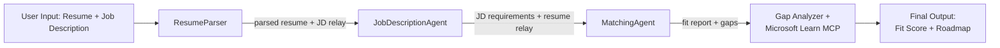

# PersonalCareerCopilot - ตัวประเมินความเหมาะสมของประวัติย่อกับงาน

แอปมัลติเอเจนต์ที่เน้นเวิร์กโฟลว์เป็นหลักซึ่งประเมินว่าประวัติย่อเหมาะสมกับคำอธิบายงานมากน้อยแค่ไหน จากนั้นก็จะสร้างแผนที่การเรียนรู้ส่วนบุคคลเพื่อเติมเต็มช่องว่าง

---

## ตัวแทน

| ตัวแทน | บทบาท | เครื่องมือ |
|-------|------|-------|
| **ResumeParser** | ดึงทักษะที่มีโครงสร้าง ประสบการณ์ ใบรับรองจากข้อความประวัติย่อ | - |
| **JobDescriptionAgent** | ดึงทักษะที่ต้องการ/ที่ต้องการเป็นพิเศษ ประสบการณ์ ใบรับรองจาก JD | - |
| **MatchingAgent** | เปรียบเทียบโปรไฟล์กับข้อกำหนด → คะแนนความเหมาะสม (0-100) + ทักษะที่ตรง/ขาด | - |
| **GapAnalyzer** | สร้างแผนที่การเรียนรู้ส่วนบุคคลพร้อมทรัพยากร Microsoft Learn | `search_microsoft_learn_for_plan` (MCP) |

## เวิร์กโฟลว์



---

## เริ่มต้นอย่างรวดเร็ว

### 1. ตั้งค่าสภาพแวดล้อม

โฟลเดอร์นี้เป็นการใช้งานอ้างอิงสำหรับการวางโครงงาน Lab 02 ที่ใช้เวิร์กโฟลว์ โดย `main.py` ใช้บล็อกคำสั่งล่วงหน้าที่มีอยู่แล้วพร้อมกับ `WorkflowBuilder` ในการเชื่อมโยงตัวแทนทั้งสี่เข้าด้วยกัน

```powershell
cd workshop\lab02-multi-agent\PersonalCareerCopilot
python -m venv .venv
.\.venv\Scripts\Activate.ps1          # Windows PowerShell
# source .venv/bin/activate            # macOS / Linux
pip install -r requirements.txt
```

### 2. กำหนดค่าข้อมูลรับรอง

สร้างไฟล์ `.env` ในโฟลเดอร์นี้:

```powershell
copy .env .env.bak 2>$null; echo $null > .env
```

แก้ไข `.env`:

```env
FOUNDRY_PROJECT_ENDPOINT=https://<your-account>.services.ai.azure.com/api/projects/<your-project>
AZURE_AI_MODEL_DEPLOYMENT_NAME=gpt-4.1-mini
```

| ค่า | หาได้ที่ไหน |
|-------|------------------|
| `FOUNDRY_PROJECT_ENDPOINT` | Foundry Toolkit แถบด้านข้าง → คลิกขวาที่โปรเจกต์ของคุณ → **คัดลอกจุดสิ้นสุดโปรเจกต์** |
| `AZURE_AI_MODEL_DEPLOYMENT_NAME` | Foundry แถบด้านข้าง → ขยายโปรเจกต์ → **แบบจำลอง + จุดสิ้นสุด** → ชื่อการปรับใช้ |

### 3. รันในเครื่อง

```powershell
python -m debugpy --listen 127.0.0.1:5679 main.py --port 8088
```

หรือใช้งาน VS Code task: `Ctrl+Shift+P` → **งาน: รันงาน** → **รันเซิร์ฟเวอร์ตัวแทน HTTP**.

สำหรับการดีบักกิ้ง F5 ใช้ **ดีบักเซิร์ฟเวอร์ตัวแทน HTTP ในเครื่อง**.

### 4. ทดสอบกับ Agent Inspector

เปิด Agent Inspector: `Ctrl+Shift+P` → **Foundry Toolkit: เปิด Agent Inspector**.

วางคำสั่งทดสอบนี้:

```
Resume:
Jane Doe
Senior Software Engineer with 5 years of experience in Python, Django, and AWS.
Built microservices handling 10K+ requests/second. Led a team of 4 developers.
Certifications: AWS Solutions Architect Associate.
Education: B.S. Computer Science, State University.

Job Description:
Senior Cloud Engineer at Contoso Ltd.
Required: Python, Azure, Kubernetes, Terraform, CI/CD pipelines.
Preferred: Go, monitoring (Prometheus/Grafana), cost optimization.
Experience: 5+ years in cloud infrastructure.
Certifications: Azure Solutions Architect Expert preferred.
```

**คาดหวัง:** คะแนนความเหมาะสม (0-100), ทักษะที่ตรง/ขาด, และแผนที่การเรียนรู้ส่วนบุคคลพร้อม URL Microsoft Learn.

### 5. ปรับใช้กับ Foundry

`Ctrl+Shift+P` → **Foundry Toolkit: ปรับใช้ตัวแทนโฮสต์** → เลือกโปรเจกต์ของคุณ → ยืนยัน.

---

## โครงสร้างโปรเจกต์

```
PersonalCareerCopilot/
├── .env                ← Your credentials (git-ignored)
├── agent.yaml          ← Hosted agent definition (name, resources, env vars)
├── Dockerfile          ← Container image for Foundry deployment
├── main.py             ← 4-agent workflow (instructions, MCP tool, WorkflowBuilder)
└── requirements.txt    ← Python dependencies
```

## ไฟล์สำคัญ

### `agent.yaml`

กำหนดตัวแทนโฮสต์สำหรับบริการ Foundry Agent:
- `kind: hosted` - รันเป็นคอนเทนเนอร์ที่จัดการโดยระบบ
- `protocols` - โปรโตคอล `responses` กับ `version: 2.0.0`, เปิดเผยจุดสิ้นสุด HTTP `/responses`
- `environment_variables` - ประกาศ `AZURE_AI_MODEL_DEPLOYMENT_NAME` ที่นี่; `FOUNDRY_PROJECT_ENDPOINT` ถูกฉีดโดยอัตโนมัติในเวลาปรับใช้

### `main.py`

ประกอบด้วย:
- **คำแนะนำตัวแทน** - สี่ค่าคงที่ `*_INSTRUCTIONS`, หนึ่งต่อหนึ่งตัวแทน
- **เครื่องมือ MCP** - เรียก `search_microsoft_learn_for_plan()` ผ่าน HTTP แบบ Streamable `https://learn.microsoft.com/api/mcp`
- **การสร้างตัวแทน** - สี่อินสแตนซ์ `Agent()` + `AgentExecutor()` แบ่งปัน `FoundryChatClient` หนึ่งตัว
- **กราฟเวิร์กโฟลว์** - `WorkflowBuilder` เชื่อมตัวแทนเป็นสายงานต่อเนื่อง: ResumeParser → JD Agent → MatchingAgent → GapAnalyzer
- **การเริ่มต้นเซิร์ฟเวอร์** - `ResponsesHostServer` รันบนพอร์ต 8088

### `requirements.txt`

| แพ็กเกจ | จุดประสงค์ |
|---------|----------|
| `agent-framework-foundry` | รันไทม์หลัก: `Agent`, `AgentExecutor`, `WorkflowBuilder`, `@tool`, `FoundryChatClient` |
| `agent-framework-foundry-hosting` | `ResponsesHostServer` + การผสานรวมโฮสติ้ง Foundry |
| `mcp<2,>=1.24.0` | ลูกค้า MCP สำหรับ GapAnalyzer (`streamable_http_client`) |
| `debugpy` | การดีบัก Python (F5 ใน VS Code) |

---

## การแก้ไขปัญหา

| ปัญหา | การแก้ไข |
|-------|-----|
| `KeyError: 'FOUNDRY_PROJECT_ENDPOINT'` หรือ `KeyError: 'AZURE_AI_MODEL_DEPLOYMENT_NAME'` | สร้าง `.env` โดยตั้งค่า `FOUNDRY_PROJECT_ENDPOINT` และ `AZURE_AI_MODEL_DEPLOYMENT_NAME` ทั้งสอง |
| `ModuleNotFoundError: No module named 'agent_framework'` | เปิดใช้งาน venv และรัน `pip install -r requirements.txt` |
| ไม่มี URL ของ Microsoft Learn ในผลลัพธ์ | ตรวจสอบการเชื่อมต่ออินเทอร์เน็ตไปยัง `https://learn.microsoft.com/api/mcp` |
| มีเพียงการ์ดช่องว่าง 1 ใบ (ถูกตัด) | ยืนยันว่า `GAP_ANALYZER_INSTRUCTIONS` รวมบล็อก `CRITICAL:` |
| พอร์ต 8088 กำลังใช้งาน | หยุดเซิร์ฟเวอร์อื่น ๆ: `netstat -ano \| findstr :8088` |

สำหรับการแก้ไขปัญหาโดยละเอียด ดูที่ [Module 8 - Troubleshooting](../docs/08-troubleshooting.md).

---

**การแนะนำอย่างเต็มรูปแบบ:** [Lab 02 Docs](../docs/README.md) · **ย้อนกลับไปที่:** [Lab 02 README](../README.md) · [Workshop Home](../../../README.md)

---

<!-- CO-OP TRANSLATOR DISCLAIMER START -->
**ปฏิเสธความรับผิดชอบ**:
เอกสารนี้ได้รับการแปลโดยใช้บริการแปลภาษา AI [Co-op Translator](https://github.com/Azure/co-op-translator) ขณะที่เราพยายามให้ความถูกต้อง โปรดทราบว่าการแปลโดยอัตโนมัติอาจมีข้อผิดพลาดหรือความไม่ถูกต้อง เอกสารต้นฉบับในภาษาต้นทางควรถูกพิจารณาเป็นแหล่งข้อมูลที่เชื่อถือได้ สำหรับข้อมูลที่สำคัญ แนะนำให้ใช้การแปลโดยมนุษย์มืออาชีพ เราไม่รับผิดชอบต่อความเข้าใจผิดหรือการตีความที่ผิดพลาดที่เกิดขึ้นจากการใช้การแปลนี้
<!-- CO-OP TRANSLATOR DISCLAIMER END -->