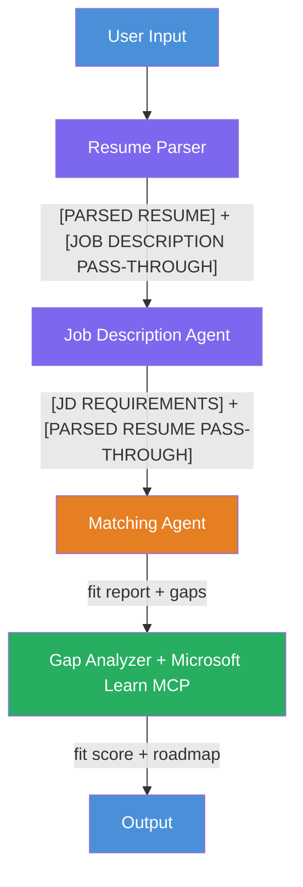

# ห้องปฏิบัติการ 02 - กระบวนการทำงานหลายตัวแทน: ประเมินความเหมาะสมของเรซูเม่ → งาน

## ภาพรวม

ในห้องปฏิบัติการเชิงปฏิบัตินี้ คุณจะสร้าง **แอปหลายตัวแทนที่เน้นกระบวนการทำงานเป็นหลัก** โดยใช้ Foundry Toolkit ใน VS Code และนำไปปรับใช้กับ Microsoft Foundry Agent Service

**สิ่งที่คุณจะสร้าง:** ระบบประเมินความเหมาะสมของเรซูเม่ → งาน ที่จะวิเคราะห์เรซูเม่และคำบรรยายงาน, ให้คะแนนการจับคู่ และสร้างแผนการเรียนรู้ส่วนบุคคลโดยใช้ทรัพยากร Microsoft Learn

---

## สถาปัตยกรรม

**วิธีการทำงาน:**
1. ผู้ใช้วางเรซูเม่และคำบรรยายงาน
2. **ResumeParser** วิเคราะห์เรซูเม่และก็อปปี้คำบรรยายงานตรงๆ ลงในส่วน `[JOB DESCRIPTION PASS-THROUGH]`
3. **JD Agent** สกัดข้อกำหนดในรูปแบบที่เป็นโครงสร้างจากข้อมูลผ่าน และส่งต่อ `[PARSED RESUME]` ไปเป็น `[PARSED RESUME PASS-THROUGH]`
4. **MatchingAgent** เปรียบเทียบ `[PARSED RESUME PASS-THROUGH]` กับ `[JD REQUIREMENTS]` และสร้างคะแนนความเหมาะสม
5. **GapAnalyzer** แปลงช่องว่างเป็นแผนที่ใช้งานได้จริงและดึงลิงก์ Microsoft Learn ที่แท้จริงผ่าน MCP

---

## ข้อกำหนดเบื้องต้น

กรุณาทำ ห้องปฏิบัติการ 01 ให้เสร็จก่อน:

- [Lab 01 - Single Agent](../lab01-single-agent/README.md)

---

## ส่วนที่ 1: อ่านโมดูลตามลำดับ

ดูเส้นทางการเรียนรู้ทั้งหมดได้ที่:

- [Lab 2 Docs - Prerequisites](docs/00-prerequisites.md)
- [Lab 2 Docs - Full Learning Path](docs/README.md)
- [PersonalCareerCopilot run guide](PersonalCareerCopilot/README.md)

---

## ส่วนที่ 2: สร้างและทดสอบกระบวนการทำงาน

1. ใช้วิซาร์ด Foundry Toolkit เพื่อสร้างโครงงานที่ใช้กระบวนการทำงาน
2. คัดลอกบล็อกคำสั่งและกราฟกระบวนการทำงานจาก `PersonalCareerCopilot/main.py` ลงในพื้นที่ทำงานของคุณ
3. รันแบบโลคัลด้วย Agent Inspector และตรวจสอบว่าตัวแทนทั้งสี่รวมถึงเครื่องมือ MCP ทำงานครบถ้วน
4. ปรับใช้ตัวแทนโฮสต์ไปที่ Foundry เมื่อทดสอบในเครื่องผ่าน

---

## รูปแบบการประสานงาน

ห้องปฏิบัติการ 02 ใช้ **pipeline แบบลำดับขั้น**: ผลลัพธ์ของตัวแทนแต่ละตัวเป็นข้อมูลป้อนต่อให้ตัวถัดไป และกระบวนการทำงานคืนคำตอบของตัวแทนสุดท้าย รูปแบบสองแบบที่ทำให้สิ่งนี้ทำงานได้:

- **โซ่ลำดับขั้น** - `WorkflowBuilder` ต่อ ResumeParser → JD Agent → MatchingAgent → GapAnalyzer ด้วยการเรียก `add_edge()` หนึ่งครั้งต่อขั้นตอน
- **การส่งผ่านเนื้อหา** - เพราะตัวแทนแต่ละตัวเห็นเพียงผลลัพธ์ของตัวก่อนหน้าโดยตรง ResumeParser และ JD Agent จึงก็อปปี้ข้อมูลที่ตัวแทนถัดไปต้องการลงในส่วนที่ผ่านข้อมูลพร้อมป้ายกำกับ

เอกสารยังอธิบายเหตุผลว่าทำไมห้องปฏิบัติการนี้จึงไม่ใช้ fan-out/fan-in และวิธีขยายกราฟด้วยตัวแทนอีกตัว

ดูที่ [docs/04-orchestration-patterns.md](docs/04-orchestration-patterns.md).

---

**ก่อนหน้า:** [Lab 01 - Single Agent](../lab01-single-agent/README.md) · **กลับไปที่:** [Workshop Home](../../README.md)

---

<!-- CO-OP TRANSLATOR DISCLAIMER START -->
**ปฏิเสธความรับผิดชอบ**:
เอกสารนี้ได้รับการแปลโดยใช้บริการแปลภาษา AI [Co-op Translator](https://github.com/Azure/co-op-translator) ขณะที่เราพยายามให้ความถูกต้อง โปรดทราบว่าการแปลโดยอัตโนมัติอาจมีข้อผิดพลาดหรือความไม่ถูกต้อง เอกสารต้นฉบับในภาษาต้นทางควรถูกพิจารณาเป็นแหล่งข้อมูลที่เชื่อถือได้ สำหรับข้อมูลที่สำคัญ แนะนำให้ใช้การแปลโดยมนุษย์มืออาชีพ เราไม่รับผิดชอบต่อความเข้าใจผิดหรือการตีความที่ผิดพลาดที่เกิดขึ้นจากการใช้การแปลนี้
<!-- CO-OP TRANSLATOR DISCLAIMER END -->