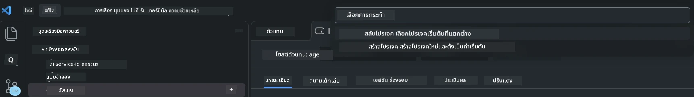

# โมดูล 0 - บทนำ

⏱️ ~10 นาที

> [!WARNING]
> **ตัวอย่างและข้อจำกัด:** [Hosted Agents](https://learn.microsoft.com/azure/foundry/agents/concepts/hosted-agents) ขณะนี้อยู่ในสถานะ **ตัวอย่างสาธารณะ** - ไม่แนะนำให้ใช้กับงานการผลิต ฟีเจอร์บางส่วนที่แสดงในเวิร์กช็อปนี้อาจมีการเปลี่ยนแปลงเมื่อบริการเข้าสู่สถานะ GA

## สิ่งที่คุณจะสร้าง

ในห้องปฏิบัติการนี้ คุณจะขยายทักษะตัวแทนเดี่ยวจาก Lab 01 เพื่อสร้าง **เวิร์กโฟลว์หลายตัวแทน** - ตัวประเมินความเหมาะสมของประวัติย่อ → งาน

คุณวาง **ประวัติย่อ** และ **คำอธิบายงาน** สี่ตัวแทนเฉพาะทางประมวลผลข้อมูลทีละลำดับ จากนั้นส่งกลับ:
- คะแนนความเหมาะสม (0–100 พร้อมสรุปคะแนน)
- รายการช่องว่างทักษะและใบรับรอง
- แผนการเรียนรู้ส่วนบุคคลพร้อมลิงก์ Microsoft Learn จริงสำหรับแต่ละช่องว่าง

**เวิร์กโฟลว์ใช้:**
- **Microsoft Agent Framework** - `WorkflowBuilder` สำหรับการจัดการลำดับขั้นตอนตามท่อ
- **Foundry Toolkit สำหรับ VS Code** - สร้างโครงสร้าง ทดลองในเครื่อง และปรับใช้
- **โมเดล AI** (เช่น `gpt-4.1-mini`) - ใช้โดยตัวแทนทั้งสี่
- **Microsoft Learn MCP server** - ให้ลิงก์ทรัพยากรการเรียนรู้จริงสำหรับแต่ละช่องว่างทักษะ

---

## เลือกเส้นทางของคุณ

> ⚠️ **ดำเนินการโดยใช้เส้นทางเดียวกับที่คุณใช้ใน Lab 01**

<details open>
<summary><strong>🅰️ เส้นทาง A - คลาวด์ Azure (ต้องมีการสมัครใช้ Azure)</strong></summary>

| | รายละเอียด |
|---|---|
| **เหมาะสำหรับใคร?** | คุณทำ Lab 01 โดยใช้การสมัคร Azure |
| **โมเดล** | Azure OpenAI ผ่าน Foundry (เช่น `gpt-4.1-mini`) |
| **โมดูลที่ครอบคลุม** | ทุกโมดูล (00–09) |
| **ปรับใช้บนคลาวด์หรือไม่?** | ✅ ใช่ - การปรับใช้แบบครบวงจร |

</details>

<details open>
<summary><strong>🅱️ เส้นทาง B - Foundry Local (ไม่ต้องมีการสมัคร Azure)</strong></summary>

| | รายละเอียด |
|---|---|
| **เหมาะสำหรับใคร?** | คุณทำ Lab 01 โดยใช้ Foundry Local |
| **โมเดล** | Foundry Local (ฟรี ทำงานบนเครื่องของคุณ) |
| **โมดูลที่ครอบคลุม** | โมดูล 00–05 (ข้าม 06–07 - การปรับใช้ & การยืนยันคลาวด์) |
| **ปรับใช้บนคลาวด์หรือไม่?** | ❌ ไม่ - ทดสอบในเครื่องเท่านั้นผ่าน Agent Inspector |

</details>

---

## ตรวจสอบ Lab 01

Lab 02 สร้างต่อโดยตรงจาก Lab 01 กรุณาทำ Lab 01 ให้เสร็จก่อนเริ่มที่นี่

ยังไม่ได้ทำ Lab 01? เริ่มที่นี่: [Lab 01 - บทนำ](../../lab01-single-agent/docs/00-prerequisites.md)

<details open>
<summary><strong>🅰️ เส้นทาง A - คลาวด์ Azure</strong></summary>

```powershell
az account show --query "{name:name, id:id}" --output table
```

หากล้มเหลว ให้รัน `az login` จากนั้นตรวจสอบใน VS Code:

1. `Ctrl+Shift+P` → พิมพ์ **Foundry Toolkit** → ยืนยันว่าคำสั่งปรากฏ
2. คลิกไอคอน **Foundry Toolkit** → โครงการและโมเดลที่ปรับใช้แสดงสถานะ **สำเร็จ**



> **RBAC:** คุณได้กำหนดบทบาท **Foundry User** ใน Lab 01 หากจำเป็นต้องกำหนดใหม่ ดู [Lab 01, โมดูล 1](../../lab01-single-agent/docs/01-setup.md#deploy-a-model--assign-rbac) บทบาทเดิมชื่อ **Azure AI User** - มีสิทธิ์เหมือนกัน

</details>

<details open>
<summary><strong>🅱️ เส้นทาง B - Foundry Local</strong></summary>

```powershell
Invoke-WebRequest -Uri "http://localhost:5273/v1/health" -UseBasicParsing | Select-Object StatusCode
```

คาดหวัง: `StatusCode: 200` หากไม่เป็นเช่นนั้น ให้รีสตาร์ท Foundry Local จาก Foundry Toolkit sidebar

> การอนุมานทั้งหมดทำงานบนเครื่องของคุณ การเรียกออกเพียงครั้งเดียวคือเครื่องมือ MCP ไปยัง `https://learn.microsoft.com/api/mcp`

</details>

---

## สิ่งใหม่ใน Lab 02

| | Lab 01 | Lab 02 |
|--|--------|--------|
| ตัวแทน | 1 | 4 (เชื่อมต่อกันด้วย WorkflowBuilder) |
| เทมเพลตโครงสร้าง | พื้นฐาน - Agent Framework | Workflows - Agent Framework |
| แพ็กเกจใหม่ | - | `mcp` |
| การจัดการลำดับขั้นตอน | ตัวแทนสนทนาเดี่ยว | ท่อแบบต่อเนื่อง (WorkflowBuilder) |
| เครื่องมือใหม่ | - | `search_microsoft_learn_for_plan` (MCP) |

---

**ถัดไป:** [01 - ทำความเข้าใจสถาปัตยกรรม →](01-understand-multi-agent.md)

---

<!-- CO-OP TRANSLATOR DISCLAIMER START -->
**ปฏิเสธความรับผิดชอบ**:
เอกสารนี้ได้รับการแปลโดยใช้บริการแปลภาษา AI [Co-op Translator](https://github.com/Azure/co-op-translator) ขณะที่เราพยายามให้ความถูกต้อง โปรดทราบว่าการแปลโดยอัตโนมัติอาจมีข้อผิดพลาดหรือความไม่ถูกต้อง เอกสารต้นฉบับในภาษาต้นทางควรถูกพิจารณาเป็นแหล่งข้อมูลที่เชื่อถือได้ สำหรับข้อมูลที่สำคัญ แนะนำให้ใช้การแปลโดยมนุษย์มืออาชีพ เราไม่รับผิดชอบต่อความเข้าใจผิดหรือการตีความที่ผิดพลาดที่เกิดขึ้นจากการใช้การแปลนี้
<!-- CO-OP TRANSLATOR DISCLAIMER END -->