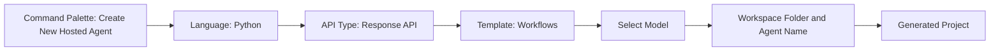
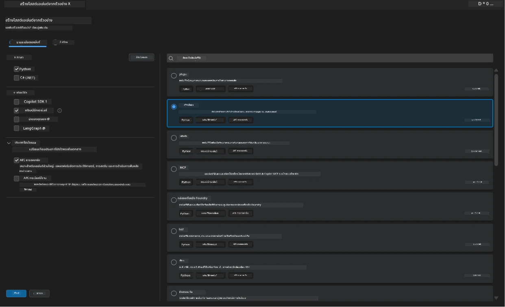
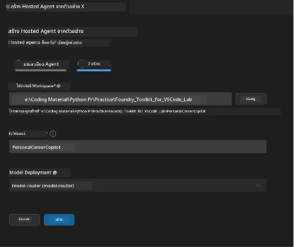

# Module 2 - สร้างโครงร่างโปรเจกต์ Multi-Agent

⏱️ ~5 นาที

ในโมดูลนี้ คุณจะใช้ [Foundry Toolkit for VS Code](https://aka.ms/foundrytk) เพื่อ **สร้างโครงร่างโปรเจกต์หลายตัวแทน** ตัวช่วยสร้างจะสร้าง `agent.yaml`, `main.py`, `Dockerfile`, `requirements.txt`, `.env` และการกำหนดค่าการดีบักใน VS Code - เพื่อให้คุณสามารถมุ่งเน้นที่การเชื่อมโยงกระแสงาน 4-agent ในโมดูล 3

> **แนวคิดหลัก:** โครงร่างนี้เป็นสตับที่ใช้งานได้โดยมีตัวแทนหนึ่งตัว คุณจะแทนที่ตรรกะตัวยึดตำแหน่งด้วยกราฟ `WorkflowBuilder` ในโมดูล 3 คุณไม่ต้องเขียนโค้ดพื้นฐานตั้งแต่ต้น

> **ตัวอย่างอ้างอิง:** [`PersonalCareerCopilot/`](../../../../../workshop/lab02-multi-agent/PersonalCareerCopilot) เป็นตัวอย่างการทำงานที่สมบูรณ์ ใช้เพื่อเปรียบเทียบงานของคุณในขณะที่ดำเนินการ

### ลำดับขั้นตอนตัวช่วยสร้างโครงร่าง



---

## ขั้นตอนที่ 1: เปิดตัวช่วยสร้าง Create Hosted Agent

1. กด `Ctrl+Shift+P` เพื่อเปิด **Command Palette**.
2. พิมพ์: **Foundry Toolkit: Create new Hosted Agent** และเลือกมัน
3. ตัวช่วยสร้างจะเปิดที่แท็บ **Agent Details**.

> **ทางเลือก:** คลิกไอคอน **Foundry Toolkit** ใน Activity Bar → คลิกไอคอน **+** ข้าง **Hosted Agents** → **Create New Hosted Agent**.

---

## ขั้นตอนที่ 2: เลือกการตั้งค่า



1. ในส่วนซ้ายของการนำทาง/ตัวเลือก ให้เลือกดังนี้:

| เมนู | การเลือก | หมายเหตุ |
|--------|-----------|-------|
| **ภาษา** | Python | C# (.NET) ก็รองรับ |
| **Framework** | Agent Framework | มี `Agent`, `AgentExecutor`, `WorkflowBuilder` |
| **ประเภท API** | Response API | `POST /responses` - มีประวัติจัดการโดยแพลตฟอร์ม, รองรับการสตรีม |
| **เทมเพลต** | **Workflows** | ประมวลผลคำขอผ่านหลายเอเจนต์ตามลำดับ |

2. เมือเลือกเสร็จแล้ว คลิก **Next**



3. ในหน้าต่างถัดไป เลือกดังนี้:

| เมนู | การเลือก | หมายเหตุ |
|--------|-----------|-------|
| **โฟลเดอร์พื้นที่ทำงาน** | เลือกโฟลเดอร์เป้าหมาย | เช่น `workshop/lab02-multi-agent/` ในรีโปนี้ |
| **ชื่อเอเจนต์** | `PersonalCareerCopilot` | จะเป็นชื่อโฟลเดอร์โปรเจกต์ |
| **โมเดลที่ปรับใช้** | เลือกโมเดลที่ปรับใช้ของคุณ | เช่น `gpt-4.1-mini` จาก Lab 01 |

4. คลิก **Create** เพื่อสร้างโครงร่างโปรเจกต์ VS Code จะสร้างไฟล์และเปิดโฟลเดอร์

> **เคล็ดลับ:** [`gpt-4.1-mini`](https://learn.microsoft.com/azure/foundry/foundry-models/concepts/models-sold-directly-by-azure#gpt-41-series) สมดุลความเร็วและคุณภาพได้ดีสำหรับการพัฒนาหลายเอเจนต์

---

## ขั้นตอนที่ 3: ตรวจสอบโปรเจกต์ที่สร้างขึ้น

หลังจากสร้างโครงร่างเสร็จ ให้ตรวจสอบว่าเห็นไฟล์เหล่านี้ใน Explorer (`Ctrl+Shift+E`):

```
📂 <your-agent-name>/
├── .azdignore          ← Files excluded from Azure Developer CLI deployments
├── .dockerignore       ← Files excluded from Docker builds
├── .env                ← Environment variables (placeholders - fill in Module 3)
├── .vscode/
│   ├── launch.json     ← Debug config (F5 → run + Agent Inspector)
│   └── tasks.json      ← VS Code task definitions
├── agent.yaml          ← Agent definition (kind: hosted, protocol: responses)
├── Dockerfile          ← Container config for deployment
├── main.py             ← Stub agent entry point (replace with WorkflowBuilder in Module 3)
└── requirements.txt    ← Python dependencies
```

> **สำคัญ:** เปิดโฟลเดอร์ที่สร้างนี้โดยตรงใน VS Code เพื่อให้ `.vscode/launch.json` และ `tasks.json` ใช้งานได้ถูกต้องสำหรับการดีบักด้วย F5

### อธิบายไฟล์หลัก

| ไฟล์ | จุดประสงค์ |
|------|---------|
| `agent.yaml` | ประกาศ `kind: hosted`, แผนที่ตัวแปร env, กำหนดโปรโตคอล `/responses` |
| `main.py` | ตัวอย่าง: เอเจนต์ `FoundryChatClient` → `Agent` → `ResponsesHostServer` คุณจะเปลี่ยนเป็น 4 เอเจนต์ + `WorkflowBuilder` ในโมดูล 3 |
| `Dockerfile` | `python:3.12-slim`, ติดตั้ง `requirements.txt`, เปิดเผยพอร์ต 8088, รัน `python main.py` |
| `requirements.txt` | `agent-framework-foundry`, `agent-framework-foundry-hosting`, `mcp<2,>=1.24.0`, `debugpy` |

> **อ้างอิง:** ดู [`PersonalCareerCopilot/agent.yaml`](../../../../../workshop/lab02-multi-agent/PersonalCareerCopilot/agent.yaml) และ [`PersonalCareerCopilot/requirements.txt`](../../../../../workshop/lab02-multi-agent/PersonalCareerCopilot/requirements.txt) สำหรับเนื้อหาที่สร้างขึ้นทั้งหมด

---

### ✅ จุดตรวจสอบ

- [ ] ตัวช่วยสร้างโครงร่างเสร็จสมบูรณ์ - โฟลเดอร์โปรเจกต์ใหม่แสดงใน Explorer
- [ ] ไฟล์ที่คาดหวังทั้งหมดมีอยู่: `agent.yaml`, `main.py`, `Dockerfile`, `requirements.txt`, `.env`
- [ ] `agent.yaml` แสดง `kind: hosted` และ `protocol: responses`
- [ ] `main.py` นำเข้า `Agent`, `FoundryChatClient`, `ResponsesHostServer`
- [ ] โฟลเดอร์ที่สร้างเปิดอยู่เป็นรากของ Workspace ใน VS Code
- [ ] คุณเข้าใจว่า `main.py` เป็นตัวอย่าง - `WorkflowBuilder` จะถูกเพิ่มในโมดูล 3

---

**ก่อนหน้า:** [01 - Understand Multi-Agent Architecture](01-understand-multi-agent.md) · **ถัดไป:** [03 - Configure Agents & Environment →](03-configure-agents.md)

---

<!-- CO-OP TRANSLATOR DISCLAIMER START -->
**ปฏิเสธความรับผิดชอบ**:
เอกสารนี้ได้รับการแปลโดยใช้บริการแปลภาษา AI [Co-op Translator](https://github.com/Azure/co-op-translator) ขณะที่เราพยายามให้ความถูกต้อง โปรดทราบว่าการแปลโดยอัตโนมัติอาจมีข้อผิดพลาดหรือความไม่ถูกต้อง เอกสารต้นฉบับในภาษาต้นทางควรถูกพิจารณาเป็นแหล่งข้อมูลที่เชื่อถือได้ สำหรับข้อมูลที่สำคัญ แนะนำให้ใช้การแปลโดยมนุษย์มืออาชีพ เราไม่รับผิดชอบต่อความเข้าใจผิดหรือการตีความที่ผิดพลาดที่เกิดขึ้นจากการใช้การแปลนี้
<!-- CO-OP TRANSLATOR DISCLAIMER END -->