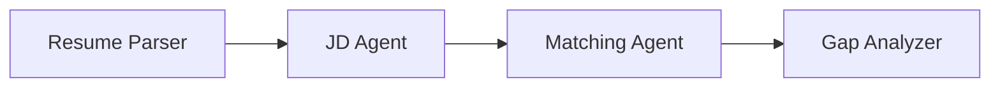
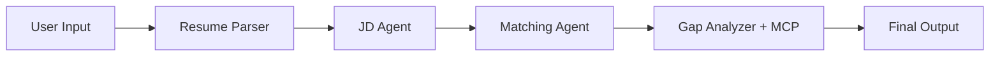

# บทที่ 4 - รูปแบบการจัดการลำดับงาน

⏱️ ~10 นาที

ในบทนี้ คุณจะได้สำรวจรูปแบบการจัดการลำดับงานที่ใช้ใน Resume Job Fit Evaluator และเรียนรู้วิธีการอ่าน แก้ไข และขยายกราฟการทำงาน ความเข้าใจรูปแบบเหล่านี้มีความสำคัญสำหรับการดีบักปัญหาการไหลของข้อมูลและการสร้าง [multi-agent workflows](https://learn.microsoft.com/agent-framework/workflows/) ของคุณเอง

---

## รูปแบบที่ 1: โซ่ต่อเนื่อง

รูปแบบพื้นฐานในเวิร์กโฟลว์คือ **โซ่ต่อเนื่อง** - เอาต์พุตของแต่ละเอเยนต์ส่งต่อโดยตรงไปยังตัวถัดไป



ในโค้ด การเรียกแต่ละครั้งของ `add_edge()` สร้างขั้นตอนหนึ่งในโซ่:

```python
.add_edge(resume_executor, jd_executor)       # ResumeParser output → JD Agent
.add_edge(jd_executor, matching_executor)     # JD Agent output → MatchingAgent
.add_edge(matching_executor, gap_executor)    # MatchingAgent output → GapAnalyzer
```

> **ทำไมต้องต่อเนื่อง ไม่ใช่ fan-out/fan-in?** `WorkflowBuilder` ใช้ **OR-semantics** สำหรับขอบขาเข้า: ตัวดำเนินการด้านล่างจะทำงานทันทีที่ **อย่างน้อยหนึ่ง** ผู้ส่งก่อนหน้าทำงานเสร็จ หาก `matching_executor` มีขอบขาเข้าสองขอบ (จากทั้ง `resume_executor` และ `jd_executor`) จะถูกเรียกสองครั้ง - ครั้งแรกเมื่อ ResumeParser เสร็จ และอีกครั้งเมื่อ JD Agent เสร็จ - ทำให้ GapAnalyzer ทำงานสองครั้งและผลลัพธ์ปรากฏสองครั้ง ท่อแบบต่อเนื่องจึงหลีกเลี่ยงปัญหานี้โดยสิ้นเชิง

## รูปแบบที่ 2: การส่งต่อเนื้อหา

เพราะว่า `context_mode="last_agent"` หมายความว่าตัวดำเนินการแต่ละตัวจะเห็นแค่ **เอาต์พุตของผู้ส่งก่อนหน้าโดยตรง** เท่านั้น เอเยนต์ในโซ่ต่อเนื่องต้องส่งต่อข้อมูลที่เอเยนต์ด้านล่างต้องใช้ด้วยตนเองอย่างชัดเจน

ในเวิร์กโฟลว์นี้:
- **ResumeParser** คัดลอก JD โดยตรงลงใน `[JOB DESCRIPTION PASS-THROUGH]` (เพื่อให้ JD Agent หาเจอ).
- **JD Agent** คัดลอก `[PARSED RESUME]` โดยตรงลงใน `[PARSED RESUME PASS-THROUGH]` (เพื่อให้ MatchingAgent สามารถเปรียบเทียบโปรไฟล์ทั้งสอง).

```
ResumeParser output
└─ [PARSED RESUME]               ← extracted by JD Agent
└─ [JOB DESCRIPTION PASS-THROUGH] ← extracted by JD Agent

JD Agent output
└─ [JD REQUIREMENTS]             ← extracted by MatchingAgent
└─ [PARSED RESUME PASS-THROUGH]  ← extracted by MatchingAgent
```

ส่วน relay แต่ละส่วนต้องถูกคัดลอก **อย่างตรงตัว** - การสรุปหรือเขียนใหม่จะทำให้ตัวแทน downstream ที่ขึ้นอยู่กับมันทำงานผิดพลาด.

---

## กราฟทั้งหมด

การรวมรูปแบบการเชื่อมโยงแบบลำดับและการถ่ายโอนเนื้อหาจะสร้าง workflow เต็มรูปแบบ:



Agent Inspector แสดงโครงสร้างกราฟนี้เมื่อเอเจนต์ทำงานในเครื่องคุณเอง ดูได้ที่ [Module 5 - Test Locally](05-test-locally.md) สำหรับภาพหน้าจอ.

---

## การอ่านโค้ด WorkflowBuilder

กราฟ workflow ถูกสร้างในฟังก์ชัน `main()` ใน [`PersonalCareerCopilot/main.py`](../../../../../workshop/lab02-multi-agent/PersonalCareerCopilot/main.py). คำสั่ง `add_edge()` สามครั้งสร้างสายงานแบบลำดับ:

| # | ขอบ | ผลลัพธ์ |
|---|------|--------|
| 1 | `resume_executor → jd_executor` | JD Agent รับ `[PARSED RESUME]` + `[JOB DESCRIPTION PASS-THROUGH]` |
| 2 | `jd_executor → matching_executor` | MatchingAgent รับ `[JD REQUIREMENTS]` + `[PARSED RESUME PASS-THROUGH]` |
| 3 | `matching_executor → gap_executor` | GapAnalyzer รับรายงานการฟิต + รายการช่องว่าง |

---

## การแก้ไขกราฟ

### การเพิ่มตัวแทนใหม่

เพื่อเพิ่มตัวแทนที่ห้า (เช่น **InterviewPrepAgent** หลัง GapAnalyzer):

1. กำหนดค่าคงที่ `INTERVIEW_PREP_INSTRUCTIONS`.
2. สร้างวัตถุ `Agent` + `AgentExecutor` (ตามรูปแบบเดียวกับสี่ตัวแทนที่มีอยู่).
3. เพิ่ม `.add_edge(gap_executor, interview_exec)` ใน `WorkflowBuilder`.
4. ปรับปรุง `output_executors=[interview_exec]`.

> **สำคัญ:** `start_executor` เป็นตัวแทนเดียวที่รับข้อมูลดิบจากผู้ใช้ ตัวแทนอื่นทั้งหมดรับข้อมูลออกจากขอบด้านบนของตน.

---

## ข้อผิดพลาดทั่วไปในกราฟ

| ข้อผิดพลาด | อาการ | วิธีแก้ไข |
|---------|---------|-----|
| ไม่มีขอบไปยัง `output_executors` | ตัวแทนทำงานแต่ผลลัพธ์ว่าง | ตรวจสอบให้แน่ใจว่ามีเส้นทางจาก `start_executor` ไปยังตัวแทนทุกตัวใน `output_executors` |
| พึ่งพาแบบวงกลม | วนลูปไม่สิ้นสุดหรือหมดเวลา | ตรวจสอบว่าไม่มีตัวแทนใดให้อาหารกลับไปยังตัวแทนด้านบน |
| ตัวแทนใน `output_executors` ที่ไม่มีขอบเข้า | ผลลัพธ์ว่าง | เพิ่มอย่างน้อยหนึ่ง `add_edge(source, that_agent)` |
| หลาย `output_executors` โดยไม่มี fan-in | ผลลัพธ์ประกอบด้วยแค่คำตอบของตัวแทนเดียว | ใช้ตัวแทนเอาต์พุตเดียวที่รวบรวมหรือยอมรับผลลัพธ์หลายอย่าง |
| ไม่มี `start_executor` | `ValueError` ขณะสร้าง | ระบุ `start_executor` ใน `WorkflowBuilder()` เสมอ |

---

## การดีบักกราฟ

### การใช้ Agent Inspector

1. เริ่มตัวแทนในเครื่องด้วย F5.
2. เปิด Agent Inspector (`Ctrl+Shift+P` → **Foundry Toolkit: Open Agent Inspector**).
3. ส่งข้อความทดสอบ.
4. ในแผงตอบกลับของ Inspector มองหา **สตรีมผลลัพธ์** - จะแสดงการมีส่วนร่วมของแต่ละตัวแทนตามลำดับ.


### การใช้ logging

เพิ่ม logging ไปยัง `main.py` เพื่อติดตามการไหลของข้อมูล:

```python
import logging
logger = logging.getLogger("resume-job-fit")

# In main(), after building the workflow:
logger.info("Workflow graph built with edges: RP→JD, JD→MA, MA→GA")
```

บันทึกเซิร์ฟเวอร์แสดงลำดับการทำงานของตัวแทนและการเรียกเครื่องมือ MCP:

```
INFO:agent_framework:Executing agent: ResumeParser
INFO:agent_framework:Executing agent: JobDescriptionAgent
INFO:agent_framework:Executing agent: MatchingAgent
INFO:agent_framework:Executing agent: GapAnalyzer
INFO:agent_framework:Tool call: search_microsoft_learn_for_plan(skill="Kubernetes")
POST https://learn.microsoft.com/api/mcp → 200
INFO:agent_framework:Tool call: search_microsoft_learn_for_plan(skill="Terraform")
POST https://learn.microsoft.com/api/mcp → 200
```

---

### จุดตรวจสอบ

- [ ] คุณสามารถระบุรูปแบบ orchestration ทั้งสองใน workflow: สายงานลำดับและการถ่ายโอนเนื้อหา
- [ ] คุณเข้าใจว่าทำไม `context_mode="last_agent"` ต้องการการถ่ายโอนข้อมูลระหว่างตัวแทนอย่างชัดเจน
- [ ] คุณสามารถอ่านโค้ด `WorkflowBuilder` และจับคู่แต่ละคำสั่ง `add_edge()` กับกราฟภาพ
- [ ] คุณรู้วิธีเพิ่มตัวแทนใหม่ที่ส่วนท้ายของสายงาน
- [ ] คุณสามารถระบุข้อผิดพลาดทั่วไปในกราฟและอาการต่างๆ

---

**ก่อนหน้า:** [03 - Configure Agents & Environment](03-configure-agents.md) · **ถัดไป:** [05 - Test Locally →](05-test-locally.md)

---

<!-- CO-OP TRANSLATOR DISCLAIMER START -->
**ปฏิเสธความรับผิดชอบ**:
เอกสารนี้ได้รับการแปลโดยใช้บริการแปลภาษา AI [Co-op Translator](https://github.com/Azure/co-op-translator) ขณะที่เราพยายามให้ความถูกต้อง โปรดทราบว่าการแปลโดยอัตโนมัติอาจมีข้อผิดพลาดหรือความไม่ถูกต้อง เอกสารต้นฉบับในภาษาต้นทางควรถูกพิจารณาเป็นแหล่งข้อมูลที่เชื่อถือได้ สำหรับข้อมูลที่สำคัญ แนะนำให้ใช้การแปลโดยมนุษย์มืออาชีพ เราไม่รับผิดชอบต่อความเข้าใจผิดหรือการตีความที่ผิดพลาดที่เกิดขึ้นจากการใช้การแปลนี้
<!-- CO-OP TRANSLATOR DISCLAIMER END -->