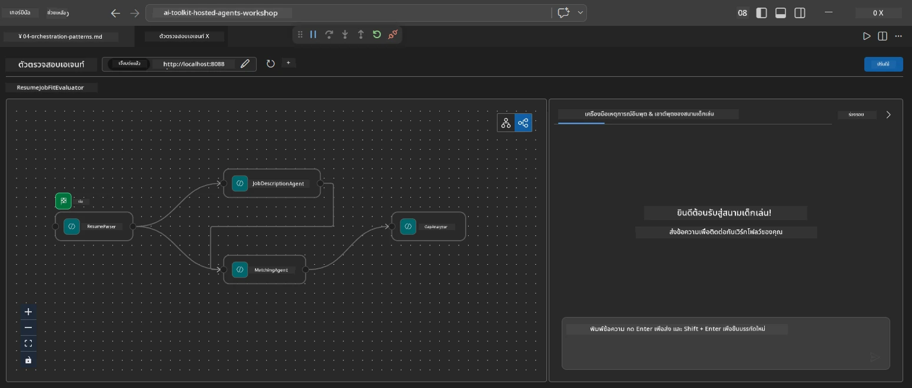
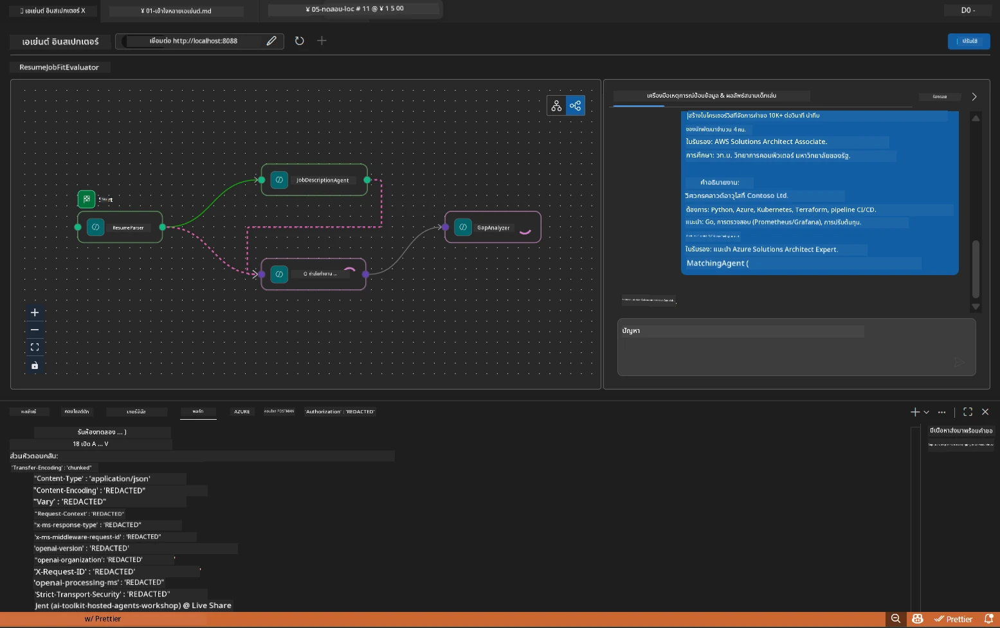
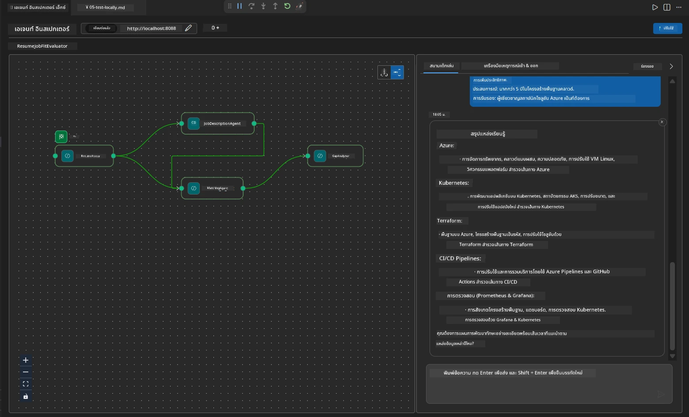

# โมดูล 5 - ทดสอบในเครื่อง

⏱️ ~15 นาที

ในโมดูลนี้ คุณจะรันเวิร์กโฟลว์หลายเอเจนต์ในเครื่อง ทดสอบด้วย Agent Inspector และตรวจสอบว่าเอเจนต์ทั้งสี่ตัวและเครื่องมือ MCP ทำงานถูกต้องก่อนการปรับใช้

---

## ขั้นตอนที่ 1: เริ่มเซิร์ฟเวอร์เอเจนต์

### ทางเลือกที่ A: ใช้งานงานใน VS Code (แนะนำ)

1. เปิด `workshop/lab02-multi-agent/PersonalCareerCopilot/` เป็นโฟลเดอร์ VS Code ของคุณ
2. กด `Ctrl+Shift+P` → พิมพ์ **Tasks: Run Task** → เลือก **Run Agent HTTP Server**.
3. งานเริ่มเซิร์ฟเวอร์พร้อม debugpy แนบอยู่ที่พอร์ต `5679` และเอเย่นต์ที่พอร์ต `8088`.
4. รอให้ผลลัพธ์แสดงข้อความเริ่มต้น ตามด้วยข้อความพร้อมใช้งานของเซิร์ฟเวอร์เอง (แถบบันทึกอื่นๆ จะปรากฏขึ้นในระหว่าง):

```
INFO:resume-job-fit:Starting Resume -> Job Fit Evaluator HTTP server...
...
INFO:hypercorn.error:Running on http://0.0.0.0:8088 (CTRL + C to quit)
```

### ตัวเลือก B: ใช้ F5 (โหมดดีบัก)

1. กด `F5` → เลือก **Debug Local Agent HTTP Server**.
2. เซิร์ฟเวอร์จะเริ่มโดยรองรับเบรกพอยต์ครบถ้วน - มีประโยชน์สำหรับตรวจสอบการตอบสนอง MCP หรือผลลัพธ์เอเย่นต์.

---

## ขั้นตอนที่ 2: เปิด Agent Inspector

1. กด `Ctrl+Shift+P` → พิมพ์ **Foundry Toolkit: Open Agent Inspector**.
2. Agent Inspector เปิดเป็นแผงใน VS Code ที่เชื่อมต่อกับ `http://localhost:8088`.
3. คุณควรเห็นส่วนติดต่อเอเย่นต์พร้อมรับข้อความ.



> **ถ้า Agent Inspector ไม่เปิด:** ตรวจสอบว่าเซิร์ฟเวอร์เริ่มต้นอย่างสมบูรณ์ (คุณเห็น `Running on http://0.0.0.0:8088` ในบันทึก) หากพอร์ต 5679 ถูกใช้งานอยู่ ให้ดูที่ [Module 8 - Troubleshooting](08-troubleshooting.md).

---

## ขั้นตอนที่ 2b: (ไม่บังคับ) เปิด Workflow Visualizer

Foundry Toolkit รวมถึง **Workflow Visualizer** แบบเรียลไทม์ที่แสดงการโต้ตอบของเอเจนต์ขณะกราฟทำงาน ซึ่งมีประโยชน์อย่างยิ่งสำหรับการแก้จุดบกพร่องแบบหลายเอเจนต์

1. กด `Ctrl+Shift+P` → พิมพ์ **Foundry Toolkit: Open Visualizer for Hosted Agents**.
2. แท็บใหม่ใน VS Code จะเปิดขึ้นแสดงกราฟการดำเนินการแบบสด
3. เมื่อคุณส่งข้อความใน Agent Inspector ตัว visualizer จะอัปเดตโดยอัตโนมัติ — โหนดสีเขียวแสดงเอเจนต์ที่ทำงานเสร็จ และขอบที่เคลื่อนไหวแสดงการไหลของข้อมูลระหว่างโหนด

> **ความขัดแย้งของพอร์ต:** หากพอร์ตของ visualizer ถูกใช้งานแล้ว ให้เปลี่ยนได้ใน VS Code Settings → **Extensions** → **Microsoft Foundry Configuration** → **Hosted Agents: Visualizer Port**.

---

## ขั้นตอนที่ 3: รันเทสต์เบื้องต้น

รันทั้งสองเทสต์นี้ตามลำดับ แต่ละเทสต์จะทดสอบการทำงานของเวิร์กโฟลว์เพิ่มขึ้น

### เทสต์ 1: เรซูเม่พื้นฐาน + คำอธิบายงาน

วางข้อความต่อไปนี้ใน Agent Inspector:

```
Resume:
Jane Doe
Senior Software Engineer with 5 years of experience in Python, Django, and AWS.
Built microservices handling 10K+ requests/second. Led a team of 4 developers.
Certifications: AWS Solutions Architect Associate.
Education: B.S. Computer Science, State University.

Job Description:
Senior Cloud Engineer at Contoso Ltd.
Required: Python, Azure, Kubernetes, Terraform, CI/CD pipelines.
Preferred: Go, monitoring (Prometheus/Grafana), cost optimization.
Experience: 5+ years in cloud infrastructure.
Certifications: Azure Solutions Architect Expert preferred.
```

**โครงสร้างผลลัพธ์ที่คาดหวัง:**

การตอบกลับควรรวมผลลัพธ์จากเอเจนต์ทั้งสี่ตามลำดับ:

1. **ผลลัพธ์ Resume Parser** - สองส่วนที่มีป้ายชื่อ: `[PARSED RESUME]` (โปรไฟล์ผู้สมัครที่มีการจัดกลุ่มทักษะ) และ `[JOB DESCRIPTION PASS-THROUGH]` (ข้อความคำอธิบายงานฉบับเต็มที่ป้อนให้ JD Agent)
2. **ผลลัพธ์ JD Agent** - ความต้องการที่มีโครงสร้าง แยกระหว่างทักษะที่จำเป็นกับที่ชื่นชอบ
3. **ผลลัพธ์ Matching Agent** - คะแนนความเหมาะสม (0-100) พร้อมรายละเอียด, ทักษะที่ตรงกัน, ทักษะที่ขาด, ช่องว่าง
4. **ผลลัพธ์ Gap Analyzer** - การ์ดช่องว่างแยกตามทักษะที่ขาด แต่ละการ์ดมีลิงก์ Microsoft Learn





### สิ่งที่ต้องตรวจสอบในเทสต์ 1

| ตรวจสอบ | คาดหวัง | ผ่าน? |
|-------|----------|-------|
| การตอบกลับมีคะแนนความเหมาะสม | ตัวเลขระหว่าง 0-100 พร้อมรายละเอียด | |
| ทักษะที่ตรงกันถูกระบุ | เช่น Python, CI/CD (บางส่วน) เป็นต้น | |
| ทักษะที่ขาดถูกระบุ | เช่น Azure, Kubernetes, Terraform เป็นต้น | |
| มีการ์ดช่องว่างสำหรับแต่ละทักษะที่ขาด | การ์ดหนึ่งใบต่อทักษะ | |
| มี URL ของ Microsoft Learn อยู่ | ลิงก์ `learn.microsoft.com` ที่แท้จริง | |
| ไม่มีข้อความแสดงข้อผิดพลาดในตอบกลับ | ผลลัพธ์ที่มีโครงสร้างและสะอาด | |

### เทสต์ 2: กรณีขอบ - ผู้สมัครที่มีคะแนนความเหมาะสมสูง

วางเรซูเม่ที่ตรงกับ JD อย่างใกล้ชิดเพื่อตรวจสอบว่า GapAnalyzer จัดการสถานการณ์ผู้สมัครคะแนนสูงได้อย่างไร:

```
Resume:
Alex Chen
Senior Cloud Engineer with 7 years of experience.
Skills: Python, Azure (AKS, Functions, DevOps), Kubernetes, Terraform, CI/CD (GitHub Actions, Azure Pipelines), Go, Prometheus, Grafana, cost optimization.
Certifications: Azure Solutions Architect Expert, Azure DevOps Engineer Expert.
Led infrastructure migration to Azure for 3 enterprise clients.
Education: M.S. Computer Science, Tech University.

Job Description:
Senior Cloud Engineer at Contoso Ltd.
Required: Python, Azure, Kubernetes, Terraform, CI/CD pipelines.
Preferred: Go, monitoring (Prometheus/Grafana), cost optimization.
Experience: 5+ years in cloud infrastructure.
Certifications: Azure Solutions Architect Expert preferred.
```

**พฤติกรรมที่คาดหวัง:**
- คะแนนความเหมาะสมควรเป็น **80+** (ทักษะส่วนใหญ่ตรงกัน)
- การ์ดช่องว่างควรเน้นการขัดเกลาหรือความพร้อมสำหรับสัมภาษณ์ มากกว่าการเรียนรู้พื้นฐาน
- คำสั่ง GapAnalyzer ระบุว่า: "หากคะแนน >= 80 ให้เน้นการขัดเกลาหรือความพร้อมสำหรับสัมภาษณ์"

---

## ขั้นตอนที่ 4: ทดสอบด้วยข้อมูลของคุณเอง (ไม่บังคับ)

ลองวางเรซูเม่ของคุณเองและคำอธิบายงานจริง เพื่อช่วยตรวจสอบ:

- เอเจนต์จัดการรูปแบบเรซูเม่ต่างๆ (เรียงตามเวลา, ฟังก์ชัน, แบบผสม)
- JD Agent จัดการรูปแบบ JD ต่างๆ (จุดหัวข้อ, ย่อหน้า, โครงสร้าง)
- เครื่องมือ MCP ส่งคืนทรัพยากรที่เกี่ยวข้องกับทักษะจริง
- การ์ดช่องว่างมีการปรับแต่งตามประวัติส่วนตัวของคุณ

> **ความเป็นส่วนตัว - เส้นทาง A (Foundry cloud):** ข้อความเรซูเม่และ JD จะถูกส่งไปยัง Azure OpenAI deployment ของคุณเพื่อการอนุมาน โดยจะไม่ถูกบันทึกหรือติดเก็บโดยโครงสร้างเวิร์กช็อป ใช้ชื่อสมมติ (เช่น "Jane Doe") หากคุณต้องการ
>
> **ความเป็นส่วนตัว - เส้นทาง B (Foundry Local):** การอนุมานทั้งสี่เอเจนต์จะรันทั้งหมดบนเครื่องของคุณ ข้อความเรซูเม่และคำอธิบายงานจะ **ไม่ถูกส่งออกนอกเครื่องของคุณ** ทั้งหมด การเรียกออกนอกเดียวคือการที่เครื่องมือ MCP ดึงทรัพยากรจาก `https://learn.microsoft.com/api/mcp`; คำค้นนี้มีเพียงชื่อทักษะ ไม่ใช่ข้อมูลส่วนตัวของคุณ

---

### จุดตรวจสอบ

- [ ] เซิร์ฟเวอร์เริ่มต้นสำเร็จที่พอร์ต `8088` (บันทึกแสดง `Running on http://0.0.0.0:8088`)
- [ ] Agent Inspector เปิดและเชื่อมต่อกับเอเจนต์
- [ ] เทสต์ 1: การตอบกลับสมบูรณ์พร้อมคะแนนความเหมาะสม ทักษะที่ตรงกัน/ขาด การ์ดช่องว่าง และ URL Microsoft Learn
- [ ] เทสต์ 2: ผู้สมัครคะแนนสูงได้คะแนน 80+ พร้อมคำแนะนำเน้นการขัดเกลา
- [ ] การ์ดช่องว่างทั้งหมดมีอยู่ (หนึ่งใบต่อทักษะที่ขาด ไม่มีการตัดทอน)
- [ ] ไม่มีข้อผิดพลาดหรือการแทรกซ้อนในเทอร์มินัลเซิร์ฟเวอร์

---

**ก่อนหน้า:** [04 - Orchestration Patterns](04-orchestration-patterns.md) · **ถัดไป:** [06 - Deploy to Foundry →](06-deploy-to-foundry.md)

---

<!-- CO-OP TRANSLATOR DISCLAIMER START -->
**ปฏิเสธความรับผิดชอบ**:
เอกสารนี้ได้รับการแปลโดยใช้บริการแปลภาษา AI [Co-op Translator](https://github.com/Azure/co-op-translator) ขณะที่เราพยายามให้ความถูกต้อง โปรดทราบว่าการแปลโดยอัตโนมัติอาจมีข้อผิดพลาดหรือความไม่ถูกต้อง เอกสารต้นฉบับในภาษาต้นทางควรถูกพิจารณาเป็นแหล่งข้อมูลที่เชื่อถือได้ สำหรับข้อมูลที่สำคัญ แนะนำให้ใช้การแปลโดยมนุษย์มืออาชีพ เราไม่รับผิดชอบต่อความเข้าใจผิดหรือการตีความที่ผิดพลาดที่เกิดขึ้นจากการใช้การแปลนี้
<!-- CO-OP TRANSLATOR DISCLAIMER END -->