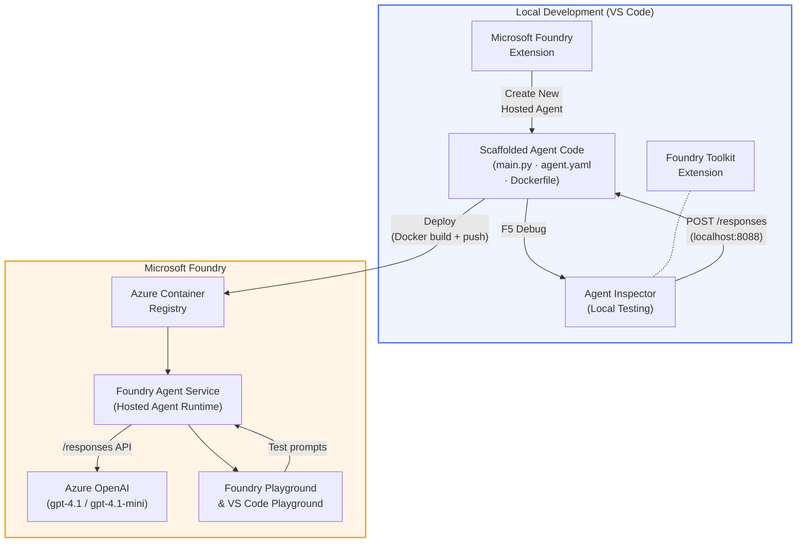

# Foundry Toolkit + Foundry Hosted Agents Workshop

[](https://www.python.org/)
[](https://github.com/microsoft/agents)
[](https://learn.microsoft.com/azure/foundry/agents/concepts/hosted-agents)
[](https://ai.azure.com/)
[](https://learn.microsoft.com/azure/ai-services/openai/)
[](https://learn.microsoft.com/cli/azure/install-azure-cli)
[](https://learn.microsoft.com/azure/developer/azure-developer-cli/install-azd)
[](https://www.docker.com/)
[](https://marketplace.visualstudio.com/items?itemName=ms-windows-ai-studio.windows-ai-studio)
[](LICENSE)

Bumuo, subukan, at i-deploy ang mga AI agents sa **Microsoft Foundry Agent Service** bilang **Hosted Agents** - mula sa VS Code gamit ang **Microsoft Foundry extension** at **Foundry Toolkit**.

> **Ang Hosted Agents ay kasalukuyang nasa preview pa lang.** Limitado ang mga suportadong rehiyon - tingnan ang [region availability](https://learn.microsoft.com/azure/foundry/agents/concepts/hosted-agents#region-availability).

> Ang folder na `agent/` sa bawat lab ay **awtomatikong ginagawa** ng Foundry extension - saka mo ia-angkop ang code, susubukan sa lokal, at ide-deploy.

### 🌐 Suporta sa Maramihang Wika

#### Sinusuportahan sa pamamagitan ng GitHub Action (Awtomatiko at Palaging Napapanahon)

<!-- CO-OP TRANSLATOR LANGUAGES TABLE START -->
[Arabic](../ar/README.md) | [Bengali](../bn/README.md) | [Bulgarian](../bg/README.md) | [Burmese (Myanmar)](../my/README.md) | [Chinese (Simplified)](../zh-CN/README.md) | [Chinese (Traditional, Hong Kong)](../zh-HK/README.md) | [Chinese (Traditional, Macau)](../zh-MO/README.md) | [Chinese (Traditional, Taiwan)](../zh-TW/README.md) | [Croatian](../hr/README.md) | [Czech](../cs/README.md) | [Danish](../da/README.md) | [Dutch](../nl/README.md) | [Estonian](../et/README.md) | [Finnish](../fi/README.md) | [French](../fr/README.md) | [German](../de/README.md) | [Greek](../el/README.md) | [Hebrew](../he/README.md) | [Hindi](../hi/README.md) | [Hungarian](../hu/README.md) | [Indonesian](../id/README.md) | [Italian](../it/README.md) | [Japanese](../ja/README.md) | [Kannada](../kn/README.md) | [Khmer](../km/README.md) | [Korean](../ko/README.md) | [Lithuanian](../lt/README.md) | [Malay](../ms/README.md) | [Malayalam](../ml/README.md) | [Manipuri (Meitei Mayek)](../mni/README.md) | [Marathi](../mr/README.md) | [Nepali](../ne/README.md) | [Nigerian Pidgin](../pcm/README.md) | [Norwegian](../no/README.md) | [Persian (Farsi)](../fa/README.md) | [Polish](../pl/README.md) | [Portuguese (Brazil)](../pt-BR/README.md) | [Portuguese (Portugal)](../pt-PT/README.md) | [Punjabi (Gurmukhi)](../pa/README.md) | [Romanian](../ro/README.md) | [Russian](../ru/README.md) | [Serbian (Cyrillic)](../sr/README.md) | [Slovak](../sk/README.md) | [Slovenian](../sl/README.md) | [Spanish](../es/README.md) | [Swahili](../sw/README.md) | [Swedish](../sv/README.md) | [Tagalog (Filipino)](./README.md) | [Tamil](../ta/README.md) | [Telugu](../te/README.md) | [Thai](../th/README.md) | [Turkish](../tr/README.md) | [Ukrainian](../uk/README.md) | [Urdu](../ur/README.md) | [Vietnamese](../vi/README.md)

> **Mas gusto mo bang i-Clone nang Lokal?**
>
> Kasama sa repository na ito ang mahigit 50 na pagsasalin ng wika na lubos na nagpapalaki ng laki ng pag-download. Para mag-clone nang walang pagsasalin, gamitin ang sparse checkout:
>
> **Bash / macOS / Linux:**
> ```bash
> git clone --filter=blob:none --sparse https://github.com/microsoft-foundry/Foundry_Toolkit_for_VSCode_Lab.git
> cd Foundry_Toolkit_for_VSCode_Lab
> git sparse-checkout set --no-cone '/*' '!translations' '!translated_images'
> ```
>
> **CMD (Windows):**
> ```cmd
> git clone --filter=blob:none --sparse https://github.com/microsoft-foundry/Foundry_Toolkit_for_VSCode_Lab.git
> cd Foundry_Toolkit_for_VSCode_Lab
> git sparse-checkout set --no-cone "/*" "!translations" "!translated_images"
> ```
>
> Binibigyan ka nito ng lahat ng kailangan mo upang matapos ang kurso nang mas mabilis ang pag-download.
<!-- CO-OP TRANSLATOR LANGUAGES TABLE END -->

---

## Arkitektura



**Daloy:** Ang Foundry extension ang nag-scaffold ng agent → inaangkop mo ang code at mga tagubilin → sinusubukan sa lokal gamit ang Agent Inspector → ide-deploy sa Foundry (Docker image ay itinutulak sa ACR) → sinusuri sa Playground.

---

## Ano ang iyong itatayo

| Lab | Deskripsyon | Katayuan |
|-----|-------------|--------|
| **Lab 01 - Isang Agent** | Bumuo ng **"Explain Like I'm an Executive" Agent**, subukan ito nang lokal, at ideploy sa Foundry | ✅ Available |
| **Lab 02 - Multi-Agent Workflow** | Bumuo ng **"Resume → Job Fit Evaluator"** - 4 na mga agent ang nagtutulungan para i-score ang resume fit at gumawa ng learning roadmap | ✅ Available |

---

## Kilalanin ang Executive Agent

Sa workshop na ito, bubuuin mo ang **"Explain Like I'm an Executive" Agent** - isang AI agent na kumukuha ng mahirap na teknikal na jargon at isinasalin ito sa mahinahon, boardroom-ready na mga buod. Kasi sa totoo lang, walang sinuman sa C-suite ang gustong marinig tungkol sa "thread pool exhaustion caused by synchronous calls introduced in v3.2."

Nilikha ko ang agent na ito pagkatapos ng sunod-sunod na insidente kung saan ang aking maayos na post-mortem ay nakatanggap ng tugon: *"Kaya... patay ba ang website o hindi?"*

### Paano ito gumagana

Binibigyan mo ito ng isang teknikal na update. Nagbabalik ito ng executive summary - tatlong bullet points, walang jargon, walang stack traces, walang existential na pangamba. Ang mahalaga ay **ano ang nangyari**, **epekto sa negosyo**, at **susunod na hakbang**.

### Tingnan ito sa aksyon

**Sabi mo:**
> "The API latency increased due to thread pool exhaustion caused by synchronous calls introduced in v3.2."

**Sagot ng agent:**

> **Executive Summary:**
> - **Ano ang nangyari:** Matapos ang pinakabagong release, bumagal ang sistema.
> - **Epekto sa negosyo:** Nakaranas ng pagkaantala ang ilang mga user habang ginagamit ang serbisyo.
> - **Susunod na hakbang:** Ang pagbabago ay ibinalik na at naghahanda ng ayos bago muling i-deploy.

### Bakit ang agent na ito?

Isa itong simpleng agent na may iisang layunin - perpekto para matutunan ang hosted agent workflow mula umpisa hanggang dulo nang hindi nalulunod sa komplikadong tool chains. At sa totoo lang? Lahat ng engineering team ay pwedeng magkaroon ng ganito.

---

## Estruktura ng workshop

```
📂 Foundry_Toolkit_for_VSCode_Lab/
├── 📄 README.md                      ← You are here
└── 📂 workshop/
    ├── 📂 lab01-single-agent/        ← Full lab: docs + agent code
    │   ├── README.md                 ← Hands-on lab instructions
    │   ├── 📂 docs/                  ← Step-by-step tutorial modules
    │   │   ├── 00-prerequisites.md
    │   │   ├── 01-setup.md
    │   │   ├── 02-create-hosted-agent.md
    │   │   ├── 03-configure-and-code.md
    │   │   ├── 04-test-locally.md
    │   │   ├── 05-deploy-to-foundry.md
    │   │   ├── 06-verify-in-playground.md
    │   │   ├── 07-summary.md
    │   │   └── 08-troubleshooting.md
    │   └── 📂 agent/                 ← Reference solution (auto-scaffolded by Foundry extension)
    │       ├── agent.yaml
    │       ├── Dockerfile
    │       ├── main.py
    │       └── requirements.txt
    └── 📂 lab02-multi-agent/         ← Resume → Job Fit Evaluator
        ├── README.md                 ← Hands-on lab instructions (end-to-end)
        ├── 📂 docs/                  ← Step-by-step tutorial modules
        │   ├── 00-prerequisites.md
        │   ├── 01-understand-multi-agent.md
        │   ├── 02-scaffold-multi-agent.md
        │   ├── 03-configure-agents.md
        │   ├── 04-orchestration-patterns.md
        │   ├── 05-test-locally.md
        │   ├── 06-deploy-to-foundry.md
        │   ├── 07-verify-in-playground.md
        │   └── 08-troubleshooting.md
        └── 📂 PersonalCareerCopilot/ ← Reference solution (multi-agent workflow)
            ├── agent.yaml
            ├── Dockerfile
            ├── main.py
            └── requirements.txt
```

> **Tandaan:** Ang `agent/` folder sa loob ng bawat lab ay ang nilikhang **Microsoft Foundry extension** kapag pinatakbo mo ang `Microsoft Foundry: Create a New Hosted Agent` mula sa Command Palette. Pagkatapos ay inaangkop ang mga file gamit ang mga tagubilin, tool, at konfigurasyon ng iyong agent. Tinatalakay sa Lab 01 kung paano ito gawin mula sa simula.

---

## Pagsisimula

### 1. I-clone ang repository

```bash
git clone https://github.com/microsoft-foundry/Foundry_Toolkit_for_VSCode_Lab.git
cd Foundry_Toolkit_for_VSCode_Lab
```

### 2. Mag-setup ng Python virtual environment

```bash
python -m venv venv
```

I-activate ito:

- **Windows (PowerShell):**
  ```powershell
  .\venv\Scripts\Activate.ps1
  ```
- **macOS / Linux:**
  ```bash
  source venv/bin/activate
  ```

### 3. I-install ang mga dependencies

```bash
pip install -r workshop/lab01-single-agent/agent/requirements.txt
```

### 4. I-configure ang mga environment variables

Kopyahin ang example na `.env` file sa loob ng agent folder at punan ang iyong mga halaga:

```bash
cp workshop/lab01-single-agent/agent/.env.example workshop/lab01-single-agent/agent/.env
```

I-edit ang `workshop/lab01-single-agent/agent/.env`:

```env
AZURE_AI_PROJECT_ENDPOINT=https://<your-account>.services.ai.azure.com/api/projects/<your-project>
AZURE_AI_MODEL_DEPLOYMENT_NAME=<your-model-deployment-name>
```

### 5. Sundan ang mga workshop labs

Ang bawat lab ay nakahiwalay gamit ang sariling mga module. Magsimula sa **Lab 01** para matutunan ang mga pundamental, saka magpatuloy sa **Lab 02** para sa multi-agent workflows.

#### Lab 01 - Isang Agent ([buong tagubilin](workshop/lab01-single-agent/README.md))

| # | Module | Link |
|---|--------|------|
| 1 | Basahin ang mga prerequisites | [00-prerequisites.md](workshop/lab01-single-agent/docs/00-prerequisites.md) |
| 2 | I-install ang Foundry Toolkit at Foundry extension | [01-setup.md](workshop/lab01-single-agent/docs/01-setup.md) |
| 3 | Gumawa ng Foundry project | [01-setup.md](workshop/lab01-single-agent/docs/01-setup.md) |
| 4 | Gumawa ng hosted agent | [02-create-hosted-agent.md](workshop/lab01-single-agent/docs/02-create-hosted-agent.md) |
| 5 | I-configure ang mga tagubilin at environment | [03-configure-and-code.md](workshop/lab01-single-agent/docs/03-configure-and-code.md) |
| 6 | Subukan sa lokal | [04-test-locally.md](workshop/lab01-single-agent/docs/04-test-locally.md) |
| 7 | I-deploy sa Foundry | [05-deploy-to-foundry.md](workshop/lab01-single-agent/docs/05-deploy-to-foundry.md) |
| 8 | Suriin sa playground | [06-verify-in-playground.md](workshop/lab01-single-agent/docs/06-verify-in-playground.md) |
| 9 | Pag-troubleshoot | [08-troubleshooting.md](workshop/lab01-single-agent/docs/08-troubleshooting.md) |

#### Lab 02 - Multi-Agent Workflow ([buong tagubilin](workshop/lab02-multi-agent/README.md))

| # | Module | Link |
|---|--------|------|
| 1 | Mga Prerequisites (Lab 02) | [00-prerequisites.md](workshop/lab02-multi-agent/docs/00-prerequisites.md) |
| 2 | Unawain ang multi-agent architecture | [01-understand-multi-agent.md](workshop/lab02-multi-agent/docs/01-understand-multi-agent.md) |
| 3 | Scaffold ang multi-agent project | [02-scaffold-multi-agent.md](workshop/lab02-multi-agent/docs/02-scaffold-multi-agent.md) |
| 4 | I-configure ang mga agents at environment | [03-configure-agents.md](workshop/lab02-multi-agent/docs/03-configure-agents.md) |
| 5 | Mga pattern ng orchestration | [04-orchestration-patterns.md](workshop/lab02-multi-agent/docs/04-orchestration-patterns.md) |
| 6 | Subukan sa lokal (multi-agent) | [05-test-locally.md](workshop/lab02-multi-agent/docs/05-test-locally.md) |
| 7 | I-deploy sa Foundry | [06-deploy-to-foundry.md](workshop/lab02-multi-agent/docs/06-deploy-to-foundry.md) |
| 8 | Suriin sa playground | [07-verify-in-playground.md](workshop/lab02-multi-agent/docs/07-verify-in-playground.md) |
| 9 | Pag-troubleshoot (multi-agent) | [08-troubleshooting.md](workshop/lab02-multi-agent/docs/08-troubleshooting.md) |

---

## Tagapangalaga

<table>
<tr>
    <td align="center"><a href="https://github.com/ShivamGoyal03">
        <br />
        <sub><b>Shivam Goyal</b></sub>
    </a><br />
    </td>
</tr>
</table>

---

## Mga kinakailangang permiso (mabilisang sanggunian)

| Senaryo | Kinakailangang mga tungkulin |
|----------|---------------|
| Gumawa ng bagong Foundry project | **Azure AI Owner** sa Foundry resource |
| Mag-deploy sa umiiral na project (bagong mga resources) | **Azure AI Owner** + **Contributor** sa subscription |
| Mag-deploy sa fully configured na project | **Reader** sa account + **Azure AI User** sa project |

> **Mahalaga:** Ang mga Azure `Owner` at `Contributor` roles ay may mga *management* permissions lang, hindi *development* (data action) permissions. Kailangan mo ng **Azure AI User** o **Azure AI Owner** para bumuo at mag-deploy ng mga agent.

---

## Mga Sanggunian

- [Mabilisang Simula: I-deploy ang iyong unang hosted agent (VS Code)](https://learn.microsoft.com/azure/foundry/agents/quickstarts/quickstart-hosted-agent)
- [Ano ang mga hosted agent?](https://learn.microsoft.com/azure/foundry/agents/concepts/hosted-agents)
- [Gumawa ng mga workflow ng hosted agent sa VS Code](https://learn.microsoft.com/azure/foundry/agents/how-to/vs-code-agents-workflow-pro-code)
- [I-deploy ang isang hosted agent](https://learn.microsoft.com/azure/foundry/agents/how-to/deploy-hosted-agent)
- [RBAC para sa Microsoft Foundry](https://learn.microsoft.com/azure/foundry/concepts/rbac-foundry)
- [Architecture Review Agent Sample](https://github.com/Azure-Samples/agent-architecture-review-sample) - Tunay na hosted agent gamit ang MCP tools, mga diagram ng Excalidraw, at doble deployment

---


## Lisensya

[MIT](../../LICENSE)

---

<!-- CO-OP TRANSLATOR DISCLAIMER START -->
**Pagtatanggi**:
Ang dokumentong ito ay isinalin gamit ang serbisyo ng AI translation na [Co-op Translator](https://github.com/Azure/co-op-translator). Bagama't nagsusumikap kami para sa katumpakan, pakatandaan na ang awtomatikong pagsasalin ay maaaring maglaman ng mga pagkakamali o hindi pagkakatugma. Ang orihinal na dokumento sa orihinal nitong wika ang dapat ituring na pangunahing sanggunian. Para sa mahahalagang impormasyon, inirerekomenda ang propesyonal na pagsasalin ng tao. Hindi kami mananagot sa anumang maling pagkakaintindi o maling interpretasyon na nagmula sa paggamit ng pagsasaling ito.
<!-- CO-OP TRANSLATOR DISCLAIMER END -->