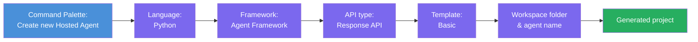
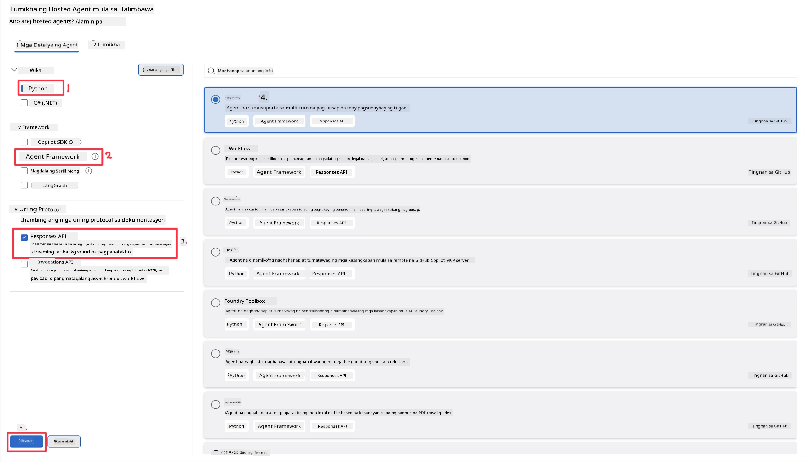
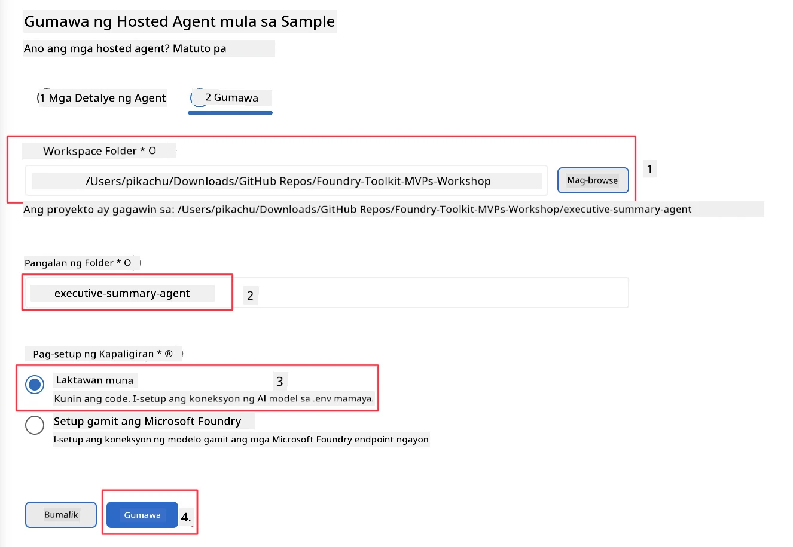

# Module 2 - Gumawa ng Bagong Hosted Agent

⏱️ ~5 min

Sa module na ito, gagamitin mo ang Foundry Toolkit upang **mag-scaffold ng hosted agent project**. Ang scaffold ay bumubuo ng buong estruktura ng proyekto - `agent.yaml`, `main.py`, `Dockerfile`, `requirements.txt`, at VS Code debug configuration - upang makapokus ka sa pag-customize ng kilos ng agent.

> **Mahalagang konsepto:** Ang folder na `agent/` sa lab na ito ay halimbawa ng nilikha ng Foundry Toolkit. Hindi mo kailangang isulat ang mga file na ito mula sa simula.

### Daloy ng Scaffold wizard



---

## Hakbang 1: Buksan ang Create Hosted Agent wizard

1. Pindutin ang `Ctrl+Shift+P` upang buksan ang **Command Palette**.
2. I-type ang: **Foundry Toolkit: Create new Hosted Agent** at piliin ito.

> **Alternatibo: Gumawa gamit ang Foundry Portal**
> Kung mas gusto mo ang browser, maaari mong likhain ang iyong proyekto sa [https://ai.azure.com](https://ai.azure.com). Kapag na-provision na ang proyekto, bumalik sa VS Code at gamitin ang **Foundry Toolkit** sidebar upang kumonekta dito.

> **Alternatibo:** Sa Foundry Toolkit sidebar, i-hover ang **Agents** sa ilalim ng iyong proyekto, i-click ang **+** na icon, pagkatapos piliin ang **Create in Code With Template**.

## Hakbang 2: Piliin ang mga setting



1. Sa kaliwang bahagi na may navigation/options, piliin ang mga sumusunod:

| Menu | Seleksyon | Tala |
|--------|-----------|-------|
| **Language** | Python | Sinusuportahan din ang C# |
| **Framework** | Agent Framework | Simpleng panimulang punto gamit ang Agent Framework SDK |
| **API type** | Response API | `POST /responses` - nag-uusap, na may platform-managed history |
| **Template** | Basic | Simpleng panimulang punto gamit ang Agent Framework SDK |

2. Kapag napili na, i-click ang **Next**



3. Sa susunod na window, piliin ang mga sumusunod:

| Menu | Seleksyon | Tala |
|--------|-----------|-------|
| **Workspace folder** | Piliin ang target na folder | hal., `/workspace/Foundry_Toolkit_for_VSCode_Lab/` o subfolder sa repo na ito |
| **Agent name** | Maglagay ng pangalan | hal., `executive-summary-agent` |
| **Environment Setup** | laktawan muna ang setup |  |

I-click ang **create** upang likhain ang ating agent. Isang bagong folder ang malilikha na may pangalan ng hosted agent.

## Hakbang 3: Suriin ang nagawang proyekto

Pagkatapos makumpleto ang scaffolding, tiyakin na nakikita mo ang mga file na ito sa Explorer (`Ctrl+Shift+E`):

```
📂 executive-summary-agent/
├── .env                ← Environment variables (placeholders)
├── .vscode/
│   ├── launch.json     ← Debug config (F5 → run + Agent Inspector)
│   └── tasks.json      ← VS Code task definitions
├── agent.yaml          ← Agent definition (kind: hosted)
├── Dockerfile          ← Container config for deployment
├── main.py             ← Agent entry point (your main code)
└── requirements.txt    ← Python dependencies
```

### Paliwanag ng mga pangunahing file

| File | Layunin |
|------|---------|
| `agent.yaml` | Idinedeklara ang agent bilang `kind: hosted`, nagmamapa ng mga environment variable, nagdedeklara ng `/responses` protocol |
| `main.py` | Lumilikha ng `FoundryChatClient` → binalot ito sa isang `Agent` na may mga tagubilin → naglilingkod gamit ang `ResponsesHostServer` sa port 8088 |
| `Dockerfile` | Gumagamit ng `python:3.12-slim`, nag-iinstall ng mga dependencies, nagpapakita ng port 8088, nagpapatakbo ng `main.py` |
| `requirements.txt` | `agent-framework-foundry`, `agent-framework-foundry-hosting`, `mcp`, `debugpy` |

> **Mahalaga:** Buksan ang scaffolded agent folder direkta sa VS Code (ang mismong `agent/` folder) upang gumana ng tama ang `.vscode/launch.json` at `tasks.json` para sa F5 debugging.

---

### ✅ Checkpoint

- [ ] Nagawa ang scaffolded project na may lahat ng inaasahang mga file
- [ ] Ipinapakita ng `agent.yaml` ang `kind: hosted` at `protocol: responses`
- [ ] Inimport ng `main.py` ang `Agent`, `FoundryChatClient`, `ResponsesHostServer`
- [ ] Nakabukas ang agent folder sa VS Code bilang workspace root

---

**Nauna:** [01 - Setup](01-setup.md) · **Susunod:** [03 - Configure & Code →](03-configure-and-code.md)

---

<!-- CO-OP TRANSLATOR DISCLAIMER START -->
**Pagtatanggi**:
Ang dokumentong ito ay isinalin gamit ang serbisyo ng AI translation na [Co-op Translator](https://github.com/Azure/co-op-translator). Bagama't nagsusumikap kami para sa katumpakan, pakatandaan na ang awtomatikong pagsasalin ay maaaring maglaman ng mga pagkakamali o hindi pagkakatugma. Ang orihinal na dokumento sa orihinal nitong wika ang dapat ituring na pangunahing sanggunian. Para sa mahahalagang impormasyon, inirerekomenda ang propesyonal na pagsasalin ng tao. Hindi kami mananagot sa anumang maling pagkakaintindi o maling interpretasyon na nagmula sa paggamit ng pagsasaling ito.
<!-- CO-OP TRANSLATOR DISCLAIMER END -->